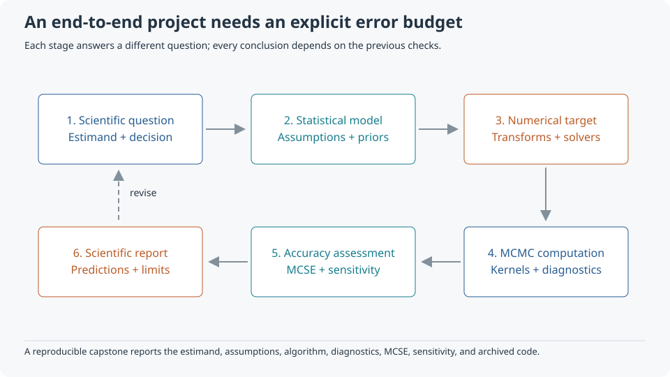

# 48. Capstone projects and research roadmap

## Learning goals and prerequisites

The goal of this chapter is to turn an interesting computation into a defensible result. By the end, you should be able to state an estimand before choosing a sampler, build a small exact or independent reference, budget numerical error against the size of a decision, expose a known failure deliberately, and deliver an experiment another reader can rerun. You should also be able to turn a surprising result into a bounded research question. A capstone succeeds when its conclusion and limits are clear, even if the proposed sampler performs poorly.

The core prerequisites are posterior construction in [Chapter 03](03-bayesian-targets.md), numerical randomness in [Chapter 04](04-numerics.md), Monte Carlo integration in [Chapter 05](05-monte-carlo.md), Markov kernels in [Chapters 09](09-metropolis-hastings.md) and [10](10-gibbs.md), error and diagnostics in [Chapters 13](13-mc-error.md) and [14](14-diagnostics.md), workflow in [Chapter 17](17-workflow.md), and the comparative laboratory in [Chapter 47](47-benchmark-lab.md). The project tracks below point to more specialized chapters. You need not master every advanced algorithm to run a modest, rigorous project.

## 48.1 From a question to a computational contract

Start with a quantity, not a sampler. “Do we have evidence that the success probability exceeds one half?” asks for $P(\theta>1/2\mid y)$. “Which forecast will have lower next-month loss?” asks for a predictive expectation under a specified loss. “What happens to a finite magnetic system at inverse temperature $\beta$?” may ask for $E_\beta[|M|]$ or $E_\beta[E]$. All three are integrals, but their interpretations and error tolerances differ. A posterior probability is conditional on a model and observations; predictive loss adds a future-data model; a physical expectation assumes an equilibrium ensemble. None is interchangeable with the density at its mode.

Write a one-page charter before coding:

| Field | Concrete question to answer |
|---|---|
| System and observations | What was observed, on what units, under what selection or measurement process? |
| Target and estimand | What distribution and function $f$ make the desired answer $E_\pi[f]$? |
| Decision scale | How close could the answer be to a threshold before it changes the conclusion? |
| Numerical contract | What MCSE, solver accuracy, and compute budget are adequate for that scale? |
| Reference and failure | What independent calculation can check the answer, and what failure will you attempt to expose? |
| Scope | Which assumptions make the answer meaningful, and which plausible changes will you examine? |

For example, if action requires $P(\theta>1/2\mid y)>0.95$, an estimate near $0.95$ needs much more precision than an estimate near $0.99$. Specify what would change your decision *before* looking at the final run. If changing a prior, observation model, or numerical solver moves the answer more than its MCSE, report that sensitivity rather than simply running longer. This framing follows the iterative model-and-computation perspective of [Gelman and coauthors' Bayesian workflow](https://arxiv.org/abs/2011.01808); the charter and grading rubric here are this book's project design.

## 48.2 Choose a baseline before choosing sophistication

The baseline must be simple enough to interrogate and strong enough to reveal a meaningful discrepancy. A method's mathematical invariant distribution, finite-run exploration, and modeling assumptions are separate claims. The following map is conditional, not a ranking by parameter count.

| Structure | First reference and possible method | Prerequisite and revealing failure |
|---|---|---|
| Conjugate or tiny state space | Analytic posterior or enumeration; independent draws if available | Correct support and measure. A transformed sampler may omit a Jacobian while looking plausible. |
| Smooth continuous density and gradients | Short random-walk check, then HMC if geometry warrants it | Correct gradients and numerical integration. Funnels, divergences, or multimodality can defeat a short run; see [Chapters 20](20-hmc.md)–[22](22-hmc-diagnostics.md). |
| Finite constrained states | Enumerate a miniature instance; use local or block moves on larger instances | Each move must preserve constraints and reach relevant states. Local moves may mix slowly; see [Chapter 29](29-discrete.md). |
| Tractable likelihood estimator, unavailable likelihood | Verify the estimator conditions, then consider pseudo-marginal methods | The likelihood estimate must have the required nonnegative unbiased property on an extended target, and its random state must be retained after rejection; see [Chapter 27](27-pseudo-marginal.md). |
| Simulator only | Define the approximate target of a summary-and-tolerance method | The tolerance and summaries change the inferential target; see [Chapter 46](46-likelihood-free.md). |

In each case compute something elementary first: a normalizing sum, conjugate mean, gradient finite difference, transition-matrix check, or simulation with parameters fixed. A sophisticated method that agrees with another implementation of the same mistaken target is weak validation. [Chapter 18](18-sampler-engineering.md) develops independent checks for sampler code.

## 48.3 Worked capstone A: a decision probability with a known answer

Suppose $y=14$ successes among $n=20$ exchangeable Bernoulli trials, conditionally independent given $\theta$, with prior $\theta\sim\operatorname{Beta}(2,2)$. The operational question is whether $\theta>1/2$. Multiplying the likelihood $\theta^{14}(1-\theta)^6$ by the prior density proportional to $\theta(1-\theta)$ gives

$$
\theta\mid y\sim\operatorname{Beta}(16,8),\qquad
E[\theta\mid y]=\frac{16}{24}=\frac23,\qquad
\operatorname{Var}(\theta\mid y)=\frac{16\cdot8}{24^2(25)}=\frac{2}{225}.
$$

For positive integers $a,b$, integrating the beta density or differentiating the binomial CDF identity gives

$$
P(\theta>1/2\mid y)
=\sum_{j=0}^{a-1}{a+b-1\choose j}2^{-(a+b-1)}
=\sum_{j=0}^{15}{23\choose j}2^{-23}
\approx0.953430.
$$

The exact sum is the primary answer. Independent beta draws give a second reference, and a logit random-walk Metropolis chain is an instructional challenge. Set $z=\log\{\theta/(1-\theta)\}$ and $\theta(z)=(1+e^{-z})^{-1}$. Since $d\theta/dz=\theta(1-\theta)$, the density *with respect to $dz$* is

$$
\pi_z(z)\propto\theta(z)^{16}\{1-\theta(z)\}^{8}.
$$

The exponents are one greater than those in the beta density with respect to $d\theta$. With a symmetric normal proposal $z'=z+\epsilon$, $\epsilon\sim N(0,s^2)$, the acceptance probability is $\min\{1,\pi_z(z')/\pi_z(z)\}$. Compute its logarithm using stable log-sigmoid arithmetic. A missing-Jacobian variant is a deliberate negative control: it uses exponents $15,7$ in $z$ and induces $\operatorname{Beta}(15,7)$ in $\theta$, whose exact tail is about $0.960823$. The wrong result is numerically close to the correct one; a short run and a generic diagnostic might not reveal it.

The [runnable capstone](examples/ch48.py) evaluates the integer sum, draws 100,000 independent beta values, and runs four seeded logit chains with 5,000 warmup and 30,000 retained iterations each. One execution gave the iid estimate $0.954040$ with estimated iid standard error $0.000662$, and pooled chains $0.954900$ with approximate batch-means MCSE $0.001361$. The erroneous chains gave $0.959825$. Random output is reproducible under the recorded Python random generator and seeds, though different software versions or floating-point environments can affect exact traces.

For a stationary chain and a suitable central limit theorem, the long-run variance for $f(z)=\mathbf1\{\theta(z)>1/2\}$ is $\sigma_f^2=\gamma_0+2\sum_{k\ge1}\gamma_k$ when the covariance sum is justified. Then $\operatorname{MCSE}(\bar f_N)\approx\sqrt{\sigma_f^2/N}$ if the long-run variance estimate is reliable. The batch estimate in the script is approximate: finite batches, finite warmup, and a missed region can all mislead it. An ergodic law of large numbers alone does not justify a normal interval or stopping rule. If MCSE is $0.006$ at 10,000 comparable draws, a target of $0.002$ suggests $10{,}000(0.006/0.002)^2=90{,}000$ draws as a planning forecast, assuming similar mixing. That calculation is not a guarantee under optional stopping. [Chapter 13](13-mc-error.md) explains the error estimate in detail.

For a decision threshold of $0.95$, the exact result clears it by only about $0.00343$. An estimate with MCSE $0.0012$ does not make this a robust operational decision: model sensitivity may dominate. The same integer-sum calculation under $\operatorname{Beta}(1,1)$ and $\operatorname{Beta}(4,4)$ priors gives posterior tails $0.960823$ and $0.938961$, respectively. The latter changes the decision at $0.95$, even though both calculations have no MCMC error. A model allowing dependence among trials is another sensitivity experiment. Report such decision changes as **model sensitivity**, distinct from Monte Carlo noise. This miniature capstone demonstrates why an exact answer is useful even when the real project has no exact reference.

## 48.4 Worked capstone B: a finite physics experiment

Consider four spins $s_i\in\{-1,+1\}$ on a periodic ring, with $s_5=s_1$, coupling $J=1$, and zero external field. Define the bond score $S(s)=\sum_{i=1}^4s_is_{i+1}$, energy $E(s)=-S(s)$, magnetization $M(s)=\sum_i s_i$, and equilibrium distribution $\pi_\beta(s)=e^{\beta S(s)}/Z(\beta)$ for $\beta\ge0$. Periodicity makes the number of domain walls even. Thus exactly two states have $S=4$ (all spins equal), twelve have $S=0$ (two walls), and two have $S=-4$ (alternating spins). Direct enumeration yields

$$
Z(\beta)=2e^{4\beta}+12+2e^{-4\beta}=4\cosh(4\beta)+12,
\qquad E_\beta[S]=\frac{16\sinh(4\beta)}{Z(\beta)}.
$$

Among the twelve $S=0$ states, eight have $|M|=2$ and four have $|M|=0$. The two aligned states have $|M|=4$; alternating states have zero. Consequently

$$
E_\beta[|M|]=\frac{8e^{4\beta}+16}{Z(\beta)},\qquad
E_\beta[M]=0,
\qquad E_\beta[E]=-E_\beta[S].
$$

The raw mean magnetization is zero at *every* $\beta$ by global spin-flip symmetry. It therefore cannot alone show ordering; $|M|$, its distribution, and its autocorrelation carry different information. At $\beta=0$, $Z=16$, $E[S]=0$, and $E[|M|]=1.5$. At $\beta=0.5$, $Z\approx27.048783$, $E[S]\approx2.14537$, and $E[|M|]\approx2.77693$. These are finite-ring facts, not evidence of a thermodynamic phase transition.

The script proposes one uniformly selected spin flip per step and accepts it with $\min\{1,e^{\beta(S'-S)}\}$. The proposal is symmetric and every state is reachable through flips; rejection supplies self-loops when $\beta>0$, while at $\beta=0$ a single-flip chain is periodic with period two. Its time averages can still converge, but periodicity matters for distributional convergence and diagnostics. In one seeded run, four chains at $\beta=0.5$ averaged $S\approx2.13729$, $|M|\approx2.77157$, and $M\approx0.01483$; the script prints exact values beside them. A random-scan update is one attempted flip, whereas a sweep usually means four attempted flips. State which unit measures runtime and autocorrelation. Algorithmic update count does not automatically represent physical time.

The larger extension is an $L\times L$ lattice with stated boundary conditions and a range of $\beta$. Record $E$, $|M|$, mode switches, and autocorrelation, comparing local moves with a justified alternative from [Chapters 25](25-tempering.md), [29](29-discrete.md), and [41](41-physics.md). Exact enumeration remains the four-spin code check; do not promise it for large $L$. A plausible-looking raw $M$ mean of zero could mean excellent movement between spin-flip partners or near-perfect cancellation within one small subset. Trace plots and occupancy counts distinguish the cases.

## 48.5 Four project tracks with testable milestones

Each track needs a first artifact that fits in a weekend, an extension, and a failure experiment. Synthetic data avoid downloads and let you keep the generating parameters, but they do not remove model misspecification once you move to real data.

| Track | Minimal target and estimand | Reference, extension, and completion evidence |
|---|---|---|
| Hierarchical binomial outcomes ([Chapters 16](16-geometry.md), [37](37-hierarchical.md)) | Generate counts $y_g\sim\operatorname{Binomial}(n_g,\theta_g)$ with a shared population distribution; estimate a new group's success probability or a population average. | Start with one-group beta-binomial checks. Compare centered and noncentered parameterizations across weak and strong group information. Deliver prior predictions, per-group checks, MCSE for the named estimand, and a case where the less suitable geometry struggles. |
| Latent AR(1) observations ([Chapters 28](28-particle-mcmc.md), [39](39-state-space.md)) | Set $x_t=\phi x_{t-1}+\eta_t$, $y_t=x_t+\epsilon_t$ with known Gaussian variances; estimate $E[x_T\mid y]$ or a forecast loss. | A Kalman filter and Gaussian smoother provide numerical references. Extend to unknown $\phi$ or nonlinear observations only after the Gaussian case agrees. Deliver a degeneracy plot or a deliberately poor single-site update and a cost-matched block/particle comparison. |
| One-dimensional diffusion inverse problem ([Chapters 24](24-function-space.md), [42](42-scientific-inference.md)) | Infer a positive diffusion coefficient from noisy observations of a specified discretized forward solution; report $P(D>D_0\mid y)$. | Check an analytic or high-resolution forward case; halve grid spacing and solver tolerance until changes are below the decision scale. Extend to a spatially varying field. Deliver a plot separating solver refinement shifts from repeated-chain MCSE, plus an identifiability check. |
| Multimodal free energy or mixture target ([Chapters 25](25-tempering.md), [26](26-normalizers.md), [38](38-mixtures.md)) | For a small symmetric mixture, estimate mode probability or an invariant function such as $E[\theta^2]$. | Integrate the one-dimensional target numerically or enumerate a finite analogue. Extend to separated modes and compare local MH with tempering at a matched cost. Deliver occupancy and round-trip evidence; deliberately initialize every chain in one mode to expose a false sense of agreement. |

For a completed hierarchical workflow to adapt, [Chapter 37, Sections 37.6a and 37.10a](37-hierarchical.md), execute prior prediction, posterior replication for observed districts, and an independent refit under a narrower group-scale prior. Keep the distinction between a stable population contrast and a sensitive group-scale parameter when choosing your capstone estimands.

The first milestone in each track is a **reference result**, not a polished figure. The second is a baseline run with a complete configuration. The third changes one difficulty at a time. The fourth explains where the method fails, how that failure was detected, and what remains uncertain. These deliverables make a negative result useful: a sampler that fails under known separation teaches more than a favorable benchmark selected after the fact.

## 48.6 A validation ladder and a lab experiment

Use checks that ask different questions. First, derive a hand-solvable limit or enumerate a toy target: is the program encoding the intended distribution? Second, inspect components such as log-density differences, constraints, proposal ratios, and gradients: is the implementation faithful to its formula? Third, use independent seeds and dispersed starts: is the observed output stable across initial conditions? Fourth, examine traces, rank-normalized split $\widehat R$, bulk and tail efficiency, and estimand-specific MCSE: did the finite runs provide usable information? [Vehtari and coauthors](https://arxiv.org/abs/1903.08008) motivate rank, folded, and localized diagnostics for different failure patterns. None of these numerical summaries proves convergence.

For a Bayesian model, add simulation-based calibration (SBC) and posterior predictive criticism. Under a proper generative prior and correctly implemented inference, the generating parameter and independent exact posterior draws are conditionally exchangeable given each simulated dataset. With continuous test quantities, its rank among $L$ draws is uniform on $0,\ldots,L$. Ties require randomized handling; correlated MCMC draws weaken the simple iid rank argument. SBC tests a prior-averaged algorithmic property, not whether a real dataset fits the model. [Talts and coauthors](https://arxiv.org/abs/1804.06788) develop this check; [Chapter 17](17-workflow.md) works through its assumptions and limits. Posterior predictive discrepancies instead ask whether replicated observations exhibit features that matter to the scientific question.

Include a negative control that has a predicted signature. Delete the logit Jacobian in Example A; compare against the exact wrong beta tail. On a lattice, remove a class of proposals and verify that a disconnected component cannot be reached. In an inverse problem, intentionally use a coarse solver and measure the estimand shift. For a multimodal mixture, start all chains in one mode and observe how apparently agreeable diagnostics can coexist with missed mass. Then repair the cause and rerun the same checks. More iterations address sampling variability only when the kernel can explore the relevant target; they cannot correct a wrong target or forward model.

Before using the following diagnostics lab, predict what happens to estimated precision when marginal variance stays fixed but successive draws become more dependent. Change the AR(1) correlation control and compare the displayed exact finite-run mean ESS, its long-run approximation, and theoretical standard error with the observed mean and empirical autocorrelation. At high correlation, reduce the sample count and observe the difference between the two ESS values; the standard error uses the finite-run value. This toy interaction illustrates finite-run precision; it does not validate either capstone target, detect a mode never visited, or establish a theorem about the real chains.

## 48.7 The reproducible artifact and a 100-point rubric

A reader should be able to regenerate the central table from a clean checkout with one documented command. Save the data generator, actual data or an authorized access description, the target definition, code version, seed streams, warmup and retained lengths, proposal settings, hardware, and a run manifest. Keep diagnostic summaries and failures alongside successful runs. “One second per iteration” is not a cost definition unless the hardware, implementation, and work per iteration are stated. Compare methods at matched wall time, target evaluations, gradient evaluations, or another justified resource; [Chapter 47](47-benchmark-lab.md) develops this comparison.

For this book's projects, use the following original rubric. It scores the completeness of the argument, not proof that the scientific model is true.

| Category | Points | Evidence for full credit |
|---|---:|---|
| Target and estimand | 20 | An explicit probability model or equilibrium distribution, measure/support, observation process, and decision-relevant function. |
| Algorithm justification | 20 | An invariant-kernel argument or stated approximation, proposal support, assumptions, baseline, and a reason for the method choice. |
| Correctness evidence | 20 | Independent known-answer or component checks, a negative control, multiple starts where appropriate, and unhidden failures. |
| Numerical uncertainty and cost | 15 | Estimand-specific MCSE or defensible bounds, solver error where relevant, a cost unit, and matched comparisons. |
| Reproducible artifact | 15 | Seed streams, exact configuration, software versions, data-generation command, run manifest, and a command that recreates principal results. |
| Interpretation and limits | 10 | The substantive conclusion, model sensitivity, excluded scenarios, and a next discriminating experiment. |

For a concrete rubric application, suppose a beta-binomial report derives the correct logit target and acceptance rule, supplies the seeded script and an iid comparison, but reports only an iid error formula for the correlated chain, omits the missing-Jacobian experiment, and never checks the prior. An illustrative score is 20/20 for target, 20/20 for algorithm, 12/20 for correctness, 5/15 for uncertainty/cost, 15/15 for a genuinely complete reproducible artifact, and 4/10 for interpretation: 76/100. Repairing it requires the predicted wrong-target comparison, a chain-aware MCSE and explicit cost accounting, and the prior-sensitivity calculation above. A longer trace alone earns none of these missing pieces. Assessors can allocate partial credit differently, but should name the absent evidence rather than grade the attractiveness of the result.

Record versions of packages actually used. This project requires checking that a newly installed package release is dated on or before 2026-09-12; an older release is not thereby certified safe or correct. The miniature [example script](examples/ch48.py) uses only the Python standard library. The [University of Minnesota's MCMC course project brief](https://www.stat.umn.edu/geyer/8054/hw/) is one primary example of a research assignment that values an executable artifact and explanatory presentation alongside theory; the point allocations here are ours.

### 48.7.1 Accept a numerical claim against a stated error budget

A project score does not decide whether a probability clears a threshold. Add an acceptance record to the report: the estimand, threshold, error allowances, evidence supporting each allowance, and outcome **above**, **below**, or **unresolved**. A completed capstone can legitimately end unresolved. The following is an original reporting protocol that combines earlier chapters' methods.

Fix a model $m$ and let $p_m$ be its intended event probability, $p_{m,h}$ the probability under its numerical approximation, and $\hat p_{m,h}$ the reported estimate. Suppose a justified deterministic bound gives $|p_{m,h}-p_m|\leq B_m$. If a Monte Carlo interval has the coverage property

$$
P\bigl(|\hat p_{m,h}-p_{m,h}|\leq H_m\bigr)\geq1-\alpha_m,
$$

then the triangle inequality gives the same coverage for

$$
I_m=\left[\max\{0,\hat p_{m,h}-H_m-B_m\},\;
\min\{1,\hat p_{m,h}+H_m+B_m\}\right]
$$

as an interval for $p_m$. The probability here is over repeated computation with the observed data fixed. Add the allowances: a deterministic bias bound is not an independent variance to combine in quadrature. A valid finite-sample $H_m$ transfers finite-sample coverage; a fixed-run normal approximation $H_m=1.96\,\widehat{\operatorname{MCSE}}$ transfers only approximate coverage under the CLT and variance-estimation conditions in [Chapter 13](13-mc-error.md). It does not include undetected initialization or exploration error. Looking repeatedly and stopping when the interval clears a threshold needs a justified sequential procedure.

The difficult input is $B_m$. [Cotter, Dashti, and Stuart, Section 2](https://users.sussex.ac.uk/~md326/app.pdf), show how forward approximation error can control posterior error under explicit stability and integrability assumptions. [Chapter 42, Section 42.7.1](42-scientific-inference.md), supplies a stronger-assumption elementary bound for event probabilities. Two nearby solver resolutions agreeing is useful evidence, but does not by itself certify distance to the limiting solution. Label a refinement difference as an observed sensitivity; if no bound is available, the numerical claim remains conditional on the chosen resolution. Never silently set an unknown $B_m$ to zero.

For the actual beta calculation there is no solver approximation, so $B=0$. The seeded estimate $0.954900$ and approximate MCSE $0.001361$ give the following audit, computed using the unrounded script values. The nonzero allowances are **hypothetical inputs**, illustrating how an inverse-problem report would change; they are not measured errors of this beta model.

| Absolute approximation allowance $B$ | Approximate interval for intended probability | Outcome against $0.95$ |
|---:|---|---|
| $0$ | $[0.952233,0.957567]$ | Above, conditional on the MC approximation |
| $0.001$ | $[0.951233,0.958567]$ | Above, additionally conditional on the supplied bound |
| $0.003$ | $[0.949233,0.960567]$ | Unresolved |

These rows hold the sampling result fixed. The last row calls for a tighter approximation allowance or more precise Monte Carlo evidence; an unexplored mode would instead call for an exploration remedy. The exact beta sum already settles the numerical decision for the stated model, independent of this approximate chain interval.

Keep model alternatives as separate rows too. Across the three stated beta priors, exact answers range from $0.938961$ to $0.960823$, so the decision is not stable across those models. This range is a sensitivity envelope, not a posterior credible interval and not a probability distribution over models. For $K$ prespecified models with valid individual computational intervals, choosing $\sum_{m=1}^K\alpha_m\leq\alpha$ gives simultaneous coverage of their $K$ probabilities by the union bound, without requiring independent runs. One may then claim all exceed a threshold only if every lower endpoint exceeds it. This does not cover unexamined model choices. The separation follows the computation and model-comparison questions in [Bayesian workflow, Sections 1.2 and 7](https://arxiv.org/html/2011.01808v1).

Before accepting the claim, also require that the target check and predicted negative control behave as specified, that unexplained diagnostic failures are recorded as unresolved, and that the artifact recreates the evidence. Calibration supplies another kind of evidence: [Talts and coauthors, Sections 4–5](https://arxiv.org/html/1804.06788v2), analyze ranks over simulated datasets; passing that check does not provide a numerical error bound for this particular dataset. The contract therefore names both the evidence obtained and the assumption it still needs.

## 48.8 Read a paper as a reproducible claim

When a paper says an estimator is unbiased, ask: unbiased for which finite or asymptotic target, under what initialization, integrability, coupling, or likelihood-estimator conditions? When it reports better efficiency, ask: which $f$, target family, cost measure, implementation, tuning budget, and uncertainty interval? A figure can be reproduced while a broader claim remains untested. Conversely, a failed reproduction may reflect a changed parameterization, hidden warmup, or hardware detail rather than a false theorem.

A compact reproduction worksheet has six lines: **claim**, **target and estimand**, **assumptions**, **algorithm and tuning**, **reference and cost**, **failure cases**. First reproduce a tiny case with a known answer. Next reproduce one reported regime at a stated resource budget. Finally vary one assumption that should matter and state a prediction before running. Record all attempted runs. This process can yield a useful contribution without inventing a new sampler: a counterexample to an overbroad empirical generalization, a clearer statement of assumptions, or an implementation whose failure modes are visible.

Read mathematical claims separately from empirical claims. For instance, [Betancourt's HMC exposition](https://arxiv.org/abs/1701.02434) supplies a geometric way to reason about trajectories, not a theorem that HMC wins on every target. [Jacob, O'Leary, and Atchadé's coupling work](https://arxiv.org/abs/1708.03625) motivates unbiased MCMC estimators under appropriate meeting and moment conditions; an observed meeting in a few trials does not establish finite variance. [Chapters 20](20-hmc.md) and [31](31-coupling.md) give the corresponding technical routes.

## 48.9 Research questions with bounded scope

Choose a question for which an answer could surprise you. “Does learned sampling work?” is too broad. A testable version is: for a specified sequence of separated Gaussian mixtures, does a flow-trained independence proposal retain sufficient overlap as dimension rises, after including training cost, compared with a tuned local or tempered baseline? State the target family, training sample budget, proposal correction, estimand, and a failure threshold. Exact MH correction needs a proposal density that can be evaluated and support wherever the target has mass; training and post-training sampling must be separated or adaptation justified. [Chapter 36](36-learned-proposals.md) develops this setting.

Other bounded questions follow naturally. On a named heavy-tailed target, does a particular coupled estimator have tolerable meeting-time tails and work variance at the precision needed for $E[f]$? Does solver refinement in a diffusion inverse problem change $P(D>D_0\mid y)$ more than Monte Carlo uncertainty? At a fixed energy or gradient evaluation budget, does parallelization improve the uncertainty of a given observable once communication and setup time are counted? How much bias does a chosen approximate stochastic-gradient schedule create for a decision functional? These are proposed studies of specified methods and targets, not claims that the entire subject lacks answers. Established tools from [Chapters 31](31-coupling.md), [34](34-scalable.md), [35](35-parallel.md), and [46](46-likelihood-free.md) supply baselines and assumptions.

For every question, define a result that would refute the hoped-for improvement. If all methods miss the same mode, the comparison is inconclusive; if the reference is itself noisy, propagate that uncertainty. Report the family on which the claim holds rather than extending a single favorable run to every dimension or application.

## 48.10 Reading routes and the final report

An applied modeller can revisit [Chapters 03](03-bayesian-targets.md), [17](17-workflow.md), [37](37-hierarchical.md), and [42](42-scientific-inference.md), then submit a model with prior/predictive checks and a decision-specific sensitivity analysis. A mathematical reader can follow [Chapters 07](07-finite-chains.md), [08](08-convergence.md), [13](13-mc-error.md), and [31](31-coupling.md), then submit a proof under explicit hypotheses plus a small counterexample when one hypothesis is removed. A scientific-computing reader can follow [Chapters 18](18-sampler-engineering.md), [24](24-function-space.md), [35](35-parallel.md), and [47](47-benchmark-lab.md), then submit a reproducible cost-and-accuracy study. An algorithm researcher can follow [Chapters 25](25-tempering.md), [34](34-scalable.md), [36](36-learned-proposals.md), and [46](46-likelihood-free.md), then submit a bounded comparison that includes a failure regime.

A concise result paragraph should be as specific as this: “For the stated beta-binomial model, the exact posterior probability that $\theta>1/2$ is $0.953430$. Four seeded logit-MH chains estimated $0.954900$ with approximate batch MCSE $0.001361$ from 120,000 retained states; an independent beta sampler and the exact sum checked the computation. The intentionally omitted Jacobian shifted the corresponding target to $\operatorname{Beta}(15,7)$, whose exact tail is $0.960823$. The result is conditional on exchangeable Bernoulli trials and the $\operatorname{Beta}(2,2)$ prior; dependence or a different prior may change a decision at $0.95$. The recorded script took about seven seconds in the run reported here, but no hardware-neutral runtime claim follows.” The report need not conceal a failed method. Its central result should be reproducible and its scope explicit.

## Exercises

### 1. A transformed-target trap

Derive the logit density for $\theta\mid y\sim\operatorname{Beta}(16,8)$. Identify the $\theta$ distribution produced by a logit sampler that omits the Jacobian.

Solution

The beta density is proportional to $\theta^{15}(1-\theta)^7$ with respect to $d\theta$. Since $d\theta/dz=\theta(1-\theta)$, its density with respect to $dz$ is proportional to $\theta^{16}(1-\theta)^8$. Omitting the Jacobian samples a $z$ density proportional to $\theta^{15}(1-\theta)^7$; transforming back divides by $\theta(1-\theta)$ and produces a $\theta$ density proportional to $\theta^{14}(1-\theta)^6$, namely $\operatorname{Beta}(15,7)$.

### 2. A precision forecast

An estimated MCSE is $0.006$ after 10,000 retained iterations. Forecast the iterations for MCSE $0.002$ and explain why the forecast can fail.

Solution

If long-run variance stays fixed and MCSE scales as $N^{-1/2}$, $N_{\rm new}=10{,}000(0.006/0.002)^2=90{,}000$. The estimate can be poor if the initial chain missed a mode, the batch or spectral variance estimate is unstable, adaptation continues, or mixing changes after extending the run. It is a planning calculation, not a guarantee for sequential stopping.

### 3. Count a periodic ring

Show that the four-spin ring has score counts $(2,12,2)$ for $S=(4,0,-4)$ and derive $Z(\beta)$.

Solution

Traversing the ring must return to the initial spin, so the number of disagreeing bonds is even. Zero disagreeing bonds gives the two aligned states; four gives the two alternating states. The remaining $16-2-2=12$ states have two disagreeing bonds. Each agreeing bond contributes $+1$ and each disagreeing bond $-1$, so $S=4,0,-4$ respectively. Weighting by $e^{\beta S}$ gives $Z=2e^{4\beta}+12+2e^{-4\beta}=4\cosh(4\beta)+12$.

### 4. Agreement in the wrong mode

All four chains on a separated mixture start in its left mode. Trace plots and split diagnostics look reassuring. Design a discriminating check and state its limit.

Solution

Start additional chains near each known mode and estimate a mode-indicator probability. On a small analogue, use exact quadrature or enumeration; on a larger problem, monitor tempered round trips and compare an independently constructed reference. A disagreement reveals poor exploration or a target error. Agreement still cannot rule out unimagined modes in a general target, and tempering itself needs its own correctness and mixing checks.

### 5. Audit a report

A report states “$P(D>D_0\mid y)=0.78\pm0.01$ after one million samples” but gives only a seed. Write a minimal manifest and identify at least two ambiguities in the uncertainty statement.

Solution

The manifest needs the data or generating script, target and prior, forward-solver grid and tolerance, software versions, seed streams, sampler and warmup settings, retained length, hardware/cost unit, diagnostics, and a rerun command. The $\pm0.01$ needs a definition: MCSE, confidence interval half-width, or posterior interval are different objects. It may omit solver discretization error and model sensitivity. One seed and a million correlated states do not establish exploration or precision.

### 6. Frame a falsifiable method study

Propose a learned-proposal or coupling study with a target family, comparator, observable, budget, failure criterion, and conditions for any exactness claim.

Solution

One design uses equally weighted Gaussian components with means $\pm a e_1$ and identity covariance, with separation $a$ and dimension varied on a grid. Compare a frozen, trained independence proposal corrected by MH against tuned local MH and tempering, including training in the wall-time budget. Estimate $P(X_1>0)=1/2$, which follows from symmetry. This half-space probability is observable without latent component labels; for unequal weights it generally differs from the positive component weight because Gaussian components overlap. Predict failure when proposal mass near one component collapses, measured by mode occupancy and large error at matched cost. MH invariance requires an evaluable proposal density with support on the target and a correct acceptance ratio; it does not guarantee finite-run exploration. A coupling design could instead compare meeting-time and work distributions for a named heavy-tailed target, with moment assumptions stated before claiming finite-variance unbiased estimates.

### 7. Decide what the error allowance supports

A fixed-run report gives $\hat p=0.9549$, approximate MCSE $0.001361$, and a certified approximation bound $B=0.003$. Form an approximate 95% computational interval and decide whether it establishes $p>0.95$. What changes if $0.003$ is merely a difference between two solver resolutions? Can a positive result under this model establish the same decision under the three beta priors above?

Solution

The radius is $1.96(0.001361)+0.003=0.00566756$, giving approximately $[0.949232,0.960568]$. It straddles $0.95$, so the decision is unresolved; the certified bias bound does not make the normal MC interval finite-sample exact. A difference between resolutions is not a certified $B$, so even this coverage interpretation is unavailable without further assumptions. Finally, the exact tail under the $\operatorname{Beta}(4,4)$ prior is $0.938961$, below the threshold. Additional sampling under the baseline model cannot remove that model sensitivity.

## Key takeaways

Name the distribution, measure, and estimand before the algorithm. Build an independent small reference and a predicted failure into each project. Separate exact target properties from finite-run uncertainty, approximation bias, and modeling assumptions. A diagnostic is evidence about the observed runs, never proof that all important states were visited. A capstone earns its conclusion by making the calculation, cost, and remaining uncertainty inspectable.
