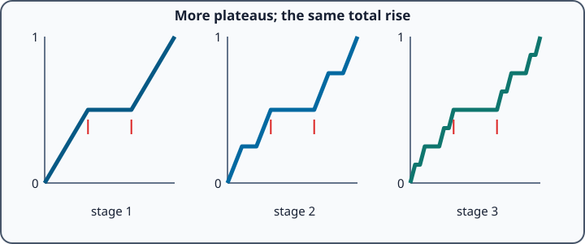

# Differentiation, Absolute Continuity, and Bounded Variation

The classical fundamental theorem differentiates an integral at continuity points of its integrand. An integrable measurable function need not be continuous anywhere, so that theorem alone cannot recover it by differentiation. The correct replacement concerns local averages: at almost every input, the average absolute difference from the value at that input tends to zero. Those inputs are Lebesgue points. Once their existence is proved, the almost everywhere derivative of an indefinite integral follows directly.

The converse asks which functions are recovered from their almost everywhere derivative. Bounded variation guarantees an integrable derivative but permits singular change, as the Cantor function shows. Absolute continuity rules out exactly that extra change. We prove these assertions rather than reading them into the notation of an integral.

The following three opening sections are the measure-theoretic continuation transferred from the [Real Analysis fundamental theorem chapter](../proof-safe-real-analysis/fundamental-theorem-and-absolute-continuity.md). Its twenty ANA-CH13 exercises and comparison project remain there with their original identities. The complete proofs and twelve new supported exercises below belong to this chapter. We use [Radon–Nikodym and Lebesgue decomposition](signed-measures-radon-nikodym.md), [Stieltjes measures](abstract-measures-caratheodory.md), and Euclidean regularity. All differentiation statements concern interior inputs of a real interval; endpoints have the corresponding one-sided statements when applicable.

## 9. Absolute continuity controls many small intervals at once

A function \(F:[a,b]\to R\) is **absolutely continuous** if for every \(\varepsilon>0\) there exists \(\delta>0\) such that for every finite collection of pairwise disjoint intervals \((x_k,y_k)\subseteq [a,b]\),

\(\sum(y_k-x_k)<\delta \Rightarrow \sum|F(y_k)-F(x_k)|<\varepsilon\).

Uniform continuity controls one short interval at a time. Absolute continuity controls the total output change across any finite disjoint family whose total input length is small.

Every Lipschitz function is absolutely continuous. If \(|F(y)-F(x)|\le L|y-x|\), then

\(\sum|F(y_k)-F(x_k)|\le L\sum|y_k-x_k|\).

Choose \(\delta=\varepsilon/L\) when \(L>0\).

Every absolutely continuous function is uniformly continuous by using a collection with one interval. The converse is false.

### Bounded variation

The total variation of \(F\) on \([a,b]\) is

\(V_a^b(F)=\sup_P \sum|F(x_i)-F(x_{i-1})|\),

where the supremum runs over partitions. Absolutely continuous functions have bounded variation. Here is the missing uniform bound. Choose \(\delta>0\) from absolute continuity with \(\varepsilon=1\), and choose a fixed grid

\(a=t_0<t_1<\cdots<t_m=b\)

whose subintervals have length below \(\delta\). Given any partition \(P\), refine it by adding the grid points. Refinement cannot decrease the variation sum. Within each grid interval \([t_{j-1},t_j]\), the refined partition intervals are disjoint and their total length is below \(\delta\), so absolute continuity bounds their total output change by \(1\). Summing over the fixed \(m\) grid intervals bounds every partition sum by \(m\). Hence \(V_a^b(F)\le m<\infty\). Monotone functions also have bounded variation, equal to their total change.

Absolute continuity is stronger than bounded variation and continuity combined.

## 10. The later complete theorem

Lebesgue integration supports the sharp form:

**Preview of theorem 12.6 (Fundamental for absolute continuity).** A function \(F:[a,b]\to R\) is absolutely continuous if and only if there is an integrable function \(g\) such that

\(F(x)=F(a)+\int _a^x g(t)dt\).

In that case \(F'\) exists almost everywhere, \(F'\) is integrable, and one may take \(g=F'\) almost everywhere. Consequently,

\(F(b)-F(a)=\int _a^bF'(t)dt\).

The words “almost everywhere” mean outside a set of measure zero. The complete proof is supplied below, after the local differentiation theorem and the Stieltjes description of bounded variation.

## 11. The Cantor function marks the boundary

The finite-stage picture below shows how horizontal plateaus consume almost all of the interval while the total rise remains one. It is a geometric guide to the limiting example, not a graph-based proof of its almost-everywhere derivative.

At stage \(n\), the polygonal approximation is constant on the middle third of each interval retained at stage \(n-1\), and it rises linearly on the \(2^n\) retained intervals. The horizontal portions visually anticipate where the limiting derivative is zero; the text below supplies the measure argument.

The **Cantor function** \(C:[0,1]\to [0,1]\) is continuous and nondecreasing. It maps the ternary expansion using only digits 0 and 2 to a binary expansion by replacing \(0\to 0\) and \(2\to 1\), and it is constant across each interval removed in the construction of the Cantor set.

The removed open intervals have total length 1. On their union, \(C\) is locally constant, so \(C'=0\). Thus \(C'=0\) almost everywhere, yet

\(C(1)-C(0)=1\).

If one naively integrated the almost-everywhere derivative, one would get zero rather than one. The Cantor function is continuous, uniformly continuous, monotone, and of bounded variation—but not absolutely continuous.

Its increase is concentrated on the Cantor set, which has measure zero. Absolute continuity forbids a function from placing positive total variation on sets of arbitrarily small total length.

This example does not contradict the mean value theorem. The Cantor function is not differentiable at every interior point; the exceptional set, though measure zero, is logically significant.

## A covering estimate that controls bad local averages

For a finite positive Borel measure \(\sigma\) on the line define
\[
 M\sigma(x)=\sup_{r>0}\frac{\sigma((x-r,x+r))}{2r}.
\]
For \(f\in L^1(\mathbb R)\), write \(Mf=M(|f|m)\). Each strict superlevel set of this maximal function is open. If one centered interval has average greater than a specified positive level, increase its radius slightly while preserving that strict inequality; nearby centers then have intervals containing the original one with only that small increase in length. This also proves measurability without assuming continuity of section masses in their centers.

**Lemma 12.1 (Weak maximal estimate).** For every \(a>0\),
\[
 m\{M\sigma>a\}\le\frac{3\sigma(\mathbb R)}a.
\]

*Proof.* Take a compact subset \(K\) of the open superlevel set and choose for each of its inputs a centered open interval with \(\sigma(I)>a|I|\). A finite selection covers \(K\). From this finite list choose an interval of largest length, discard all intervals meeting it, and repeat. The selected intervals are disjoint. Any discarded interval meets a selected interval at least as long as itself and is contained in that selected interval enlarged by a factor of three about its center. Hence
\[
 m(K)\le3\sum_{I\text{ selected}}|I|
 <\frac3a\sum_{I\text{ selected}}\sigma(I)
 \le\frac{3\sigma(\mathbb R)}a.
\]
Inner regularity of length on the open superlevel set gives the assertion. Only a finite covering selection was used, so no unproved infinite greedy selection is needed. ∎

The bound is weak because it controls the measure of a superlevel set, rather than asserting an \(L^1\) bound for the maximal function. The constant three is sufficient for differentiation. Its exact optimal value is irrelevant to the argument, but the factor must come from a valid covering statement.

## Lebesgue points of integrable functions

**Theorem 12.2 (Lebesgue differentiation).** If \(f\in L^1_{\mathrm{loc}}(\mathbb R)\), then for almost every \(x\),
\[
 \lim_{r\downarrow0}\frac1{2r}
 \int_{x-r}^{x+r}|f(t)-f(x)|\,dt=0.
\]
Such inputs are called Lebesgue points of the chosen measurable representative.

*Proof.* First suppose \(f\in L^1(\mathbb R)\). Continuous compactly supported functions are dense in this space. For clarity, that density follows from the earlier regularity results: approximate an integrable function by simple functions supported on finite-measure sets; truncate each such set to a bounded region; enclose it between a compact set \(K\) and a bounded open set \(U\) with small measure difference. A continuous function equal to one on \(K\), zero outside \(U\), and between zero and one is provided by
\[
 \phi(x)=\frac{d(x,U^c)}{d(x,U^c)+d(x,K)}.
\]
The nonempty compact set lies strictly inside the open set, so the denominator never vanishes. If the compact set is empty, use zero and the already small measure error. The \(L^1\) distance between the indicator and this function is bounded by the measure difference. Finite sums give the density assertion for real and complex functions.

Let \(Df(x)\) be the limsup of the averages in the theorem at inputs where \(f(x)\) is finite. For continuous \(g\), its own local oscillation tends to zero, so
\[
 Df(x)\le M(f-g)(x)+|f(x)-g(x)|.
\]
The maximal estimate and Markov's inequality imply, for any \(a>0\),
\[
 m\{Df>2a\}\le\frac{4\|f-g\|_1}{a}.
\]
The left set is measurable: the integrals as functions of center and radius are measurable by the product theorem, and the limsup may be taken over rational radii, using continuity from below of the interval integrals and the continuous denominator. Choose continuous approximations with arbitrarily small \(L^1\) error. The left measure is zero. Taking a countable union over reciprocal tolerances proves the result. For a locally integrable function, apply the global result to its restrictions to increasing bounded intervals, extended by zero. At an interior input sufficiently small averaging intervals remain inside the restriction. A countable union of exceptional null sets completes the proof. ∎

Changes on a null set may change which particular inputs are Lebesgue points, but not the assertion that almost every input is one. At a Lebesgue point, either one-sided average absolute error is bounded by twice the corresponding centered average. Consequently if
\[
 F(x)=\int_a^xf(t)\,dt,
\]
then \(F'(x)=f(x)\) at almost every interior input: subtract \(f(x)\) from the difference quotient and use that one-sided estimate for positive or negative increments. Integrability supplies the primitive everywhere, while differentiation recovers its integrand almost everywhere.

**Worked example 12.3 (A primitive with an unbounded derivative).** On \((0,1]\), let \(f(x)=x^{-1/2}\), assigning any finite value at zero. Its integral is finite and its primitive is \(F(x)=2\sqrt x\). It is absolutely continuous by the integral argument proved below, although it is not Lipschitz on the interval: \(|F(h)-F(0)|/h=2/\sqrt h\) is unbounded. At positive inputs the ordinary derivative equals the integrand, and at zero no finite one-sided derivative exists. The almost everywhere theorem accommodates both the unbounded integrand and that exceptional endpoint.

## Differentiating singular measures

We will use one regularity fact for finite Borel measures on the line, not just for length: such a measure is inner regular by compact sets and outer regular by open sets. Here is a proof. Every open set is exhausted by its compact subsets obtained by imposing a bounded coordinate and a positive distance from its complement; continuity from below gives inner approximation. A closed set is inner approximated by bounded truncations, and outer approximation follows by taking complements of compact approximations to its open complement, since the total measure is finite. The class of sets admitting both approximations is closed under complements, using compact truncation when needed. It is closed under countable unions: choose open outer approximations with summable errors, and obtain an inner approximation by first keeping finitely many members and then taking the finite union of their compact approximations. The finite truncation error is small by continuity from below. This class is a sigma algebra containing the open sets, hence contains every Borel set.

**Theorem 12.4 (Singular mass has zero density almost everywhere).** If a finite positive Borel measure \(\sigma\) is carried by a length-zero Borel set, then
\[
 \lim_{r\downarrow0}\frac{\sigma((x-r,x+r))}{2r}=0
 \quad\text{for almost every }x.
\]

*Proof.* Given \(\varepsilon>0\), regularity gives a compact subset \(K\) of the null carrying set with \(\sigma(\mathbb R\setminus K)<\varepsilon\). At every input outside \(K\), sufficiently small intervals avoid \(K\). The limsup of the displayed ratios is therefore bounded by \(M(\sigma|_{\mathbb R\setminus K})\). For each \(a>0\), its region above \(a\) has length at most \(3\varepsilon/a\), apart from the null set \(K\), by lemma 12.1. Let \(\varepsilon\) decrease to zero and then take reciprocal integer levels. The nonnegative limsup is zero almost everywhere, proving the assertion. ∎

Combining this theorem with Lebesgue differentiation proves differentiation of any finite positive Borel measure: if \(\sigma=g m+\sigma_s\) is its Lebesgue decomposition, its centered interval ratios tend to \(g(x)\) almost everywhere. The same holds for finite signed measures by applying the result to their Jordan parts. In particular, the variation of a singular signed measure has zero density almost everywhere. This stronger variation statement controls increments even when the signed increments themselves cancel.

## Bounded variation and its Stieltjes measure

Variation is additive across adjacent intervals. Refining a partition by a division point gives one inequality, and concatenating partitions approaching the two separate suprema gives the other. Thus, for \(V(x)=V_a^x(F)\),
\[
 V(y)-V(x)=V_x^y(F)\ge|F(y)-F(x)|.
\]
It follows that
\[
 P(x)=\tfrac12(V(x)+F(x)-F(a)),\qquad
 N(x)=\tfrac12(V(x)-F(x)+F(a))
\]
are nondecreasing and \(F=F(a)+P-N\). This is the function version of a Jordan decomposition, and proves that a bounded-variation function has one-sided limits everywhere in the interior.

First suppose \(F\) is right continuous. Its variation function is right continuous too. To justify this detail, choose a partition of \([x,b]\) whose variation sum is within \(\varepsilon\) of the supremum. For sufficiently small positive \(h\), replace its first endpoint \(x\) by \(x+h\), leaving the other endpoints fixed. Right continuity of \(F\) makes the new sum converge to the old one. Additivity of variation now gives \(V_x^{x+h}(F)\to0\). Therefore \(P,N\) are right continuous. Extend them constantly outside \([a,b]\) and construct their finite Stieltjes measures. Their difference \(\eta\) satisfies
\[
 \eta((x,y])=F(y)-F(x),\qquad a\le x<y\le b.
\]
Its variation is the Stieltjes measure of \(V\). For one inequality use the sum of the two positive Stieltjes measures as a dominating variation measure. For the reverse inequality, partition an interval and sum the absolute increments; each sum is bounded by \(|\eta|\) on that interval. Take the supremum and then use uniqueness of finite measures from interval values.

Decompose this signed measure into an absolutely continuous part \(g m\) and a singular signed part \(\eta_s\), by decomposing its Jordan parts. Then
\[
 F(x)=F(a)+\int_a^xg(t)\,dt+S(x),
 \qquad S(x)=\eta_s((a,x]).
\]
The function \(g\) is integrable. The singular density theorem, applied to \(|\eta_s|\), shows that \(S'=0\) almost everywhere. Indeed an increment over a one-sided interval is bounded in absolute value by that variation on a slightly larger centered interval, whose length is a fixed multiple of the increment. Consequently \(F'=g\) almost everywhere and \(\int|F'|\le V_a^b(F)\). This proves both the existence and the integrability of the derivative for right-continuous bounded-variation functions.

For a general bounded-variation function choose its right-continuous representative \(F^r(x)=F(x+)\) for \(a\le x<b\), keeping the final endpoint value. It still has bounded variation. The difference \(H=F-F^r\) is supported on a countable set, and the sum of its absolute values there is finite. To see this, every discrepancy is bounded by the corresponding right jump of the increasing variation function. The sum of any finite selection of such jumps is at most its total increase, using disjoint short intervals and then their one-sided limits. Hence the positive discrepancies are countably supported and summable.

Let \(\alpha\) be the finite atomic measure placing mass \(|H(x)|\) at each such input. It is singular with respect to length. At an input outside the countable support, \(H(x)=0\), and
\[
 \frac{|H(x+h)-H(x)|}{|h|}
 \le\frac{\alpha((x-2|h|,x+2|h|))}{|h|}.
\]
The singular density theorem makes the right side tend to zero almost everywhere. Thus \(H'=0\) almost everywhere. Applying the right-continuous result to \(F^r\) proves that every bounded-variation function is differentiable almost everywhere with integrable derivative. Exact Stieltjes increment representations use the right-continuous representative; changing isolated point values need not preserve those exact increments.

**Worked example 12.5 (A jump invisible to the derivative).** Let \(F(x)=1_{[c,b]}(x)\) on \([a,b]\), with \(a<c<b\). Its Stieltjes measure is \(\delta_c\), entirely singular. Its derivative is zero except at the jump, but its endpoint increase is one. In the decomposition above, \(g=0\) and \(S=F\). This is the atomic version of the Cantor phenomenon: singular change may be concentrated at a point or spread continuously over a null set.

## The full fundamental theorem for absolute continuity

**Theorem 12.6 (Absolutely continuous fundamental theorem).** A real function \(F\) on \([a,b]\) is absolutely continuous if and only if
\[
 F(x)=F(a)+\int_a^xg(t)\,dt
\]
for some \(g\in L^1([a,b])\). In this case \(F'=g\) almost everywhere, so its derivative recovers every endpoint increment.

*Proof.* If \(F\) has the displayed form, then for disjoint intervals the sum of its absolute increments is bounded by the integral of \(|g|\) over their union. Absolute continuity of the Lebesgue integral makes this small when the total interval length is small. This proves absolute continuity of \(F\); differentiation follows from theorem 12.2.

Conversely let \(F\) be absolutely continuous. The transferred argument proves bounded variation, and its variation function \(V\) is itself absolutely continuous. For the latter claim, take finitely many disjoint intervals of sufficiently small combined length and approximate the variation in each by a finite partition. Their subintervals still have that same combined length, so absolute continuity of \(F\) bounds the sum of all absolute increments. Taking the finitely many suprema proves the required bound for the sum of the increments of \(V\).

The finite Stieltjes measure \(\mu_V\) is absolutely continuous with respect to length. Indeed, cover a length-zero Borel set by an open set of arbitrarily small total length. Its disjoint component intervals have any finite sum of \(V\)-increments as small as desired by absolute continuity. Countable additivity gives the same bound for its \(\mu_V\) mass. Endpoints carry no atoms because \(V\) is continuous. Monotonicity bounds the mass of the null set, and letting the error tend to zero proves it is zero. Restriction to the compact original interval and constant extension handle the possible unbounded exterior components without changing their increments.

The signed Stieltjes measure \(\eta\) of \(F\) has variation \(\mu_V\), so it too is absolutely continuous with respect to length. The signed Radon–Nikodym theorem supplies an integrable density \(g\). Evaluating it on \((a,x]\) gives exactly the displayed representation, and differentiation again identifies \(g=F'\) almost everywhere. This proves the converse and all stated conclusions. ∎

The proof also identifies the obstruction for a continuous bounded-variation function: its singular Stieltjes component must vanish. The integral of its derivative recovers its absolutely continuous part, while a nonzero singular component remains invisible to that derivative almost everywhere. Absolute continuity is therefore a statement about all small collections of intervals, not merely a statement that the derivative exists and is integrable.

**Worked example 12.7 (A continuous singular remainder).** Let \(C\) be the Cantor function and define \(F(x)=x+C(x)\) on \([0,1]\). It is continuous and increasing, with variation two. Its derivative is one almost everywhere, so the integral of its derivative is one, while its endpoint increase is two. Its Stieltjes measure is \(m+\mu_C\), where the singular probability \(\mu_C\) is carried by the Cantor set. Thus the density part and singular part each contribute one. Subtracting the primitive of the derivative leaves the nonconstant function \(C\), demonstrating exactly why a derivative-zero-almost-everywhere remainder need not be constant.

## Exercises with hints and complete solutions

### MEASURE-DIFF-E001 — One-sided averages

Show that at a Lebesgue point both one-sided average absolute errors tend to zero.

**Hint 1.** Each one-sided interval is contained in the centered interval of twice its length.

**Hint 2.** Account for the factor of two in the denominators.

**Solution.** For \(h>0\), the average over \([x,x+h]\) is at most twice the centered average over \([x-h,x+h]\). The latter tends to zero. The same estimate applies to the interval on the left. Consequently the difference quotient of an indefinite integral differs from \(f(x)\) by a quantity tending to zero from either direction.

### MEASURE-DIFF-E002 — A representative matters at individual inputs

For \(f=1_{\mathbb Q}\) on \([0,1]\), identify all interior Lebesgue points of this representative.

**Hint 1.** The function is zero almost everywhere.

**Hint 2.** Compare the average absolute error when the assigned point value is zero and when it is one.

**Solution.** At an irrational input, the assigned value is zero and the average absolute difference is zero on every contained interval, so it is a Lebesgue point. At a rational input, the assigned value is one and the absolute difference is one almost everywhere, so every such average is one. Those inputs are not Lebesgue points. The theorem still holds almost everywhere and its primitive is the zero function.

### MEASURE-DIFF-E003 — The maximal constant

Explain why the finite covering selection gives a threefold enlargement rather than merely a twofold enlargement.

**Hint 1.** The centers of two intersecting intervals can be separated by the sum of their radii.

**Hint 2.** A discarded radius is at most the selected radius.

**Solution.** If the selected radius is \(R\) and the discarded radius is \(r\le R\), their center separation is less than \(R+r\). A point of the discarded interval is then at distance less than \(R+2r\le3R\) from the selected center. A radius \(2R\) need not contain it. Thus dilation by three guarantees coverage and yields the factor three in the weak estimate.

### MEASURE-DIFF-E004 — An integrable primitive is absolutely continuous

Prove absolute continuity directly for \(F(x)=\int_a^xg\), \(g\in L^1\), using a truncation height to make the interval budget explicit.

**Hint 1.** Choose \(M\) so that \(\int_{\{|g|>M\}}|g|\) is small.

**Hint 2.** Bound the integral on the remaining part of a set by \(M\) times its length.

**Solution.** Given \(\varepsilon>0\), choose positive \(M\) with the tail integral below \(\varepsilon/2\), and choose \(\delta=\varepsilon/(2M)\). A union \(E\) of disjoint intervals of total length below \(\delta\) has \(\int_E|g|\le M m(E)+\int_{|g|>M}|g|<\varepsilon\). The sum of the absolute increments of \(F\) is bounded by this integral, giving the required definition.

### MEASURE-DIFF-E005 — Variation is additive

Prove \(V_a^b(F)=V_a^c(F)+V_c^b(F)\) for \(a<c<b\) and bounded-variation \(F\).

**Hint 1.** Refine any partition by adding \(c\).

**Hint 2.** Concatenate two partitions with sums close to their separate suprema.

**Solution.** Refinement can only increase the sum by the triangle inequality, and the refined sum splits at \(c\), proving the left side is at most the right. Conversely choose partitions on both subintervals within any positive tolerance of their suprema. Their concatenation has sum within twice that tolerance of the right side, so the left side is at least the right after the tolerance tends to zero. All variations here are finite.

### MEASURE-DIFF-E006 — A jump and an endpoint value

Compare \(F=1_{[c,b]}\) and \(G=1_{(c,b]}\) on \([a,b]\). Do they have the same derivative almost everywhere? Do they have the same exact right-continuous Stieltjes increment representation?

**Hint 1.** They differ at only one input.

**Hint 2.** Only one of them is right continuous at \(c\).

**Solution.** Both have derivative zero except at the jump, so their almost everywhere derivatives agree. The first is right continuous and is represented by the atom \(\delta_c\). The second is not right continuous at \(c\); its increment assignment would violate the necessary right-continuity condition for a measure. Its canonical right-continuous representative is \(F\), which has that atom. Exact pointwise increments retain information that an almost everywhere derivative omits.

### MEASURE-DIFF-E007 — The Cantor obstruction

For \(F(x)=3x+2C(x)\), find its almost everywhere derivative, endpoint increase, variation and Lebesgue decomposition of its Stieltjes measure.

**Hint 1.** The Cantor function is increasing with derivative zero almost everywhere.

**Hint 2.** Increasing functions have variation equal to total increase.

**Solution.** The derivative is three almost everywhere. The endpoint increase and variation are both five. The Stieltjes measure is \(3m+2\mu_C\), with density part \(3m\) and singular part \(2\mu_C\). Its derivative integral equals three and misses the singular increase two, so the function is not absolutely continuous.

### MEASURE-DIFF-E008 — Derivative zero under the correct hypothesis

Prove that an absolutely continuous function with derivative zero almost everywhere is constant. Explain why bounded variation does not suffice.

**Hint 1.** Apply theorem 12.6 to every endpoint \(x\).

**Hint 2.** Use either an atomic step or the Cantor function for the failed weaker hypothesis.

**Solution.** The theorem gives \(F(x)-F(a)=\int_a^xF'=0\) for every \(x\), so the function is constant. A step function is of bounded variation and has derivative zero almost everywhere but is not constant. Even adding continuity is insufficient, because the Cantor function has those same derivative and variation properties while remaining nonconstant and continuous.

### MEASURE-DIFF-E009 — Lipschitz recovery

If \(F\) is Lipschitz with constant \(L\), prove it has an almost everywhere derivative bounded by \(L\) and is recovered by integrating that derivative.

**Hint 1.** The absolute-continuity definition follows by summing the Lipschitz bound.

**Hint 2.** At a differentiability input every difference quotient has absolute value at most \(L\).

**Solution.** For disjoint intervals the sum of increments is bounded by \(L\) times their total length, proving absolute continuity, with the constant-function case handled separately if \(L=0\). The fundamental theorem gives almost everywhere differentiability and recovery. Where the derivative exists, the Lipschitz difference-quotient bound passes to the limit and yields \(|F'|\le L\). This proof establishes the one-dimensional Lipschitz differentiability statement without assuming it in advance.

### MEASURE-DIFF-E010 — A singular measure with isolated support

Let \(\sigma=\sum_{n\ge1}2^{-n}\delta_{q_n}\), where \((q_n)\) enumerates the rationals in \([0,1]\). Explain why its density is zero almost everywhere despite its dense support.

**Hint 1.** The countable carrying set has length zero even though it is dense.

**Hint 2.** Use the finite singular-measure density theorem rather than a claim that every input has a neighbourhood avoiding the support.

**Solution.** The total mass is one and the measure is carried by the countable rational set, hence is singular. Theorem 12.4 gives centered density zero almost everywhere. Dense support prevents a direct neighbourhood-avoidance argument for the entire measure. The proof works by retaining a compact part carrying nearly all the mass and controlling the small remainder by the weak maximal estimate.

### MEASURE-DIFF-E011 — Absolute continuity of variation

Prove the step in theorem 12.6 that the variation function of an absolutely continuous function is absolutely continuous.

**Hint 1.** Approximate each of finitely many interval variations by a partition.

**Hint 2.** All those subintervals remain disjoint and keep the original combined length.

**Solution.** Given a desired error, take an absolute-continuity length threshold for \(F\) with half that error. For disjoint intervals of smaller combined length, choose partitions whose sums approach their separate variations. The full finite list of subintervals has the same total length, so the sum of absolute increments of \(F\) is below half the desired error. Taking the supremum gives a bound at most half the desired error for the sum of variations. By additivity those variations are the increments of \(V\), which proves its absolute continuity with a strict final error bound.

### MEASURE-DIFF-E012 — Almost everywhere equality is not endpoint equality

Define \(F=0\) except \(F(c)=1\) at one interior input. Find its variation and almost everywhere derivative, and decide whether it is absolutely continuous or has the same endpoint increment representation as the zero function.

**Hint 1.** A partition passing through the spike records a rise and a fall.

**Hint 2.** Exact intervals ending at \(c\) detect the assigned point value.

**Solution.** Its variation is two, attained by a partition passing through \(c\). Its derivative is zero away from \(c\), so is zero almost everywhere. It is discontinuous and therefore not absolutely continuous. Although its global endpoint increase is zero, it does not share the zero function's increments on all subintervals: \(F(c)-F(a)=1\). Its right-continuous representative is zero. This shows why the canonical representative was specified in the Stieltjes construction and why equality almost everywhere does not preserve all endpoint data.

## Summary

The weak maximal estimate controls the region where local averages can be large. Approximation by continuous functions then proves the Lebesgue differentiation theorem and almost everywhere differentiation of indefinite integrals. The same estimate shows that singular measures have zero length density almost everywhere. Through Stieltjes measures, bounded variation yields an integrable almost everywhere derivative, with a possible singular remainder and representative-dependent point values. Absolute continuity removes both obstructions and gives the exact integral representation by that derivative. The classical continuous-integrand fundamental theorem is a special case; the Cantor and jump examples locate the boundary of the stronger statement.
