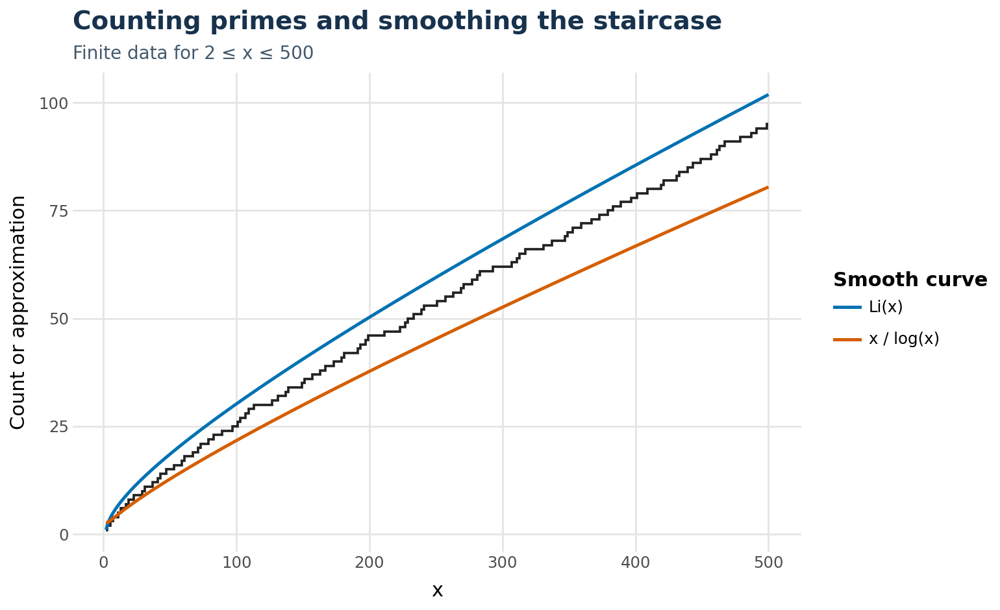

# The Integer Landscape {#sec-landscape}

<div class="chapter-goals">

**Learning goals.** Translate statements with quantifiers; distinguish examples from proofs; use direct proof, contraposition, contradiction, induction, and minimality; explain how the well-ordering principle supports division with remainder.

</div>

The first surprise of number theory is methodological. Its objects are concrete, but its conclusions often concern every integer, or assert that some integer must exist. We therefore begin not with a catalogue of special numbers but with the grammar of proof.

## What number theory asks

### Patterns, classification, and obstruction

A typical pattern question asks what regularly happens: which last digits can a square have? A classification question asks for all objects with a property: which positive integer pairs satisfy $x^2+y^2=z^2$? An obstruction question asks why a proposed object cannot exist: why can no square leave remainder $2$ upon division by $4$? These modes reinforce each other. A pattern suggests a classification; a failed construction suggests an obstruction.

Consider the observations
$$
1=1^2,\qquad 1+3=2^2,\qquad 1+3+5=3^2.
$$
They suggest that the sum of the first $n$ odd positive integers is $n^2$. The observation becomes a theorem only after an argument covers every positive $n$.

### Experiment versus proof

Checking $10^6$ cases can be excellent evidence and still leave infinitely many cases untouched. One counterexample, however, disproves a universal claim. This asymmetry makes experiments powerful for falsification and discovery but insufficient for universal verification.

<div class="callout callout-warning">
<p class="callout-title">Pitfall: the next-case illusion</p>

A rule that fits the first several terms need not govern the next one. The values $n^2-n+41$ are prime for $n=1,\ldots,40$, but at $n=41$ the value is $41^2$.

</div>

## Sets, quantifiers, and implication

### Necessary and sufficient conditions

The statement “if $P$, then $Q$” means that $P$ is sufficient for $Q$, while $Q$ is necessary for $P$. Its converse “if $Q$, then $P$” is a different claim. If $4\mid n$, then $2\mid n$; the converse fails at $n=2$.

A biconditional, written “$P$ if and only if $Q$,” contains two implications. A classification theorem therefore needs two directions. To prove that an integer is even if and only if its square is even, show first that $n=2k$ implies $n^2=2(2k^2)$, and then show that $n^2$ even forces $n$ even. The second direction is easiest by contraposition: if $n=2k+1$, then $n^2=2(2k^2+2k)+1$ is odd.

### Negating mathematical statements

Quantifiers reverse under negation. The negation of “for every integer $n$, $P(n)$ holds” is “there exists an integer $n$ for which $P(n)$ fails.” The negation of “there exists $n$ such that $P(n)$” is “for every $n$, $P(n)$ fails.” This is why a single counterexample defeats a universal assertion.

Order matters. “For every integer $a$ there exists an integer $b>a$” is true: choose $b=a+1$. “There exists an integer $b$ such that for every integer $a$, $b>a$” is false because the integers have no largest member.

## Core proof strategies

### Direct proof and contraposition

A direct proof starts from the hypotheses and applies definitions. Suppose $a\mid b$ and $b\mid c$. Then $b=ak$ and $c=b\ell$ for integers $k,\ell$, so $c=a(k\ell)$ and hence $a\mid c$. The definition does nearly all the work.

The contrapositive of $P\Rightarrow Q$ is $\neg Q\Rightarrow\neg P$, and the two are logically equivalent. To prove that $n^2$ odd implies $n$ odd, prove that $n$ even implies $n^2$ even. Contraposition is especially useful when the negated conclusion has an explicit arithmetic form.

### Contradiction and minimal counterexample

In a proof by contradiction, assume the desired conclusion is false and derive an impossibility. The impossibility must be genuine, such as an integer being both even and odd, not merely surprising.

The irrationality of $\sqrt{2}$ is a model. Assume $\sqrt2=a/b$ in lowest terms with $b>0$. Then $a^2=2b^2$, so $a^2$ and therefore $a$ are even. Write $a=2c$. Substitution gives $b^2=2c^2$, so $b$ is even too. This contradicts the fraction being in lowest terms.

Minimal-counterexample arguments combine contradiction with well-ordering. Assume some positive integer violates a claim and choose the least such integer. Transform it into a smaller positive counterexample. That contradicts minimality. The crucial audit is that the transformed object really is positive, smaller, and still a counterexample.

### Mathematical induction and strong induction

To prove $P(n)$ for every $n\ge n_0$, ordinary induction proves a base case $P(n_0)$ and an implication $P(k)\Rightarrow P(k+1)$. For the odd-number sum,
$$
1+3+\cdots+(2k-1)=k^2
$$
implies
$$
1+3+\cdots+(2k-1)+(2k+1)=k^2+2k+1=(k+1)^2.
$$

Strong induction allows $P(n_0),\ldots,P(k)$ when proving $P(k+1)$. It is not logically stronger, but it is often a better fit. To show every integer $n\ge2$ is a product of primes, either $n$ is prime or $n=ab$ with $2\le a,b<n$; the strong hypothesis factors both smaller integers.

## The well-ordering principle

### Least elements as a proof engine

The well-ordering principle says every nonempty set of positive integers has a least element. It sounds obvious, yet it encodes the discreteness of the integers. There is no analogous claim for positive rational numbers: given a positive rational $r$, the smaller positive rational $r/2$ exists.

Well-ordering implies induction, and induction implies well-ordering, given the usual axioms for the integers. Choosing between them is a matter of exposition: induction follows a forward chain; minimality focuses attention on the smallest failure.

### From well-ordering to division with remainder

Let $a$ be an integer and $n>0$. Consider all nonnegative integers of the form $a-kn$. This set is nonempty: taking $k$ sufficiently negative makes the expression positive. Let $r=a-qn$ be its least member. If $r\ge n$, then $r-n=a-(q+1)n$ is a smaller nonnegative member, impossible. Thus $0\le r<n$ and $a=qn+r$. Uniqueness will be established in [sec-divisibility](02-divisibility.md#sec-divisibility).

This proof reveals a recurring pattern: define a set of admissible errors, select the least error, and show any nonzero error could be improved.

## Computation as reconnaissance

### Responsible pattern hunting

A productive experiment has a declared range, reproducible method, and question. Rather than writing “all tested primes behave this way,” record “for primes $p<10^5$, the program found no exception.” Then seek a mechanism: a factorisation, congruence, or invariant.

Small cases deserve special attention because hypotheses often fail there. A claim about odd primes may exclude $2$; an exponent rule may require a positive exponent; a divisibility assertion may behave differently at zero.

### Common logical pitfalls

Working backwards from a desired equation can discover a proof, but only reversible steps support one. Dividing by an expression requires proving it is nonzero. Taking square roots introduces sign choices. Cancelling modulo $n$ requires a coprimality condition. We will revisit each warning where it matters.

## Visual checkpoint: exact counts and asymptotic shape

<figure id="fig-nt-landscape-prime-counting">


<figcaption>

Figure 1.1: The exact prime-counting staircase is compared with two smooth approximations.

</figcaption>
</figure>

The staircase in [Figure 1.1](#fig-nt-landscape-prime-counting) is exact at the displayed
integers; the smooth curves summarize scale rather than individual primes. This
single picture previews a recurring distinction in the book: computation can
reveal structure, while a proof must control every integer in the claim.

<!-- inline-formula-code:start -->
## Formula and finite computation

A useful formula in this chapter is

$$
d\mid n\iff n=dq\text{ for some integer }q
$$

Remainder zero is Python's exact test for the divisibility definition. The following standalone Python block expresses that finite rule with its inputs and stopping conditions visible.

```python
number = 12
divisors = [d for d in range(1, number + 1) if number % d == 0]
print(divisors)
```

**What the computation establishes.** The output certifies only the declared finite case. The theorem, if one is claimed, still requires the argument developed in the chapter.
<!-- inline-formula-code:end -->

## Summary

- Universal claims need arguments that cover infinitely many cases; one counterexample refutes them.
- An implication differs from its converse but is equivalent to its contrapositive.
- Induction, contradiction, and minimality are complementary proof architectures.
- Well-ordering captures the discreteness that makes arithmetic descent possible.
- Computation generates questions and checks finite ranges; it does not erase quantifiers.

## Exercises

<div class="exercise" id="number_theory-01-landscape-ex-1">
<p class="exercise-title"><strong>Exercise 1</strong></p>

**Fluency.** Negate precisely: “For every integer $n$, there is a prime $p>n$.”

<details class="hint"><summary>Hint 1</summary>

reverse the quantifiers and negate the inequality claim: look for one bound above which no prime exists.

</details>

</div>

<div class="exercise" id="number_theory-01-landscape-ex-2">
<p class="exercise-title"><strong>Exercise 2</strong></p>

**Logic.** Give an implication about divisibility whose converse is false, and exhibit a counterexample to the converse.

</div>

<div class="exercise" id="number_theory-01-landscape-ex-3">
<p class="exercise-title"><strong>Exercise 3</strong></p>

**Direct proof.** Prove that the sum of two odd integers is even using only the definition of parity.

</div>

<div class="exercise" id="number_theory-01-landscape-ex-4">
<p class="exercise-title"><strong>Exercise 4</strong></p>

**Contraposition.** Prove: if $3\nmid n$, then $3\nmid n^2$ is false as written or true? Correct the direction if needed and prove the valid statement.

<details class="hint"><summary>Hint 1</summary>

the statement is true: it is the contrapositive of $3\mid n^2\Rightarrow3\mid n$. Prove it using residues $1,2$ modulo $3$.

</details>

</div>

<div class="exercise" id="number_theory-01-landscape-ex-5">
<p class="exercise-title"><strong>Exercise 5</strong></p>

**Induction.** Prove $1+2+\cdots+n=n(n+1)/2$ for every $n\ge1$.

</div>

<div class="exercise" id="number_theory-01-landscape-ex-6">
<p class="exercise-title"><strong>Exercise 6</strong></p>

**Strong induction.** Prove that every integer $n\ge12$ can be written as $4a+5b$ with nonnegative integers $a,b$.

<details class="hint"><summary>Hint 1</summary>

verify four consecutive base values, then add $4$ in the induction step.

</details>

</div>

<div class="exercise" id="number_theory-01-landscape-ex-7">
<p class="exercise-title"><strong>Exercise 7</strong></p>

**Minimality.** Explain why a minimal-counterexample proof fails if the transformed counterexample might equal the original.

</div>

<div class="exercise" id="number_theory-01-landscape-ex-8">
<p class="exercise-title"><strong>Exercise 8</strong></p>

**Exploration.** Test $n^2+n+41$ for $0\le n\le50$. State exactly what your test proves and what it merely suggests.

<details class="hint"><summary>Hint 1</summary>

at $n=40$, one factor is visible; at $n=41$, both are.

</details>

</div>
