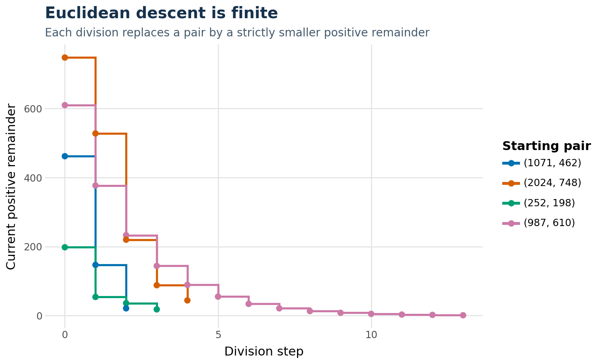

# Divisibility and the Euclidean Algorithm {#sec-divisibility}

<div class="chapter-goals">

**Learning goals.** Use the division algorithm; compute gcds and Bézout coefficients; prove Euclid's lemma; connect gcd and lcm; interpret Euclidean descent geometrically and algorithmically.

</div>

Divisibility replaces the approximate question “How large?” with the exact question “How many whole copies?” The Euclidean algorithm turns this relation into one of mathematics' oldest efficient procedures.

## Divisibility as a relation

### Definition and closure properties

For integers $a,b$, we say $a$ divides $b$, written $a\mid b$, if $b=ak$ for some integer $k$. If no such $k$ exists, write $a\nmid b$. Every integer divides $0$, because $0=a\cdot0$. Only $1$ and $-1$ divide every integer.

Divisibility is transitive: $a\mid b$ and $b\mid c$ imply $a\mid c$. It is preserved by integer linear combinations: if $d\mid a$ and $d\mid b$, then $d\mid (ra+sb)$ for every pair of integers $r,s$. This simple closure property is the engine behind gcd theory.

### Divisibility, signs, and units

Divisors come in opposite-sign pairs: $a\mid b$ if and only if $-a\mid b$. The units $1$ and $-1$ are precisely the integers with multiplicative inverses inside $\mathbb Z$. We normalize greatest common divisors to be nonnegative so that “the” gcd is unambiguous.

If $a\mid b$ and $b\mid a$ with $a,b\ne0$, then $a=\pm b$. Indeed, $b=ak$ and $a=b\ell$ give $a=ak\ell$, hence $k\ell=1$.

## The division algorithm

### Existence and uniqueness

**Division algorithm.** For every integer $a$ and positive integer $n$, there exist unique integers $q,r$ such that
$$
a=qn+r,\qquad 0\le r<n.
$$
Existence followed from well-ordering in [sec-landscape](01-landscape.md#sec-landscape). For uniqueness, suppose $a=qn+r=q'n+r'$ with both remainders in the stated range. Then $(q-q')n=r'-r$. The right side has absolute value less than $n$, while a nonzero multiple of $n$ has absolute value at least $n$. Therefore both sides are zero: $q=q'$ and $r=r'$.

For $a=-17$ and $n=5$, the valid representation is $-17=(-4)5+3$, not $(-3)5-2$, because the remainder must be nonnegative and less than $5$.

### Quotients, remainders, and floor functions

The quotient is $q=\lfloor a/n\rfloor$ and the remainder is $r=a-n\lfloor a/n\rfloor$. This convention matters in software: some programming languages define remainder for negative inputs differently. A mathematical statement using residues should declare representatives rather than inherit an implementation's convention.

## Greatest common divisors

### Common divisors and normalization

For integers $a,b$, not both zero, $\gcd(a,b)$ is the greatest positive common divisor. We set $\gcd(0,0)=0$ by convention. Signs do not matter: $\gcd(a,b)=\gcd(|a|,|b|)$.

The key reduction is
$$
\gcd(a,b)=\gcd(b,a-qb)
$$
for every integer $q$. Any common divisor of $a$ and $b$ divides $a-qb$; conversely, any common divisor of $b$ and $a-qb$ divides $(a-qb)+qb=a$. Thus the two pairs have exactly the same common divisors.

### The Euclidean algorithm

Repeatedly divide and retain remainders. For $252$ and $198$,
$$
\begin{aligned}
252&=1\cdot198+54,\\
198&=3\cdot54+36,\\
54&=1\cdot36+18,\\
36&=2\cdot18+0.
\end{aligned}
$$
The last nonzero remainder is $18$, so $\gcd(252,198)=18$. Termination is guaranteed because the nonzero remainders form a strictly decreasing sequence of nonnegative integers.

<figure id="fig-euclidean">


<figcaption>

Figure 2.1: A step plot of Euclidean remainders for several input pairs, descending to their gcd.

</figcaption>
</figure>

[Figure 2.1](#fig-euclidean) makes termination visible: every path descends through a finite ladder of nonnegative remainders. The paths differ, but none can descend forever. The picture illustrates the well-ordering argument; it does not replace it.

### The geometry of Euclidean descent

Geometrically, $\gcd(a,b)$ is the side length of the largest square tile that exactly covers an $a$ by $b$ rectangle when lengths are integral. Removing as many $b$ by $b$ squares as possible leaves a $b$ by $r$ rectangle, where $r$ is the remainder. The tiling problem is unchanged, which mirrors gcd invariance.

## Bézout's identity

### The extended Euclidean algorithm

**Bézout's identity.** For integers $a,b$, not both zero, there exist integers $x,y$ such that
$$
ax+by=\gcd(a,b).
$$
Back-substitute through the Euclidean algorithm. From the previous example,
$$
18=54-36=54-(198-3\cdot54)=4\cdot54-198
$$
and $54=252-198$, so
$$
18=4\cdot252-5\cdot198.
$$
The coefficients are not unique: adding $b/d$ to $x$ and subtracting $a/d$ from $y$, where $d=\gcd(a,b)$, gives another pair.

The back-substitution can be carried out at the same time as the remainder
calculation.  The two coefficient pairs maintained below always express the
current remainders as integer combinations of the original inputs.

```python
def bezout_coefficients(
    first_integer: int, second_integer: int
) -> tuple[int, int, int]:
    """Return gcd, x, y with first_integer*x + second_integer*y = gcd."""
    if first_integer == 0 and second_integer == 0:
        raise ValueError("Bézout coefficients are undefined for (0, 0)")
    old_remainder, remainder = abs(first_integer), abs(second_integer)
    old_x, current_x = 1, 0
    old_y, current_y = 0, 1
    while remainder != 0:
        quotient, next_remainder = divmod(old_remainder, remainder)
        old_remainder, remainder = remainder, next_remainder
        old_x, current_x = current_x, old_x - quotient * current_x
        old_y, current_y = current_y, old_y - quotient * current_y
    x_coefficient = old_x if first_integer >= 0 else -old_x
    y_coefficient = old_y if second_integer >= 0 else -old_y
    return old_remainder, x_coefficient, y_coefficient

greatest_divisor, x_coefficient, y_coefficient = bezout_coefficients(252, 198)
reconstructed = 252 * x_coefficient + 198 * y_coefficient
if reconstructed != greatest_divisor:
    raise RuntimeError("the computed coefficients failed the Bézout identity")
print(greatest_divisor, x_coefficient, y_coefficient, reconstructed)
```

This run constructs one certificate, $(18,4,-5)$, and checks it by exact
integer arithmetic.  Termination and the claim that the returned divisor is
greatest still come from Euclidean descent, not from this one input.

An alternative proof defines $S$ as the positive linear combinations $ax+by$. Choose the least $d\in S$. Dividing $a$ by $d$ shows the remainder is another nonnegative linear combination; minimality forces it to be zero. Similarly $d\mid b$. Every common divisor divides $d$, so $d$ is the gcd.

### Linear combinations and coprimality

Integers $a,b$ are coprime when $\gcd(a,b)=1$. Bézout gives the useful equivalence
$$
\gcd(a,b)=1 \quad\Longleftrightarrow\quad ax+by=1
$$
for some integers $x,y$. Multiplying by $c$ shows that every integer is then a linear combination of $a$ and $b$.

## Consequences of Bézout

### Euclid's lemma

**Lemma 2.1 (Euclid's).** If $p$ is prime and $p\mid ab$, then $p\mid a$ or $p\mid b$.

Suppose $p\nmid a$. Since the only positive divisors of $p$ are $1,p$, we have $\gcd(p,a)=1$. Choose $x,y$ with $px+ay=1$. Multiply by $b$:
$$
pbx+aby=b.
$$
Both terms on the left are divisible by $p$, so $p\mid b$.

The prime hypothesis is essential. Although $6\mid2\cdot3$, neither $6\mid2$ nor $6\mid3$.

### Least common multiples

For nonzero $a,b$, the least common multiple $\operatorname{lcm}(a,b)$ is the least positive integer divisible by both. The product relation is
$$
\gcd(a,b)\operatorname{lcm}(a,b)=|ab|.
$$
To see the structure, write $a=da'$, $b=db'$ with $d=\gcd(a,b)$ and $\gcd(a',b')=1$. Then $d|a'b'|$ is a positive common multiple. Any common multiple must contain both coprime factors $a'$ and $b'$, so it is divisible by $d|a'b'|$. Thus $\operatorname{lcm}(a,b)=d|a'b'|$, giving the product relation even when $a$ and $b$ have opposite signs.

## Algorithmic complexity and continued subtraction

The naive method of repeatedly subtracting the smaller number is correct but can be slow: reducing $(N,1)$ takes about $N$ subtractions. Division compresses repeated subtractions into one quotient. In fact, the number of Euclidean divisions grows only logarithmically with the smaller input; consecutive Fibonacci numbers furnish near-worst cases. We return to the quotient sequence in [sec-fractions](09-fractions.md#sec-fractions), where it becomes a continued fraction.

<div class="callout callout-warning">
<p class="callout-title">Pitfall: gcd is not an operation on fractions</p>

The expression $\gcd(a,b)$ concerns integers. Cancel common factors before interpreting $a/b$, and do not infer $\gcd(a+c,b+c)=\gcd(a,b)$; adding the same number is not a valid gcd-invariance rule.

</div>

<!-- inline-formula-code:start -->
## Formula and finite computation

A useful formula in this chapter is

$$
a=qb+r,\qquad 0\le r<b
$$

Each loop iteration is one division-with-remainder identity. The following standalone Python block expresses that finite rule with its inputs and stopping conditions visible.

```python
def euclidean_trace(
    first_integer: int, second_integer: int
) -> tuple[int, list[tuple[int, int, int, int]]]:
    """Return the gcd and rows (dividend, divisor, quotient, remainder)."""
    old_a, old_b = abs(first_integer), abs(second_integer)
    rows: list[tuple[int, int, int, int]] = []
    while old_b != 0:
        quotient, remainder = divmod(old_a, old_b)
        rows.append((old_a, old_b, quotient, remainder))
        old_a, old_b = old_b, remainder
    return old_a, rows

gcd_value, trace = euclidean_trace(252, 198)
print(gcd_value)
for row in trace:
    print(row)
```

**What the computation establishes.** The calculation checks a declared finite instance; the surrounding argument explains what is true beyond those inputs.
<!-- inline-formula-code:end -->

## Summary

- Division with remainder has unique quotient and canonical remainder.
- Replacing $(a,b)$ by $(b,a-qb)$ preserves all common divisors.
- Euclid terminates because positive remainders strictly decrease.
- The gcd is an integer linear combination of the inputs.
- Bézout yields Euclid's lemma, modular inverses, and solvability criteria used later.

## Exercises

<div class="exercise" id="number_theory-02-divisibility-ex-1">
<p class="exercise-title"><strong>Exercise 1</strong></p>

Compute $\gcd(414,662)$ by Euclid's algorithm.

</div>

<div class="exercise" id="number_theory-02-divisibility-ex-2">
<p class="exercise-title"><strong>Exercise 2</strong></p>

Find integers $x,y$ with $414x+662y=\gcd(414,662)$.

</div>

<div class="exercise" id="number_theory-02-divisibility-ex-3">
<p class="exercise-title"><strong>Exercise 3</strong></p>

Prove that $\gcd(a,b)=\gcd(a,a+b)$.

</div>

<div class="exercise" id="number_theory-02-divisibility-ex-4">
<p class="exercise-title"><strong>Exercise 4</strong></p>

Prove that if $\gcd(a,b)=1$ and $a\mid c$, $b\mid c$, then $ab\mid c$.

<details class="hint"><summary>Hint 1</summary>

write $c=ak=b\ell$. Bézout for $a,b$ helps prove one quotient contains the other factor.

</details>

<details class="solution"><summary>Solution</summary>

Assume $\gcd(a,b)=1$ and $a\mid c$, $b\mid c$. Write $c=ak$. Since $b\mid c$, we have $b\mid ak$. Euclid's lemma in its coprime form says $\gcd(a,b)=1$ and $b\mid ak$ imply $b\mid k$. Hence $k=b\ell$ for some integer $\ell$, and $c=ab\ell$. Therefore $ab\mid c$.

The coprimality hypothesis is used exactly in the Euclid-lemma step. Without it, $a=b=2,c=2$ is a counterexample.

</details>

</div>

<div class="exercise" id="number_theory-02-divisibility-ex-5">
<p class="exercise-title"><strong>Exercise 5</strong></p>

Determine all common divisors of $0$ and $24$. Explain the convention $\gcd(0,24)=24$.

</div>

<div class="exercise" id="number_theory-02-divisibility-ex-6">
<p class="exercise-title"><strong>Exercise 6</strong></p>

Show that $\gcd(n,n+1)=1$ for every integer $n$.

</div>

<div class="exercise" id="number_theory-02-divisibility-ex-7">
<p class="exercise-title"><strong>Exercise 7</strong></p>

If $d=\gcd(a,b)$, prove that all Bézout pairs are $x=x_0+(b/d)t$, $y=y_0-(a/d)t$.

<details class="hint"><summary>Hint 1</summary>

subtract the equation for $(x_0,y_0)$ from the equation for $(x,y)$ and divide by $d$.

</details>

</div>

<div class="exercise" id="number_theory-02-divisibility-ex-8">
<p class="exercise-title"><strong>Exercise 8</strong></p>

Compare division counts for consecutive Fibonacci pairs and formulate a precise finite observation.

<details class="hint"><summary>Hint 1</summary>

apply Euclid to $(F_{k+1},F_k)$ and observe each quotient before the last.

</details>

</div>
