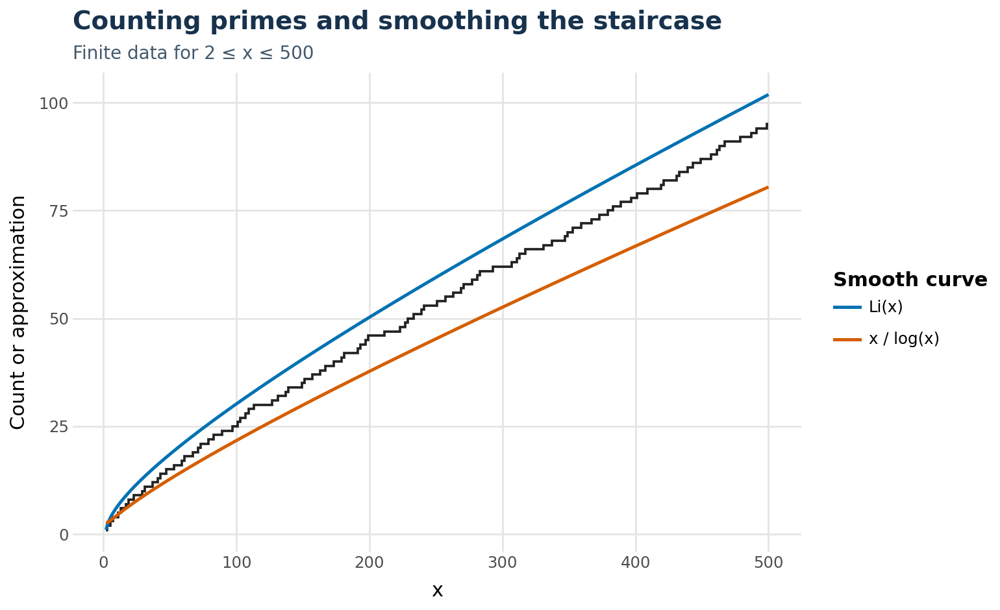

# Primes and Unique Factorisation {#sec-primes}

<div class="chapter-goals">

**Learning goals.** Detect compositeness by bounded trial division; prove there are infinitely many primes; prove existence and uniqueness of prime factorisation; use $p$-adic valuations to compute gcds and lcms; interpret prime-counting data cautiously.

</div>

Primes are the multiplicative atoms of the positive integers. The metaphor becomes mathematics only after two questions are answered: can every integer be assembled from primes, and is the assembly unique?

## Irreducibles of the integers

### Prime versus composite

A prime is a positive integer $p>1$ whose only positive divisors are $1$ and $p$. An integer $n>1$ that is not prime is composite. The number $1$ is neither: treating it as prime would destroy uniqueness because arbitrary factors of $1$ could be inserted into every factorisation.

If $n=ab$ with $1<a<n$ and $1<b<n$, then $n$ is composite. Conversely, any nontrivial divisor yields such a factorisation. Negative integers factor as a unit $-1$ times a positive integer, so positive factorisation contains the essential information.

### Trial division and the square-root bound

If $n=ab$ is composite with $1<a\le b$, then $a^2\le n$, so $a\le\sqrt n$. Therefore it suffices to test prime divisors at most $\sqrt n$. To test $221$, try $2,3,5,7,11,13$; since $221=13\cdot17$, the final test finds a factor.

This is a proof of the square-root stopping rule, not a claim that trial division is efficient for enormous inputs. Modern primality tests avoid trying every possible small divisor; factoring and primality proving are different computational tasks.

## Infinitely many primes

### Euclid's proof

**Theorem 3.1.** There are infinitely many primes.

Assume instead that $p_1,\ldots,p_k$ are all primes. Form
$$
N=p_1p_2\cdots p_k+1.
$$
Since $N>1$, it has a prime divisor $q$. None of the listed primes divides $N$, because division by any $p_i$ leaves remainder $1$. Thus $q$ is a prime not on the complete list, a contradiction.

Notice that $N$ itself need not be prime. For $2,3,5,7,11,13$, the product plus one is $30031=59\cdot509$. The proof needs a new prime divisor, not a prime value.

### Variations and what the proof does not say

The same idea proves infinitely many primes divide numbers in various constructed sequences, but it does not estimate where the next prime lies or how frequently primes occur. Existence and distribution are distinct questions.

For primes congruent to $3$ modulo $4$, suppose $p_1,\ldots,p_k$ were all of them and examine $N=4p_1\cdots p_k-1$. At least one prime factor of $N$ is $3$ modulo $4$; otherwise a product of factors each $1$ modulo $4$ would be $1$ modulo $4$. That factor is absent from the list. The corresponding proof for primes $1$ modulo $4$ needs deeper input.

## The fundamental theorem of arithmetic

### Existence by strong induction

**Theorem 3.2 (Fundamental of arithmetic).** Every integer $n>1$ is a product of primes, unique up to rearranging the factors.

For existence, use strong induction. The base $n=2$ is prime. Assume all integers from $2$ through $n-1$ are products of primes. If $n$ is prime, it already is such a product. If composite, $n=ab$ with $2\le a,b<n$; factor $a$ and $b$ using the induction hypothesis and combine the lists.

The proof is constructive in principle: if a number is composite, split it and recurse. Its mathematical termination follows from descent, though the search for a factor may be computationally expensive.

### Uniqueness via Euclid's lemma

Suppose
$$
p_1p_2\cdots p_r=q_1q_2\cdots q_s
$$
with every factor prime. Since $p_1$ divides the right side, repeated use of Euclid's lemma shows $p_1\mid q_j$ for some $j$. A prime divides another prime only when they are equal. Cancel this common factor and repeat. Eventually both lists are exhausted, giving the same primes with the same multiplicities.

Cancellation occurs in the ordinary integer equality after identifying an equal factor; it is not unlicensed modular cancellation. The logical heart is Euclid's lemma.

## Valuations and exponent vectors

### The function $v_p(n)$

For a prime $p$ and nonzero integer $n$, define $v_p(n)$ as the exponent of $p$ in $|n|$. Thus $v_2(360)=3$, $v_3(360)=2$, and $v_7(360)=0$. Unique factorisation yields
$$
v_p(ab)=v_p(a)+v_p(b).
$$
If $a\mid b$, then $v_p(a)\le v_p(b)$ for every prime $p$; conversely, those coordinatewise inequalities imply $a\mid b$ for positive $a,b$.

It is sometimes convenient to set $v_p(0)=+\infty$, but this convention must be declared because infinity is not an integer exponent. We use valuations of nonzero integers unless explicitly noted.

### GCD and LCM coordinatewise

Prime exponent vectors turn gcd and lcm into coordinatewise minimum and maximum:
$$
v_p(\gcd(a,b))=\min\{v_p(a),v_p(b)\},\qquad
v_p(\operatorname{lcm}(a,b))=\max\{v_p(a),v_p(b)\}.
$$
Adding these equations recovers the product identity because $\min(u,v)+\max(u,v)=u+v$.

For $360=2^3 3^2 5$ and $168=2^3 3\cdot7$, the gcd takes the minima $2^3 3=24$, while the lcm takes the maxima $2^3 3^2 5\cdot7=2520$.

## Prime-counting experiments

### The staircase $\pi(x)$

Let $\pi(x)$ count primes not exceeding $x$. It is a staircase: flat across composite stretches and rising by one at each prime.

<figure id="fig-prime-counting">


<figcaption>

Figure 3.1: The prime-counting staircase together with the smooth curves x over log x and the logarithmic integral for x from 2 to 500.

</figcaption>
</figure>

[Figure 3.1](#fig-prime-counting) compares finite data with two smooth approximations. The curve $x/\log x$ captures the first-order scale, while $\operatorname{Li}(x)=\int_2^x dt/\log t$ is often closer in this window. Neither curve predicts individual primes, and the picture proves no limiting theorem. The prime number theorem appears, with its status explicit, in [sec-analytic](12-analytic.md#sec-analytic).

### Density is not regular spacing

Primes thin out on average, yet their gaps fluctuate. There are arbitrarily long composite runs: for any $k$, the integers
$$
(k+1)!+2,\ (k+1)!+3,\ldots,(k+1)!+(k+1)
$$
are all composite. On the other hand, small prime gaps continue to occur. Average density therefore says little about the next local gap.

<div class="callout callout-warning">
<p class="callout-title">Pitfall: probabilistic language</p>

Saying that a large integer near $x$ has “probability about $1/\log x$ of being prime” is a useful heuristic for uniformly sampled integers in a window. A fixed integer is either prime or composite; the heuristic is not an independent random model.

</div>

<!-- inline-formula-code:start -->
## Formula and finite computation

A useful formula in this chapter is

$$
n\ge2\text{ is prime}\iff d\nmid n\text{ for every }2\le d\le\sqrt n
$$

A finite sieve crosses out exactly the multiples that the definition excludes. The following standalone Python block expresses that finite rule with its inputs and stopping conditions visible.

```python
from math import isqrt

def primes_up_to(limit: int) -> list[int]:
    """Return every prime p with 2 <= p <= limit."""
    if limit < 0:
        raise ValueError("limit must be nonnegative")
    is_prime = bytearray(b"\x01") * (limit + 1)
    if limit >= 0:
        is_prime[0] = 0
    if limit >= 1:
        is_prime[1] = 0
    for prime in range(2, isqrt(limit) + 1):
        if is_prime[prime]:
            start = prime * prime
            count = (limit - start) // prime + 1
            is_prime[start : limit + 1 : prime] = b"\x00" * count
    return [value for value in range(2, limit + 1) if is_prime[value]]

print(primes_up_to(50))
```

**What the computation establishes.** The calculation checks a declared finite instance; the surrounding argument explains what is true beyond those inputs.
<!-- inline-formula-code:end -->

## Summary

- A composite $n$ has a prime divisor at most $\sqrt n$.
- Euclid's construction forces a prime outside any finite list.
- Strong induction gives existence of prime factorisation; Euclid's lemma gives uniqueness.
- Valuations linearise products and make divisibility coordinatewise.
- Prime-counting graphs motivate distribution theorems but do not prove them.

## Exercises

<div class="exercise" id="number_theory-03-primes-ex-1">
<p class="exercise-title"><strong>Exercise 1</strong></p>

Determine whether $437$ is prime, explaining the stopping point.

<details class="hint"><summary>Hint 1</summary>

$\sqrt{437}<21$; test only primes at most $19$.

</details>

</div>

<div class="exercise" id="number_theory-03-primes-ex-2">
<p class="exercise-title"><strong>Exercise 2</strong></p>

Factor $12320$ and record every nonzero $v_p(12320)$.

</div>

<div class="exercise" id="number_theory-03-primes-ex-3">
<p class="exercise-title"><strong>Exercise 3</strong></p>

Prove that every integer greater than $1$ has a prime divisor.

</div>

<div class="exercise" id="number_theory-03-primes-ex-4">
<p class="exercise-title"><strong>Exercise 4</strong></p>

Show there are infinitely many primes by considering a factorial plus one.

<details class="hint"><summary>Hint 1</summary>

if a finite list contains all primes, every prime divisor of the factorial plus one is new.

</details>

</div>

<div class="exercise" id="number_theory-03-primes-ex-5">
<p class="exercise-title"><strong>Exercise 5</strong></p>

Prove: if $a^2\mid b^2$ for positive integers, then $a\mid b$, using valuations.

<details class="hint"><summary>Hint 1</summary>

compare $v_p(a^2)=2v_p(a)$ with $v_p(b^2)$ for every prime.

</details>

</div>

<div class="exercise" id="number_theory-03-primes-ex-6">
<p class="exercise-title"><strong>Exercise 6</strong></p>

Compute the gcd and lcm of $2^5 3^2 7$ and $2^2 3^4 5$ without expanding them.

</div>

<div class="exercise" id="number_theory-03-primes-ex-7">
<p class="exercise-title"><strong>Exercise 7</strong></p>

Construct a run of ten consecutive composite integers.

</div>

<div class="exercise" id="number_theory-03-primes-ex-8">
<p class="exercise-title"><strong>Exercise 8</strong></p>

Research-free exploration: compute $\pi(10^k)$ for the values your tools can handle, and compare $\pi(x)\log x/x$. State the finite range.

</div>
