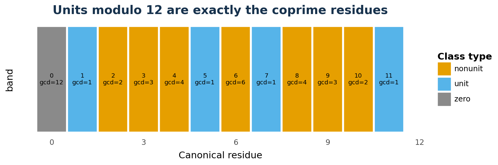

# Congruence as a Calculus {#sec-congruence}

<div class="chapter-goals">

**Learning goals.** Treat congruence as an equivalence relation; compute with residue classes; identify units and zero divisors; justify cancellation; use fast exponentiation, Fermat's little theorem, Euler's theorem, and multiplicative order.

</div>

A clock ignores the number of complete revolutions and records only a remainder. Congruence formalises that loss of information while preserving exactly enough structure to add and multiply.

## Equivalence modulo $n$

### Residue classes and canonical representatives

For a positive integer $n$, define
$$
a\equiv b\pmod n \quad\Longleftrightarrow\quad n\mid(a-b).
$$
This is an equivalence relation: reflexivity follows from $n\mid0$; symmetry from changing the sign of $a-b$; and transitivity from adding divisible differences.

The equivalence class of $a$ is $[a]_n=\{a+kn:k\in\mathbb Z\}$. Exactly one representative lies in $\{0,1,\ldots,n-1\}$, by the division algorithm. Thus every integer has a canonical remainder modulo $n$, though alternative representatives such as $-1$ for $n-1$ may simplify work.

### Congruence respects addition and multiplication

If $a\equiv b\pmod n$ and $c\equiv d\pmod n$, then
$$
a+c\equiv b+d\pmod n,\qquad ac\equiv bd\pmod n.
$$
For multiplication, write $a=b+kn$ and $c=d+\ell n$; then $ac-bd=n(b\ell+dk+k\ell n)$. Polynomial expressions with integer coefficients therefore respect congruence. Division generally does not.

For example, to find the last digit of $37^{20}$, reduce $37\equiv7\pmod{10}$ and observe $7^4\equiv1\pmod{10}$. Hence $37^{20}\equiv(7^4)^5\equiv1$.

## Arithmetic in $\mathbb{Z}/n\mathbb{Z}$

### Units and zero divisors

The residue classes modulo $n$, with classwise addition and multiplication, form the ring $\mathbb Z/n\mathbb Z$. A class $[a]_n$ is a unit if it has a multiplicative inverse. Bézout gives the criterion
$$
[a]_n\text{ is a unit}\quad\Longleftrightarrow\quad \gcd(a,n)=1.
$$
Indeed, $ax+ny=1$ is exactly the assertion $ax\equiv1\pmod n$.

A nonzero class $[a]_n$ is a zero divisor if $[a]_n[b]_n=[0]_n$ for some nonzero $[b]_n$. Modulo $6$, $[2][3]=[0]$. When $p$ is prime, every nonzero class is a unit; when $n$ is composite, a proper factor gives a zero divisor. Thus $\mathbb Z/p\mathbb Z$ is a field precisely when $p$ is prime.

<figure id="fig-residue-units">


<figcaption>

Figure 4.1: Residues modulo 12 arranged by greatest common divisor with 12, distinguishing units from nonunits.

</figcaption>
</figure>

In [Figure 4.1](#fig-residue-units) the four residues coprime to $12$ are units. The grouping by gcd explains more than a circular clock alone: inverse arithmetic is available exactly in the coprime band.

### Cancellation: when it works and when it fails

From $ac\equiv bc\pmod n$, one may cancel $c$ if $\gcd(c,n)=1$, by multiplying by its inverse. More generally, if $d=\gcd(c,n)$, cancellation yields
$$
a\equiv b\pmod{n/d}.
$$
For instance, $2\cdot1\equiv2\cdot4\pmod6$, but $1\not\equiv4\pmod6$; only $1\equiv4\pmod3$ follows.

<div class="callout callout-warning">
<p class="callout-title">Pitfall: informal division</p>

Never divide both sides of a congruence without tracking the gcd with the modulus. Multiplication may collapse distinct residue classes when zero divisors exist.

</div>

## Powers and periodicity

### Fast modular exponentiation

Repeated squaring computes $a^e\bmod n$ using only $O(\log e)$ multiplications. Write $e$ in binary. To find $7^{13}\bmod20$, compute
$$
7^2\equiv9,\quad 7^4\equiv1,\quad 7^8\equiv1\pmod{20},
$$
then $7^{13}=7^8 7^4 7\equiv7$. Reducing after each multiplication prevents intermediate numbers from growing needlessly.

### Last digits and digital tests

Modulo $9$, every power of $10$ is $1$, so an integer is congruent to its digit sum. This proves the familiar divisibility test for $9$. Modulo $11$, $10\equiv-1$, so the alternating digit sum gives a test for $11$. These are not tricks detached from theory; they are polynomial evaluation in a convenient residue class.

## Fermat's little theorem

### A permutation proof

**Theorem 4.1 (Fermat's little).** If $p$ is prime and $p\nmid a$, then $a^{p-1}\equiv1\pmod p$. Equivalently, $a^p\equiv a\pmod p$ for every integer $a$.

Multiplication by nonzero $a$ permutes the nonzero residues modulo $p$: if $ai\equiv aj$, cancellation gives $i\equiv j$. Therefore
$$
a\cdot2a\cdots(p-1)a\equiv1\cdot2\cdots(p-1)\pmod p.
$$
Cancel the invertible product $(p-1)!$ to obtain $a^{p-1}\equiv1$.

### Pseudoprimes and the limits of a test

If $n$ is prime, $a^{n-1}\equiv1\pmod n$ for every $a$ coprime to $n$. The converse fails. For example, $341=11\cdot31$ satisfies $2^{340}\equiv1\pmod{341}$. A composite passing a Fermat test to base $a$ is a base-$a$ pseudoprime. Some composites, the Carmichael numbers, pass for every coprime base. Passing is evidence, not proof of primality.

## Euler's theorem and multiplicative order

Let $\varphi(n)$ count residues from $1$ through $n$ that are coprime to $n$. The same permutation argument on the unit classes proves **Euler's theorem**:
$$
\gcd(a,n)=1\quad\Longrightarrow\quad a^{\varphi(n)}\equiv1\pmod n.
$$

The multiplicative order $\operatorname{ord}_n(a)$ is the least positive $r$ with $a^r\equiv1\pmod n$, defined when $\gcd(a,n)=1$. Division with remainder shows the order divides every exponent producing $1$; in particular it divides $\varphi(n)$ by Lagrange's theorem for the finite unit group. For $a=2,n=7$, the powers $2,4,1$ show order $3$, which divides $\varphi(7)=6$.

## Congruence as finite-state dynamics

### Every modular orbit eventually repeats

Let $F(X)$ be a polynomial with integer coefficients and choose a modulus $n$. Starting from a residue $x_0$, define
$$
x_{k+1}\equiv F(x_k)\pmod n.
$$
There are only $n$ possible states. Among $x_0,x_1,\ldots,x_n$, two must agree, by the pigeonhole principle. Because the same state always has the same successor, everything after that first repetition cycles forever. Thus every orbit has a possibly empty **tail** followed by a **cycle**. This conclusion uses finiteness alone; it does not require $F$ to be invertible.

For example, take $F(x)=x^2+1$ modulo $10$ and start at $2$:
$$
2\longmapsto5\longmapsto6\longmapsto7\longmapsto0
\longmapsto1\longmapsto2.
$$
All six displayed states form a cycle. In contrast, iteration of $F(x)=x^2$ modulo $12$ sends $6$ to $0$, which is then fixed; here $6$ lies in a one-step tail. A modular orbit is a finite shadow of an integer orbit, not proof that the corresponding unreduced integers repeat.

If $n=ab$ with $\gcd(a,b)=1$, CRT identifies a state modulo $n$ with a pair of states modulo $a$ and $b$. Polynomial iteration respects this identification. One can therefore study an orbit componentwise and combine its periods: after both components enter cycles, the combined period divides the least common multiple of their periods. This principle underlies many pseudorandom generators and also explains why a poor choice of modulus can create short, predictable cycles.

### Reversible and irreversible maps

The linear map $x\mapsto ux+v$ modulo $n$ is a permutation precisely when $u$ is a unit. If $u$ is not a unit, distinct inputs can merge. Once two trajectories merge under a deterministic map, they can never separate. This is the dynamical version of failed cancellation.

For a general polynomial, checking whether the induced function is a permutation can be difficult. It is important to distinguish the formal polynomial from the function it induces: different polynomials may agree on every residue. Fermat's theorem, for instance, says that $X^p$ and $X$ define the same function on $\mathbb F_p$ even though they are different polynomials.

## Polynomial congruences

### Root counts over a prime field

Over a field, a nonzero polynomial of degree $d$ has at most $d$ roots. The proof is the familiar factor theorem followed by induction: if $f(a)=0$, then $f(X)=(X-a)g(X)$, and every other root is a root of $g$. Consequently a quadratic congruence modulo a prime has at most two roots, a fact used repeatedly in quadratic-residue theory.

The field hypothesis matters. Modulo $8$,
$$
x^2\equiv1\pmod8
$$
has four solutions: $1,3,5,7$. Here $(x-1)(x+1)\equiv0$ does not force either factor to vanish, because the ring has zero divisors. Root-count arguments imported from real numbers or fields can therefore fail over composite moduli.

The polynomial
$$
X^p-X
$$
has all $p$ residues as roots modulo a prime $p$, by Fermat's theorem. Since it is monic of degree $p$, it factors completely:
$$
X^p-X=\prod_{a\in\mathbb F_p}(X-a)
\quad\text{in }\mathbb F_p[X].
$$
This identity is a first glimpse of finite-field structure and will reappear when extension fields are constructed.

### Linear congruences revisited

The equation $ax\equiv b\pmod n$ has a solution exactly when $d=\gcd(a,n)$ divides $b$. When it does, divide $a,b,n$ by $d$, solve the resulting congruence with an invertible coefficient modulo $n/d$, and lift back. There are exactly $d$ incongruent solutions modulo $n$. Thus existence, construction, and counting all come from the same gcd calculation.

<!-- inline-formula-code:start -->
## Formula and finite computation

A useful formula in this chapter is

$$
a^{2k}\equiv(a^k)^2\pmod m
$$

Binary exponentiation repeatedly applies the displayed congruence. The following standalone Python block expresses that finite rule with its inputs and stopping conditions visible.

```python
def modular_power(base: int, exponent: int, modulus: int) -> tuple[int, int]:
    """Return base**exponent mod modulus and the modular multiplication count."""
    if exponent < 0 or modulus <= 1:
        raise ValueError("require exponent >= 0 and modulus > 1")
    result = 1
    current = base % modulus
    remaining = exponent
    multiplications = 0
    while remaining > 0:
        if remaining % 2 == 1:
            result = (result * current) % modulus
            multiplications += 1
        remaining //= 2
        if remaining > 0:
            current = (current * current) % modulus
            multiplications += 1
    return result, multiplications

value, cost = modular_power(7, 560, 561)
print(value, cost, pow(7, 560, 561))
```

**What the computation establishes.** The calculation checks a declared finite instance; the surrounding argument explains what is true beyond those inputs.
<!-- inline-formula-code:end -->

## Summary

- Congruence partitions the integers into residue classes and respects integer polynomials.
- A residue modulo $n$ is invertible exactly when it is coprime to $n$.
- Cancellation is licensed by invertibility, not visual similarity.
- Binary exponentiation makes large modular powers practical.
- Fermat's and Euler's theorems impose periodicity; their converses require care.
- Polynomial iteration modulo $n$ always becomes periodic, but its reduced orbit need not describe integer growth.
- Polynomial root bounds work over prime fields and can fail over composite moduli.

## Exercises

<div class="exercise" id="number_theory-04-congruence-ex-1">
<p class="exercise-title"><strong>Exercise 1</strong></p>

List all units and zero divisors modulo $15$.

</div>

<div class="exercise" id="number_theory-04-congruence-ex-2">
<p class="exercise-title"><strong>Exercise 2</strong></p>

Find the last two digits of $3^{100}$.

<details class="hint"><summary>Hint 1</summary>

Euler's theorem gives a useful period modulo $100$ after separating any nonunit issue.

</details>

</div>

<div class="exercise" id="number_theory-04-congruence-ex-3">
<p class="exercise-title"><strong>Exercise 3</strong></p>

Prove the divisibility test for $11$ from $10\equiv-1\pmod{11}$.

</div>

<div class="exercise" id="number_theory-04-congruence-ex-4">
<p class="exercise-title"><strong>Exercise 4</strong></p>

Solve $7x\equiv1\pmod{26}$ by Bézout's identity.

</div>

<div class="exercise" id="number_theory-04-congruence-ex-5">
<p class="exercise-title"><strong>Exercise 5</strong></p>

Give a concrete failed cancellation modulo $8$.

</div>

<div class="exercise" id="number_theory-04-congruence-ex-6">
<p class="exercise-title"><strong>Exercise 6</strong></p>

Prove $n^5\equiv n\pmod5$ for every integer $n$.

<details class="hint"><summary>Hint 1</summary>

split into $5\mid n$ and $5\nmid n$, or use Fermat's equivalent form.

</details>

</div>

<div class="exercise" id="number_theory-04-congruence-ex-7">
<p class="exercise-title"><strong>Exercise 7</strong></p>

Compute $\operatorname{ord}_{11}(2)$ and list its powers.

</div>

<div class="exercise" id="number_theory-04-congruence-ex-8">
<p class="exercise-title"><strong>Exercise 8</strong></p>

Verify that $341$ passes the base-$2$ Fermat test without computing $2^{340}$ directly.

<details class="hint"><summary>Hint 1</summary>

$2^{10}\equiv1\pmod{11}$ and $2^5\equiv1\pmod{31}$; combine by CRT.

</details>

</div>
