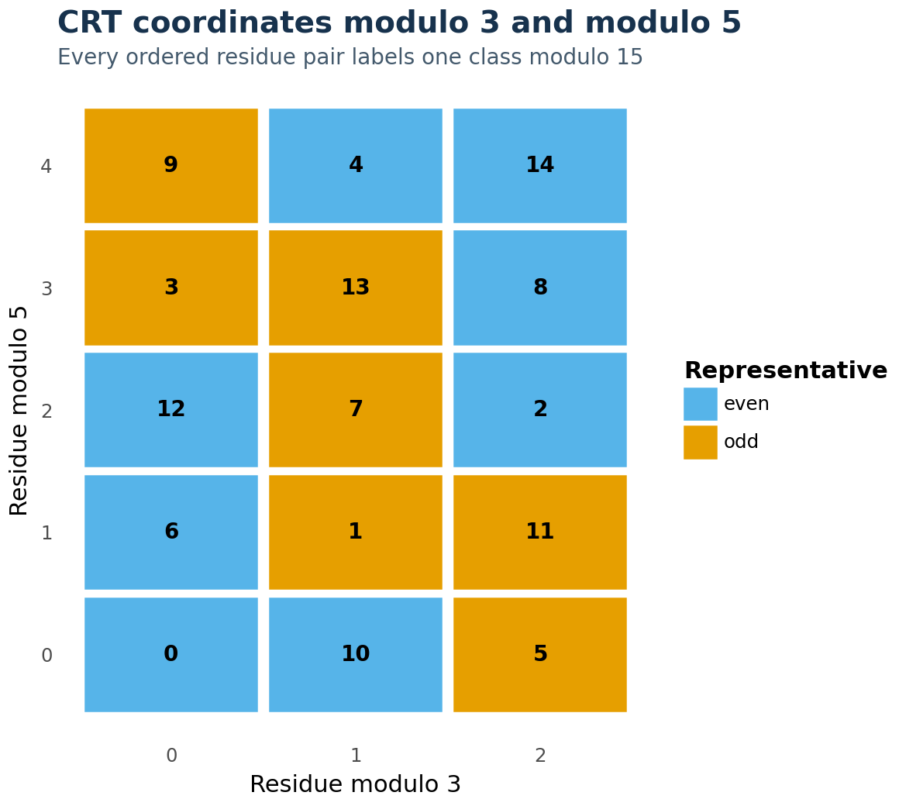

# Linear Congruences and the Chinese Remainder Theorem {#sec-crt}

<div class="chapter-goals">

**Learning goals.** Decide when a linear congruence is solvable; enumerate its solutions; construct inverses with extended Euclid; solve coprime and compatible noncoprime CRT systems; reconstruct residues incrementally.

</div>

Congruences become a problem-solving language once we can reverse multiplication and reconcile several modular observations. The governing quantities are gcds: they measure both obstruction and multiplicity.

## Solving a linear congruence

### The gcd solvability criterion

The congruence
$$
ax\equiv b\pmod n
$$
is equivalent to $ax+ny=b$ for some integer $y$. By Bézout theory this linear equation is solvable exactly when
$$
\gcd(a,n)\mid b.
$$
For $12x\equiv8\pmod{20}$, the gcd is $4$, which divides $8$, so solutions exist. Dividing the entire integer equation by $4$ yields $3x\equiv2\pmod5$, hence $x\equiv4\pmod5$.

By contrast, $12x\equiv6\pmod{20}$ has no solution because $4\nmid6$. Trying residues may discover this fact, but the gcd criterion explains it immediately.

### Counting and listing solutions

If $d=\gcd(a,n)$ divides $b$, then there are exactly $d$ incongruent solutions modulo $n$. After dividing by $d$, solve
$$
(a/d)x\equiv b/d\pmod{n/d}.
$$
This has one class modulo $n/d$. Its lifts modulo $n$ are
$$
x_0,\ x_0+n/d,\ldots,x_0+(d-1)n/d.
$$
Thus the earlier solutions are $x\equiv4,9,14,19\pmod{20}$.

## Modular inverses

### Extended Euclid in action

When $\gcd(a,n)=1$, extended Euclid returns $u,v$ with $au+nv=1$; therefore $u$ is the inverse of $a$ modulo $n$. For $17^{-1}\pmod{43}$,
$$
43=2\cdot17+9,\quad17=1\cdot9+8,\quad9=1\cdot8+1.
$$
Back-substitution gives $1=2\cdot43-5\cdot17$, so $17^{-1}\equiv-5\equiv38\pmod{43}$.

An inverse is a residue class, not a rational reciprocal. The notation $a^{-1}\pmod n$ means an integer class whose product with $a$ is $1$ modulo $n$.

### Affine congruences

For $\alpha$ invertible modulo $n$, the map $x\mapsto\alpha x+\beta$ permutes residue classes. Its inverse is $y\mapsto\alpha^{-1}(y-\beta)$. This elementary fact underlies affine ciphers, hash-table probing, and changes of variables in modular sums.

## The Chinese remainder theorem

### Constructive proof for coprime moduli

**Theorem 5.1 (Chinese remainder (CRT)).** If $n_1,\ldots,n_k$ are pairwise coprime, then for any residues $a_1,\ldots,a_k$ the system
$$
x\equiv a_i\pmod{n_i}\qquad(i=1,\ldots,k)
$$
has a solution, unique modulo $N=n_1\cdots n_k$.

Let $N_i=N/n_i$. Since $\gcd(N_i,n_i)=1$, choose $M_i$ with $N_iM_i\equiv1\pmod{n_i}$. Then
$$
x=\sum_{i=1}^k a_iN_iM_i
$$
works: modulo $n_j$, every term except the $j$th vanishes, and that term is $a_j$.

Solve $x\equiv2\pmod3$, $x\equiv3\pmod5$, $x\equiv2\pmod7$. Here $N=105$. We may take
$$
(N_1,M_1)=(35,2),\quad(N_2,M_2)=(21,1),\quad(N_3,M_3)=(15,1).
$$
Thus $x\equiv2(35)(2)+3(21)+2(15)=233\equiv23\pmod{105}$.

Here the mathematical construction translates directly: `partial_modulus` is
$N_i$, and Python's three-argument `pow` computes the inverse $M_i$.

```python
from math import gcd, prod

def coprime_crt(residues: list[int], moduli: list[int]) -> tuple[int, int]:
    """Return the least nonnegative CRT solution and the product modulus."""
    if not residues or len(residues) != len(moduli):
        raise ValueError("provide equally long, nonempty residue and modulus lists")
    if any(modulus <= 1 for modulus in moduli):
        raise ValueError("every modulus must exceed one")
    if any(
        gcd(moduli[left_index], moduli[right_index]) != 1
        for left_index in range(len(moduli))
        for right_index in range(left_index + 1, len(moduli))
    ):
        raise ValueError("this construction requires pairwise-coprime moduli")
    product_modulus = prod(moduli)
    total = 0
    for residue, modulus in zip(residues, moduli, strict=True):
        partial_modulus = product_modulus // modulus
        inverse = pow(partial_modulus, -1, modulus)
        total += residue * partial_modulus * inverse
    return total % product_modulus, product_modulus

solution, period = coprime_crt([2, 3, 2], [3, 5, 7])
checks = [solution % modulus for modulus in [3, 5, 7]]
if checks != [2, 3, 2]:
    raise RuntimeError("the reconstructed residue failed a local check")
print(solution, period, checks)
```

The output verifies the three finite congruences and returns the full period
$105$.  Pairwise coprimality is checked rather than assumed; compatible
noncoprime systems require the later, lcm-based construction.

### Uniqueness modulo the product

If $x,y$ satisfy every congruence, then each $n_i$ divides $x-y$. Pairwise coprimality implies their product divides $x-y$, so $x\equiv y\pmod N$. “Unique” therefore means one residue class modulo $N$, not one integer.

<figure id="fig-crt-grid">


<figcaption>

Figure 5.1: Candidate integers represented by their residues modulo 3 and 5, with a unique cycle through all 15 ordered pairs.

</figcaption>
</figure>

[Figure 5.1](#fig-crt-grid) shows the map $x\mapsto(x\bmod3,x\bmod5)$. As $x$ runs from $0$ to $14$, each ordered pair appears once. The theorem says this complete grid phenomenon occurs because the moduli are coprime.

### Compatible noncoprime systems

For two arbitrary positive moduli $m,n$, the system
$$
x\equiv a\pmod m,\qquad x\equiv b\pmod n
$$
is solvable exactly when $a\equiv b\pmod{\gcd(m,n)}$. Necessity follows because the gcd divides both $x-a$ and $x-b$. For sufficiency, write $x=a+mt$ and solve $mt\equiv b-a\pmod n$ using the linear criterion. When solvable, the answer is unique modulo $\operatorname{lcm}(m,n)$.

For $x\equiv1\pmod6$ and $x\equiv4\pmod9$, compatibility holds modulo $3$. Substitution gives $6t\equiv3\pmod9$, or $2t\equiv1\pmod3$, so $t\equiv2\pmod3$ and $x\equiv13\pmod{18}$.

## CRT as decomposition

### Reconstructing an integer from local data

The theorem says the ring $\mathbb Z/N\mathbb Z$ is equivalent, when the factors are coprime, to a product of smaller rings. Addition and multiplication can be performed componentwise and reconstructed. This local decomposition explains why CRT accelerates some computations, including RSA decryption.

If a hidden integer is known to lie in $0\le x<N$, its residues determine it exactly. Without a range bound, they determine only a class modulo $N$. Measurement design therefore chooses moduli whose product exceeds the expected range.

### Calendar and scheduling models

Suppose an event repeats every $7$ days and another every $9$ days. Relative phase constraints become congruences. The joint pattern repeats every $63$ days because the periods are coprime. Shared factors reduce the combined period to the lcm and impose compatibility.

These models require a common origin: “day $2$ modulo $7$” has no meaning until day zero is fixed. Translating the story correctly is often harder than solving the resulting equations.

## Idempotent coordinates

### Projection elements

In the constructive proof, define
$$
e_i=N_iM_i\pmod N.
$$
This element is $1$ modulo $n_i$ and $0$ modulo every other $n_j$. Consequently
$$
e_i^2=e_i,\qquad e_ie_j=0\ (i\ne j),\qquad
e_1+\cdots+e_k=1
$$
in $\mathbb Z/N\mathbb Z$. Such an element is called an **idempotent** because squaring does not change it. The CRT solution is simply
$$
x=a_1e_1+\cdots+a_ke_k.
$$
Each $e_i$ acts like a coordinate selector: multiplying by it preserves the $i$th component and erases all the others.

For $N=15=3\cdot5$, we may take
$$
e_3=10,\qquad e_5=6.
$$
Indeed, $10\equiv1\pmod3$ and $0\pmod5$, while $6\equiv0\pmod3$ and $1\pmod5$. They satisfy $10^2\equiv10$, $6^2\equiv6$, $10\cdot6\equiv0$, and $10+6\equiv1\pmod{15}$. The pair of residues $(a,b)$ reconstructs as $10a+6b\pmod{15}$.

This algebra explains the ring isomorphism
$$
\mathbb Z/N\mathbb Z\longrightarrow
\mathbb Z/n_1\mathbb Z\times\cdots\times\mathbb Z/n_k\mathbb Z,
\qquad
x\longmapsto(x\bmod n_1,\ldots,x\bmod n_k).
$$
The forward map respects addition and multiplication, injectivity is CRT uniqueness, and surjectivity is CRT existence. Thus “local computation” is not a metaphor: it is a change of coordinates in a ring.

### Units and equations component by component

An element modulo $N$ is a unit exactly when every CRT component is a unit. Its inverse is found by inverting each component and reconstructing. Likewise, a polynomial equation $f(x)\equiv0\pmod N$ is equivalent to the collection $f(x_i)\equiv0\pmod{n_i}$. If the local equations have $r_i$ roots, the global equation has $r_1\cdots r_k$ roots. The multiple square roots of $1$ modulo a composite number are one important instance.

The product description also exposes zero divisors. The nonzero element corresponding to $(1,0)$ times the nonzero element corresponding to $(0,1)$ is $(0,0)$. Composite modular arithmetic loses cancellation precisely because independent coordinates can vanish in complementary places.

## General systems and exact reconstruction

### More than two noncoprime moduli

For a system $x\equiv a_i\pmod{n_i}$ with arbitrary positive moduli, a solution exists if and only if
$$
a_i\equiv a_j\pmod{\gcd(n_i,n_j)}
$$
for every pair $i,j$. When this pairwise compatibility holds, one may merge the first two congruences using the two-modulus theorem, then merge the result with the third, and continue. The final solution is unique modulo
$$
\operatorname{lcm}(n_1,\ldots,n_k).
$$
Repeated constraints may therefore add no new information. For example, knowing $x\equiv5\pmod6$ already forces $x\equiv1\pmod2$; listing the second condition does not double the reconstruction range.

Compatibility checks also help diagnose inconsistent data. The statements $x\equiv1\pmod4$ and $x\equiv2\pmod6$ disagree modulo their shared factor $2$, so no additional congruence can repair the system. In applications this signals either measurement error or an incorrect model.

### Recovering signed integers

Residues determine a class, so a size promise is essential. If an unknown integer satisfies $|x|\le B$ and the combined modulus obeys $N>2B$, exactly one representative of its residue class lies in $[-B,B]$. Compute the canonical representative $r\in[0,N)$; if $r>N/2$, replace it by $r-N$. This **symmetric representative** recovers the signed integer.

The strict inequality matters. With modulus $N=100$ and bound $B=50$, the residues of $50$ and $-50$ agree. No algorithm can distinguish inputs that the measurement map identifies. Increasing numerical precision inside the CRT calculation cannot compensate for an insufficient product of moduli.

<div class="callout callout-example">
<p class="callout-title">Worked reconstruction audit</p>

An integer is promised to satisfy $|x|\le83$, and its residues modulo $5,7,11$ are $2,1,5$. The product $385$ exceeds $2\cdot83$, so uniqueness is possible. Merge the first two observations by writing $x=2+5t$. Then
$$
5t\equiv-1\equiv6\pmod7,
$$
so $t\equiv4\pmod7$ and $x\equiv22\pmod{35}$. Next write $x=22+35u$. Modulo $11$ this gives $2u\equiv5$, hence $u\equiv8\pmod{11}$. The canonical result is $x\equiv302\pmod{385}$.

Because $302>385/2$, its symmetric representative is $302-385=-83$. A final verification checks all three original residues and the promised bound. This last audit is not redundant: it catches transcription and inverse errors without rerunning the derivation.

</div>

### Redundant moduli as checks

If the product of some moduli already exceeds the reconstruction range, another coprime modulus can serve as a consistency check. Reconstruct from the information moduli and compare the predicted extra residue with the observed one. Agreement does not prove the data error-free, but disagreement certifies that at least one residue is wrong. Correcting errors requires additional redundancy and a declared error model; ordinary CRT alone is a reconstruction theorem, not an error-correcting theorem.

## Garner-style incremental reconstruction

Large CRT sums can be avoided by merging congruences one at a time. Suppose $x=r+Mt$ already satisfies processed moduli. To include $x\equiv a\pmod n$ with $\gcd(M,n)=1$, solve
$$
t\equiv(a-r)M^{-1}\pmod n
$$
and update $r\leftarrow r+Mt$, $M\leftarrow Mn$. Reducing $r$ after each update controls size. This is the conceptual core of mixed-radix reconstruction.

<div class="callout callout-warning">
<p class="callout-title">Pitfall: multiplying incompatible moduli</p>

Do not apply the pairwise-coprime formula to noncoprime moduli. First check compatibility and use the lcm, not blindly the product, as the combined modulus.

</div>

<!-- inline-formula-code:start -->
## Formula and finite computation

A useful formula in this chapter is

$$
x\equiv a\pmod m,\qquad x\equiv b\pmod n
$$

The code constructs one solution class and returns its combined modulus. The following standalone Python block expresses that finite rule with its inputs and stopping conditions visible.

```python
from math import gcd

def inverse_mod(value: int, modulus: int) -> int:
    """Return the inverse of value modulo modulus."""
    if modulus <= 1 or gcd(value, modulus) != 1:
        raise ValueError("an inverse requires coprime input and modulus > 1")
    return pow(value, -1, modulus)

def crt_pair(
    first_residue: int,
    first_modulus: int,
    second_residue: int,
    second_modulus: int,
) -> tuple[int, int]:
    """Solve two congruences whose moduli are coprime."""
    if (
        first_modulus <= 1
        or second_modulus <= 1
        or gcd(first_modulus, second_modulus) != 1
    ):
        raise ValueError("moduli must be greater than one and coprime")
    combined = first_modulus * second_modulus
    correction = (
        (second_residue - first_residue)
        * inverse_mod(first_modulus, second_modulus)
    ) % second_modulus
    solution = (first_residue + first_modulus * correction) % combined
    return solution, combined

solution, modulus = crt_pair(2, 3, 3, 5)
print(solution, modulus, solution % 3, solution % 5)
```

**What the computation establishes.** The calculation checks a declared finite instance; the surrounding argument explains what is true beyond those inputs.
<!-- inline-formula-code:end -->

## Summary

- $ax\equiv b\pmod n$ is solvable exactly when $\gcd(a,n)\mid b$.
- A solvable linear congruence has as many solutions modulo $n$ as that gcd.
- CRT converts pairwise-coprime local residues into one global class modulo the product.
- Noncoprime systems need agreement modulo shared gcds.
- Range bounds turn modular reconstruction into exact recovery.
- CRT idempotents are coordinate projections and make the product-ring structure explicit.
- Arbitrary systems are governed by pairwise gcd compatibility and a final lcm modulus.

## Exercises

<div class="exercise" id="number_theory-05-crt-ex-1">
<p class="exercise-title"><strong>Exercise 1</strong></p>

Solve $18x\equiv30\pmod{42}$ and list all solutions modulo $42$.

<details class="hint"><summary>Hint 1</summary>

the gcd is $6$; reduce to a congruence modulo $7$, then lift six times.

</details>

<details class="solution"><summary>Solution</summary>

We solve $18x\equiv30\pmod{42}$. Since $\gcd(18,42)=6$ and $6\mid30$, there are six solutions modulo $42$. Divide the corresponding integer equation by $6$:
$$
3x\equiv5\pmod7.
$$
The inverse of $3$ modulo $7$ is $5$, so $x\equiv25\equiv4\pmod7$. Lifting to representatives modulo $42$ gives
$$
x\equiv4,11,18,25,32,39\pmod{42}.
$$
Substitution confirms that each makes $18x-30$ divisible by $42$.

</details>

</div>

<div class="exercise" id="number_theory-05-crt-ex-2">
<p class="exercise-title"><strong>Exercise 2</strong></p>

Find $29^{-1}\pmod{101}$ with extended Euclid.

</div>

<div class="exercise" id="number_theory-05-crt-ex-3">
<p class="exercise-title"><strong>Exercise 3</strong></p>

Solve $x\equiv4\pmod7$, $x\equiv5\pmod{11}$ constructively.

</div>

<div class="exercise" id="number_theory-05-crt-ex-4">
<p class="exercise-title"><strong>Exercise 4</strong></p>

Decide whether $x\equiv2\pmod8$, $x\equiv5\pmod{14}$ is solvable.

<details class="hint"><summary>Hint 1</summary>

compare the desired residues modulo $\gcd(8,14)$.

</details>

</div>

<div class="exercise" id="number_theory-05-crt-ex-5">
<p class="exercise-title"><strong>Exercise 5</strong></p>

Prove the two-modulus compatibility criterion.

</div>

<div class="exercise" id="number_theory-05-crt-ex-6">
<p class="exercise-title"><strong>Exercise 6</strong></p>

A number below $1000$ leaves remainders $2,3,2$ modulo $5,7,9$. Recover it or explain the remaining ambiguity.

<details class="hint"><summary>Hint 1</summary>

the modulus product is $315$, so a bound of $1000$ can leave several candidates.

</details>

</div>

<div class="exercise" id="number_theory-05-crt-ex-7">
<p class="exercise-title"><strong>Exercise 7</strong></p>

Show CRT reconstruction respects addition.

</div>

<div class="exercise" id="number_theory-05-crt-ex-8">
<p class="exercise-title"><strong>Exercise 8</strong></p>

Design three small pairwise-coprime moduli that uniquely encode every integer from $0$ through $499$.

</div>

<div class="exercise" id="number_theory-05-crt-ex-9">
<p class="exercise-title"><strong>Exercise 9</strong></p>

Find the CRT idempotents for the factorisation $77=7\cdot11$ and verify all four idempotent identities.

<details class="hint"><summary>Hint 1</summary>

construct one element that is $1$ modulo $7$ and $0$ modulo $11$; the other is its complement to $1$.

</details>

</div>

<div class="exercise" id="number_theory-05-crt-ex-10">
<p class="exercise-title"><strong>Exercise 10</strong></p>

Decide whether $x\equiv3\pmod8$, $x\equiv7\pmod{12}$, $x\equiv19\pmod{30}$ is compatible; if it is, find the combined modulus.

<details class="hint"><summary>Hint 1</summary>

test every pair modulo its shared gcd before using the lcm.

</details>

</div>

<div class="exercise" id="number_theory-05-crt-ex-11">
<p class="exercise-title"><strong>Exercise 11</strong></p>

Recover the integer $x$ with $|x|<100$ from $x\equiv4\pmod9$ and $x\equiv2\pmod{23}$.

<details class="hint"><summary>Hint 1</summary>

reconstruct the canonical residue modulo $207$, then choose its symmetric representative.

</details>

</div>

<div class="exercise" id="number_theory-05-crt-ex-12">
<p class="exercise-title"><strong>Exercise 12</strong></p>

Explain precisely what one redundant modulus can and cannot certify when one reported residue may be wrong.

<details class="hint"><summary>Hint 1</summary>

a failed check certifies inconsistency, while agreement cannot identify which channel was trustworthy.

</details>

</div>
