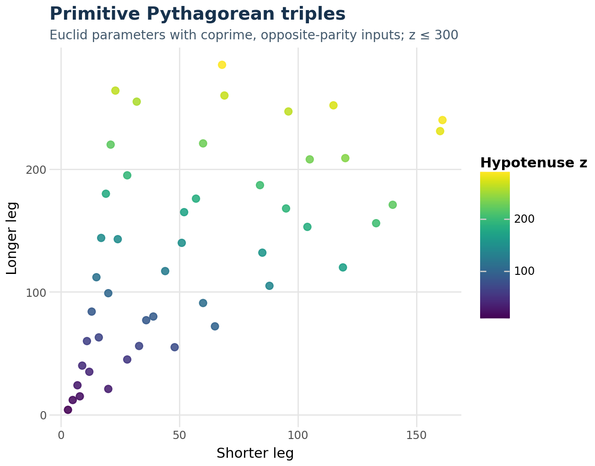

# Diophantine Equations {#sec-diophantine}

<div class="chapter-goals">

**Learning goals.** Parametrise linear integer equations; apply sign constraints and modular obstructions; classify primitive Pythagorean triples; recognize infinite descent; distinguish necessary local conditions from global solvability.

</div>

A Diophantine equation asks for integer or rational solutions rather than arbitrary real ones. This change of domain transforms flexible curves into rigid arithmetic objects. Sometimes an algorithm lists every solution; sometimes a single congruence proves there are none.

## Linear equations

### Solvability and parametrisation

For integers $a,b,c$, the equation
$$
ax+by=c
$$
has an integer solution exactly when $d=\gcd(a,b)$ divides $c$. If $(x_0,y_0)$ is one solution, every solution is
$$
x=x_0+\frac{b}{d}t,\qquad y=y_0-\frac{a}{d}t,\qquad t\in\mathbb Z.
$$
To prove completeness, subtract two solutions: $a(x-x_0)=-b(y-y_0)$. After dividing by $d$, the remaining coefficients are coprime, so Euclid's lemma forces the stated divisibilities.

For $18x+30y=6$, divide by $6$ to get $3x+5y=1$. One solution is $(2,-1)$, hence
$$
x=2+5t,\qquad y=-1-3t.
$$

### Positivity constraints

Applications may require $x,y\ge0$. Insert the parametrisation and solve inequalities for the integer parameter. For $7x+11y=100$, extended Euclid or inspection gives $(x_0,y_0)=(8,4)$. All solutions are $x=8+11t$, $y=4-7t$. Nonnegativity forces $t=0$, so the only nonnegative solution is $(8,4)$.

Boundary words matter: “positive” excludes zero; “nonnegative” includes it. A complete answer must apply these restrictions after finding the integer family.

## Congruence obstructions

### Squares and cubes modulo small bases

Squares modulo $4$ are $0$ or $1$ because an integer is even or odd. Squares modulo $8$ are $0,1,4$; odd squares are always $1$. Cubes modulo $9$ lie among $0,1,8$. Such short lists provide impossibility certificates.

For example, $x^2+y^2=4k+3$ has no integer solutions: each square is $0$ or $1$ modulo $4$, so their sum cannot be $3$. Likewise, $x^2=4y+2$ is impossible because no square is $2$ modulo $4$.

### Local impossibility certificates

Reducing modulo $m$ maps a global integer solution to a local solution. Therefore local insolubility implies global insolubility. Choose a modulus adapted to the expression: parity for coefficients involving $2$, modulo $4$ or $8$ for squares, and a prime dividing a troublesome coefficient.

The method is one-way. A solution modulo every tested $m$ need not lift to an integer solution. Local tests are necessary filters unless a theorem explicitly upgrades them to sufficient conditions.

## Pythagorean triples

### Primitive triples and parity

A Pythagorean triple is a positive integer solution of $x^2+y^2=z^2$. It is primitive when $\gcd(x,y,z)=1$. In a primitive triple, $x$ and $y$ cannot both be odd because then $x^2+y^2\equiv2\pmod4$, not a square. They cannot both be even by primitivity. Thus exactly one leg is even, and the hypotenuse is odd.

Every nonprimitive triple is a positive multiple of a primitive one, so classification reduces to the primitive case.

### Euclid's parametrisation

Assume $y$ is even. From $x^2+y^2=z^2$,
$$
\left(\frac y2\right)^2=\frac{z+x}{2}\frac{z-x}{2}.
$$
The two factors on the right are coprime: any common divisor divides both $z$ and $x$, and parity rules remove a factor of $2$. A product of coprime positive integers is a square only when each factor is a square. Hence
$$
\frac{z+x}{2}=m^2,\qquad \frac{z-x}{2}=n^2
$$
for coprime $m>n$ of opposite parity. Therefore
$$
x=m^2-n^2,\qquad y=2mn,\qquad z=m^2+n^2.
$$
Conversely these formulas always satisfy the equation, and the coprimality and parity conditions make the triple primitive.

<figure id="fig-triples">


<figcaption>

Figure 6.1: Primitive Pythagorean triples with hypotenuse at most 300, plotted by their two legs and coloured by hypotenuse.

</figcaption>
</figure>

[Figure 6.1](#fig-triples) displays only primitive triples and orders the legs so $x<y$. Their sparse placement contrasts with the continuous quarter-circles of real solutions. Euclid's parameters explain every plotted point rather than merely generating examples.

## Descent

### The shape of an infinite descent

An infinite descent assumes a positive integer solution exists, selects one minimal in a declared measure, and constructs a strictly smaller solution. Well-ordering forbids the resulting infinite chain. The measure may be a hypotenuse, denominator, or absolute value; it must remain a positive integer.

Fermat used descent to prove that no right triangle with positive integer sides has square area. The complete argument transforms a hypothetical minimal triangle into a smaller one via the parametrisation above. The lesson is architectural: classification can create the smaller object needed for contradiction.

### A case study: no square triangular obstruction

Care is needed with slogans. Some numbers are both square and triangular: $1,36,1225,\ldots$. Thus “no square triangular number” would be false. A valid descent-style statement is that there is no positive square triangular number lying strictly between consecutive squares, which is immediate from ordering. Always formulate the target before invoking a famous method.

A genuine elementary descent shows $\sqrt2$ irrational: a lowest-term fraction produces a smaller equivalent fraction after both numerator and denominator are shown even. The “smaller solution” is the halved pair.

## Sums of squares and representation questions

Which positive integers equal $x^2+y^2$? The congruence observation excludes any integer containing a prime $p\equiv3\pmod4$ to an odd exponent. The full **sum-of-two-squares theorem**, proved conceptually in [sec-algebraic](13-algebraic.md#sec-algebraic), says this condition is also sufficient:
$$
n=x^2+y^2 \quad\Longleftrightarrow\quad
v_p(n)\text{ is even for every prime }p\equiv3\pmod4.
$$
Here $x$ or $y$ may be zero. The theorem is global, yet its criterion is expressed through local prime factors.

## What local tests cannot decide

The equation $x^2-13y^2=-4$ has solutions modulo many small moduli; finding or excluding integer solutions needs more structure than a few residue tables. Conversely, some equation families satisfy a local-to-global principle. Quadratic forms in sufficiently many variables are governed by deep local criteria, while higher-degree curves can violate naive versions dramatically.

<div class="callout callout-warning">
<p class="callout-title">Pitfall: passing tests is not solving</p>

Failure modulo one modulus proves global failure. Success modulo ten, a hundred, or every modulus tested proves only those local successes unless a stated theorem supplies the converse.

</div>

<!-- inline-formula-code:start -->
## Formula and finite computation

A useful formula in this chapter is

$$
sa+tb=\gcd(a,b)
$$

The returned coefficients are an independently checkable Bézout certificate. The following standalone Python block expresses that finite rule with its inputs and stopping conditions visible.

```python
def extended_gcd(first_integer: int, second_integer: int) -> tuple[int, int, int]:
    """Return g, s, t with s*first_integer + t*second_integer = g >= 0."""
    if first_integer == 0 and second_integer == 0:
        raise ValueError("at least one input must be nonzero")
    old_r, r = abs(first_integer), abs(second_integer)
    old_s, s = 1, 0
    old_t, t = 0, 1
    while r != 0:
        quotient = old_r // r
        old_r, r = r, old_r - quotient * r
        old_s, s = s, old_s - quotient * s
        old_t, t = t, old_t - quotient * t
    sign_a = -1 if first_integer < 0 else 1
    sign_b = -1 if second_integer < 0 else 1
    return old_r, old_s * sign_a, old_t * sign_b

g, s, t = extended_gcd(252, 198)
print(g, s, t, s * 252 + t * 198)
```

**What the computation establishes.** The calculation checks a declared finite instance; the surrounding argument explains what is true beyond those inputs.
<!-- inline-formula-code:end -->

## Summary

- Linear Diophantine equations are controlled completely by a gcd and one parameter.
- Congruence obstructions are short, rigorous nonexistence proofs.
- Primitive Pythagorean triples are exactly Euclid's parametrised triples with coprime, opposite-parity parameters.
- Descent needs an explicit positive measure that strictly decreases.
- Local solvability is generally necessary but not automatically sufficient.

## Exercises

<div class="exercise" id="number_theory-06-diophantine-ex-1">
<p class="exercise-title"><strong>Exercise 1</strong></p>

Parametrise all solutions of $84x+33y=6$.

</div>

<div class="exercise" id="number_theory-06-diophantine-ex-2">
<p class="exercise-title"><strong>Exercise 2</strong></p>

Find all nonnegative solutions of $9x+14y=160$.

<details class="hint"><summary>Hint 1</summary>

find one solution modulo $14$, parametrise, then impose two inequalities.

</details>

</div>

<div class="exercise" id="number_theory-06-diophantine-ex-3">
<p class="exercise-title"><strong>Exercise 3</strong></p>

Prove that $x^2+y^2=8k+6$ has no integer solutions.

<details class="hint"><summary>Hint 1</summary>

list square residues modulo $8$.

</details>

</div>

<div class="exercise" id="number_theory-06-diophantine-ex-4">
<p class="exercise-title"><strong>Exercise 4</strong></p>

List all primitive Pythagorean triples with $m\le8$.

</div>

<div class="exercise" id="number_theory-06-diophantine-ex-5">
<p class="exercise-title"><strong>Exercise 5</strong></p>

Prove that Euclid's formula always gives a Pythagorean triple.

</div>

<div class="exercise" id="number_theory-06-diophantine-ex-6">
<p class="exercise-title"><strong>Exercise 6</strong></p>

Show that a primitive triple has exactly one even leg.

</div>

<div class="exercise" id="number_theory-06-diophantine-ex-7">
<p class="exercise-title"><strong>Exercise 7</strong></p>

Decide which of $45,65,75,85$ pass the sum-of-two-squares prime-exponent criterion, and find representations when possible.

<details class="hint"><summary>Hint 1</summary>

use the parity of exponents of primes congruent to $3$ modulo $4$.

</details>

</div>

<div class="exercise" id="number_theory-06-diophantine-ex-8">
<p class="exercise-title"><strong>Exercise 8</strong></p>

Find solutions to $x^2+y^2\equiv3\pmod5$ or prove none exist; then explain exactly what this says globally.

</div>
