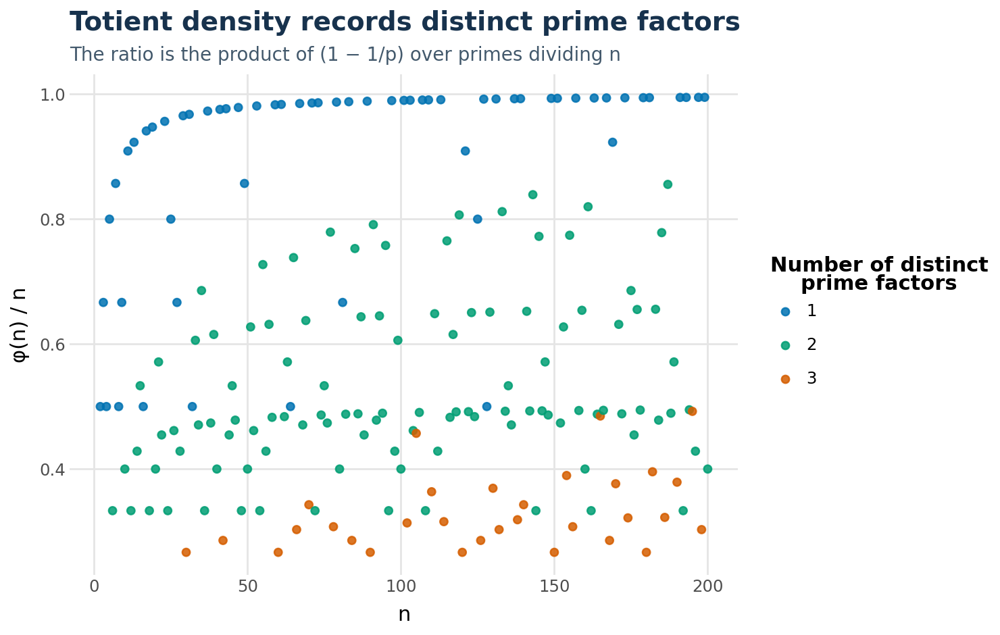

# Arithmetic Functions {#sec-functions}

<div class="chapter-goals">

**Learning goals.** Compute $\tau$, $\sigma$, and $\varphi$ from prime factorisation; distinguish multiplicative from completely multiplicative functions; use Dirichlet convolution and the Möbius function; prove and apply Möbius inversion; interpret finite average data.

</div>

An arithmetic function assigns a complex number to each positive integer. The most useful examples encode factorisation indirectly: they count divisors, measure units, or attach signs to squarefree products. Their identities turn unique factorisation into a calculus.

## Functions built from divisors

### The functions $\tau$, $\sigma$, and $\varphi$

Write $\tau(n)$ for the number of positive divisors, $\sigma(n)$ for their sum, and $\varphi(n)$ for the number of integers in $\{1,\ldots,n\}$ coprime to $n$. For $n=12$, the divisors are $1,2,3,4,6,12$, so $\tau(12)=6$ and $\sigma(12)=28$. The units represented in $1$ through $12$ are $1,5,7,11$, so $\varphi(12)=4$.

If $n=\prod p_i^{a_i}$, every divisor chooses an exponent from $0$ through $a_i$ independently. Therefore
$$
\tau(n)=\prod_i(a_i+1),\qquad
\sigma(n)=\prod_i(1+p_i+\cdots+p_i^{a_i}).
$$
The formulas include $n=1$: the empty products equal $1$, agreeing with the single divisor $1$.

### Multiplicative versus completely multiplicative

An arithmetic function $f$ is multiplicative when $f(1)=1$ and
$$
f(mn)=f(m)f(n)\quad\text{whenever }\gcd(m,n)=1.
$$
It is completely multiplicative if the equation holds without the coprimality condition. Both $\tau$ and $\sigma$ are multiplicative, because divisors of coprime products split uniquely, but neither is completely multiplicative: $\tau(4)=3\ne4=\tau(2)^2$.

The function $n\mapsto n^s$ is completely multiplicative for fixed $s$. Multiplicative functions are determined by their values on prime powers; completely multiplicative ones are determined just by their prime values.

## Euler's totient function

### Counting units

The totient counts the unit group $(\mathbb Z/n\mathbb Z)^\times$. For a prime power $p^a$, precisely the multiples of $p$ fail to be units. Among $1,\ldots,p^a$, there are $p^{a-1}$ such multiples, hence
$$
\varphi(p^a)=p^a-p^{a-1}=p^a\left(1-\frac1p\right).
$$
CRT gives an isomorphism of unit groups for coprime moduli, so $\varphi$ is multiplicative.

### Product formula and inclusion-exclusion

Combining prime powers yields
$$
\varphi(n)=n\prod_{p\mid n}\left(1-\frac1p\right).
$$
Inclusion-exclusion gives the same result: start with $n$ candidates, remove multiples of each distinct prime factor, restore intersections of two removed sets, and continue.

For $n=360=2^3 3^2 5$,
$$
\varphi(360)=360\left(1-\frac12\right)\left(1-\frac13\right)\left(1-\frac15\right)=96.
$$

<figure id="fig-totient">


<figcaption>

Figure 7.1: Values of the ratio phi(n)/n for n up to 200, grouped by the number of distinct prime factors.

</figcaption>
</figure>

[Figure 7.1](#fig-totient) visualises the product formula. Prime values lie near $1$, while integers with several distinct small prime factors have smaller ratios. The bands reflect factor sets, not a smooth trend in $n$.

## Divisor sums

### Prime-power formulas

The geometric sum gives
$$
\sigma(p^a)=1+p+\cdots+p^a=\frac{p^{a+1}-1}{p-1}.
$$
Multiplicativity then computes $\sigma(n)$ without listing divisors. For $72=2^3 3^2$,
$$
\sigma(72)=(1+2+4+8)(1+3+9)=15\cdot13=195.
$$

More generally, $\sigma_k(n)=\sum_{d\mid n}d^k$ is multiplicative. The case $k=0$ is $\tau$, and $k=1$ is $\sigma$.

### Perfect and abundant numbers

A positive integer is perfect when the sum of its proper positive divisors equals itself, equivalently $\sigma(n)=2n$. It is deficient if $\sigma(n)<2n$ and abundant if $\sigma(n)>2n$. The smallest perfect numbers are $6$ and $28$.

**Theorem 7.1 (Euclid–Euler (stated)).** An even number is perfect exactly when it has the form
$$
2^{p-1}(2^p-1)
$$
where $2^p-1$ is prime. Whether any odd perfect number exists is an open problem. Extensive necessary conditions and computational searches do not constitute a nonexistence proof.

## Dirichlet convolution

### Identity elements and inverses

For arithmetic functions $f,g$, define
$$
(f*g)(n)=\sum_{d\mid n}f(d)g(n/d).
$$
This Dirichlet convolution is commutative and associative. Its identity is $\varepsilon$, where $\varepsilon(1)=1$ and $\varepsilon(n)=0$ for $n>1$. The constant-one function, denoted $\mathbf1$, satisfies
$$
(\mathbf1*\mathbf1)(n)=\tau(n),\qquad
(\operatorname{id}*\mathbf1)(n)=\sigma(n),
$$
where $\operatorname{id}(n)=n$.

The divisor sum in the definition is already a finite algorithm once the
positive divisors of $n$ are enumerated.

```python
from collections.abc import Callable
from math import isqrt

def positive_divisors(integer: int) -> list[int]:
    """Return all positive divisors in increasing order."""
    if integer <= 0:
        raise ValueError("integer must be positive")
    small: list[int] = []
    large: list[int] = []
    for candidate in range(1, isqrt(integer) + 1):
        if integer % candidate == 0:
            small.append(candidate)
            paired = integer // candidate
            if paired != candidate:
                large.append(paired)
    return small + large[::-1]

def dirichlet_convolution(
    left_function: Callable[[int], int],
    right_function: Callable[[int], int],
    integer: int,
) -> int:
    """Evaluate one Dirichlet convolution value exactly."""
    return sum(
        left_function(divisor) * right_function(integer // divisor)
        for divisor in positive_divisors(integer)
    )

divisor_count = dirichlet_convolution(lambda divisor: 1, lambda quotient: 1, 72)
divisor_sum = dirichlet_convolution(
    lambda divisor: divisor, lambda quotient: 1, 72
)
print(divisor_count, divisor_sum)
```

The program returns $\tau(72)=12$ and $\sigma(72)=195$ using the displayed
definition.  It evaluates one finite convolution; associativity and
multiplicativity are algebraic statements that still require proof.

If $f(1)\ne0$, it has a convolution inverse, determined recursively. Convolution preserves multiplicativity, so complicated divisor sums can often be reduced prime-power by prime-power.

### The Möbius function

Define
$$
\mu(n)=
\begin{cases}
1,&n=1,\\
(-1)^r,&n\text{ is a product of }r\text{ distinct primes},\\
0,&n\text{ is divisible by a square greater than }1.
\end{cases}
$$
For a prime power, $\mu(p)=-1$ and $\mu(p^a)=0$ for $a\ge2$. Expanding over subsets of distinct prime factors shows
$$
\sum_{d\mid n}\mu(d)=
\begin{cases}1,&n=1,\\0,&n>1.\end{cases}
$$
Thus $\mu*\mathbf1=\varepsilon$: Möbius is the convolution inverse of the constant-one function.

## Möbius inversion

### Divisor-lattice inversion

**Möbius inversion.** If
$$
F(n)=\sum_{d\mid n}f(d),
$$
then
$$
f(n)=\sum_{d\mid n}\mu(d)F(n/d).
$$
In convolution notation, $F=\mathbf1*f$. Convolving both sides with $\mu$ gives $\mu*F=(\mu*\mathbf1)*f=\varepsilon*f=f$.

This is inclusion-exclusion organized by divisibility. The zero values of $\mu$ discard repeated prime exclusions; its signs correct overcounting among distinct primes.

### Counting primitive objects

Every word of length $n$ over an alphabet of $q$ symbols is a power of a unique primitive word (one that is not itself a proper power), whose length $d$ divides $n$. Let $P(d)$ count primitive words of length $d$. Then
$$
q^n=\sum_{d\mid n}P(d),
$$
so
$$
P(n)=\sum_{d\mid n}\mu(d)q^{n/d}.
$$
The same pattern counts primitive necklaces after additionally accounting for rotations. The important modeling step is identifying a unique “primitive size” dividing the total size.

## Average behaviour in a finite window

The jaggedness of arithmetic functions is not noise; it records factorisation. Still, averages can be regular. A double count gives
$$
\sum_{n\le x}\tau(n)=\sum_{d\le x}\left\lfloor\frac{x}{d}\right\rfloor,
$$
because both sides count pairs $(d,m)$ with $dm\le x$. Replacing floors heuristically by $x/d$ suggests an average order near $\log x$. Proving a precise error term requires analysis, but the exact double-count identity already explains the scale.

<div class="callout callout-warning">
<p class="callout-title">Pitfall: multiplicative does not mean additive</p>

The word “multiplicative” describes behavior on coprime products. It does not say $f(m+n)=f(m)+f(n)$, nor does it permit $f(p^2)=f(p)^2$ without complete multiplicativity.

</div>

<!-- inline-formula-code:start -->
## Formula and finite computation

A useful formula in this chapter is

$$
\varphi(n)=n\prod_{p\mid n}\left(1-\frac1p\right)
$$

The implementation removes each distinct prime factor once, matching the product. The following standalone Python block expresses that finite rule with its inputs and stopping conditions visible.

```python
from math import gcd

def totient(number: int) -> int:
    """Return Euler's totient by exact trial division."""
    if number <= 0:
        raise ValueError("number must be positive")
    result = number
    remaining = number
    prime = 2
    while prime * prime <= remaining:
        if remaining % prime == 0:
            result -= result // prime
            while remaining % prime == 0:
                remaining //= prime
        prime = 3 if prime == 2 else prime + 2
    if remaining > 1:
        result -= result // remaining
    return result

for number in (1, 8, 12, 36):
    direct = sum(gcd(candidate, number) == 1 for candidate in range(1, number + 1))
    print(number, totient(number), direct)
```

**What the computation establishes.** The calculation checks a declared finite instance; the surrounding argument explains what is true beyond those inputs.
<!-- inline-formula-code:end -->

## Summary

- Prime-power values determine multiplicative functions.
- $\varphi(n)/n$ is a product over distinct prime divisors.
- Dirichlet convolution packages divisor sums into an algebra.
- The Möbius function is the convolution inverse of the constant-one function.
- Möbius inversion recovers primitive counts from cumulative divisor counts.

## Exercises

<div class="exercise" id="number_theory-07-functions-ex-1">
<p class="exercise-title"><strong>Exercise 1</strong></p>

Compute $\tau(7560)$, $\sigma(7560)$, and $\varphi(7560)$ from its factorisation.

</div>

<div class="exercise" id="number_theory-07-functions-ex-2">
<p class="exercise-title"><strong>Exercise 2</strong></p>

Prove that $\tau$ is multiplicative by matching divisors.

<details class="hint"><summary>Hint 1</summary>

a divisor of $mn$ has a unique product $d_1d_2$ with $d_1\mid m$, $d_2\mid n$ when $m,n$ are coprime.

</details>

</div>

<div class="exercise" id="number_theory-07-functions-ex-3">
<p class="exercise-title"><strong>Exercise 3</strong></p>

Show that $\varphi(pq)=(p-1)(q-1)$ for distinct primes.

</div>

<div class="exercise" id="number_theory-07-functions-ex-4">
<p class="exercise-title"><strong>Exercise 4</strong></p>

Compute $\mu(n)$ for $1\le n\le20$.

</div>

<div class="exercise" id="number_theory-07-functions-ex-5">
<p class="exercise-title"><strong>Exercise 5</strong></p>

Verify $\sum_{d\mid12}\mu(d)=0$ directly.

</div>

<div class="exercise" id="number_theory-07-functions-ex-6">
<p class="exercise-title"><strong>Exercise 6</strong></p>

Prove $\sum_{d\mid n}\varphi(d)=n$ by classifying fractions $k/n$ by reduced denominator.

<details class="hint"><summary>Hint 1</summary>

the gcd of $k$ and $n$ determines the reduced denominator of $k/n$.

</details>

<details class="solution"><summary>Solution</summary>

Classify the integers $k=1,\ldots,n$ by the reduced denominator of $k/n$. If $g=\gcd(k,n)$, then
$$
\frac{k}{n}=\frac{k/g}{n/g},
$$
whose denominator $d=n/g$ divides $n$ and whose numerator is coprime to $d$. For a fixed divisor $d\mid n$, exactly $\varphi(d)$ reduced numerators from $1$ through $d$ occur. Every $k$ belongs to one class, so counting all $n$ choices gives
$$
n=\sum_{d\mid n}\varphi(d).
$$

</details>

</div>

<div class="exercise" id="number_theory-07-functions-ex-7">
<p class="exercise-title"><strong>Exercise 7</strong></p>

Use inversion on the preceding identity to express $\varphi(n)$ with $\mu$.

</div>

<div class="exercise" id="number_theory-07-functions-ex-8">
<p class="exercise-title"><strong>Exercise 8</strong></p>

Count primitive binary words of length $6$ (words that are not a proper power of a shorter word).

<details class="hint"><summary>Hint 1</summary>

use $P(6)=\sum_{d\mid6}\mu(d)2^{6/d}$.

</details>

</div>
