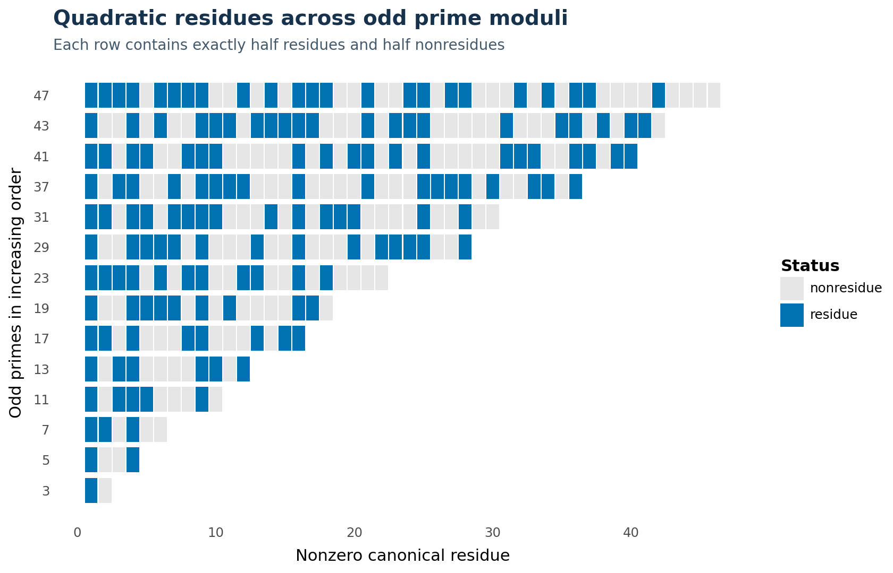

# Quadratic Residues {#sec-residues}

<div class="chapter-goals">

**Learning goals.** Classify nonzero squares modulo an odd prime; use Euler's criterion and the Legendre symbol; apply both supplementary laws and quadratic reciprocity; distinguish Legendre and Jacobi symbols; find square roots in simple cases.

</div>

Linear congruences are governed by gcds. Quadratic congruences reveal a subtler symmetry: whether a prime regards another integer as a square. Quadratic reciprocity turns that apparently one-sided question into a relation between two primes.

## Squares modulo an odd prime

### Residues, nonresidues, and symmetry

An integer $a$ is a quadratic residue modulo an odd prime $p$ if $a\not\equiv0\pmod p$ and $x^2\equiv a\pmod p$ for some $x$. Otherwise a nonzero $a$ is a quadratic nonresidue. Among the $p-1$ nonzero classes, exactly $(p-1)/2$ are residues: the squares of $1,\ldots,(p-1)/2$ are distinct, and $x^2=(-x)^2$ pairs the remaining inputs.

Modulo $11$, the nonzero squares are
$$
1^2,2^2,3^2,4^2,5^2\equiv1,4,9,5,3.
$$
Thus $3$ is a residue and $2$ a nonresidue. Every nonzero residue has exactly two square roots, $x$ and $-x$.

### Euler's criterion

**Euler's criterion.** If $p$ is an odd prime and $p\nmid a$, then
$$
a^{(p-1)/2}\equiv
\begin{cases}
1\pmod p,&a\text{ is a quadratic residue},\\
-1\pmod p,&a\text{ is a quadratic nonresidue}.
\end{cases}
$$
If $a=x^2$, Fermat gives $a^{(p-1)/2}=x^{p-1}\equiv1$. For the converse and the nonresidue case, the polynomial $X^{(p-1)/2}-1$ has at most $(p-1)/2$ roots in the field $\mathbb F_p$; the known squares already fill that quota. Fermat says every nonzero class is a root of $(X^{(p-1)/2}-1)(X^{(p-1)/2}+1)$, leaving $-1$ for the rest.

## The Legendre symbol

### Definition and multiplicativity

For odd prime $p$, define
$$
\left(\frac ap\right)=
\begin{cases}
0,&p\mid a,\\
1,&a\text{ is a nonzero square modulo }p,\\
-1,&a\text{ is a nonresidue modulo }p.
\end{cases}
$$
Euler's criterion says $(a/p)\equiv a^{(p-1)/2}\pmod p$. Consequently
$$
\left(\frac{ab}{p}\right)=\left(\frac ap\right)\left(\frac bp\right).
$$
The equality is between integers $-1,0,1$, after the congruence identifies the correct sign.

<figure id="fig-residue-map">


<figcaption>

Figure 8.1: Quadratic residuosity for nonzero classes modulo odd primes up to 47, with residues and nonresidues in contrasting colours.

</figcaption>
</figure>

The half-filled rows of [Figure 8.1](#fig-residue-map) show the exact $(p-1)/2$ count. No simple monotone pattern identifies the marked positions, which is why structural laws such as reciprocity are valuable.

### Supplementary laws for minus one and two

The first supplementary law is
$$
\left(\frac{-1}{p}\right)=(-1)^{(p-1)/2}=
\begin{cases}1,&p\equiv1\pmod4,\\-1,&p\equiv3\pmod4.\end{cases}
$$
It follows directly from Euler's criterion. Thus $x^2\equiv-1\pmod p$ is solvable exactly for primes $p\equiv1\pmod4$.

The second is
$$
\left(\frac2p\right)=(-1)^{(p^2-1)/8}=
\begin{cases}1,&p\equiv1,7\pmod8,\\-1,&p\equiv3,5\pmod8.\end{cases}
$$
Its proof follows from Gauss's lemma by counting which of $2,4,\ldots,p-1$ cross the midpoint $p/2$ when reduced.

## Quadratic reciprocity

### Statement and computational use

**Quadratic reciprocity.** For distinct odd primes $p,q$,
$$
\left(\frac pq\right)\left(\frac qp\right)=(-1)^{((p-1)/2)((q-1)/2)}.
$$
Thus the symbols are equal unless both primes are $3$ modulo $4$, in which case their signs are opposite.

To decide whether $29$ is a square modulo $53$, reciprocity gives
$$
\left(\frac{29}{53}\right)=\left(\frac{53}{29}\right)
=\left(\frac{24}{29}\right)
=\left(\frac{2}{29}\right)^3\left(\frac3{29}\right).
$$
The first factor is $-1$. Reciprocity gives $(3/29)=(29/3)=(2/3)=-1$, so the product is $1$: square roots exist.

### Gauss's lemma proof route

Gauss's lemma says $(a/p)=(-1)^m$, where $m$ counts the least absolute residues of
$$
a,2a,\ldots,\frac{p-1}{2}a
$$
that are negative. Multiplying these residues in two ways proves the lemma. Applying it with $a=q$ translates $(q/p)$ into a lattice-point count under a line; swapping $p$ and $q$ compares complementary counts and yields reciprocity.

### A lattice-point interpretation

In the rectangle $1\le i\le(p-1)/2$, $1\le j\le(q-1)/2$, the line $qi=pj$ passes through no lattice point because $p,q$ are distinct primes. Every grid point lies strictly on one side. The two Gauss counts partition the rectangle, whose parity is $((p-1)/2)((q-1)/2)$. This parity is the sign in reciprocity. The geometric count is a proof skeleton; filling it in requires matching each side precisely to the lemma.

## Square roots modulo primes

When $p\equiv3\pmod4$ and $(a/p)=1$, a square root is especially simple:
$$
x\equiv a^{(p+1)/4}\pmod p,
$$
because $x^2=a^{(p+1)/2}=a\,a^{(p-1)/2}\equiv a$. For other odd primes, algorithms such as Tonelli–Shanks use the factorisation of $p-1$ and a known nonresidue. The existence test and the construction problem are related but distinct.

For $a=5,p=11$, compute $x=5^3=125\equiv4$; indeed $4^2\equiv5\pmod{11}$, and the other root is $7$.

### Construction beyond the easy congruence class

When $p\equiv1\pmod4$, the exponent $(p+1)/4$ is not an integer, so the preceding shortcut does not apply. The **Tonelli–Shanks algorithm** handles every odd prime. Write
$$
p-1=2^s q,\qquad q\text{ odd},
$$
choose a quadratic nonresidue, and repeatedly reduce the power-of-two part of the order of a suitable element. The algorithm is finite and efficient once modular exponentiation and a nonresidue are available. Its bookkeeping is longer than the $p\equiv3\pmod4$ formula, but the conceptual ingredients are exactly those already developed: cyclic groups, orders, and repeated squaring.

Three questions should be kept separate. Euler's criterion decides whether a root exists. An algorithm constructs one root. Negation then gives the other root modulo an odd prime. A certificate such as $x^2\equiv a\pmod p$ is cheap to verify even when finding $x$ required more work.

## Composite moduli and the Jacobi symbol

For odd positive $n=\prod p_i^{e_i}$, the Jacobi symbol is
$$
\left(\frac an\right)=\prod_i\left(\frac a{p_i}\right)^{e_i}.
$$
Its reciprocity laws permit fast calculation without displaying the factorisation. But $(a/n)=1$ does **not** guarantee that $a$ is a square modulo composite $n$. For example,
$$
\left(\frac2{15}\right)=\left(\frac23\right)\left(\frac25\right)=(-1)(-1)=1,
$$
yet $2$ is not a square modulo $3$, hence cannot be a square modulo $15$.

## Counting roots over composite moduli

### Independent sign choices through CRT

Suppose $n=p_1\cdots p_r$ is squarefree and odd, and $\gcd(a,n)=1$. If $a$ is a square modulo every $p_i$, then there are two local roots modulo each prime. CRT combines the independent choices, producing exactly $2^r$ roots modulo $n$. If even one local congruence is insoluble, there are no global roots.

For $x^2\equiv1\pmod{15}$, choose a sign modulo $3$ and independently a sign modulo $5$. CRT turns the four sign pairs into
$$
x\equiv1,4,11,14\pmod{15}.
$$
The two “extra” roots $4$ and $11$ are why a quadratic can have more than two roots over a composite modulus. In cryptographic settings, recovering different square roots can reveal a factor of the modulus: if $x^2\equiv y^2\pmod n$ but $x\not\equiv\pm y\pmod n$, then $n$ divides $(x-y)(x+y)$ without generally dividing either factor, and gcds can expose a proper divisor.

Repeated prime factors require more care. A solution modulo $p$ may lift uniquely, split into several solutions, or fail to lift, depending on whether the derivative vanishes modulo $p$.

## Lifting roots to prime powers

### The simple-root form of Hensel's lemma

Let $f(X)\in\mathbb Z[X]$. Suppose
$$
f(r_1)\equiv0\pmod p,
\qquad
f'(r_1)\not\equiv0\pmod p.
$$
Then for every $k\ge1$ there is a unique residue $r_k$ modulo $p^k$ with $r_k\equiv r_1\pmod p$ and $f(r_k)\equiv0\pmod{p^k}$. This is the simple-root version of **Hensel's lemma**.

The lifting step is concrete. Given a root $r_k$ modulo $p^k$, seek
$$
r_{k+1}=r_k+t p^k,\qquad t\in\{0,\ldots,p-1\}.
$$
Taylor expansion modulo $p^{k+1}$ gives
$$
f(r_k+t p^k)\equiv f(r_k)+t p^k f'(r_k)\pmod{p^{k+1}}.
$$
After dividing the required congruence by $p^k$, one linear equation modulo $p$ determines $t$ uniquely because $f'(r_k)$ is invertible.

For $f(X)=X^2-a$, a nonzero root modulo an odd $p$ has derivative $2r\not\equiv0\pmod p$. Hence each of the two roots lifts uniquely to every $p^k$. Combining these lifts with CRT gives the same $2^r$ count for units modulo an arbitrary odd modulus with $r$ distinct prime divisors.

### What happens at a multiple root

If $f'(r)\equiv0\pmod p$, the uniqueness conclusion is unavailable. For example, $x^2\equiv0\pmod{p^2}$ has all roots $x\equiv0\pmod p$, so one root modulo $p$ expands to $p$ roots modulo $p^2$. In other problems a multiple root disappears at the next level. One must inspect the valuations of both $f(r)$ and $f'(r)$ or use a stronger form of Hensel's lemma; chanting “Hensel” without checking its hypotheses is not a proof.

<div class="callout callout-warning">
<p class="callout-title">Pitfall: a symbol is not a fraction</p>

Legendre and Jacobi symbols take the values $-1,0,1$. Algebraic-looking numerator and denominator notation does not permit ordinary fraction operations.

</div>

<!-- inline-formula-code:start -->
## Formula and finite computation

A useful formula in this chapter is

$$
R_m=\{x^2\bmod m:0\le x<m\}
$$

A set comprehension is the literal finite version of this set-builder formula. The following standalone Python block expresses that finite rule with its inputs and stopping conditions visible.

```python
def square_root_counts(modulus: int) -> dict[int, int]:
    """Count square roots of each residue modulo modulus."""
    if modulus <= 1:
        raise ValueError("modulus must be greater than one")
    counts = {residue: 0 for residue in range(modulus)}
    for value in range(modulus):
        counts[(value * value) % modulus] += 1
    return counts

counts = square_root_counts(11)
print([residue for residue, count in counts.items() if count > 0])
print(counts)
```

**What the computation establishes.** The calculation checks a declared finite instance; the surrounding argument explains what is true beyond those inputs.
<!-- inline-formula-code:end -->

## Summary

- Exactly half the nonzero classes modulo an odd prime are squares.
- Euler's criterion turns residuosity into modular exponentiation.
- The Legendre symbol is multiplicative, and two supplementary laws handle $-1$ and $2$.
- Quadratic reciprocity swaps numerator and prime denominator with a controlled sign.
- A Jacobi symbol of $1$ is not, by itself, a square certificate for composite modulus.
- CRT turns local square roots into independent global choices.
- A simple root modulo $p$ lifts uniquely to every power of $p$.

## Exercises

<div class="exercise" id="number_theory-08-residues-ex-1">
<p class="exercise-title"><strong>Exercise 1</strong></p>

List all squares modulo $13$ and their roots.

</div>

<div class="exercise" id="number_theory-08-residues-ex-2">
<p class="exercise-title"><strong>Exercise 2</strong></p>

Use Euler's criterion to compute $(7/19)$.

</div>

<div class="exercise" id="number_theory-08-residues-ex-3">
<p class="exercise-title"><strong>Exercise 3</strong></p>

Decide whether $-1$ and $2$ are squares modulo $41$.

</div>

<div class="exercise" id="number_theory-08-residues-ex-4">
<p class="exercise-title"><strong>Exercise 4</strong></p>

Use reciprocity to compute $(47/101)$.

<details class="hint"><summary>Hint 1</summary>

reciprocity swaps $47$ and $101$ without a sign because $101\equiv1\pmod4$; then reduce.

</details>

<details class="solution"><summary>Solution</summary>

Compute $(47/101)$. Since $101\equiv1\pmod4$, reciprocity introduces no sign:
$$
\left(\frac{47}{101}\right)=\left(\frac{101}{47}\right)
=\left(\frac7{47}\right).
$$
Both $7$ and $47$ are $3$ modulo $4$, so swapping introduces a minus sign:
$$
\left(\frac7{47}\right)=-\left(\frac{47}{7}\right)
=-\left(\frac5{7}\right).
$$
Because $5\equiv1\pmod4$, swap again without a sign:
$$
\left(\frac5{7}\right)=\left(\frac7{5}\right)=\left(\frac2{5}\right)=-1.
$$
Therefore $(47/101)=1$, so $47$ is a quadratic residue modulo $101$.

</details>

</div>

<div class="exercise" id="number_theory-08-residues-ex-5">
<p class="exercise-title"><strong>Exercise 5</strong></p>

Find square roots of $9$ modulo $19$ using the $p\equiv3\pmod4$ formula.

</div>

<div class="exercise" id="number_theory-08-residues-ex-6">
<p class="exercise-title"><strong>Exercise 6</strong></p>

Prove multiplicativity of the Legendre symbol from Euler's criterion.

<details class="hint"><summary>Hint 1</summary>

compare $(ab)^{(p-1)/2}$ with the two separate powers.

</details>

</div>

<div class="exercise" id="number_theory-08-residues-ex-7">
<p class="exercise-title"><strong>Exercise 7</strong></p>

Find another $a,n$ with Jacobi symbol $1$ but no square root modulo $n$.

</div>

<div class="exercise" id="number_theory-08-residues-ex-8">
<p class="exercise-title"><strong>Exercise 8</strong></p>

Explain how CRT reduces square roots modulo a squarefree composite to roots modulo its prime factors.

<details class="hint"><summary>Hint 1</summary>

choose roots independently modulo each prime, then apply CRT; count the sign choices.

</details>

</div>
