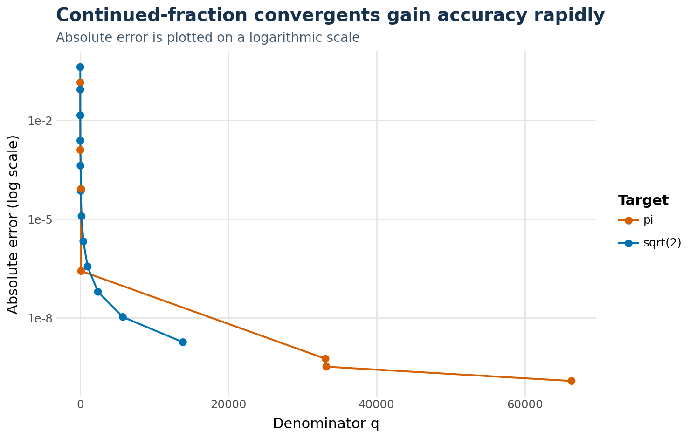

# Continued Fractions and Rational Approximation {#sec-fractions}

<div class="chapter-goals">

**Learning goals.** Convert Euclidean quotients into finite continued fractions; compute convergents by recurrence; prove determinant and error identities; explain best approximation; recognize periodic expansions of quadratic irrationals.

</div>

Decimal expansions privilege powers of ten. Continued fractions adapt their denominators to the number being approximated. The Euclidean algorithm supplies the finite theory; limits extend it to irrational numbers.

## Finite simple continued fractions

### Euclid written vertically

A simple continued fraction is
$$
[a_0;a_1,\ldots,a_k]
=a_0+\frac{1}{a_1+\frac{1}{\ddots+\frac{1}{a_k}}},
$$
where $a_0\in\mathbb Z$ and $a_i\in\mathbb N$ for $i\ge1$. For uniqueness one normally requires the final $a_k>1$, since $[\ldots,a_k]=[\ldots,a_k-1,1]$.

Euclid's algorithm for $415/93$ gives quotients $4,2,6,7$, so
$$
\frac{415}{93}=[4;2,6,7].
$$
The successive remainders become reciprocals of fractional parts. Every rational has a finite simple continued fraction because Euclid terminates; conversely every finite expansion is rational.

### Convergents and recurrence relations

The $k$th convergent $p_k/q_k=[a_0;\ldots,a_k]$ can be computed from
$$
p_k=a_kp_{k-1}+p_{k-2},\qquad
q_k=a_kq_{k-1}+q_{k-2},
$$
with $p_{-2}=0,p_{-1}=1,q_{-2}=1,q_{-1}=0$. These recurrences avoid rebuilding nested fractions.

For $\sqrt2=[1;2,2,\ldots]$, the convergents begin
$$
1,\quad\frac32,\quad\frac75,\quad\frac{17}{12},\quad\frac{41}{29}.
$$
Each new numerator and denominator is twice the previous plus the one before.

## Infinite continued fractions

### Irrationality and convergence

An infinite simple continued fraction defines the limit of its convergents. Denominators increase, and the determinant identity
$$
p_kq_{k-1}-p_{k-1}q_k=(-1)^{k-1}
$$
shows consecutive convergents differ by $1/(q_kq_{k-1})$. The even and odd subsequences squeeze toward a common limit.

If the expansion terminated, the value would be rational. Conversely, Euclid applied to a rational terminates. Thus infinite simple continued fractions represent precisely the irrational real numbers.

### Geometric error bounds

The determinant identity implies alternating errors. More precisely,
$$
\left|x-\frac{p_k}{q_k}\right|<\frac1{q_kq_{k+1}}<\frac1{q_k^2}.
$$
The denominator alone therefore certifies strong accuracy. Large next partial quotient $a_{k+1}$ makes $q_{k+1}$ large and the current convergent exceptionally accurate.

<figure id="fig-convergents">


<figcaption>

Figure 9.1: Absolute approximation errors for convergents to square root of 2 and pi, shown on a logarithmic scale against denominator.

</figcaption>
</figure>

[Figure 9.1](#fig-convergents) uses a logarithmic error axis because the improvements span many orders of magnitude. The points for $\pi$ drop unevenly: the famous partial quotient $292$ after $355/113$ creates a particularly accurate convergent. The plot compares selected rational approximations, not decimal algorithms.

## Best approximations

### Determinant identities

Because $p_kq_{k-1}-p_{k-1}q_k=\pm1$, consecutive numerator-denominator pairs are coprime and form a basis of the integer lattice. No fraction with a small denominator can be inserted between them too cheaply: any such lattice point needs sufficiently large coordinates in this basis.

The identity follows by induction from the convergent recurrences. It also gives Bézout coefficients for $p_k$ and $q_k$, proving their fraction is reduced.

### Why convergents are exceptional

A standard best-approximation theorem says: if a reduced fraction $a/b$ satisfies
$$
\left|x-\frac ab\right|<\frac1{2b^2},
$$
then $a/b$ is a convergent of $x$. Another formulation says convergents minimise $|qx-p|$ among denominators up to a relevant bound. The exact definitions of “best” differ, but all express that continued fractions find unusually efficient denominator–accuracy trade-offs.

The theorem is a classification of very good approximations, not a claim that every convergent is closer than every fraction with larger denominator.

### Intermediate convergents fill the gaps

Convergents are the principal landmarks, but fractions between successive landmarks can also be optimal under a denominator constraint. If $a_{k+1}>1$, the **intermediate convergents** are
$$
\frac{m p_k+p_{k-1}}{m q_k+q_{k-1}},
\qquad 1\le m<a_{k+1}.
$$
They interpolate along the line of lattice points joining the directions determined by two consecutive convergents. Depending on the precise definition of “best approximation,” some of these semiconvergents must be included.

For $\sqrt2$, every later partial quotient is $2$. With $p_k/q_k=7/5$, between $3/2$ and $17/12$ the choice $m=1$ gives
$$
\frac{7+3}{5+2}=\frac{10}{7}.
$$
It is not a principal convergent, but it is a natural denominator-limited competitor. This example explains why a theorem about all best approximations needs more precise wording than “the convergents are best.”

## The matrix language

### One matrix per partial quotient

Associate to an integer $a$ the matrix
$$
M(a)=\begin{pmatrix}a&1\\1&0\end{pmatrix}.
$$
The recurrence relations are summarised by the product identity
$$
M(a_0)M(a_1)\cdots M(a_k)
= \begin{pmatrix}
p_k&p_{k-1}\\
q_k&q_{k-1}
\end{pmatrix}.
$$
Because every factor has determinant $-1$, taking determinants immediately yields
$$
p_kq_{k-1}-p_{k-1}q_k=(-1)^{k-1}.
$$
Matrix multiplication also explains why concatenating blocks of partial quotients corresponds to composing fractional-linear maps $x\mapsto(ax+b)/(cx+d)$. A repeating block therefore acts by one fixed matrix, and its limiting value is a fixed point of a fractional-linear transformation—hence a root of a quadratic equation.

### A geometric reading

The columns $(p_k,q_k)$ and $(p_{k-1},q_{k-1})$ form a basis of the integer lattice because their determinant is $\pm1$. Replacing a column by $m$ times it plus the other walks through primitive lattice points in a cone; these are exactly the intermediate convergents. The approximation theorem can thus be read geometrically: a narrow strip around the line $p=xq$ contains no cheaper lattice direction until the continued-fraction construction reaches it.

## Periodic continued fractions

### Quadratic irrationals

The expansion of $\sqrt2$ repeats:
$$
\sqrt2=[1;\overline2].
$$
Indeed, after subtracting $1$ and reciprocating, $1/(\sqrt2-1)=\sqrt2+1$, returning the same fractional state. Similar algebra for $\sqrt D$ produces complete quotients of the form $(\sqrt D+P)/Q$.

### Lagrange's theorem as a vista

**Theorem 9.1 (Lagrange's (stated)).** A real number has an eventually periodic simple continued fraction if and only if it is a quadratic irrational: a real root of an integer quadratic polynomial that is not rational.

The forward direction converts a repeating tail into a fixed-point quadratic equation. The reverse direction proves only finitely many normalized complete quotients can occur, forcing repetition. A full proof belongs in a course on continued fractions, but the theorem's status is established, not conjectural.

## Approximation experiments for square root of two and pi

For $\sqrt2$, partial quotients are uniformly small, and approximation improves steadily. For $\pi=[3;7,15,1,292,\ldots]$, sporadically large coefficients create spectacular individual approximations such as $355/113$. A finite expansion does not reveal whether coefficients obey a simple law; no periodicity is expected for $\pi$, which is transcendental, not quadratic.

## Numerical stability and certified extraction

To extract partial quotients from an exact symbolic number, repeatedly take the floor, subtract it, and invert. With floating-point input, this procedure can become unstable. If the current fractional part is very small, reciprocal formation magnifies its uncertainty. An approximation that lies on the wrong side of an integer boundary may produce a completely different next coefficient.

The remedy is to carry an interval known to contain the target. A partial quotient is certified only when the whole interval has the same floor. After subtraction and reciprocal, reverse interval endpoints as required and continue. If the interval straddles an integer, increase the input precision rather than guessing. Two real numbers that share a long continued-fraction prefix are genuinely close, so disagreement far down the expansion is not evidence that earlier certified digits were wrong.

Rational input has a second boundary issue: the two finite representations $[\ldots,a_k]$ and $[\ldots,a_k-1,1]$ are equal. Requiring the final coefficient to exceed $1$ selects a canonical form. Software comparing expansions should normalize this ambiguity before declaring them different.

<div class="callout callout-warning">
<p class="callout-title">Pitfall: truncating from the wrong end</p>

Evaluate a continued fraction from the last partial quotient upward. Reading it as $a_0+1/a_1+1/a_2+\cdots$ changes the expression entirely.

</div>

<!-- inline-formula-code:start -->
## Formula and finite computation

A useful formula in this chapter is

$$
x=[a_0;a_1,\ldots,a_k]
$$

Repeated quotient and remainder operations produce the finite continued fraction. The following standalone Python block expresses that finite rule with its inputs and stopping conditions visible.

```python
from fractions import Fraction

def rational_continued_fraction(value: Fraction) -> list[int]:
    """Return the finite simple continued fraction of a positive rational."""
    if value <= 0:
        raise ValueError("value must be positive")
    numerator, denominator = value.numerator, value.denominator
    coefficients: list[int] = []
    while denominator != 0:
        quotient, remainder = divmod(numerator, denominator)
        coefficients.append(quotient)
        numerator, denominator = denominator, remainder
    return coefficients

print(rational_continued_fraction(Fraction(415, 93)))
```

**What the computation establishes.** The calculation checks a declared finite instance; the surrounding argument explains what is true beyond those inputs.
<!-- inline-formula-code:end -->

## Summary

- Euclidean quotients are the partial quotients of a rational number.
- Convergent recurrences give coprime numerator-denominator pairs with determinant $\pm1$.
- Error is less than $1/q_k^2$, with especially strong steps after large partial quotients.
- Very accurate rational approximations must be convergents under a quantitative bound.
- Eventual periodicity characterises quadratic irrationals.
- Intermediate convergents account for additional denominator-limited optima.
- Matrix products unify recurrences, determinants, and periodic fixed points.
- Interval arithmetic prevents floating-point uncertainty from inventing partial quotients.

## Exercises

<div class="exercise" id="number_theory-09-fractions-ex-1">
<p class="exercise-title"><strong>Exercise 1</strong></p>

Find the continued fraction of $355/113$ by Euclid's algorithm.

</div>

<div class="exercise" id="number_theory-09-fractions-ex-2">
<p class="exercise-title"><strong>Exercise 2</strong></p>

Compute the first six convergents of $[1;\overline2]$.

</div>

<div class="exercise" id="number_theory-09-fractions-ex-3">
<p class="exercise-title"><strong>Exercise 3</strong></p>

Prove the determinant identity by induction.

<details class="hint"><summary>Hint 1</summary>

insert both recurrence formulas and watch the $a_k$ terms cancel.

</details>

</div>

<div class="exercise" id="number_theory-09-fractions-ex-4">
<p class="exercise-title"><strong>Exercise 4</strong></p>

Deduce that $\gcd(p_k,q_k)=1$.

</div>

<div class="exercise" id="number_theory-09-fractions-ex-5">
<p class="exercise-title"><strong>Exercise 5</strong></p>

Show directly that $[2;\overline4]=\sqrt5/2+3/2$ or correct the proposed value.

<details class="hint"><summary>Hint 1</summary>

let $y=[\overline4]$ first, solve its quadratic, then set $x=2+1/y$.

</details>

</div>

<div class="exercise" id="number_theory-09-fractions-ex-6">
<p class="exercise-title"><strong>Exercise 6</strong></p>

Compare $22/7$ and $355/113$ as approximations to $\pi$ using absolute and denominator-scaled error.

</div>

<div class="exercise" id="number_theory-09-fractions-ex-7">
<p class="exercise-title"><strong>Exercise 7</strong></p>

Derive a quadratic equation for $x=[1;\overline{1,2}]$.

<details class="hint"><summary>Hint 1</summary>

name the repeating tail and write a fractional-linear equation for it.

</details>

</div>

<div class="exercise" id="number_theory-09-fractions-ex-8">
<p class="exercise-title"><strong>Exercise 8</strong></p>

Explain why seeing 1000 nonrepeating partial quotients cannot prove an expansion is aperiodic.

</div>
