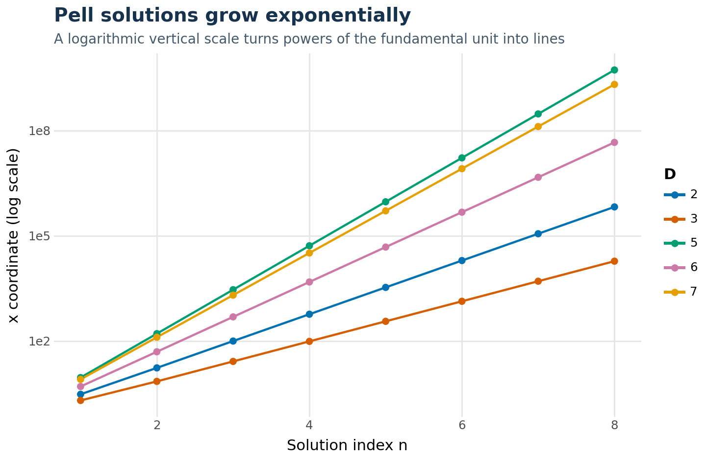

# Pell Equations and Units {#sec-pell}

<div class="chapter-goals">

**Learning goals.** Relate Pell equations to norms and continued fractions; find a fundamental solution; generate all positive solutions; state the negative-Pell period criterion; interpret exponential growth and generalised norm equations.

</div>

For a positive nonsquare integer $D$, Pell's equation is
$$
x^2-Dy^2=1.
$$
It is a conic with infinitely many real points, but its integer points form a rigid multiplicative sequence. Continued fractions find the first nontrivial point; algebra generates the rest.

## The Pell equation

### Norms and factorisation intuition

Formally adjoin $\sqrt D$ and define
$$
N(x+y\sqrt D)=(x+y\sqrt D)(x-y\sqrt D)=x^2-Dy^2.
$$
Norms multiply. Therefore if $x_1+y_1\sqrt D$ and $x_2+y_2\sqrt D$ have norm $1$, so does their product. Expanding gives the composition law
$$
(x_1x_2+Dy_1y_2)+(x_1y_2+x_2y_1)\sqrt D.
$$
One solution can thus seed infinitely many.

The trivial solutions $(\pm1,0)$ are usually excluded when asking for positive Pell solutions; we require $x,y>0$ unless stated otherwise.

### Producing a solution from a convergent

If $p/q$ approximates $\sqrt D$ unusually well, then
$$
p^2-Dq^2=(p-q\sqrt D)(p+q\sqrt D)
$$
may be a small integer. Convergents supply the necessary accuracy. A theorem from periodic continued fractions guarantees that, for nonsquare $D>0$, some convergent satisfies $p^2-Dq^2=1$.

For $D=2$, $3/2$ is a convergent and $3^2-2\cdot2^2=1$. For $D=13$, the smallest positive solution is already large: $(x,y)=(649,180)$. This warns against bounded brute-force conclusions.

## Generating all positive solutions

### Powers of the fundamental unit

Let $(x_1,y_1)$ be the positive solution with least $x_1>1$, and write $\varepsilon=x_1+y_1\sqrt D$. Then every positive solution is determined by
$$
x_n+y_n\sqrt D=\varepsilon^n\qquad(n\ge1).
$$
This classification uses the ordering of positive real units: for any solution $u>1$, choose $n$ with $\varepsilon^n\le u<\varepsilon^{n+1}$. Then $u\varepsilon^{-n}$ is a norm-one unit in $[1,\varepsilon)$; minimality forces it to be $1$.

One should note a ring subtlety: for $D\equiv1\pmod4$, the full ring of algebraic integers also contains $(1+\sqrt D)/2$. The stated classification concerns integer-coordinate solutions $x+y\sqrt D$ and remains correct with the fundamental positive solution chosen in that subgroup.

### Recurrences and exponential growth

Multiplying by $\varepsilon$ gives
$$
x_{n+1}=x_1x_n+Dy_1y_n,\qquad
y_{n+1}=y_1x_n+x_1y_n.
$$
Also
$$
x_n=\frac{\varepsilon^n+\varepsilon^{-n}}2,
$$
so $x_n$ grows essentially like $\varepsilon^n/2$. For $D=2$, powers of $3+2\sqrt2$ produce
$$
(3,2),(17,12),(99,70),(577,408),\ldots.
$$

<figure id="fig-pell-growth">


<figcaption>

Figure 10.1: The first several positive Pell solutions for selected D, showing logarithm of x against solution index.

</figcaption>
</figure>

The near-lines in [Figure 10.1](#fig-pell-growth) confirm the exact exponential formula: a logarithmic vertical axis converts powers into linear trends. Different slopes are $\log\varepsilon$, so a larger fundamental unit produces faster growth.

## Negative Pell equations

### Solvability is subtler

The negative equation
$$
x^2-Dy^2=-1
$$
is not always solvable. For $D=2$, $(1,1)$ works. For $D=3$, reducing modulo $3$ would require $x^2\equiv-1\equiv2\pmod3$, impossible. A solution of norm $-1$ squares to a solution of norm $1$, but a norm-$1$ solution need not have a norm-$-1$ square root in the integer ring.

### Period parity criterion

**Theorem 10.1 (continued-fraction criterion).** For positive nonsquare $D$, the equation $x^2-Dy^2=-1$ has an integer solution if and only if the repeating period of the simple continued fraction of $\sqrt D$ has odd length.

This criterion emerges because convergents at the end of a period alternate between norm $1$ and norm $-1$ according to parity. It is an exact theorem, unlike a pattern inferred from a table.

### Norm-minus-one solutions form a coset

If $\eta=x_0+y_0\sqrt D$ has norm $-1$ and $\varepsilon$ is the fundamental positive norm-one unit, then
$$
\eta\varepsilon^k\qquad(k\in\mathbb Z)
$$
also has norm $-1$. Subject to positivity and the chosen integer order, every norm-minus-one solution lies in this orbit. For $D=2$, take $\eta=1+\sqrt2$ and $\varepsilon=3+2\sqrt2$. The first positive solutions are
$$
1+\sqrt2,\qquad 7+5\sqrt2,\qquad 41+29\sqrt2,\ldots.
$$
Squaring any one of them produces a norm-one solution, but only the first square gives the fundamental norm-one unit. The language of a **coset** is useful: norm-one units form a group, while norm-minus-one units, if they exist, form a translate of it.

## Approximation, algebra, and geometry

A Pell solution gives
$$
\left|\sqrt D-\frac xy\right|=
\frac1{y^2(\sqrt D+x/y)},
$$
an approximation of order $1/y^2$. Geometrically, integer solutions lie on the hyperbola $x^2-Dy^2=1$. Algebraically, they are norm-one units. Analytically, their ratios approximate $\sqrt D$. The same objects answer three differently phrased questions.

## Generalised Pell-type equations

For fixed nonzero $N$, the equation $x^2-Dy^2=N$ is a norm equation. Multiplying one solution by powers of a norm-one unit generates further solutions, but there may be several orbits or none. Congruence tests can eliminate possibilities; ideal theory can organize the remaining classes.

### Why finitely many seeds suffice

Suppose $\alpha=x+y\sqrt D$ has norm $N$. Multiplying by a suitable power of $\varepsilon^{-1}$ can place the positive real size of $\alpha$ into a fixed interval, for example
$$
1\le |\alpha|<\varepsilon.
$$
Its conjugate satisfies $|\alpha'|=|N|/|\alpha|$, so both real embeddings are bounded in terms of $D,N,$ and $\varepsilon$. The coordinates
$$
x=\frac{\alpha+\alpha'}2,\qquad
y=\frac{\alpha-\alpha'}{2\sqrt D}
$$
are then bounded as well. Only finitely many integer pairs occur in this reduced window. Consequently the complete solution set, when nonempty, is a finite union of unit orbits.

This argument proves a structural finiteness statement, not that there is always one orbit. Different reduced seeds need not be related by an integer-coordinate unit. It also suggests an exhaustive algorithm: search only the justified reduced region, then expand each surviving seed by powers of $\varepsilon$.

Equations such as $x^2-Dy^2=N$ should not all be called “Pell equations” without qualification. The right-hand side $1$ has the cleanest universal existence and cyclic structure.

## Algorithms: continued fractions and chakravala

### The continued-fraction method

Compute the periodic continued fraction of $\sqrt D$ and test its convergents. If the period length is $L$, the convergent at a period boundary yields norm $-1$ when $L$ is odd; doubling the block then yields norm $1$. If $L$ is even, the first block already yields norm $1$. This gives a terminating exact algorithm and proves existence at the same time.

The arithmetic must remain integral. Testing a decimal approximation to $\sqrt D$ can miss the exact identity $p^2-Dq^2=\pm1$, especially when $p$ and $q$ are large. The standard recurrence for complete quotients computes the period using integer additions, divisions, and remainders.

### The chakravala viewpoint

The classical Indian **chakravala** method works with near-solutions
$$
a^2-Db^2=k
$$
and composes them with carefully chosen small auxiliary terms so that the new $|k|$ tends to shrink. A congruence condition guarantees the updated coordinates remain integral; among allowed choices, one selects a multiplier making its square close to $D$. When $k=1$, a Pell solution has been reached.

Chakravala is not merely trial and error: its composition step is the same multiplicativity of norms used throughout this chapter, coupled with a reduction rule. For hand calculation it can reach solutions with surprisingly few steps. For a proof-oriented implementation, however, every divisibility condition, sign convention, and termination claim must be stated explicitly.

### Complexity includes the output

The smallest solution can contain many digits compared with the number of digits of $D$. Any algorithm that prints that solution must spend at least linear time in the output length. It is therefore misleading to compare methods only by counting iterations while ignoring the size of the integers multiplied at later steps. Bit complexity, memory, and whether one wants the full solution or only information modulo a number are separate performance questions.

<div class="callout callout-warning">
<p class="callout-title">Pitfall: finite search versus nonexistence</p>

The fundamental solution may be unexpectedly large. Failure to find $y$ below a chosen bound is only a bounded computation unless paired with a theorem that makes the bound exhaustive.

</div>

<!-- inline-formula-code:start -->
## Formula and finite computation

A useful formula in this chapter is

$$
x_k^2-2y_k^2=1
$$

Every generated pair is checked against the Pell invariant. The following standalone Python block expresses that finite rule with its inputs and stopping conditions visible.

```python
def pell_solutions(count: int) -> list[tuple[int, int]]:
    """Return the first count positive solutions of x*x - 2*y*y = 1."""
    if count < 1:
        raise ValueError("count must be positive")
    solutions: list[tuple[int, int]] = []
    x_value, y_value = 3, 2
    for _ in range(count):
        if x_value * x_value - 2 * y_value * y_value != 1:
            raise ArithmeticError("Pell invariant was lost")
        solutions.append((x_value, y_value))
        x_value, y_value = (
            3 * x_value + 4 * y_value,
            2 * x_value + 3 * y_value,
        )
    return solutions

for index, (x_value, y_value) in enumerate(pell_solutions(8), start=1):
    print(index, x_value, y_value, x_value * x_value - 2 * y_value * y_value)
```

**What the computation establishes.** The calculation checks a declared finite instance; the surrounding argument explains what is true beyond those inputs.
<!-- inline-formula-code:end -->

## Summary

- Pell equations are norm-one equations in a quadratic ring.
- Continued-fraction convergents produce a nontrivial solution for every positive nonsquare $D$.
- Powers of the fundamental unit generate all positive solutions and explain exponential growth.
- The negative Pell equation is solvable exactly when the continued-fraction period length is odd.
- Generalised norm equations may split into several unit orbits.
- Norm-minus-one solutions, when they exist, form a coset of the norm-one unit group.
- Continued fractions and chakravala turn norm composition into exact algorithms.

## Exercises

<div class="exercise" id="number_theory-10-pell-ex-1">
<p class="exercise-title"><strong>Exercise 1</strong></p>

Use continued fractions to find the fundamental solution for $D=3$.

</div>

<div class="exercise" id="number_theory-10-pell-ex-2">
<p class="exercise-title"><strong>Exercise 2</strong></p>

Generate the first five positive solutions for $D=2$ by recurrence.

</div>

<div class="exercise" id="number_theory-10-pell-ex-3">
<p class="exercise-title"><strong>Exercise 3</strong></p>

Verify directly that the composition law preserves norm.

<details class="hint"><summary>Hint 1</summary>

multiply $(x_1+y_1\sqrt D)(x_2+y_2\sqrt D)$ and take its conjugate.

</details>

</div>

<div class="exercise" id="number_theory-10-pell-ex-4">
<p class="exercise-title"><strong>Exercise 4</strong></p>

Prove the displayed approximation formula from $x^2-Dy^2=1$.

<details class="solution"><summary>Solution</summary>

From $x^2-Dy^2=1$ and $y>0$,
$$
\left(\frac xy-\sqrt D\right)\left(\frac xy+\sqrt D\right)=\frac1{y^2}.
$$
The first factor is positive because $x^2/y^2>D$. Divide by the positive second factor:
$$
\left|\sqrt D-\frac xy\right|
=\frac1{y^2(x/y+\sqrt D)}.
$$
This is less than $1/(2\sqrt D\,y^2)$ because $x/y>\sqrt D$.

</details>

</div>

<div class="exercise" id="number_theory-10-pell-ex-5">
<p class="exercise-title"><strong>Exercise 5</strong></p>

Show the negative Pell equation has no solution for $D=3$ using a congruence.

</div>

<div class="exercise" id="number_theory-10-pell-ex-6">
<p class="exercise-title"><strong>Exercise 6</strong></p>

Determine whether $x^2-5y^2=-1$ has a small positive solution, then square it to obtain a norm-one solution.

</div>

<div class="exercise" id="number_theory-10-pell-ex-7">
<p class="exercise-title"><strong>Exercise 7</strong></p>

Derive a second-order recurrence for $x_n$ involving $2x_1$.

<details class="hint"><summary>Hint 1</summary>

$\varepsilon$ and $\varepsilon^{-1}$ are roots of $t^2-2x_1t+1$.

</details>

</div>

<div class="exercise" id="number_theory-10-pell-ex-8">
<p class="exercise-title"><strong>Exercise 8</strong></p>

For $x^2-2y^2=7$, find two solutions and test whether multiplying by $3+2\sqrt2$ stays in the solution set.

<details class="hint"><summary>Hint 1</summary>

norm multiplicativity preserves the right-hand side $7$.

</details>

</div>
