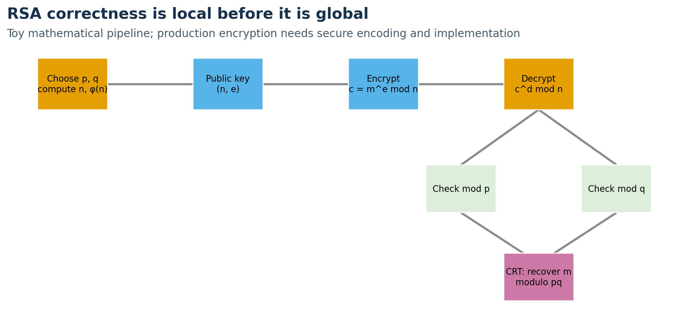

# Public-Key Cryptography {#sec-cryptography}

<div class="chapter-goals">

**Learning goals.** Explain security assumptions separately from correctness; perform a toy RSA example; prove RSA decryption with CRT; describe Diffie–Hellman and primality testing; identify why textbook protocols are not production systems.

</div>

Cryptography turns arithmetic asymmetry into communication protocols. Multiplication of two primes is easy; recovering them from their large product appears hard. Modular exponentiation is easy; reversing it in a carefully chosen group appears hard. “Appears hard” is a security assumption, not a theorem of impossibility.

## From one-way arithmetic to protocols

### Threat models and mathematical assumptions

A protocol specifies participants, messages, secrets, and an adversary's capabilities. Correctness says honest participants recover the intended message. Security says a defined adversary cannot achieve a defined goal within a resource model. These are different claims.

A one-way function is easy to compute but difficult to invert on typical inputs. A trapdoor function additionally has secret information making inversion easy. RSA is designed around modular exponentiation with a factorisation trapdoor. Its practical security depends on parameter generation, padding, implementation, and the absence of an unexpectedly efficient attack.

### Kerckhoffs's principle

A sound system assumes the adversary knows the algorithm; only the key is secret. Hiding the design prevents broad review and does not substitute for a security argument. Number theory supplies transparent public operations whose inversion depends on hidden structure.

Toy examples in this chapter use tiny numbers so every step is visible. They provide no security. Real cryptographic software should use maintained, reviewed libraries and current standards rather than hand-written textbook code.

## RSA

### Key generation

Choose distinct primes $p,q$ and set $n=pq$. Let
$$
\varphi(n)=(p-1)(q-1).
$$
Choose an integer encryption exponent $e>1$ coprime to $\varphi(n)$, and compute a positive integer $d$ satisfying
$$
ed\equiv1\pmod{\varphi(n)}.
$$
The public key is $(n,e)$ and the trapdoor includes $d$ or, more fundamentally, the factorisation $p,q$. A message representative $m$ is encrypted as $c\equiv m^e\pmod n$ and decrypted as $m'\equiv c^d\pmod n$.

Modern formulations often use $\lambda(n)=\operatorname{lcm}(p-1,q-1)$ in place of $\varphi(n)$; choosing $ed\equiv1\pmod{\lambda(n)}$ is sufficient. The elementary $\varphi$ version makes Euler's theorem immediately visible.

### Correctness via CRT

Write $ed=1+k(p-1)$ for an integer $k$. Modulo $p$, if $p\mid m$, then $m^{ed}\equiv m\equiv0$. If $p\nmid m$, Fermat gives
$$
m^{ed}=m(m^{p-1})^k\equiv m\pmod p.
$$
The same argument holds modulo $q$. CRT then gives $m^{ed}\equiv m\pmod{pq}$. This proof covers messages not coprime to $n$, a case that a direct invocation of Euler's theorem would miss.

### A complete toy example

Take $p=11$, $q=17$, so $n=187$ and $\varphi(n)=160$. Choose $e=7$. Extended Euclid gives $7\cdot23=161\equiv1\pmod{160}$, so $d=23$.

Encrypt $m=42$ by repeated squaring:
$$
42^2\equiv81,\qquad42^4\equiv81^2\equiv16\pmod{187},
$$
and
$$
c\equiv42^7\equiv42^4 42^2 42\equiv15\pmod{187}.
$$
Decryption computes $15^{23}\equiv42\pmod{187}$. CRT can perform this as two smaller exponentiations modulo $11$ and $17$ before reconstruction.

The complete toy round trip fits in a few exact modular operations.  The input
checks require an integer public exponent greater than one and coprime to the totient.

```python
from math import gcd, isqrt

def is_prime(candidate: int) -> bool:
    """Decide primality by trial division; suitable only for small examples."""
    if candidate < 2:
        return False
    return all(
        candidate % divisor != 0
        for divisor in range(2, isqrt(candidate) + 1)
    )

def toy_rsa_round_trip(
    message: int,
    first_prime: int,
    second_prime: int,
    encryption_exponent: int,
) -> tuple[int, int, int]:
    """Return modulus, ciphertext, and recovered message for textbook RSA."""
    if first_prime == second_prime or not all(
        is_prime(prime) for prime in (first_prime, second_prime)
    ):
        raise ValueError("provide two distinct primes")
    modulus = first_prime * second_prime
    totient = (first_prime - 1) * (second_prime - 1)
    if not 0 <= message < modulus:
        raise ValueError("message must be a residue representative modulo n")
    if encryption_exponent <= 1 or gcd(encryption_exponent, totient) != 1:
        raise ValueError("encryption exponent must be greater than one and coprime to the totient")
    decryption_exponent = pow(encryption_exponent, -1, totient)
    ciphertext = pow(message, encryption_exponent, modulus)
    recovered = pow(ciphertext, decryption_exponent, modulus)
    return modulus, ciphertext, recovered

modulus, ciphertext, recovered = toy_rsa_round_trip(42, 11, 17, 7)
if (modulus, ciphertext, recovered) != (187, 15, 42):
    raise RuntimeError("toy RSA round trip failed")
print(modulus, ciphertext, recovered)
```

This establishes correctness for the declared finite key and message.  Trial
division, tiny primes, and deterministic textbook RSA are deliberately
educational and must not be used as a security implementation.

<figure id="fig-rsa">


<figcaption>

Figure 11.1: A schematic of toy RSA showing key generation, public encryption, private decryption, and the CRT correctness checks modulo p and q.

</figcaption>
</figure>

[Figure 11.1](#fig-rsa) separates the public path from the trapdoor path. Its two lower lanes emphasise that correctness is proved locally modulo $p$ and $q$, then recombined globally.

## Attacks and implementation hazards

### Factoring, weak parameters, and side channels

Knowledge of $p,q$ reveals $\varphi(n)$ and hence $d$. Conversely, several relationships between $d$ and the factorisation make recovery possible, so protecting the private exponent is not independent of protecting the primes. Reused primes, predictable randomness, or unbalanced choices can destroy security.

Even sound mathematics can leak through timing, power use, memory access, or fault behavior. CRT speeds decryption but a fault in one branch can reveal a factor of $n$. Constant-time routines, blinding, fault checks, secure randomness, and key lifecycle controls are implementation concerns beyond the proof of $m^{ed}\equiv m$.

### Why textbook RSA is not secure deployment

Deterministic textbook RSA preserves equality: identical messages give identical ciphertexts. It is also algebraically malleable because $(m_1m_2)^e\equiv m_1^e m_2^e$. Secure encryption and signatures therefore use distinct, standardised encoding schemes with randomness or hashing and formally analysed security properties.

This text intentionally gives no copy-and-deploy recipe. The mathematical primitive is educational; safe deployment is an engineering and standards-compliance task.

## Diffie–Hellman in finite cyclic groups

Let a finite cyclic group have generator $g$ of order $r$. Alice chooses secret $a$ and sends $g^a$; Bob chooses secret $b$ and sends $g^b$. Each computes
$$
(g^b)^a=(g^a)^b=g^{ab}.
$$
An observer sees $g,g^a,g^b$ but should have difficulty obtaining $g^{ab}$. The computational Diffie–Hellman assumption formalises this difficulty in the selected group.

Using the multiplicative group modulo a prime requires validating elements and choosing a suitable subgroup; otherwise small-subgroup attacks may leak information. Elliptic-curve groups provide another setting with smaller representations for comparable classical security; their group law is developed mathematically in [sec-elliptic-curves](20-elliptic-curves.md#sec-elliptic-curves), without turning this chapter into deployment guidance.

## Primality testing

### Fermat, Miller–Rabin, and certificates

Fermat testing rejects $n$ if some coprime base satisfies $a^{n-1}\not\equiv1\pmod n$, but Carmichael numbers can fool every coprime base. Miller–Rabin writes $n-1=2^s d$ with $d$ odd and checks a stronger sequence of squares. For an odd composite $n$, at most one quarter of bases are strong liars; independently sampled bases make the error probability decrease exponentially.

That probability statement assumes appropriate random base selection. For bounded machine-size integers, fixed published base sets can be exhaustive, but the bound and base theorem must be matched exactly. Primality certificates provide verifiable proofs; algorithms such as ECPP are effective in practice, while AKS established deterministic polynomial-time primality testing as a theorem of computational complexity.

### Probable prime versus proved prime

A probable prime has passed specified tests. A proven prime comes with a valid deductive argument or certificate. Both can be appropriate in a protocol pipeline, but reports must use the correct term and state the test parameters. “No factor found” is weaker than either.

## Ethical and practical boundaries

Cryptographic education should improve defensive understanding. Test only systems and keys you own or are authorised to assess. Do not infer that a mathematical demonstration authorises access to deployed systems. Algorithms age as computing platforms, standards, and attacks change; practical choices require current expert guidance.

<div class="callout callout-warning">
<p class="callout-title">Pitfall: conflating correctness and security</p>

The congruence proving RSA decryption works says nothing about chosen-ciphertext attacks, key generation, leakage, or future algorithms. A correct primitive can be used in an insecure protocol.

</div>

<!-- inline-formula-code:start -->
## Formula and finite computation

A useful formula in this chapter is

$$
c\equiv m^e\pmod N,\qquad m\equiv c^d\pmod N
$$

The round trip keeps every modular operation visible. The following standalone Python block expresses that finite rule with its inputs and stopping conditions visible.

```python
from math import gcd, isqrt

def is_prime(number: int) -> bool:
    """Return whether number is prime by exact trial division."""
    if number < 2:
        return False
    return all(number % divisor != 0 for divisor in range(2, isqrt(number) + 1))

def rsa_toy(
    message: int,
    first_prime: int,
    second_prime: int,
    public_exponent: int,
) -> tuple[int, int]:
    """Return ciphertext and recovered message for a validated toy RSA instance."""
    if (
        first_prime == second_prime
        or not is_prime(first_prime)
        or not is_prime(second_prime)
    ):
        raise ValueError("use two distinct positive primes")
    modulus = first_prime * second_prime
    totient = (first_prime - 1) * (second_prime - 1)
    if (
        not 0 <= message < modulus
        or public_exponent <= 1
        or gcd(public_exponent, totient) != 1
    ):
        raise ValueError("message range or public exponent is invalid")
    private_exponent = pow(public_exponent, -1, totient)
    ciphertext = pow(message, public_exponent, modulus)
    recovered = pow(ciphertext, private_exponent, modulus)
    return ciphertext, recovered

ciphertext, recovered = rsa_toy(
    message=42,
    first_prime=61,
    second_prime=53,
    public_exponent=17,
)
print(ciphertext, recovered)
```

**What the computation establishes.** The calculation checks a declared finite instance; the surrounding argument explains what is true beyond those inputs.
<!-- inline-formula-code:end -->

## Summary

- Public-key systems separate a public operation from secret trapdoor information.
- RSA correctness follows locally modulo its prime factors and globally by CRT.
- Security is conditional on explicit computational and implementation assumptions.
- Diffie–Hellman relies on the hardness of discrete-log-related problems in a chosen group.
- Probable-prime tests and primality proofs have different guarantees.

## Exercises

<div class="exercise" id="number_theory-11-cryptography-ex-1">
<p class="exercise-title"><strong>Exercise 1</strong></p>

Complete every RSA exponentiation in the toy example.

</div>

<div class="exercise" id="number_theory-11-cryptography-ex-2">
<p class="exercise-title"><strong>Exercise 2</strong></p>

Build a different toy RSA key from $p=13,q=19,e=5$ and encrypt $m=10$.

</div>

<div class="exercise" id="number_theory-11-cryptography-ex-3">
<p class="exercise-title"><strong>Exercise 3</strong></p>

Explain why the RSA correctness proof splits into $p\mid m$ and $p\nmid m$.

<details class="hint"><summary>Hint 1</summary>

Fermat's theorem requires a nonzero class modulo $p$; zero must be handled directly.

</details>

</div>

<div class="exercise" id="number_theory-11-cryptography-ex-4">
<p class="exercise-title"><strong>Exercise 4</strong></p>

Show textbook RSA is multiplicatively malleable.

<details class="hint"><summary>Hint 1</summary>

compare the encryption of $m_1m_2$ with the product of the two ciphertexts.

</details>

</div>

<div class="exercise" id="number_theory-11-cryptography-ex-5">
<p class="exercise-title"><strong>Exercise 5</strong></p>

Perform toy Diffie–Hellman modulo $23$ with generator $5$ and secrets $4,7$.

</div>

<div class="exercise" id="number_theory-11-cryptography-ex-6">
<p class="exercise-title"><strong>Exercise 6</strong></p>

Show that $561$ passes Fermat tests for bases coprime to it using its factorisation.

<details class="hint"><summary>Hint 1</summary>

use $561=3\cdot11\cdot17$ and note each $p-1$ divides $560$.

</details>

</div>

<div class="exercise" id="number_theory-11-cryptography-ex-7">
<p class="exercise-title"><strong>Exercise 7</strong></p>

Distinguish “factor not found,” “probable prime,” and “certified prime.”

</div>

<div class="exercise" id="number_theory-11-cryptography-ex-8">
<p class="exercise-title"><strong>Exercise 8</strong></p>

Write a threat model for sending one confidential message over a public channel; list assets and adversary capabilities without proposing an implementation.

</div>
