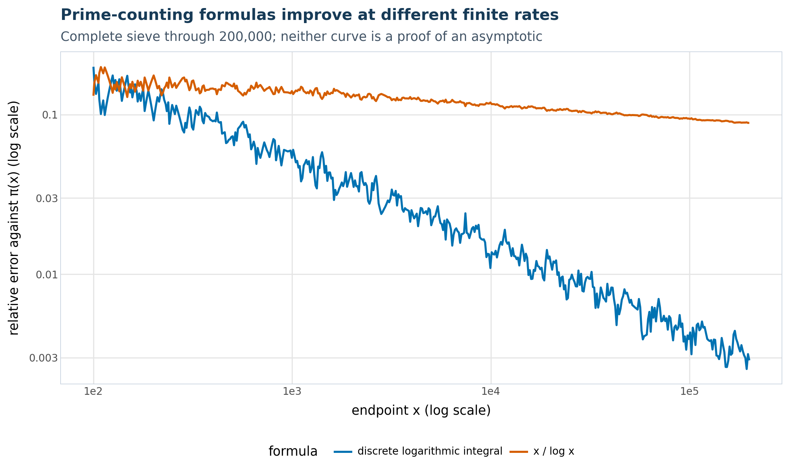

# An Analytic Vista: How Primes Are Distributed {#sec-analytic}

<div class="chapter-goals">

**Learning goals.** State the prime number theorem accurately; derive Euler's product where it converges; prove that reciprocal primes diverge; explain how zeta zeros influence prime-counting error; state Dirichlet's theorem and the Riemann hypothesis without overclaiming.

</div>

Unique factorisation describes individual integers. Analytic number theory studies factorisation in aggregate by encoding arithmetic sequences in functions of a real or complex variable. This chapter is a vista: major theorems are stated accurately, while proofs requiring complex analysis are signposted rather than compressed into misleading sketches.

## The prime-counting function

### Data and the logarithmic scale

Recall $\pi(x)=\#\{p\le x:p\text{ prime}\}$. The graph in [Figure 3.1](03-primes.md#fig-prime-counting) suggests a density near $1/\log x$. This is not because primes are independent random events. Rather, the logarithm emerges from sieving by many small primes and, rigorously, from analytic properties of functions encoding prime powers.

The logarithmic integral
$$
\operatorname{Li}(x)=\int_2^x\frac{dt}{\log t}
$$
accumulates the changing density. It often approximates $\pi(x)$ better than $x/\log x$ at accessible scales, although their ratio tends to $1$.

### The prime number theorem

**Theorem 12.1 (Prime number (PNT)).** As $x\to\infty$,
$$
\pi(x)\sim\frac{x}{\log x},
$$
meaning $\pi(x)/(x/\log x)\to1$. This is a proved theorem, first established independently by Hadamard and de la Vallée Poussin in 1896.

The PNT is a relative asymptotic statement. It does not say $\pi(x)=x/\log x$, locate the next prime, or imply regularly spaced primes. Even an approximation with vanishing relative error may have a growing absolute error.

## Weighted prime-counting functions

### The Chebyshev functions

Raw prime counting jumps by $1$ at each prime. Analytic formulas interact more naturally with logarithmic weights. Define
$$
\vartheta(x)=\sum_{p\le x}\log p,
\qquad
\psi(x)=\sum_{p^k\le x}\log p.
$$
The second sum counts every prime power. With the von Mangoldt function
$$
\Lambda(n)=
\begin{cases}
\log p,&n=p^k\text{ for a prime }p\text{ and }k\ge1,\\
0,&\text{otherwise},
\end{cases}
$$
we have $\psi(x)=\sum_{n\le x}\Lambda(n)$. The relation
$$
\psi(x)=\sum_{k\ge1}\vartheta\!\left(x^{1/k}\right)
$$
separates primes from their higher powers. Only finitely many terms are nonzero. The terms with $k\ge2$ are lower order; an elementary estimate gives, for example, $\psi(x)-\vartheta(x)=O(\sqrt{x}\log^2x)$.

The three forms of PNT
$$
\pi(x)\sim\frac{x}{\log x},
\qquad \vartheta(x)\sim x,
\qquad \psi(x)\sim x
$$
are equivalent. Passing between them requires estimates or partial summation, not simply deleting the logarithmic weights.

### Chebyshev's pre-PNT bounds

Before the PNT was proved, Chebyshev established constants $A,B>0$ such that
$$
A\frac{x}{\log x}\le \pi(x)\le B\frac{x}{\log x}
$$
for all sufficiently large $x$. In modern notation, $\pi(x)\asymp x/\log x$. These inequalities determine the correct order of magnitude but do not say that the ratio tends to $1$.

One elementary route studies the prime factorisation of central binomial coefficients $\binom{2n}{n}$. Their size is exponential in $n$, while their prime factors are constrained by primes up to $2n$. Comparing upper and lower bounds turns combinatorics into information about $\vartheta(x)$. This is an instructive boundary: substantial prime-distribution information is possible without complex analysis, while the exact leading constant requires deeper input.

## Euler's product

### From unique factorisation to an infinite product

For real $s>1$, define
$$
\zeta(s)=\sum_{n=1}^{\infty}\frac1{n^s}.
$$
Absolute convergence permits multiplication and rearrangement. Expanding one geometric series for each prime gives
$$
\prod_p\left(1-p^{-s}\right)^{-1}
=\prod_p(1+p^{-s}+p^{-2s}+\cdots)
=\sum_{n=1}^{\infty}n^{-s}.
$$
Unique factorisation ensures every $n^{-s}$ appears exactly once. This **Euler product** is an analytic shadow of the fundamental theorem of arithmetic.

The condition $s>1$ is structural, not cosmetic. At or left of the convergence boundary, formal rearrangement needs new justification.

### Why reciprocals of primes diverge

Euler's product also shows
$$
\sum_p\frac1p=\infty.
$$
If the prime reciprocal sum converged, then the product $\prod_p(1-1/p)^{-1}$ would remain bounded because $-\log(1-u)$ is comparable to $u$ for small positive $u$. But finite Euler products dominate harmonic partial sums over integers composed of the included primes, and the harmonic series diverges. A careful limiting argument produces the contradiction.

This strengthens “infinitely many primes”: an infinite set can have a convergent reciprocal sum, as the squares do. It still does not give the full PNT.

## The Riemann zeta function

### Dirichlet series in the half-plane of convergence

For a complex variable $s=\sigma+it$, the Dirichlet series converges absolutely when $\sigma>1$. In that half-plane the Euler product proves $\zeta(s)\ne0$. Complex analysis extends $\zeta$ meromorphically to the whole plane, with a single pole at $s=1$, and a functional equation relates $s$ to $1-s$.

The zeros at negative even integers are called trivial. The nontrivial zeros lie in the critical strip $0<\operatorname{Re}(s)<1$. Their locations govern oscillations in weighted prime counts through explicit formulas.

### Zeros and prime fluctuations: a careful vista

One weighted function is
$$
\psi(x)=\sum_{p^k\le x}\log p.
$$
An explicit formula expresses its main term $x$ plus contributions involving zeta zeros and smaller correction terms. A zero with real part close to $1$ permits larger fluctuations; controlling all real parts yields error estimates.

The PNT is equivalent to the absence of zeta zeros on the line $\operatorname{Re}(s)=1$. The stronger Riemann hypothesis would place every nontrivial zero on $\operatorname{Re}(s)=1/2$, implying essentially square-root-scale prime-counting error up to logarithmic factors. “Zeros encode primes” is therefore a precise analytic relationship, not mystical causation.

## Primes in arithmetic progressions

### Dirichlet's theorem

**Theorem 12.2 (Dirichlet's on arithmetic progressions).** If $\gcd(a,q)=1$, then the progression
$$
a,a+q,a+2q,\ldots
$$
contains infinitely many primes. The coprimality condition is necessary: if a common divisor exceeds $1$, every term shares it, apart from at most one exceptional prime.

A stronger asymptotic theorem says reduced residue classes modulo fixed $q$ receive primes equally in the limit:
$$
\pi(x;q,a)\sim\frac{1}{\varphi(q)}\frac{x}{\log x}.
$$
This is proved, but its proof requires Dirichlet $L$-functions and nonvanishing at $1$.

### Characters as modular Fourier analysis

A Dirichlet character modulo $q$ is a periodic, completely multiplicative function that vanishes on integers not coprime to $q$. Characters form an orthogonal basis for functions on the unit group modulo $q$, analogous to sine and cosine modes. Weighted sums of characters isolate a residue class, while their $L$-functions
$$
L(s,\chi)=\sum_{n=1}^{\infty}\frac{\chi(n)}{n^s}
$$
carry its prime information.

This is the analytic continuation of CRT's local decomposition: residue classes become frequency components.

## Partial summation: transferring information

### A discrete analogue of integration by parts

Let $A(x)=\sum_{n\le x}a_n$, and let $f$ be continuously differentiable. Abel's partial-summation formula is
$$
\sum_{n\le x}a_nf(n)
=A(x)f(x)-\int_1^x A(t)f'(t)\,dt,
$$
with endpoints adjusted when the sequence starts later. It is proved by grouping the constant values of the step function $A(t)$, exactly as summation by parts mirrors integration by parts.

Taking $a_n$ to be the prime indicator gives
$$
\sum_{p\le x}f(p)
=\pi(x)f(x)-\int_2^x\pi(t)f'(t)\,dt.
$$
For $f(t)=\log t$, this connects $\vartheta$ and $\pi$. For $f(t)=1/t$, it gives
$$
\sum_{p\le x}\frac1p
=\frac{\pi(x)}x+\int_2^x\frac{\pi(t)}{t^2}\,dt.
$$
Substituting the PNT main term predicts and proves the first-order growth $\sum_{p\le x}1/p\sim\log\log x$. The stronger Mertens theorem for primes refines this to $\log\log x+B_1+o(1)$ for a constant $B_1$.

### Error terms do not transfer mechanically

If $A(t)=M(t)+E(t)$, partial summation integrates both the main term and the error against $f'(t)$. An error that is small pointwise may accumulate over a long interval; conversely, oscillation can create cancellation that a bound using absolute values discards. Endpoint terms also matter. Every claimed transfer should therefore display the formula and estimate its terms rather than rely on the phrase “by partial summation.”

This habit becomes essential when conditional hypotheses enter. RH-quality control of $\psi(x)-x$, for instance, implies strong estimates for $\pi(x)-\operatorname{Li}(x)$ only after prime powers, integration, and logarithmic factors are tracked carefully.

## The status of the Riemann hypothesis

**Open problem.** The Riemann hypothesis asserts that every nontrivial zero of $\zeta(s)$ has real part $1/2$. It remains unproved in this edition. Many zeros have been checked computationally and many consequences are known conditionally, but neither finite verification nor the proof of a consequence establishes the full hypothesis.

When a result assumes RH or its generalisations, it must be labeled conditional. Conversely, the PNT and Dirichlet's theorem are unconditional established theorems.

<div class="callout callout-warning">
<p class="callout-title">Pitfall: asymptotic equality</p>

The notation $f(x)\sim g(x)$ means a ratio tends to $1$. It is not ordinary equality, does not assert one-sided error, and may become informative only on a scale larger than a plotted window.

</div>

## Computational view of the approximation formulas

<figure id="fig-nt-analytic-prime-approximations">


<figcaption>

Figure 12.1: Two prime-counting approximations are compared against exact finite counts.

</figcaption>
</figure>

[Figure 12.1](#fig-nt-analytic-prime-approximations) turns the asymptotic notation into
a finite error audit. The logarithmic-integral approximation is better on this
window, but the plot cannot establish either asymptotic statement; the proof
must bound the tail beyond every displayed endpoint.

<!-- inline-formula-code:start -->
## Formula and finite computation

A useful formula in this chapter is

$$
g_k=p_{k+1}-p_k
$$

Prime gaps are consecutive differences, so the data structure mirrors the formula. The following standalone Python block expresses that finite rule with its inputs and stopping conditions visible.

```python
def prime_gaps(limit: int) -> list[tuple[int, int, bool]]:
    """Return upper prime, preceding gap, and record status through limit."""
    if limit < 3:
        raise ValueError("limit must be at least three")
    flags = bytearray(b"\x01") * (limit + 1)
    flags[0:2] = b"\x00\x00"
    divisor = 2
    while divisor * divisor <= limit:
        if flags[divisor]:
            start = divisor * divisor
            count = (limit - start) // divisor + 1
            flags[start : limit + 1 : divisor] = b"\x00" * count
        divisor += 1
    primes = [number for number, flag in enumerate(flags) if flag]
    result: list[tuple[int, int, bool]] = []
    record = 0
    for lower, upper in zip(primes, primes[1:]):
        gap = upper - lower
        is_record = gap > record
        record = max(record, gap)
        result.append((upper, gap, is_record))
    return result

gaps = prime_gaps(10_000)
print(gaps[:8])
print([row for row in gaps if row[2]])
```

**What the computation establishes.** The calculation checks a declared finite instance; the surrounding argument explains what is true beyond those inputs.
<!-- inline-formula-code:end -->

## Summary

- The PNT gives the first-order density $\pi(x)\sim x/\log x$.
- Euler's product translates unique factorisation into analysis for $\operatorname{Re}(s)>1$.
- Reciprocal primes have a divergent sum.
- Nontrivial zeta zeros control fluctuations around prime-counting main terms.
- Dirichlet's theorem proves infinitely many primes in every reduced arithmetic progression.
- The Riemann hypothesis remains open; statements assuming it are conditional.
- Weighted functions $\vartheta$ and $\psi$ expose prime powers and are equivalent forms of PNT.
- Partial summation transfers asymptotics between weighted sums while also transferring their errors.

## Exercises

<div class="exercise" id="number_theory-12-analytic-ex-1">
<p class="exercise-title"><strong>Exercise 1</strong></p>

Compare $x/\log x$ with supplied or computed values of $\pi(x)$ for a declared finite range.

</div>

<div class="exercise" id="number_theory-12-analytic-ex-2">
<p class="exercise-title"><strong>Exercise 2</strong></p>

Explain where unique factorisation is used in Euler's product.

<details class="hint"><summary>Hint 1</summary>

in the expanded prime product, record the selected exponent of every prime.

</details>

</div>

<div class="exercise" id="number_theory-12-analytic-ex-3">
<p class="exercise-title"><strong>Exercise 3</strong></p>

Show $\sum_{n=1}^{\infty}1/n^2$ converges while $\sum_n1/n$ diverges; explain why infinitude alone cannot decide a reciprocal sum.

</div>

<div class="exercise" id="number_theory-12-analytic-ex-4">
<p class="exercise-title"><strong>Exercise 4</strong></p>

Why is $a$ coprime to $q$ necessary in Dirichlet's theorem?

</div>

<div class="exercise" id="number_theory-12-analytic-ex-5">
<p class="exercise-title"><strong>Exercise 5</strong></p>

List the reduced residue classes modulo $10$ and interpret the asymptotic theorem for final digits of primes.

<details class="hint"><summary>Hint 1</summary>

the classes are those ending in $1,3,7,9$; “equally” refers to a limiting ratio.

</details>

</div>

<div class="exercise" id="number_theory-12-analytic-ex-6">
<p class="exercise-title"><strong>Exercise 6</strong></p>

Distinguish PNT, RH, and an RH-conditional error bound in one sentence each.

</div>

<div class="exercise" id="number_theory-12-analytic-ex-7">
<p class="exercise-title"><strong>Exercise 7</strong></p>

Verify that a nonprincipal character modulo $3$ is completely multiplicative on examples.

<details class="hint"><summary>Hint 1</summary>

define $\chi(n)=0,1,-1$ according as $n\equiv0,1,2\pmod3$.

</details>

</div>

<div class="exercise" id="number_theory-12-analytic-ex-8">
<p class="exercise-title"><strong>Exercise 8</strong></p>

Audit the sentence “RH is true because billions of zeros lie on the line,” identifying the quantifier error.

</div>
