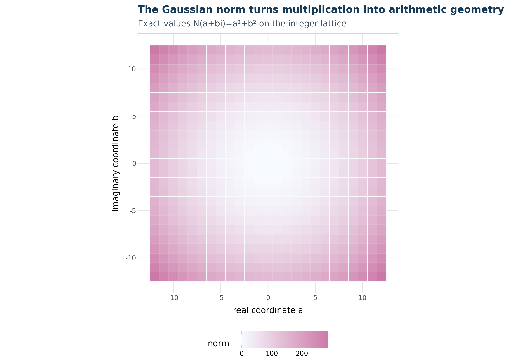

# An Algebraic Vista: Number Rings {#sec-algebraic}

<div class="chapter-goals">

**Learning goals.** Compute in the Gaussian integers; use norms for units and divisibility; explain Gaussian Euclidean division; connect Gaussian primes to sums of two squares; exhibit failure of element factorisation and explain how ideals repair it; preview local and $p$-adic viewpoints.

</div>

Some integer equations become simpler after enlarging the number system. Over the Gaussian integers, $x^2+y^2$ factors as $(x+iy)(x-iy)$ and primes can split into new factors. Enlargement gains structure but raises a new question: which familiar properties survive?

## Beyond the integers

### Gaussian integers

The Gaussian integers are
$$
\mathbb Z[i]=\{a+bi:a,b\in\mathbb Z\},\qquad i^2=-1.
$$
They form a ring under complex addition and multiplication. Geometrically they are the square lattice in the complex plane. Conjugation sends $a+bi$ to $a-bi$.

Ordinary integer divisibility may change after enlargement. The integer $5$ is prime in $\mathbb Z$ but
$$
5=(2+i)(2-i)
$$
in $\mathbb Z[i]$. By contrast, $3$ remains prime in the Gaussian ring.

### Norms and units

Define
$$
N(a+bi)=(a+bi)(a-bi)=a^2+b^2.
$$
The norm is a nonnegative integer and satisfies $N(zw)=N(z)N(w)$. If $u$ is a unit, then $1=N(u)N(u^{-1})$, so $N(u)=1$. The only solutions of $a^2+b^2=1$ give the units $\pm1,\pm i$.

Norms prove termination and irreducibility statements. If $z=ab$ and neither factor is a unit, then $N(a),N(b)>1$ are proper integer factors of $N(z)$. The converse need not identify a factor, but it sharply limits possibilities.

## Divisibility in the Gaussian integers

### A Euclidean algorithm in the plane

Given $z,w\in\mathbb Z[i]$ with $w\ne0$, compute the complex quotient $z/w$ and round its real and imaginary parts to nearest integers, obtaining $q\in\mathbb Z[i]$. Then $r=z-qw$ satisfies
$$
N(r)<N(w).
$$
Indeed, the rounding error has both coordinates at most $1/2$, so its squared magnitude is at most $1/2<1$. Thus $\mathbb Z[i]$ is Euclidean with respect to $N$, and the familiar chain follows: gcds, Bézout, Euclid's lemma, and unique factorisation up to units and order.

The choice of nearest integer can tie, but any nearest lattice point works. Each coordinate error is at most $1/2$, so the squared magnitude is at most $1/2<1$, including the case of two simultaneous ties.

### Gaussian primes and sums of two squares

An odd rational prime $p$ behaves as follows:

- if $p\equiv1\pmod4$, it splits as $p=(a+bi)(a-bi)$ and hence $p=a^2+b^2$;
- if $p\equiv3\pmod4$, it remains Gaussian prime;
- $2=-i(1+i)^2$ is ramified, up to a unit.

For the split case, $(-1/p)=1$ supplies $x^2\equiv-1\pmod p$. Then $p$ divides $(x+i)(x-i)$ in $\mathbb Z[i]$ but cannot remain prime; a Gaussian gcd of $p$ and $x+i$ extracts a factor of norm $p$.

Unique factorisation now proves the **sum-of-two-squares theorem** stated in [sec-diophantine](06-diophantine.md#sec-diophantine). A prime $3$ modulo $4$ dividing $x^2+y^2$ must divide both $x$ and $y$, so its exponent is even. Conversely, pair split primes into Gaussian factors, retain even powers of inert primes, multiply, and take a norm.

## When unique factorisation fails

### The example $\mathbb Z[\sqrt{-5}]$

In the ring $R=\mathbb Z[\sqrt{-5}]$,
$$
6=2\cdot3=(1+\sqrt{-5})(1-\sqrt{-5}).
$$
These are genuinely different factorizations into irreducibles. The norm $N(a+b\sqrt{-5})=a^2+5b^2$ shows the four displayed nonunit factors are irreducible: a further factorisation would require norm factors such as $2$ or $3$, and the corresponding norm equations have no solutions where needed. They are not associates because their quotients are not units.

The failure is not that factorisation into irreducibles fails to exist; it is that uniqueness fails. It also means irreducible elements need not be prime elements: $2$ divides $(1+\sqrt{-5})(1-\sqrt{-5})$ but divides neither factor.

### Repair by ideals

An ideal is an additive subgroup closed under multiplication by arbitrary ring elements. The principal ideal $(a)$ consists of all multiples of $a$. In rings of algebraic integers, every nonzero proper ideal factors uniquely into prime ideals even when elements do not factor uniquely.

In $\mathbb Z[\sqrt{-5}]$, the competing element factorisations of $6$ become compatible decompositions after the nonprincipal prime ideals above $2$ and $3$ are tracked. Ideals record divisibility more finely than individual generators.

This is a theorem of Dedekind domains, a class that includes rings of integers of number fields. A full construction needs modules and quotient rings; here the point is conceptual: enlarge the objects being factored to restore uniqueness.

## Algebraic integers and number fields

A number field is a finite extension of $\mathbb Q$, such as $\mathbb Q(\sqrt D)$. An algebraic integer is a root of a monic polynomial with integer coefficients. In quadratic fields, the ring of integers is sometimes larger than $\mathbb Z[\sqrt D]$: when squarefree $D\equiv1\pmod4$, it is
$$
\mathbb Z\left[\frac{1+\sqrt D}{2}\right].
$$
Trace and norm generalise conjugate sum and product. Prime ideals may split, remain prime, or ramify. The splitting pattern connects congruences, quadratic reciprocity, and field structure.

## Local viewpoints and a $p$-adic preview

Real absolute value regards numbers as close when their difference is small. For a prime $p$, the $p$-adic absolute value
$$
|x|_p=p^{-v_p(x)}
$$
regards numbers as close when their difference is divisible by a high power of $p$. Completing $\mathbb Q$ in this metric yields $\mathbb Q_p$.

The triangle inequality becomes stronger:
$$
|x+y|_p\le\max\{|x|_p,|y|_p\}.
$$
Congruence modulo $p^k$ is therefore a statement of $p$-adic closeness. Solving an equation in every $\mathbb Q_p$ and over the reals is a refined local test; whether local solutions assemble into a rational one depends on the equation family.

<div class="callout callout-warning">
<p class="callout-title">Pitfall: the ambient ring matters</p>

“Prime” and “factorisation” are properties relative to a ring. State whether divisibility occurs in $\mathbb Z$, $\mathbb Z[i]$, or another ring before transferring conclusions.

</div>

## Visual checkpoint: the Gaussian norm

<figure id="fig-nt-algebraic-gaussian-norm">


<figcaption>

Figure 13.1: Gaussian-integer norms form discrete circular level patterns.

</figcaption>
</figure>

The level patterns in [Figure 13.1](#fig-nt-algebraic-gaussian-norm) make the norm geometric,
while its integer formula makes it computational. Multiplicativity is not read
from the colors; it follows by expanding the product and is checked exactly in
Appendix F, Lab 19.

<!-- inline-formula-code:start -->
## Formula and finite computation

A useful formula in this chapter is

$$
N(zw)=N(z)N(w),\qquad N(a+bi)=a^2+b^2
$$

Integer pairs make Gaussian multiplication and the norm identity explicit. The following standalone Python block expresses that finite rule with its inputs and stopping conditions visible.

```python
def gaussian_multiply(left: tuple[int, int], right: tuple[int, int]) -> tuple[int, int]:
    """Multiply two Gaussian integers represented by integer pairs."""
    a, b = left
    c, d = right
    return a * c - b * d, a * d + b * c

def gaussian_norm(value: tuple[int, int]) -> int:
    """Return the exact norm a squared plus b squared."""
    real, imaginary = value
    return real * real + imaginary * imaginary

left = (3, 2)
right = (1, -4)
product = gaussian_multiply(left, right)
certificate = gaussian_norm(product) == gaussian_norm(left) * gaussian_norm(right)
print(left, right, product)
print(gaussian_norm(left), gaussian_norm(right), gaussian_norm(product), certificate)
```

**What the computation establishes.** The calculation checks a declared finite instance; the surrounding argument explains what is true beyond those inputs.
<!-- inline-formula-code:end -->

## Summary

- The Gaussian norm is multiplicative and supports Euclidean division.
- Rational primes split, remain prime, or ramify in $\mathbb Z[i]$ according to congruence.
- Gaussian factorisation proves the sum-of-two-squares theorem conceptually.
- Element factorisation can fail; prime-ideal factorisation restores uniqueness in rings of integers.
- $p$-adic distance recasts congruence modulo high prime powers as closeness.

## Exercises

<div class="exercise" id="number_theory-13-algebraic-ex-1">
<p class="exercise-title"><strong>Exercise 1</strong></p>

Compute $(3+2i)(1-4i)$ and its norm in two ways.

</div>

<div class="exercise" id="number_theory-13-algebraic-ex-2">
<p class="exercise-title"><strong>Exercise 2</strong></p>

List all Gaussian units using the norm.

</div>

<div class="exercise" id="number_theory-13-algebraic-ex-3">
<p class="exercise-title"><strong>Exercise 3</strong></p>

Factor $13$ and $17$ in $\mathbb Z[i]$.

<details class="hint"><summary>Hint 1</summary>

search for $a^2+b^2=p$.

</details>

</div>

<div class="exercise" id="number_theory-13-algebraic-ex-4">
<p class="exercise-title"><strong>Exercise 4</strong></p>

Execute one Gaussian division step for $(8+7i)/(3+i)$.

</div>

<div class="exercise" id="number_theory-13-algebraic-ex-5">
<p class="exercise-title"><strong>Exercise 5</strong></p>

Use Gaussian norms to show $3$ is irreducible in $\mathbb Z[i]$.

<details class="hint"><summary>Hint 1</summary>

a nontrivial factorisation would split norm $9$ into norms $3$ and $3$; solve $a^2+b^2=3$.

</details>

</div>

<div class="exercise" id="number_theory-13-algebraic-ex-6">
<p class="exercise-title"><strong>Exercise 6</strong></p>

Explain why the two factorizations of $6$ in $\mathbb Z[\sqrt{-5}]$ are not related by units and order.

<details class="hint"><summary>Hint 1</summary>

first show the only units have norm $1$.

</details>

</div>

<div class="exercise" id="number_theory-13-algebraic-ex-7">
<p class="exercise-title"><strong>Exercise 7</strong></p>

Compute $|72|_2$, $|72|_3$, and $|72|_5$.

</div>

<div class="exercise" id="number_theory-13-algebraic-ex-8">
<p class="exercise-title"><strong>Exercise 8</strong></p>

Show directly that the $p$-adic absolute value is multiplicative for nonzero integers.

</div>
