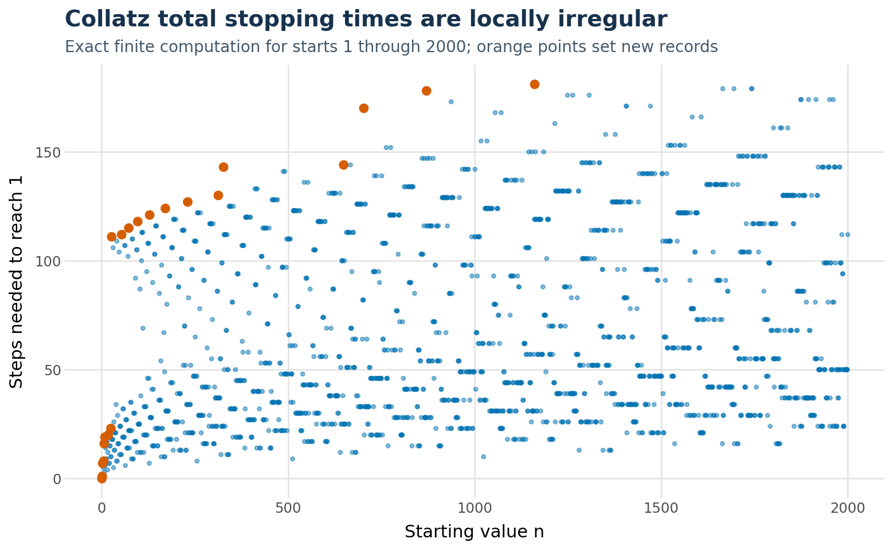

# Open Problems and Responsible Experiment {#sec-frontiers}

<div class="chapter-goals">

**Learning goals.** Label mathematical status precisely; explain twin-prime, Goldbach, and Collatz questions; separate bounded verification from proof; design reproducible finite experiments; recognize how heuristics guide without certifying.

</div>

Elementary statements can conceal extraordinary difficulty. A responsible encounter with open problems is not a collection of dramatic claims; it is practice in quantifiers, evidence, and status. The discipline learned here applies equally to research papers, software tests, and everyday inference.

## The taxonomy of mathematical status

### Theorem, conjecture, heuristic, and conditional result

A **theorem** follows deductively from stated axioms and earlier results. A **conjecture** is a precise assertion believed or investigated but not proved. A **heuristic** is an explanatory model or plausibility argument without deductive force. A **conditional result** has the form “if hypothesis $H$, then conclusion $C$”; it proves the implication, not necessarily $H$ or $C$ independently.

There are other useful labels. A lemma supports a later theorem. A corollary follows readily from one. A computational verification is a theorem about a finite, explicitly checked domain if the computation and its correctness are justified. An asymptotic theorem concerns a limit and need not settle every small case.

### Computation is finite evidence

Suppose a program checks $P(n)$ for $1\le n\le B$. Its logical conclusion is
$$
\forall n\in\mathbb Z,\quad 1\le n\le B\Longrightarrow P(n),
$$
subject to trust in code, hardware, and validation. It does not conclude $P(n)$ for $n>B$. Larger $B$ can increase confidence in a heuristic and eliminate small counterexamples, but infinity remains outside every finite bound.

Reproducibility strengthens a finite claim: specify code, version, parameters, integer types, checksums or outputs, and independent cross-checks. It does not change the quantifier.

## Twin primes and bounded gaps

### The conjecture

The **twin prime conjecture** asserts that infinitely many primes $p$ have $p+2$ also prime. Examples include $(3,5)$, $(5,7)$, $(11,13)$, and $(17,19)$. Apart from $(3,5)$, the middle number is divisible by $6$, so every later pair has the form $(6k-1,6k+1)$. This necessary form does not prove infinitely many successes.

A sieve heuristic predicts infinitely many twin primes and an asymptotic count proportional to $x/(\log x)^2$, with a correction product accounting for residue exclusions. This Hardy–Littlewood prediction is influential and numerically successful, but the twin-prime case remains unproved.

### What bounded-gap theorems establish

**Theorem 14.1 (Established).** There exists a finite constant $H$ such that infinitely many pairs of distinct primes differ by at most $H$. Zhang's breakthrough and subsequent Maynard–Tao methods proved and sharpened this bounded-gap statement unconditionally.

This does not prove the twin-prime conjecture because “at most some finite $H$” does not imply “equal to $2$.” Improvements to numerical bounds are substantial mathematics, yet the final logical gap is qualitative. We avoid quoting a “current best” value because such optimization records can change and are not needed for the theorem's meaning.

## Goldbach's conjecture

### Strong and weak forms

The **strong Goldbach conjecture** says every even integer greater than $2$ is the sum of two primes. It remains open in this edition. The **weak Goldbach theorem**, proved by Harald Helfgott, says every odd integer greater than $5$ is the sum of three primes.

The adjective “weak” describes logical strength, not proof quality. The proved three-prime theorem is a major analytic achievement. It does not immediately imply the two-prime conjecture because removing one prime while preserving primality of the other summands is precisely the hard part.

### Verified ranges versus proofs

Strong Goldbach has been verified computationally through very large finite ranges, and related theorems show every sufficiently large odd integer has controlled prime representations. These facts are evidence and partial structure. A complete proof needs either an exhaustive bound paired with a theorem above that bound, or one argument covering all even integers.

When reporting a verification, cite the precise bound and method from a maintained primary source. This book omits a mutable record value and focuses on the invariant logic.

## The Collatz map as a cautionary case

### Stopping times and trajectories

Define
$$
T(n)=
\begin{cases}
n/2,&n\text{ even},\\
3n+1,&n\text{ odd}.
\end{cases}
$$
The **Collatz conjecture** asserts that every positive starting integer eventually reaches $1$. Once $1$ is reached, the uncompressed map enters the cycle $1,4,2,1$.

The total stopping time is the least $k$ with $T^k(n)=1$, if such $k$ exists. An unverified trajectory might diverge or enter another cycle, so a program must impose a stopping rule rather than assume termination.

<figure id="fig-collatz">


<figcaption>

Figure 14.1: Total stopping times for Collatz starting values from 1 through 2000, with record-setting starts highlighted.

</figcaption>
</figure>

[Figure 14.1](#fig-collatz) shows extreme local irregularity. Nearby starting values can have very different stopping times, and occasional records punctuate the cloud. Every plotted trajectory reaches $1$; the plot asserts nothing about starts beyond $2000$.

### Random-walk heuristics and their limits

Odd steps increase $n$ to $3n+1$, while powers of $2$ in subsequent even steps decrease it. A probabilistic model treats parity or divisibility patterns as roughly random and predicts average downward drift on a logarithmic scale. The heuristic helps explain why most observed trajectories fall.

But iterates are arithmetically dependent: the map determines future residues from the present one. Replacing them by independent coin flips changes the problem. Significant partial theorems describe large sets of starting values in density senses, yet none proves that every positive integer reaches $1$.

## Designing reproducible experiments

A useful number-theory experiment follows a short protocol:

1. **State the finite question.** Give the range, inclusivity, and definitions.
2. **Use exact arithmetic.** Overflow can silently corrupt divisibility and trajectories.
3. **Declare termination.** Bound iterations or prove the loop terminates.
4. **Cross-check.** Compare a second method, known small cases, or invariant.
5. **Preserve provenance.** Record environment, seed if randomness is used, and output summaries.
6. **Report the actual quantifier.** Say “no exception for $n\le B$,” not “there is no exception.”

For conjecture discovery, partition data before inspection: use one range to notice a pattern and a disjoint range to challenge it. Search deliberately for boundary cases and values likely to stress the rule.

<div class="callout callout-warning">
<p class="callout-title">Pitfall: theorem by graph</p>

A visual compresses finite data and can reveal structure, outliers, or errors. It cannot certify an infinite claim, and plotting choices can conceal exceptional points.

</div>

The polynomial and rational iteration framework in [sec-arithmetic-dynamics](41-arithmetic-dynamics.md#sec-arithmetic-dynamics)
returns to this warning with functional graphs, good reduction, and canonical
heights. It also explains why those degree-based height theorems do not transfer
automatically to the parity-dependent Collatz map.

<!-- inline-formula-code:start -->
## Formula and finite computation

A useful formula in this chapter is

$$
2m=p+q\quad\text{with primes }p,q
$$

A bounded search can audit Goldbach representations without claiming the conjecture. The following standalone Python block expresses that finite rule with its inputs and stopping conditions visible.

```python
from math import isqrt

def is_prime(number: int) -> bool:
    if number < 2:
        return False
    return all(number % d != 0 for d in range(2, isqrt(number) + 1))

limit = 50
representations = {
    even: next(
        ((p, even - p) for p in range(2, even) if is_prime(p) and is_prime(even - p)),
        None,
    )
    for even in range(4, limit + 1, 2)
}
print(representations)
```

**What the computation establishes.** The output certifies only the declared finite case. The theorem, if one is claimed, still requires the argument developed in the chapter.
<!-- inline-formula-code:end -->

## Summary

- Status words encode logical guarantees and should never be used decoratively.
- Twin primes remain conjectural; finite bounded gaps occur infinitely often by theorem.
- Weak Goldbach is proved; strong Goldbach remains open.
- Collatz experiments are compelling but finite, and random-walk models are heuristic.
- Reproducible computation supports precise bounded statements.

## Exercises

<div class="exercise" id="number_theory-14-frontiers-ex-1">
<p class="exercise-title"><strong>Exercise 1</strong></p>

Classify each statement as theorem, conjecture, heuristic, or conditional result: PNT; RH; “RH implies a strong prime error bound”; random Collatz drift.

</div>

<div class="exercise" id="number_theory-14-frontiers-ex-2">
<p class="exercise-title"><strong>Exercise 2</strong></p>

Prove every twin-prime pair beyond $(3,5)$ has the form $(6k-1,6k+1)$.

<details class="hint"><summary>Hint 1</summary>

among three consecutive integers $6k-1,6k,6k+1$, the middle is the only possible multiple of $3$ once the primes exceed $3$.

</details>

</div>

<div class="exercise" id="number_theory-14-frontiers-ex-3">
<p class="exercise-title"><strong>Exercise 3</strong></p>

Explain in quantifiers why a bounded-gap theorem with $H=100$ would not prove twins.

<details class="hint"><summary>Hint 1</summary>

“there exists $H$” and “$H=2$” are different conclusions.

</details>

</div>

<div class="exercise" id="number_theory-14-frontiers-ex-4">
<p class="exercise-title"><strong>Exercise 4</strong></p>

Write prime decompositions of even integers from $4$ through $30$ and state the exact finite conclusion.

</div>

<div class="exercise" id="number_theory-14-frontiers-ex-5">
<p class="exercise-title"><strong>Exercise 5</strong></p>

Compute Collatz trajectories for $n=6,7,8$ by hand.

</div>

<div class="exercise" id="number_theory-14-frontiers-ex-6">
<p class="exercise-title"><strong>Exercise 6</strong></p>

Design a loop guard for a Collatz experiment that does not assume the conjecture.

<details class="hint"><summary>Hint 1</summary>

stop on reaching $1$, repeating a seen state, exceeding an iteration bound, or exceeding a value bound; report which occurred.

</details>

</div>

<div class="exercise" id="number_theory-14-frontiers-ex-7">
<p class="exercise-title"><strong>Exercise 7</strong></p>

Give an example where checking many initial cases is misleading.

</div>

<div class="exercise" id="number_theory-14-frontiers-ex-8">
<p class="exercise-title"><strong>Exercise 8</strong></p>

Draft a reproducibility statement for a modular-residue search, including range and integer representation.

</div>
