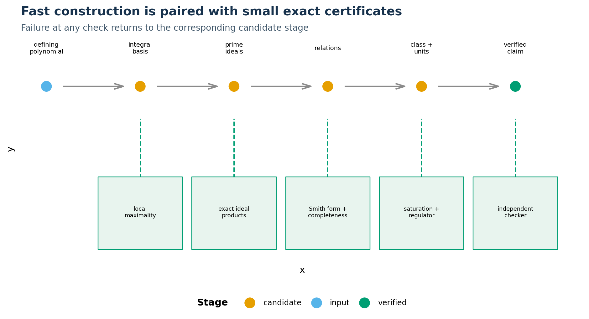

# Synthesis: Local-to-Global Number Theory {#sec-synthesis}

<div class="chapter-goals">

**Learning goals.** Select tools by problem structure; combine congruence, factorisation, approximation, and ring enlargement; solve integrated representation and reconstruction cases; audit proofs; plan a path into further number theory.

</div>

The subject's power lies less in any isolated theorem than in moving between viewpoints. An equation over integers can be reduced modulo primes, encoded by valuations, approximated by rationals, or factored in a larger ring. The art is choosing what information to discard and what structure to expose.

## A decision tree for integer problems

### Factor, reduce, approximate, or enlarge the ring

When confronting a new problem, begin with its quantifiers and domain. Then ask:

- **Divisibility present?** Factor expressions, compute gcds, and seek Bézout combinations.
- **Powers or remainders present?** Reduce modulo a purposeful modulus and inspect units or orders.
- **Several modular observations?** Check gcd compatibility and apply CRT.
- **Integer equation?** Parametrise a linear family, search for congruence obstructions, or descend.
- **Near equality of ratios?** Run Euclid and inspect continued fractions.
- **A quadratic factorisation missing?** Enlarge to a suitable number ring and use a norm.
- **A counting-over-divisors identity?** Use multiplicativity, convolution, or Möbius inversion.

This is not an automatic solver. A modulus should be chosen because it collapses the possible values; a ring should be enlarged because it reveals factorisation while retaining control.

### Choosing an invariant

An invariant remains unchanged under a transformation; a monovariant moves only in one direction. Euclid preserves the gcd while reducing the second coordinate. Descent preserves solvability while decreasing a positive measure. Modular reduction preserves polynomial equality while discarding magnitude. Norms convert multiplication in an enlarged ring to multiplication of nonnegative integers.

Before calculating, write what the proposed move preserves. This sentence often becomes the proof's spine and exposes invalid moves early.

## Capstone case study: representing an integer by two squares

### Congruence filters

Suppose we ask whether $n=x^2+y^2$ for integers $x,y$. Modulo $4$, primes $p\equiv3\pmod4$ have $-1$ as a nonresidue. If such a $p$ divides $x^2+y^2$ and $p\nmid y$, then $(xy^{-1})^2\equiv-1\pmod p$, impossible. Hence $p\mid y$, and then $p\mid x$. It follows that $p^2\mid x^2+y^2$. Repeating shows every $p\equiv3\pmod4$ occurs in $n$ with even exponent.

This is a local obstruction amplified by valuation. It is necessary, but sufficiency still needs a construction.

### Prime-factor structure

Factor
$$
n=2^a\prod_{p\equiv1(4)}p^{e_p}\prod_{q\equiv3(4)}q^{f_q}.
$$
If every $f_q$ is even, primes $q$ contribute squares and therefore trivial two-square factors. The identity
$$
(r^2+s^2)(u^2+v^2)=(ru-sv)^2+(rv+su)^2
$$
combines representations. It remains to represent each prime $p\equiv1\pmod4$, which quadratic residues and Gaussian gcds accomplish.

For $n=325=5^2\cdot13$, use $5=1^2+2^2$ and $13=2^2+3^2$. Combining representations twice yields solutions; direct inspection finds $325=1^2+18^2=6^2+17^2=10^2+15^2$. Different Gaussian factor choices explain the multiplicity.

### Gaussian-integer explanation

In $\mathbb Z[i]$, $x^2+y^2=N(x+iy)$. Primes $1$ modulo $4$ split, primes $3$ modulo $4$ remain prime, and $2$ ramifies. A Gaussian element of norm $n$ can contain an inert prime only through a rational factor, contributing an even exponent to the norm. Conversely, choose one factor from each conjugate pair over every split prime and multiply. Unique factorisation makes the criterion both necessary and sufficient.

The global theorem is thus assembled from local prime behavior inside a ring chosen to factor the form.

## Capstone case study: reconstructing hidden integers

### CRT design

Suppose a sensor reports residues modulo $7,11,13$ and the hidden nonnegative integer is below $1000$. Their product is $1001$, just large enough for unique recovery. If the readings are
$$
x\equiv4\pmod7,\qquad x\equiv9\pmod{11},\qquad x\equiv3\pmod{13},
$$
incremental reconstruction starts $x=4+7t$. The second condition gives $7t\equiv5\pmod{11}$, so $t\equiv7\pmod{11}$ and $x\equiv53\pmod{77}$. Write $x=53+77u$; modulo $13$, $77u\equiv12u\equiv2$, so $u\equiv11$. Thus $x\equiv900\pmod{1001}$, and the range fixes $x=900$. Indeed, $900$ has residues $4$, $9$, and $3$ modulo $7$, $11$, and $13$, respectively.

The design principle is explicit: pairwise-coprime moduli create independent coordinates, and their product must exceed the ambiguity range.

### Error detection and ambiguity

If we add a redundant modulus, not every tuple of readings is valid. For instance, reconstruct from three moduli and compare the predicted fourth residue. This detects some errors but does not necessarily correct them. Correction requires enough redundancy and a model for how many residue channels may fail.

Without the bound $x<1000$, every $900+1001k$ fits. Without coprimality, the product overstates information. Without a common origin, the readings may be systematically shifted. CRT solves the formal system presented; modeling determines whether that system describes reality.

## Proof-writing clinic

### Auditing quantifiers and edge cases

Use this compact audit:

1. **Domain:** Are zero, negative values, or units included?
2. **Quantifiers:** Is the claim universal, existential, or asymptotic?
3. **Definitions:** Has each symbol been introduced before use?
4. **Hypotheses:** Where does primality, coprimality, or positivity enter?
5. **Reversibility:** Did division, cancellation, or square-root extraction lose cases?
6. **Termination:** Does an algorithm or descent have a decreasing nonnegative measure?
7. **Status:** Is any conjectural or conditional input labeled?

A proof should survive this audit independently of its author's intention.

### Separating evidence from conclusion

Write computational evidence in a separate sentence from the theorem claim. For example: “The script finds the identity for $1\le n\le10^5$. The following induction proves it for every positive integer.” If no proof follows, say that the experiment motivates a conjecture.

Plots need the same separation. State the finite dataset and visual encoding, then state what pattern is visible, then supply—or explicitly withhold—the deductive argument.

## Visual synthesis: claims and certificates

<figure id="fig-nt-synthesis-certificate-pipeline">


<figcaption>

Figure 15.1: An algebraic computation is organized as input, transformation, certificate, and verification.

</figcaption>
</figure>

[Figure 15.1](#fig-nt-synthesis-certificate-pipeline) supplies a reusable question for
every method in this chapter: what can a second reader check without rerunning
the entire search? A congruence, factorization, Bézout identity, or norm equality
is stronger evidence than an unexplained final number.

## Where to go next

Several routes now open:

- **Algebraic number theory:** number fields, Dedekind domains, class groups, and reciprocity laws.
- **Analytic number theory:** Dirichlet series, sieve methods, exponential sums, and prime distributions.
- **$p$-adic analysis:** completions, Hensel lifting, local fields, and local–global principles.
- **Arithmetic geometry:** rational points on curves, elliptic curves, and Diophantine geometry.
- **Computational number theory:** primality proofs, factorisation, lattice reduction, and computer algebra.

Choose a route by revisiting a chapter whose unresolved question felt structural rather than merely difficult.

## Final challenge set

<div class="exercise" id="number_theory-15-synthesis-ex-1">
<p class="exercise-title"><strong>Exercise 1</strong></p>

**Divisibility synthesis.** Prove $\gcd(a+b,a^2-ab+b^2)$ divides $3\gcd(a,b)^2$, and identify where coprimality simplifies the statement.

<details class="hint"><summary>Hint 1</summary>

reduce to $\gcd(a,b)=1$ and take linear combinations of $a+b$ with the quadratic expression.

</details>

</div>

<div class="exercise" id="number_theory-15-synthesis-ex-2">
<p class="exercise-title"><strong>Exercise 2</strong></p>

**CRT synthesis.** Recover $x<5000$ from $x\equiv8\pmod{17}$, $x\equiv3\pmod{19}$, $x\equiv14\pmod{23}$.

</div>

<div class="exercise" id="number_theory-15-synthesis-ex-3">
<p class="exercise-title"><strong>Exercise 3</strong></p>

**Residue synthesis.** Determine all primes $p$ for which $x^2\equiv-2\pmod p$ is soluble, expressing the answer in residue classes modulo $8$ and treating $p=2$ separately.

<details class="hint"><summary>Hint 1</summary>

factor the symbol $(-2/p)=(-1/p)(2/p)$ and combine the supplementary laws.

</details>

</div>

<div class="exercise" id="number_theory-15-synthesis-ex-4">
<p class="exercise-title"><strong>Exercise 4</strong></p>

**Function synthesis.** Prove $\sum_{d\mid n}\mu(d)\tau(n/d)=1$ and interpret it by convolution.

<details class="solution"><summary>Solution</summary>

In convolution notation, $\tau=\mathbf1*\mathbf1$. Therefore
$$
\mu*\tau=\mu*(\mathbf1*\mathbf1)
=(\mu*\mathbf1)*\mathbf1
=\varepsilon*\mathbf1
=\mathbf1.
$$
Evaluating at $n$ gives
$$
\sum_{d\mid n}\mu(d)\tau(n/d)=1.
$$
The identity removes one layer of unrestricted divisor choice by Möbius cancellation.

</details>

</div>

<div class="exercise" id="number_theory-15-synthesis-ex-5">
<p class="exercise-title"><strong>Exercise 5</strong></p>

**Approximation synthesis.** Show any Pell solution yields a convergent to $\sqrt D$ once its denominator is large enough, using the $1/(2q^2)$ criterion.

</div>

<div class="exercise" id="number_theory-15-synthesis-ex-6">
<p class="exercise-title"><strong>Exercise 6</strong></p>

**Ring synthesis.** Find two representations of $1105$ as a sum of two squares using $1105=5\cdot13\cdot17$ and the product identity.

<details class="hint"><summary>Hint 1</summary>

use $5=1^2+2^2$, $13=2^2+3^2$, and $17=1^2+4^2$, choosing signs differently in the product identity.

</details>

</div>

<div class="exercise" id="number_theory-15-synthesis-ex-7">
<p class="exercise-title"><strong>Exercise 7</strong></p>

**Status audit.** Write a paragraph that distinguishes what is proved, computed, and conjectured about twin primes.

</div>

<div class="exercise" id="number_theory-15-synthesis-ex-8">
<p class="exercise-title"><strong>Exercise 8</strong></p>

**Capstone.** Choose an integer equation from this book. Produce a two-page analysis using at least three viewpoints, one worked example, one obstruction or invariant, and a statement of any unresolved step.

</div>

## Closing perspective

The integers are global objects assembled from local prime data. Divisibility exposes their atoms; congruence views one local shadow; CRT recombines shadows; continued fractions measure near misses; number rings change what can factor; analysis averages the whole landscape. Good number theory moves among these views while keeping its logical promises exact.

<!-- inline-formula-code:start -->
## Formula and finite computation

A useful formula in this chapter is

$$
n\longmapsto(n\bmod m_1,\ldots,n\bmod m_r)
$$

A residue signature displays how several local views encode one integer. The following standalone Python block expresses that finite rule with its inputs and stopping conditions visible.

```python
number = 137
moduli = (3, 5, 7)
signature = tuple(number % modulus for modulus in moduli)
candidates = [
    value
    for value in range(3 * 5 * 7)
    if tuple(value % modulus for modulus in moduli) == signature
]
print(signature, candidates)
```

**What the computation establishes.** The output certifies only the declared finite case. The theorem, if one is claimed, still requires the argument developed in the chapter.
<!-- inline-formula-code:end -->
