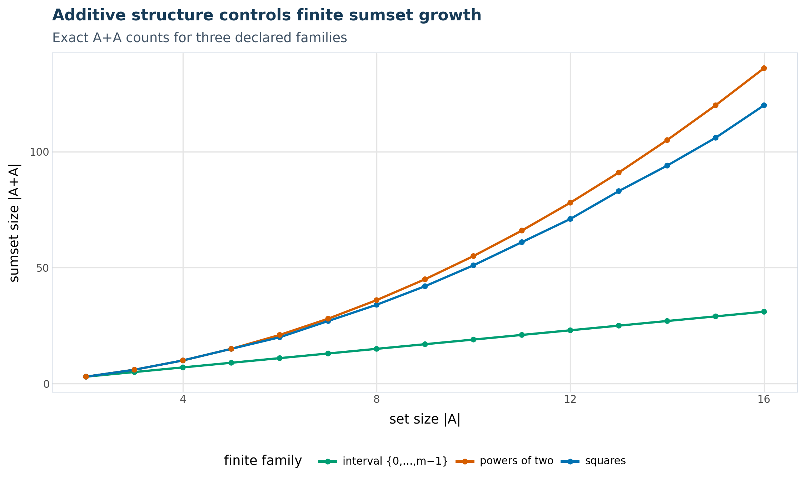

# Additive and Combinatorial Number Theory {#sec-additive}

**Level and prerequisites: L3.** Prepare finite abelian groups, arithmetic functions and the pigeonhole principle. Use the [level-specific reading guide](index.md#who-this-book-is-for) for linked Euler preparation.

<div class="chapter-goals">

**Learning goals.** Work with sumsets; recognize when pigeonhole arguments force
arithmetic structure; prove elementary zero-sum results; distinguish finitary
theorems about progressions from asymptotic heuristics; encode partitions with
generating functions; understand what the circle method is designed to do.

</div>

Earlier chapters emphasized multiplication: factors, primes, units, and
multiplicative functions. **Additive number theory** asks how integers are built
from sums. Addition sounds simpler, yet prime factorization no longer separates
the problem. Goldbach's conjecture is the emblematic warning: knowing the prime
factors of the summands does not make their sum transparent.

## Sumsets and additive structure

An **additive group** is a set with an associative addition, a zero element,
and an additive inverse for every element; familiar examples are $\mathbb Z$
and $\mathbb Z/p\mathbb Z$. For finite sets $A,B$ in such a group, define

$$
A+B=\{a+b:a\in A,\ b\in B\}.
$$

Repeated sums are written $2A=A+A$ and $kA=A+\cdots+A$. If
$A=\{0,1,4\}$, then $A+A=\{0,1,2,4,5,8\}$. There are nine ordered pairs but
only six distinct sums because representations collide.

The size of $A+A$ measures additive organization. An interval
$A=\{0,1,\ldots,m-1\}$ has $|A+A|=2m-1$, nearly the smallest possible over
the integers. A sparse-looking set such as $\{1,10,100\}$ has all six unordered
sums distinct. Small **doubling** $|A+A|/|A|$ signals progression-like
structure; large doubling signals fewer additive relations.

**Proposition 16.1.** If $A,B$ are nonempty finite subsets of $\mathbb Z$, then
$|A+B|\ge |A|+|B|-1$.

**Proof.** Write $a_1<\cdots<a_r$ and $b_1<\cdots<b_s$. The chain

$$
a_1+b_1<a_2+b_1<\cdots<a_r+b_1<a_r+b_2<\cdots<a_r+b_s
$$

contains $r+s-1$ distinct elements of $A+B$. Equality occurs for matching
arithmetic progressions, though proving the full inverse statement requires
more work. $\square$

Modulo a prime $p$, wraparound changes the bound. The **Cauchy–Davenport
Theorem** states

$$
|A+B|\ge\min(p,|A|+|B|-1)
$$

for nonempty $A,B\subseteq\mathbb Z/p\mathbb Z$. A polynomial proof is beyond
our present route, but the statement is precise: primality is essential, and
cardinality is counted after residues collide.

## Pigeonhole arguments in arithmetic

The pigeonhole principle says that placing more than $m$ objects into $m$
boxes forces a shared box. The difficult step is choosing boxes that encode the
desired conclusion.

**Dirichlet approximation, elementary form.** For every real $\alpha$ and
positive integer $N$, there are integers $p,q$ with $1\le q\le N$ such that

$$
|q\alpha-p|<\frac1N.
$$

**Proof.** Put the $N+1$ fractional parts
$0,\{\alpha\},\ldots,\{N\alpha\}$ into $N$ half-open intervals of length
$1/N$. Two occupy one interval. Subtract their indices; their fractional parts
differ by less than $1/N$, producing $q$ and an integer $p$ with the required
bound.
$\square$

Dividing by $q$ gives $|\alpha-p/q|<1/(qN)$. This result is finite and
constructive in principle. It does not say which denominator is best; continued
fractions answer that sharper question.

Another useful choice of boxes is residue class. Among any $n+1$ integers, two
have the same residue modulo $n$, so their difference is divisible by $n$.
This statement concerns values, not necessarily adjacent positions.

## Zero-sum phenomena

Partial sums convert a consecutive-block question into a collision question.

**Theorem 16.2.** Given integers $a_1,\ldots,a_n$, some nonempty consecutive block
has sum divisible by $n$.

**Proof.** Consider $s_j=a_1+\cdots+a_j$. If some $s_j\equiv0\pmod n$, use
the first $j$ terms. Otherwise the $n$ nonzero residues $s_1,\ldots,s_n$ occupy
only $n-1$ classes, so $s_i\equiv s_j$ for some $i<j$. Then
$a_{i+1}+\cdots+a_j=s_j-s_i$ is divisible by $n$. $\square$

The word “consecutive” is supplied by subtracting partial sums. Without that
encoding, a raw pigeonhole count would miss the geometry of the index set.

A deeper benchmark is the **Erdős–Ginzburg–Ziv Theorem**: among any $2n-1$
integers, one can select exactly $n$ whose sum is divisible by $n$. We state it
without proof. Notice how it strengthens both the prescribed number of terms
and the lack of a consecutiveness requirement.

## Arithmetic progressions

A three-term arithmetic progression has form $a,a+d,a+2d$ with $d\ne0$.
Equivalently, its middle term is the average of the endpoints:
$x+z=2y$. Sets without such triples are called **3-AP-free**.

Residues help locate progressions but also create false impressions. The set of
odd integers contains progressions such as $1,3,5$; avoiding one residue class
does not destroy additive structure. A finite interval can contain a large
3-AP-free set, yet density changes the conclusion.

**Theorem 16.3 (Roth's (stated)).** For every $\delta>0$, there is $N_0$ such that if
$N\ge N_0$ and $A\subseteq\{1,\ldots,N\}$ has $|A|\ge\delta N$, then $A$
contains a nonconstant three-term arithmetic progression.

The theorem is qualitative as stated: a fixed positive density eventually
forces a progression. It does not say every large set does; size relative to
$N$ matters. Fourier analysis on finite cyclic groups is one route to proof.

## Partitions and generating functions

A **partition** of $n$ writes $n$ as a sum of positive integers without regard
to order. Thus $4$ has five partitions:

$$
4,\qquad 3+1,\qquad 2+2,\qquad 2+1+1,\qquad 1+1+1+1.
$$

Let $p(n)$ be the number of partitions and set $p(0)=1$. The formal identity

$$
\sum_{n\ge0}p(n)x^n
=\prod_{k\ge1}\frac1{1-x^k}
=\prod_{k\ge1}(1+x^k+x^{2k}+\cdots)
$$

encodes independent choices: choose zero, one, two, or more parts of size $k$.
For the coefficient of $x^n$, only factors with $k\le n$ matter, so the
identity can be manipulated formally without first discussing analytic
convergence.

Restricting to distinct parts replaces each factor by $(1+x^k)$. Restricting
to odd parts keeps $(1-x^k)^{-1}$ only for odd $k$. Algebra shows

$$
\prod_{k\ge1}(1+x^k)
=\prod_{k\ge1}\frac{1-x^{2k}}{1-x^k}
=\prod_{\text{odd }j\ge1}\frac1{1-x^j}.
$$

Therefore partitions into distinct parts and partitions into odd parts are
equinumerous. The generating function proves equality of counts; a bijection
would explain how to transform individual partitions.

## What the circle method tries to measure

Suppose $r_k(n)$ counts representations of $n$ as a sum of $k$ members of a
set. Encode that set by an exponential sum

$$
S(\alpha)=\sum_{m\le X}w(m)e^{2\pi i\alpha m}.
$$

Orthogonality of complex exponentials extracts the required coefficient:

$$
r_k(n)=\int_0^1 S(\alpha)^k e^{-2\pi i\alpha n}\,d\alpha
$$

for a suitable weight and range. The circle method divides the integral into
**major arcs**, near rationals with small denominators where arithmetic
structure dominates, and **minor arcs**, where cancellation should make the
contribution small.

This is a blueprint, not a proof of Goldbach. Success depends on estimates
strong enough for the particular sequence and number of summands. The method
beautifully illustrates a recurring move: convert addition into multiplication
of generating objects, then recover one coefficient by integration.

The missing cancellation machinery is supplied in [sec-exponential-sums](37-exponential-sums.md#sec-exponential-sums):
Weyl's criterion, exact linear phases, van der Corput differencing, Fourier
completion, Gauss sums, and explicit theorem boundaries for deeper character
and Kloosterman estimates. That chapter turns the present major/minor-arc
blueprint into a route with auditable analytic inputs.

## Computational view of sumset growth

<figure id="fig-nt-additive-sumset-growth">


<figcaption>

Figure 16.1: Three exact finite families exhibit different sumset growth.

</figcaption>
</figure>

The interval curve in [Figure 16.1](#fig-nt-additive-sumset-growth) grows slowly because many
ordered pairs collide at the same sum. The powers-of-two curve has fewer
collisions. The finite table motivates doubling and additive energy, while the
theorems explain which conclusions survive beyond these three families.

<!-- inline-formula-code:start -->
## Formula and finite computation

A useful formula in this chapter is

$$
P_k(s)=P_{k-1}(s)+P_k(s-k)
$$

Dynamic programming stores the two terms in this partition recurrence. The following standalone Python block expresses that finite rule with its inputs and stopping conditions visible.

```python
def partition_counts(limit: int) -> list[int]:
    """Return p(0), p(1), ..., p(limit) by exact dynamic programming."""
    if limit < 0:
        raise ValueError("limit must be nonnegative")
    ways = [0] * (limit + 1)
    ways[0] = 1
    for part in range(1, limit + 1):
        for total in range(part, limit + 1):
            ways[total] += ways[total - part]
    return ways

values = partition_counts(20)
for integer, count in enumerate(values):
    print(integer, count)
```

**What the computation establishes.** The calculation checks a declared finite instance; the surrounding argument explains what is true beyond those inputs.
<!-- inline-formula-code:end -->

## Chapter summary

- Sumsets measure how strongly a finite set is organized by addition; small
  doubling is evidence of progression-like structure.
- Pigeonhole arguments become powerful only after residues, fractional parts, or
  partial sums are chosen as the boxes.
- Zero-sum and progression theorems turn density or sequence length into forced
  additive structure, with hypotheses and theorem status kept explicit.
- Generating functions encode additive choices as products, while the circle
  method extracts representation counts through Fourier orthogonality.

## Pitfalls and practice

<div class="callout callout-warning">
<p class="callout-title">Common additive errors</p>

Do not count representations without stating whether order and repetition are
allowed. Do not transfer an integer sumset bound unchanged to a composite
modulus. Do not infer an infinite density theorem from a finite plot.

</div>

1. Compute $A+A$ and $A-A$ for $A=\{0,2,5\}$.
2. Prove $|A-A|\ge2|A|-1$ for nonempty finite $A\subset\mathbb Z$.
3. Among $11$ integers, prove two differ by a multiple of $10$.
4. Apply the consecutive-block theorem to $3,1,4,1,5$ with modulus $5$ and
   exhibit a block.
5. List all partitions of $6$ into distinct parts and all partitions of $6$
   into odd parts.
6. Show that the coefficient of $x^n$ in $(1+x+\cdots+x^a)(1+x+\cdots+x^b)$
   counts solutions of $u+v=n$ with $0\le u\le a$, $0\le v\le b$.
7. Find a 3-AP-free subset of $\{1,\ldots,8\}$ of size $4$ and verify every
   triple.
8. Explain exactly why the circle-method identity uses an integral over one
   full period.

**Checks.** For (1), $A+A=\{0,2,4,5,7,10\}$ and
$A-A=\{-5,-3,-2,0,2,3,5\}$. For (2), order the elements and use the chain
$a_1-a_r<\cdots<a_{r-1}-a_r<0<a_2-a_1<\cdots<a_r-a_1$.
For (4), partial sums are $3,4,3,4,4$ modulo $5$; the collision between the
first and third gives $1+4=5$. For (5), distinct: $6,5+1,4+2,3+2+1$; odd:
$5+1,3+3,3+1+1+1,1+1+1+1+1+1$. In (8), integration makes
$\int_0^1e^{2\pi i(m-n)\alpha}d\alpha$ equal $1$ for $m=n$ and $0$ otherwise.

The next chapter turns from additive representation to quadratic expressions,
where geometry, congruences, and factorization meet.
