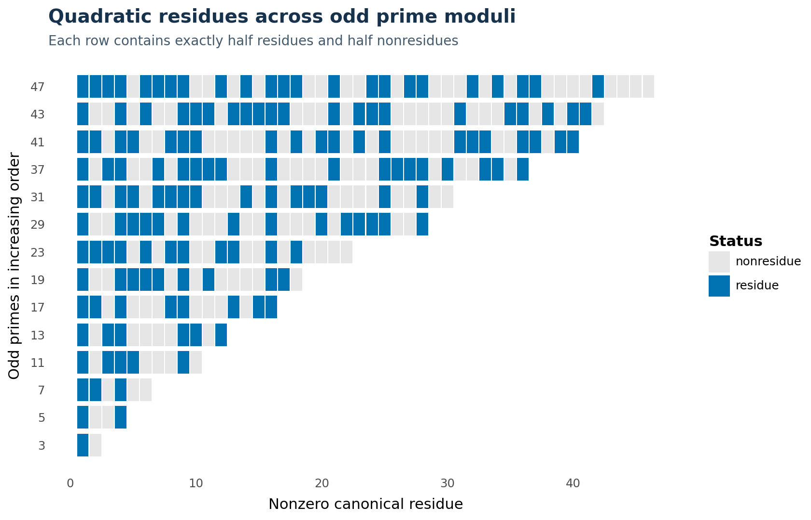

# Quadratic Forms and Representation {#sec-quadratic-forms}

**Level and prerequisites: L3.** Prepare quadratic residues, binary quadratic forms and elementary linear algebra. Use the [level-specific reading guide](index.md#who-this-book-is-for) for linked Euler preparation.

<div class="chapter-goals">

**Learning goals.** Compute discriminants and equivalent forms; reduce positive
definite binary quadratic forms; prove the two-square criterion from Gaussian
factorization; use local conditions without overclaiming sufficiency; interpret
class number as a failure of one-form classification.

</div>

A **binary quadratic form** is

$$
Q(x,y)=ax^2+bxy+cy^2,\qquad a,b,c\in\mathbb Z.
$$

It **represents** $n$ if $Q(x,y)=n$ for some integers $x,y$, and represents it
**primitively** when $\gcd(x,y)=1$. Questions such as whether $n=x^2+y^2$ or
$n=x^2+5y^2$ are therefore classification problems for forms.

## Discriminant and shape

The discriminant

$$
\Delta=b^2-4ac
$$

controls geometry. If $a>0$ and $\Delta<0$, then $Q$ is positive definite:
$Q(x,y)>0$ away from $(0,0)$. Completing the square shows why:

$$
4aQ(x,y)=(2ax+by)^2-\Delta y^2.
$$

When $\Delta<0$, both terms on the right are nonnegative and cannot vanish
simultaneously except at the origin. If $\Delta>0$, the form is indefinite and
takes both signs, whether or not $\Delta$ is a square. The degenerate case
$\Delta=0$ behaves like a squared linear form and requires separate treatment.

For $x^2+y^2$, $(a,b,c)=(1,0,1)$ and $\Delta=-4$. For
$x^2+xy+2y^2$, the discriminant is $1-8=-7$.

## Equivalence by changing integer coordinates

Let

$$
\begin{pmatrix}x\\y\end{pmatrix}
=M\begin{pmatrix}u\\v\end{pmatrix},
\qquad M\in\operatorname{SL}_2(\mathbb Z),
$$

so $M$ has integer entries and determinant $1$. The substitution is reversible
over integer pairs because $M^{-1}$ also has integer entries. Forms related by
such a substitution are **properly equivalent** and represent exactly the same
integers, including primitive representations.

Two elementary moves generate these changes:

$$
(x,y)=(u+kv,v),\qquad (x,y)=(-v,u).
$$

The first replaces a basis vector by itself plus an integer multiple of the
other; the second swaps and rotates. Direct expansion verifies that the
discriminant stays fixed. Discriminant is therefore an invariant of the
equivalence class, though it does not identify a unique class.

## Reduction of positive definite forms

A positive definite form $(a,b,c)$ is **reduced** when

$$
|b|\le a\le c,
$$

with a conventional sign choice on boundary equalities. Reduction repeatedly
uses integer coordinate changes to decrease coefficients until these
inequalities hold. It is analogous to choosing a short, nearly orthogonal basis
for a lattice.

For fixed negative discriminant, reduced forms are finite in number. Since
$4a^2\le4ac=b^2-\Delta\le a^2-\Delta$, we have
$3a^2\le|\Delta|$, hence $a\le\sqrt{|\Delta|/3}$. Only finitely many $a$ and
$b$ remain, and $c=(b^2-\Delta)/(4a)$ is forced.

**Example: discriminant $-20$.** The bound gives $a\le2$. The reduced primitive
forms are

$$
x^2+5y^2\quad\text{and}\quad2x^2+2xy+3y^2.
$$

They are inequivalent. The first represents $1$; the second does not. Thus one
discriminant can contain several classes. Their number is the **class number**;
here it is $2$.

## Gaussian integers in full detail

The Gaussian integers $\mathbb Z[i]=\{a+bi:a,b\in\mathbb Z\}$ have norm

$$
N(a+bi)=a^2+b^2,\qquad N(zw)=N(z)N(w).
$$

Division with remainder follows by dividing in $\mathbb C$, rounding real and
imaginary parts to nearest integers, and observing that the error has norm at
most $1/2$. Therefore $\mathbb Z[i]$ is Euclidean, hence every nonzero nonunit
factors uniquely into Gaussian primes up to units $\{\pm1,\pm i\}$ and order.

Rational primes behave in three ways:

- $2=-i(1+i)^2$ **ramifies**;
- if $p\equiv1\pmod4$, then $p$ **splits** as $\pi\bar\pi$;
- if $p\equiv3\pmod4$, then $p$ remains Gaussian prime.

For the splitting claim, quadratic reciprocity gives an integer $r$ with
$r^2\equiv-1\pmod p$. Computing a Gaussian gcd
$\gcd(p,r+i)$ produces a nontrivial element $a+bi$ whose norm is $p$, so
$p=a^2+b^2$.

## The two-square theorem

**Theorem 17.1.** A positive integer $n$ is a sum of two integer squares if and only
if every prime $q\equiv3\pmod4$ occurs with even exponent in the factorization
of $n$.

**Necessity.** If $q\mid x^2+y^2$ and $q\nmid y$, then
$(xy^{-1})^2\equiv-1\pmod q$, impossible for $q\equiv3\pmod4$. Hence
$q\mid y$, then $q\mid x$, so $q^2\mid x^2+y^2$. Dividing and repeating shows
the valuation is even.

**Sufficiency.** The prime $2$ and every prime $1$ modulo $4$ are sums of two
squares; primes $3$ modulo $4$ occur in square factors. The identity

$$
(a^2+b^2)(c^2+d^2)=(ac-bd)^2+(ad+bc)^2
$$

combines the representations. This identity is simply norm multiplicativity in
$\mathbb Z[i]$. $\square$

For $n=65=5\cdot13$, multiply
$(1+2i)(2+3i)=-4+7i$ to get $65=4^2+7^2$. Choosing a conjugate factor gives
$(1+2i)(2-3i)=8+i$ and $65=8^2+1^2$.

Lagrange's four-square theorem says every nonnegative integer is a sum of four
squares. We state it without proof. It is stronger in universality but uses a
different algebraic setting; the noncommutative quaternions supply one route.

## Local representation tests

If $Q(x,y)=n$ over the integers, then the equation is solvable modulo every
$m$ and over the real numbers. These are **local necessary conditions**.
They are often cheap and powerful.

For $x^2+y^2=n$, reduction modulo $4$ immediately excludes $n\equiv3\pmod4$.
For $x^2+5y^2=n$, reduction modulo $5$ says that $n$ must be a square residue,
with $0$ included. Combining this with the parity information by direct
enumeration gives the possible residues
$0,1,4,5,6,9,10,14,16$ modulo $20$.

<figure id="fig-form-local-residues">


<figcaption>

Figure 17.1: Quadratic residues modulo several small moduli, used as quick local tests for equations represented by quadratic forms.

</figcaption>
</figure>

The highlighted classes in [Figure 17.1](#fig-form-local-residues) turn a modular obstruction
into a lookup: if the residue of a proposed right-hand side is absent, no
integer solution can exist. Passing every displayed test is evidence, not a
proof of global representability.

In general, even solvability over the reals and modulo every positive integer
need not imply global integral solvability by one fixed binary quadratic form;
we state that warning without proof. A related, more elementary distinction is
already visible at discriminant $-20$: the prime $3$ is represented by
$2x^2+2xy+3y^2$ at $(0,1)$ but not by $x^2+5y^2$. This particular example is
not itself a local–global counterexample—indeed, reduction modulo $5$
already obstructs the second equation. A **genus** groups form classes that
cannot be distinguished by certain local characters; the class group can
refine that information.

<div class="callout callout-warning">
<p class="callout-title">Necessary is not sufficient</p>

Checking every small modulus is still only a finite collection of necessary
tests. A local–global theorem must itself be proved for the family under
study. Never turn the absence of a found obstruction into a representation.

</div>

## A computational census

To study a positive definite form, a finite search can be certified. If
$Q(x,y)\le B$, completing the square provides bounds on $|x|$ and $|y|$.
Enumerate all lattice points in that bounding box, evaluate with exact integer
arithmetic, and record both represented values and multiplicities. Then verify
that the bound truly contains the ellipse $Q(x,y)\le B$.

Multiplicity requires conventions. Are $(x,y)$ and $(-x,-y)$ distinct? Do
automorphisms of the form count separately? Does “primitive” require
$\gcd(x,y)=1$? State these before comparing data with a formula.

<!-- inline-formula-code:start -->
## Formula and finite computation

A useful formula in this chapter is

$$
r_2(n)=\#\{(x,y)\in\mathbb Z^2:x^2+y^2=n\}
$$

The comprehension is the finite representation-count formula itself. The following standalone Python block expresses that finite rule with its inputs and stopping conditions visible.

```python
from math import isqrt

number = 25
radius = isqrt(number)
representations = [
    (x, y)
    for x in range(-radius, radius + 1)
    for y in range(-radius, radius + 1)
    if x * x + y * y == number
]
print(len(representations), representations)
```

**What the computation establishes.** The output certifies only the declared finite case. The theorem, if one is claimed, still requires the argument developed in the chapter.
<!-- inline-formula-code:end -->

## Chapter summary

- The discriminant controls the coarse geometry of a binary quadratic form and
  is preserved by reversible integer coordinate changes.
- Reduction gives finitely many representatives at each negative discriminant;
  more than one reduced class explains why a discriminant need not determine a
  single representation law.
- Gaussian unique factorization proves the two-square criterion and turns its
  product identity into norm multiplicativity.
- Congruence and local tests are necessary filters. Sufficiency requires a
  theorem for the exact family, and computational censuses require certified
  search bounds and counting conventions.

## Exercises and selected answers

<div class="exercise" id="number_theory-17-quadratic-forms-ex-1">
<p class="exercise-title"><strong>Exercise 1</strong></p>

Classify the signs of $2x^2+6xy+3y^2$ using its discriminant.

</div>

<div class="exercise" id="number_theory-17-quadratic-forms-ex-2">
<p class="exercise-title"><strong>Exercise 2</strong></p>

Apply $(x,y)=(u+v,v)$ to $x^2+5y^2$ and verify the discriminant.

</div>

<div class="exercise" id="number_theory-17-quadratic-forms-ex-3">
<p class="exercise-title"><strong>Exercise 3</strong></p>

Enumerate all reduced primitive forms of discriminant $-15$.

</div>

<div class="exercise" id="number_theory-17-quadratic-forms-ex-4">
<p class="exercise-title"><strong>Exercise 4</strong></p>

Use Gaussian multiplication to find two representations of $85$ as two
squares.

</div>

<div class="exercise" id="number_theory-17-quadratic-forms-ex-5">
<p class="exercise-title"><strong>Exercise 5</strong></p>

Prove that if $p\equiv3\pmod4$ divides $x^2+y^2$, then $p$ divides both
$x$ and $y$.

</div>

<div class="exercise" id="number_theory-17-quadratic-forms-ex-6">
<p class="exercise-title"><strong>Exercise 6</strong></p>

Decide whether $3^4\cdot7^2\cdot13$ is a sum of two squares and construct
one if it is.

</div>

<div class="exercise" id="number_theory-17-quadratic-forms-ex-7">
<p class="exercise-title"><strong>Exercise 7</strong></p>

Show that $x^2+y^2$ cannot represent a number congruent to $3$ modulo $4$,
but explain why this condition alone is not sufficient.

</div>

<div class="exercise" id="number_theory-17-quadratic-forms-ex-8">
<p class="exercise-title"><strong>Exercise 8</strong></p>

Design exact pseudocode to list values of $2x^2+2xy+3y^2$ up to $100$ and
justify the search box.

</div>

**Selected answers.** In (1), $\Delta=36-24=12>0$, so the form is
indefinite. For (3), the reduced forms are $(1,1,4)$ and $(2,1,2)$ under the
usual boundary convention. For (4), $85=9^2+2^2=7^2+6^2$. In (6), all primes
$3$ modulo $4$ have even exponent. Since $13=3^2+2^2$ and
$3^4 7^2=(3^2\cdot7)^2=63^2$, multiplication by the square gives
$3^4\cdot7^2\cdot13=189^2+126^2$. Always substitute a proposed representation
back into the target; the factorization criterion proves existence, while the
arithmetic still needs checking.

Quadratic forms turn representation into geometry on an integer lattice. The
next chapter develops that geometry directly.
