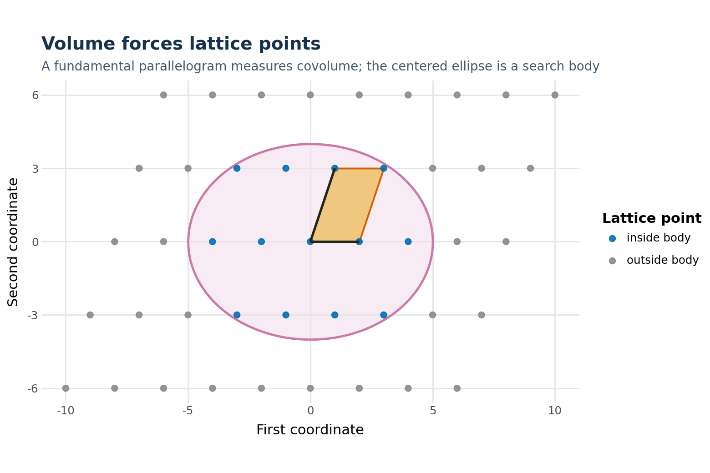

# Geometry of Numbers and Diophantine Approximation {#sec-geometry-numbers}

**Level and prerequisites: L4.** Prepare real linear algebra, lattice determinants, volume and compactness. Use the [level-specific reading guide](index.md#who-this-book-is-for) for linked Euler preparation.

<div class="chapter-goals">

**Learning goals.** Describe lattices independently of a chosen basis; compute
covolumes; apply Minkowski's convex-body theorem; derive rational and
simultaneous approximation results; connect continued fractions with short
lattice vectors; place irrationality and transcendence claims at the right
theorem level.

</div>

The **geometry of numbers** converts integer questions into the geometry of
points in Euclidean space. A divisibility condition becomes a sublattice, a
linear form becomes a strip, and a good approximation becomes an unexpectedly
short vector. The pictures guide the proof, while volume makes the counting
rigorous.

## Lattices, bases, and covolume

A full-rank lattice in $\mathbb R^n$ has form

$$
\Lambda=B\mathbb Z^n
=\{B\mathbf m:\mathbf m\in\mathbb Z^n\},
$$

where $B$ is an invertible real $n\times n$ matrix. Its columns form a lattice
basis. Different bases can generate the same lattice: replacing $B$ by $BU$
with $U\in\operatorname{GL}_n(\mathbb Z)$—an integer matrix whose inverse
also has integer entries—changes integer coordinates reversibly and preserves
the point set.

The half-open parallelepiped

$$
P=B[0,1)^n
$$

is a **fundamental region**: its translates by lattice points tile space
without overlapping interiors. Its volume

$$
\det(\Lambda)=|\det B|
$$

is the lattice's **covolume**. It does not depend on the basis because an
integer change-of-basis matrix has determinant $\pm1$.

**Example.** Vectors $(2,0)$ and $(1,3)$ generate a lattice of covolume
$|2\cdot3-0\cdot1|=6$. The skewed fundamental parallelogram contains the same
area as six unit squares. It need not contain exactly six integer points on its
boundary, because boundary conventions matter; area, not a naive point count,
is the invariant.

<figure id="fig-lattice-minkowski">


<figcaption>

Figure 18.1: A planar lattice, one fundamental region, and a symmetric convex body containing nonzero lattice points.

</figcaption>
</figure>

[Figure 18.1](#fig-lattice-minkowski) separates two roles. The parallelogram measures one copy
of the lattice; the symmetric convex body is a search region whose volume can
force a nonzero lattice point.

## Minkowski's convex-body theorem

A set $K\subset\mathbb R^n$ is **convex** if it contains the line segment
between any two of its points, and **centrally symmetric** if $K=-K$.

**Theorem 18.1 (Minkowski's).** Let $\Lambda$ be a full-rank lattice and let $K$ be a
convex, centrally symmetric, measurable set. If

$$
\operatorname{vol}(K)>2^n\det(\Lambda),
$$

then $K$ contains a nonzero lattice point.

**Proof idea.** Scale $K$ by $1/2$. Its volume exceeds one fundamental volume.
When points of $K/2$ are reduced modulo the lattice into a fundamental region,
two distinct points must coincide modulo $\Lambda$; this is the continuous
pigeonhole principle, formalized by Blichfeldt's lemma. Their difference is a
nonzero lattice vector. Because both points lie in $K/2$, central symmetry and
convexity put their difference in $K$. The strict inequality avoids boundary
ambiguity.

**Application: two squares near a prime.** For a prime $p\equiv1\pmod4$, choose
$r$ with $r^2\equiv-1\pmod p$ and define

$$
\Lambda=\{(x,y)\in\mathbb Z^2:x\equiv ry\pmod p\}.
$$

This lattice has covolume $p$. The closed disk of radius $\sqrt{2p}$ has area
$2\pi p>4p$, so Minkowski supplies a nonzero $(x,y)\in\Lambda$ with

$$
0<x^2+y^2\le 2p.
$$

The congruence makes $p\mid x^2+y^2$, so the sum is either $p$ or $2p$. In the
second case, $x$ and $y$ are both odd because $2p\equiv2\pmod4$, and

$$
\left(\frac{x+y}{2}\right)^2+
\left(\frac{x-y}{2}\right)^2=p.
$$

Either case gives a representation of $p$ as two squares.

## Dirichlet approximation as a lattice problem

For irrational $\alpha$ and $Q\ge1$, the elementary Dirichlet theorem gives
integers $p,q$ with $1\le q\le Q$ and

$$
\left|\alpha-\frac pq\right|<\frac1{qQ}.
$$

One geometric encoding uses the lattice

$$
\Lambda_\alpha=
\left\{(q,q\alpha-p):p,q\in\mathbb Z\right\},
$$

which has covolume $1$. A symmetric rectangle controlling $|q|$ horizontally
and $|q\alpha-p|$ vertically has area just beyond the Minkowski threshold.
The resulting nonzero lattice point is a rational approximation.

The quantifiers are important. For each bound $Q$, the theorem supplies some
$q\le Q$; as $Q$ grows, irrationality prevents the same nonzero error from
serving forever. Consequently infinitely many fractions satisfy

$$
\left|\alpha-\frac pq\right|<\frac1{q^2}.
$$

This does not mean every denominator provides such accuracy.

## Continued fractions as two-dimensional reduction

Convergents $p_k/q_k$ to $\alpha$ satisfy

$$
p_kq_{k-1}-p_{k-1}q_k=(-1)^{k-1}.
$$

Thus consecutive coordinate vectors form a unimodular basis of
$\mathbb Z^2$. The continued-fraction algorithm repeatedly replaces a basis by
a shorter one adapted to the line $x=\alpha y$. In this sense it is a
two-dimensional lattice-reduction algorithm.

The best-approximation property says that if $0<q<q_{k+1}$, then
$|q\alpha-p|\ge|q_k\alpha-p_k|$ for every integer $p$, apart from standard
tie qualifications. The algorithm does not merely find good fractions; it
certifies that no smaller denominator improves the relevant error.

**Example.** The convergents to $\sqrt2=[1;2,2,\ldots]$ are
$1/1,3/2,7/5,17/12,\ldots$. They also produce Pell solutions because
$p_k^2-2q_k^2$ is unusually small and alternates between $\pm1$ along suitable
indices. Approximation and exact Diophantine equations meet through the same
short vectors.

## Simultaneous approximation

For real $\alpha_1,\ldots,\alpha_d$ and positive integer $Q$, a pigeonhole
argument in the unit cube gives an integer $q$ with $1\le q\le Q^d$ and
integers $p_1,\ldots,p_d$ satisfying

$$
|q\alpha_j-p_j|\le\frac1Q
\quad(1\le j\le d).
$$

Partition $[0,1)^d$ into $Q^d$ cubes of side $1/Q$ and place the $Q^d+1$
fractional-part vectors $\{k(\alpha_1,\ldots,\alpha_d)\}$ inside. Two share a
cube; subtract their indices.

The price of approximating $d$ targets simultaneously is the denominator bound
$Q^d$. Dimension changes exponents, a theme that continues into higher-rank
lattice algorithms such as LLL.

## Irrationality and transcendence vistas

An **algebraic number** is a root of a nonzero polynomial with integer
coefficients. A real or complex number that is not algebraic is
**transcendental**. Every rational is algebraic, but $\sqrt2$ is irrational and
algebraic. The numbers $e$ and $\pi$ are transcendental.

Approximation can certify irrationality. If infinitely many distinct rationals
$p/q$ approximate $\alpha$ more closely than any rational number could permit,
then $\alpha$ cannot be rational. Liouville proved that for every algebraic
number $\alpha$ of degree $d\ge2$, there is a constant $c(\alpha)>0$ such that

$$
\left|\alpha-\frac pq\right|>\frac{c(\alpha)}{q^d}
$$

for every rational $p/q$ in lowest terms with $q>0$. Numbers constructed with
rational approximations of arbitrarily high power-law accuracy are therefore
transcendental.

Roth's theorem dramatically strengthens this: for algebraic irrational
$\alpha$ and every $\varepsilon>0$, only finitely many $p/q$ satisfy
$|\alpha-p/q|<q^{-2-\varepsilon}$. We state Roth's theorem without proof. It is
an upper limitation, not an algorithm for deciding whether an arbitrary
constant is transcendental.

<!-- inline-formula-code:start -->
## Formula and finite computation

A useful formula in this chapter is

$$
N(R)=\#\{(x,y)\in\mathbb Z^2:x^2+y^2\le R^2\}
$$

Enumerating lattice points makes the geometric counting problem literal. The following standalone Python block expresses that finite rule with its inputs and stopping conditions visible.

```python
radius = 5
lattice_points = [
    (x, y)
    for x in range(-radius, radius + 1)
    for y in range(-radius, radius + 1)
    if x * x + y * y <= radius * radius
]
print(len(lattice_points))
```

**What the computation establishes.** The output certifies only the declared finite case. The theorem, if one is claimed, still requires the argument developed in the chapter.
<!-- inline-formula-code:end -->

## Chapter summary

- A lattice is an integer span whose covolume is independent of the chosen
  basis; fundamental regions translate algebra into volume.
- Minkowski's theorem is a continuous pigeonhole principle: sufficient volume,
  together with convexity and symmetry, forces a nonzero lattice point.
- Rational and simultaneous approximation become searches for short lattice
  vectors, and continued fractions perform the exact two-dimensional reduction.
- Liouville and Roth bounds constrain how closely algebraic numbers can be
  approximated; their strong conclusions are stated with their quantifiers and
  deferred proof requirements.

## Pitfalls, exercises, and checks

<div class="callout callout-warning">
<p class="callout-title">Geometry does not erase arithmetic</p>

A large body forces a lattice point only under the theorem's symmetry,
convexity, volume, and full-rank hypotheses. A plotted empty region is not a
proof, and a short real vector need not have integer coordinates.

</div>

<div class="exercise" id="number_theory-18-geometry-numbers-ex-1">
<p class="exercise-title"><strong>Exercise 1</strong></p>

Find the covolume of the lattice generated by $(4,1)$ and $(2,3)$.

</div>

<div class="exercise" id="number_theory-18-geometry-numbers-ex-2">
<p class="exercise-title"><strong>Exercise 2</strong></p>

Give two different bases for $2\mathbb Z\times3\mathbb Z$ and verify equal
covolume.

</div>

<div class="exercise" id="number_theory-18-geometry-numbers-ex-3">
<p class="exercise-title"><strong>Exercise 3</strong></p>

Apply Minkowski in one dimension and interpret the result.

</div>

<div class="exercise" id="number_theory-18-geometry-numbers-ex-4">
<p class="exercise-title"><strong>Exercise 4</strong></p>

Use the fractional-part proof with $\alpha=\sqrt2,N=5$ to find an explicit
pair of close fractional parts and a rational approximation.

</div>

<div class="exercise" id="number_theory-18-geometry-numbers-ex-5">
<p class="exercise-title"><strong>Exercise 5</strong></p>

Verify the determinant identity for consecutive convergents $7/5$ and
$17/12$.

</div>

<div class="exercise" id="number_theory-18-geometry-numbers-ex-6">
<p class="exercise-title"><strong>Exercise 6</strong></p>

Prove the stated simultaneous approximation theorem by writing every
quantifier and box boundary convention.

</div>

<div class="exercise" id="number_theory-18-geometry-numbers-ex-7">
<p class="exercise-title"><strong>Exercise 7</strong></p>

Explain why $0.101001000100001\ldots$ is plausibly irrational but why its
decimal pattern alone is not yet a transcendence proof.

</div>

<div class="exercise" id="number_theory-18-geometry-numbers-ex-8">
<p class="exercise-title"><strong>Exercise 8</strong></p>

Research LLL from a reliable reference and state only its input, output
guarantee, and one number-theoretic use.

**Checks.** (1) gives $|12-2|=10$. For (2), the standard basis $(2,0),(0,3)$
and $(2,0),(2,3)$ both have covolume $6$ and differ by a unimodular matrix. In
(3), a symmetric interval of length greater than $2\det(\Lambda)$ contains a
nonzero lattice point. For (5), $7\cdot12-17\cdot5=-1$.

The next chapter changes not the lattice but the notion of distance, letting
divisibility itself define closeness.

</div>
