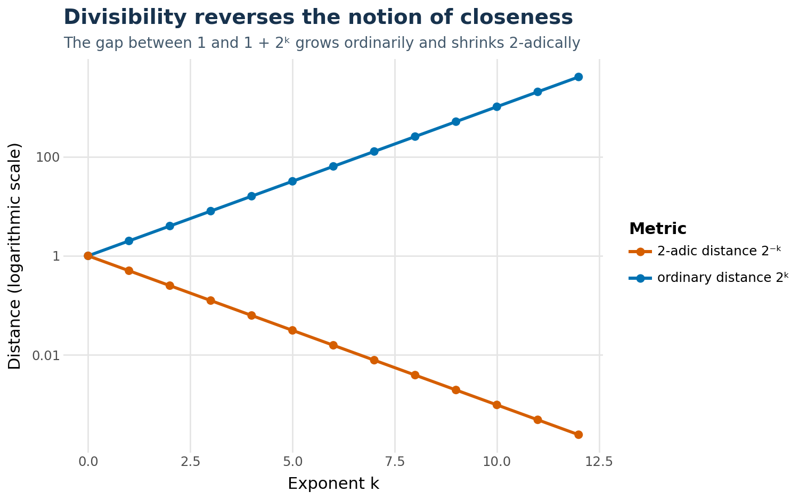

# Local and *p*-Adic Number Theory {#sec-local-p-adic}

**Level and prerequisites: L3–L4.** Prepare valuations, congruences, Cauchy sequences and complete metric spaces. Use the [level-specific reading guide](index.md#who-this-book-is-for) for linked Euler preparation.

<div class="chapter-goals">

**Learning goals.** Use valuations as divisibility measurements; construct the
$p$-adic absolute value and completion; calculate with $p$-adic digits; perform
Hensel lifting; classify elementary local square conditions; understand the
logic and limits of local–global reasoning.

</div>

Real distance treats a small numerical difference as close. Fix a prime $p$.
The $p$-adic viewpoint treats two rationals as close when their difference is
divisible by a high power of $p$. It is a local microscope focused on one
prime.

## Valuations refine divisibility

For nonzero integer $n$, the **$p$-adic valuation** $v_p(n)$ is the exponent of
$p$ in its prime factorization. Extend to nonzero rationals by

$$
v_p(a/b)=v_p(a)-v_p(b),
$$

and put $v_p(0)=+\infty$. For example,
$v_3(378/20)=v_3(378)-v_3(20)=3-0=3$.

The basic rules are

$$
v_p(xy)=v_p(x)+v_p(y),
\qquad
v_p(x+y)\ge\min\{v_p(x),v_p(y)\}.
$$

If the two valuations differ, equality holds in the second rule. To see this,
factor out the smaller power of $p$; the remaining sum has exactly one term
divisible by $p$, so it is not divisible by $p$.

Define

$$
|x|_p=p^{-v_p(x)},\qquad |0|_p=0.
$$

Large divisibility becomes small absolute value. The valuation inequality is
equivalent to the **ultrametric inequality**

$$
|x+y|_p\le\max(|x|_p,|y|_p),
$$

which is stronger than the ordinary triangle inequality.

<figure id="fig-nt-p-adic-closeness">


<figcaption>

Figure 19.1: Ordinary and 2-adic sizes of powers of two move in opposite directions.

</figcaption>
</figure>

Thus the same sequence $2^k$ escapes to infinity in the ordinary metric but
converges to $0$ in the $2$-adic metric, as [Figure 19.1](#fig-nt-p-adic-closeness) makes
visible. A notion of closeness is part of the structure, not an absolute fact.

## Completion of the rationals

A sequence $(x_n)$ is $p$-adically Cauchy if, for each $k$, all sufficiently
late differences $x_m-x_n$ are divisible by $p^k$ in the rational valuation
sense. The field $\mathbb Q_p$ is obtained by completing $\mathbb Q$ with
respect to $|\cdot|_p$, just as $\mathbb R$ completes $\mathbb Q$ for ordinary
absolute value.

An element of

$$
\mathbb Z_p=\{x\in\mathbb Q_p:|x|_p\le1\}
$$

has a unique expansion

$$
x=a_0+a_1p+a_2p^2+\cdots,
\qquad a_j\in\{0,1,\ldots,p-1\}.
$$

The series converges because $|a_jp^j|_p\le p^{-j}\to0$. Digits extend
infinitely to the left in powers of $p$, unlike ordinary decimals.

**Example.** In every $\mathbb Z_p$,

$$
-1=(p-1)+(p-1)p+(p-1)p^2+\cdots.
$$

Indeed the $N$th partial sum is $p^N-1$, whose difference from $-1$ is $p^N$
and therefore tends to $0$ $p$-adically. There is no contradiction with real
divergence: convergence depends on the chosen absolute value.

## Arithmetic with digits

Addition and multiplication use familiar carrying, but carries move toward
higher powers of $p$. To solve $3x=1$ in $\mathbb Z_5$, choose digits
$x=a_0+5a_1+\cdots$ so $3x\equiv1$ modulo successively higher powers. Modulo
$5$, $a_0=2$. Write $x=2+5t$; then $3x=6+15t\equiv1+5(1+3t)$, so modulo
$25$ require $1+3t\equiv0\pmod5$, giving $t\equiv3$. Thus
$x\equiv17\pmod{25}$, and the process continues uniquely.

A $p$-adic integer is a unit precisely when its first digit is nonzero, or
equivalently $v_p(x)=0$. Every nonzero $x\in\mathbb Q_p$ has unique form
$p^ku$ with $k\in\mathbb Z$ and $u\in\mathbb Z_p^\times$.

## Hensel lifting

Hensel's lemma is a $p$-adic analogue of Newton's method.

**Simple-root form.** Let $f\in\mathbb Z_p[x]$. If an integer $a$ satisfies

$$
f(a)\equiv0\pmod p,
\qquad f'(a)\not\equiv0\pmod p,
$$

then there is a unique $\alpha\in\mathbb Z_p$ with
$f(\alpha)=0$ and $\alpha\equiv a\pmod p$.

**Why one digit lifts.** Suppose $f(a_k)\equiv0\pmod{p^k}$ and seek
$a_{k+1}=a_k+tp^k$. Taylor expansion modulo $p^{k+1}$ gives

$$
f(a_{k+1})\equiv f(a_k)+tp^kf'(a_k)\pmod{p^{k+1}}.
$$

After dividing by $p^k$, one linear congruence modulo $p$ determines $t$
uniquely because $f'(a_k)$ is a unit.

**Worked lift.** Solve $x^2=2$ in $\mathbb Q_7$. Modulo $7$, $3^2\equiv2$ and
$f'(3)=6$ is nonzero. Let $x=3+7t$. Modulo $49$,

$$
x^2-2\equiv7+42t=7(1+6t),
$$

so $1+6t\equiv0\pmod7$, hence $t\equiv1$. Thus a root begins
$x\equiv10\pmod{49}$, and further digits lift uniquely. The other root begins
at $-3$ modulo $7$.

The derivative hypothesis is sufficient, not necessary. Multiple roots require
stronger versions and may lift in zero, one, or several ways.

## Local square classes

For odd $p$, a nonzero $x\in\mathbb Q_p$ is a square exactly when

1. $v_p(x)$ is even, and
2. the unit $p^{-v_p(x)}x$ has square residue modulo $p$.

Necessity follows by valuing $y^2=x$. For sufficiency, lift a nonzero residue
root using Hensel's lemma. At $p=2$, unit squares are congruent to $1$ modulo
$8$, so the criterion needs extra digits: a nonzero $2$-adic number is a square
when its valuation is even and its unit part is $1$ modulo $8$.

These tests can rule out rational solutions. If a rational number were a
square, it would be a square in every $\mathbb Q_p$ and in $\mathbb R$.
For example, $3$ is not a square in $\mathbb Q_5$ because $3$ is a nonsquare
modulo $5$.

## Product formula and local–global logic

For nonzero $x\in\mathbb Q$, with the usual absolute value $|\cdot|_\infty$,

$$
|x|_\infty\prod_p|x|_p=1.
$$

Only finitely many factors differ from $1$. For $x=a/b$ in lowest terms, prime
exponents in the product cancel the ordinary ratio $|a|/|b|$. This **product
formula** shows that all places—one real and one for each prime—form a balanced
family.

A rational solution to a polynomial equation produces a solution over every
completion. The converse is a **local–global principle**, and it must be proved
case by case. The **Hasse–Minkowski theorem (stated)** gives one for quadratic
forms: a quadratic form over $\mathbb Q$ represents zero nontrivially exactly
when it does so over $\mathbb R$ and every $\mathbb Q_p$. Some cubic curves can
violate the analogous implication.

<div class="callout callout-warning">
<p class="callout-title">Local evidence has a logical direction</p>

Failure at one place proves global failure. Success at every tested place does
not prove global success unless a theorem covers the exact class of equations,
and finite testing never literally checks every prime without an additional
reduction argument.

</div>

<!-- inline-formula-code:start -->
## Formula and finite computation

A useful formula in this chapter is

$$
v_p(n)=\max\{e:p^e\mid n\}
$$

Exact repeated division computes the local exponent without logarithms. The following standalone Python block expresses that finite rule with its inputs and stopping conditions visible.

```python
from math import isqrt

def is_prime(number: int) -> bool:
    """Return whether number is prime by exact trial division."""
    if number < 2:
        return False
    return all(
        number % divisor != 0 for divisor in range(2, isqrt(number) + 1)
    )

def valuation(number: int, prime_base: int) -> int:
    """Return the exponent of prime_base in a nonzero integer."""
    if number == 0 or not is_prime(prime_base):
        raise ValueError("require a nonzero integer and a prime base")
    exponent = 0
    remainder = abs(number)
    while remainder % prime_base == 0:
        remainder //= prime_base
        exponent += 1
    return exponent

print(valuation(2**7 * 15, 2))
```

**What the computation establishes.** The output certifies only the declared finite case. The theorem, if one is claimed, still requires the argument developed in the chapter.
<!-- inline-formula-code:end -->

## Chapter summary

- The valuation $v_p$ measures divisibility, and $|\cdot|_p$ turns high
  divisibility into small distance under the ultrametric inequality.
- Completing $\mathbb Q$ produces $\mathbb Q_p$; its integral elements have
  infinite base-$p$ expansions whose terms converge in the $p$-adic metric.
- Hensel's lemma lifts a simple modular root one digit at a time and provides
  both an existence theorem and an algorithm.
- Local failure obstructs rational solvability. Local success implies a global
  solution only when a proved local–global theorem covers the problem.

## Exercises and lifting checks

<div class="exercise" id="number_theory-19-local-p-adic-ex-1">
<p class="exercise-title"><strong>Exercise 1</strong></p>

Compute $v_2(360/49)$, $v_3(360/49)$, and the corresponding absolute
values.

</div>

<div class="exercise" id="number_theory-19-local-p-adic-ex-2">
<p class="exercise-title"><strong>Exercise 2</strong></p>

Prove that unequal valuations imply
$v_p(x+y)=\min(v_p(x),v_p(y))$.

</div>

<div class="exercise" id="number_theory-19-local-p-adic-ex-3">
<p class="exercise-title"><strong>Exercise 3</strong></p>

Show that $1+p+p^2+\cdots$ converges to $1/(1-p)$ in $\mathbb Q_p$.

</div>

<div class="exercise" id="number_theory-19-local-p-adic-ex-4">
<p class="exercise-title"><strong>Exercise 4</strong></p>

Find the first three base-$3$ digits of $1/2$ in $\mathbb Z_3$.

</div>

<div class="exercise" id="number_theory-19-local-p-adic-ex-5">
<p class="exercise-title"><strong>Exercise 5</strong></p>

Lift a solution of $x^2\equiv2\pmod7$ from modulo $49$ to modulo $343$.

</div>

<div class="exercise" id="number_theory-19-local-p-adic-ex-6">
<p class="exercise-title"><strong>Exercise 6</strong></p>

Decide whether $45/7$ is a square in $\mathbb Q_5$ and in $\mathbb Q_7$.

</div>

<div class="exercise" id="number_theory-19-local-p-adic-ex-7">
<p class="exercise-title"><strong>Exercise 7</strong></p>

Verify the product formula for $x=18/35$.

</div>

<div class="exercise" id="number_theory-19-local-p-adic-ex-8">
<p class="exercise-title"><strong>Exercise 8</strong></p>

Explain why Hensel's simple-root lemma does not apply to $x^2=0$ at
$a=0$, even though a root exists.

</div>

**Selected answers.** In (1), the valuations are $3$ and $2$, giving
$|360/49|_2=1/8$ and $|360/49|_3=1/9$. For (3), the difference between the
$N$th partial sum and $1/(1-p)$ is a multiple of $p^{N+1}$ times a unit. In
(4), $1/2\equiv2\pmod3$, $1/2\equiv5\pmod9$, and
$1/2\equiv14\pmod{27}$, so the first digits are $2,1,1$. For (5), from
$x=10+49t$, division by $49$ yields $2+20t\equiv0\pmod7$, so $t\equiv2$ and
$x\equiv108\pmod{343}$.

The companion volume on $p$-adic numbers develops analysis, measure, dynamics,
and local fields in much greater depth. Here the local viewpoint becomes one
tool among several for studying rational and integer equations.

Within this volume, [sec-local-fields](38-local-fields.md#sec-local-fields) continues specifically to finite
extensions: ramification index, residue degree, unramified and Eisenstein
extensions, differents, ramification groups, and local norm groups. Those norms
then become the input to reciprocity in [sec-class-field-theory](40-class-field-theory.md#sec-class-field-theory).
