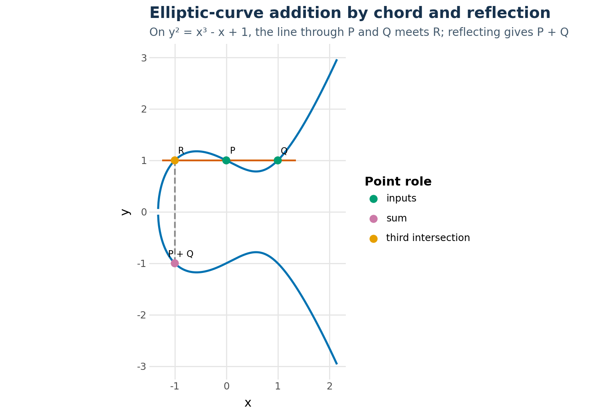

# Elliptic Curves and Rational Points {#sec-elliptic-curves}

**Level and prerequisites: L4.** Prepare fields, projective coordinates, polynomial rings and elementary algebraic curves. Use the [level-specific reading guide](index.md#who-this-book-is-for) for linked Euler preparation.

<div class="chapter-goals">

**Learning goals.** Recognize a nonsingular Weierstrass cubic; construct and
calculate its group law; use projective completion; understand reduction,
torsion, height, descent, and Selmer groups at an honest introductory level;
separate elliptic-curve arithmetic from secure cryptographic deployment.

</div>

An **elliptic curve over $\mathbb Q$** can be presented, after suitable
coordinate choices, as

$$
E:y^2=x^3+Ax+B,\qquad A,B\in\mathbb Q,
$$

with

$$
4A^3+27B^2\ne0.
$$

The inequality prevents a cusp or self-intersection. Despite the name, an
elliptic curve is not an ellipse. “Elliptic” records its historical connection
to elliptic integrals.

The central surprise is that rational points on this cubic form an abelian
group. Geometry supplies the operation; algebra proves it stays rational.

## Chords, tangents, and the point at infinity

Take rational points $P$ and $Q$ on $E$. A line through them meets a cubic in a
third point $R$, counting multiplicity. Reflect $R$ across the $x$-axis; the
result is defined to be $P+Q$. If $P=Q$, use the tangent line. A vertical line
meets $P=(x,y)$ and $-P=(x,-y)$, and its third intersection is the **point at
infinity** $O$. We declare $P+(-P)=O$ and $P+O=P$.

<figure id="fig-elliptic-group-law">


<figcaption>

Figure 20.1: The chord-and-reflection construction for addition on an elliptic curve.

</figcaption>
</figure>

In [Figure 20.1](#fig-elliptic-group-law) the chord through $P$ and $Q$ first finds $R$;
reflection supplies $P+Q$. The picture motivates the law, while the formulas
below verify that rational input gives rational output.

Projective coordinates make $O$ an actual point. Homogenizing gives

$$
Y^2Z=X^3+AXZ^2+BZ^3.
$$

On the line $Z=0$, the only projective point is $O=[0:1:0]$. This completion
removes the exceptional appearance of parallel or vertical lines.

For distinct nonopposite points $P=(x_1,y_1)$ and $Q=(x_2,y_2)$, put

$$
m=\frac{y_2-y_1}{x_2-x_1},\qquad
x_3=m^2-x_1-x_2,
$$

and

$$
y_3=m(x_1-x_3)-y_1.
$$

Then $P+Q=(x_3,y_3)$. For doubling a point with $y_1\ne0$, replace the slope by

$$
m=\frac{3x_1^2+A}{2y_1}.
$$

These formulas follow by substituting the line into the cubic: two roots are
known, so Vieta's relations identify the third. Rational inputs yield rational
outputs.

**Worked doubling.** On $E:y^2=x^3-2$, $P=(3,5)$ lies on the curve. The tangent
slope is $m=27/10$, so

$$
x(2P)=\frac{729}{100}-6=\frac{129}{100},
$$

and

$$
y(2P)=\frac{27}{10}\left(3-\frac{129}{100}\right)-5
=-\frac{383}{1000}.
$$

Substitution checks $(129/100,-383/1000)$ lies on the curve. Denominators can
grow rapidly even when the curve and starting point are integral.

Associativity is the hard group axiom. It can be verified algebraically from
the formulas, but that computation obscures the geometry. A proof using
divisors on a projective curve explains it conceptually; here we record the
theorem and use the law.

## Torsion and reduction modulo primes

A point $P$ is **torsion** if $nP=O$ for some positive integer $n$. All torsion
points form the finite subgroup $E(\mathbb Q)_{\mathrm{tors}}$.

**Theorem 20.1 (Nagell–Lutz (stated)).** If $A,B\in\mathbb Z$, the cubic has nonzero
discriminant, and $P=(x,y)$ is a rational torsion point, then $x,y$ are integers
and either $y=0$ or

$$
y^2\mid 4A^3+27B^2.
$$

(Some authors call $-16(4A^3+27B^2)$ the curve discriminant, so stating the
normalization avoids an unnecessary factor of $16$.)

The theorem turns an infinite rational search into a finite integral one. Its
integral-model hypotheses matter; changing coordinates carelessly can invalidate
the test.

After choosing an integral model, a prime has **good reduction** when reducing
its equation modulo $p$ leaves a nonsingular cubic. Reduction then gives a
homomorphism to the finite group $E(\mathbb F_p)$. For every $m$ coprime to
$p$, reduction is injective on the rational $m$-torsion. Consequently the
prime-to-$p$ part of rational torsion divides $\#E(\mathbb F_p)$. Counts at
several good primes give strong gcd constraints once the possibly exceptional
$p$-primary parts are tracked explicitly.

Reduction can merge nontorsion points and says little by itself about the free
part. It is a filter, not a complete rational-point algorithm.

## Height and Mordell's theorem

Write a rational $x$-coordinate in lowest terms as $x=a/b$. A naive logarithmic
height is

$$
h(x)=\log\max(|a|,|b|).
$$

The canonical height $\hat h(P)$ corrects this so that

$$
\hat h(nP)=n^2\hat h(P)
$$

and differs from a multiple of the naive height by a bounded amount on a fixed
curve. Height converts repeated group addition into controlled quadratic
growth.

**Theorem 20.2 (Mordell's (stated)).** The group $E(\mathbb Q)$ is finitely generated:

$$
E(\mathbb Q)\cong E(\mathbb Q)_{\mathrm{tors}}\oplus\mathbb Z^r
$$

for some nonnegative integer $r$, called the **rank**.

Finitely generated does not mean finite. If $r>0$, multiples of a nontorsion
point produce infinitely many rational points. Nor does the theorem by itself
give an easy way to compute $r$ or find generators.

The proof has two major ingredients. A descent shows $E(\mathbb Q)/mE(\mathbb
Q)$ is finite for a suitable $m$; a height argument shows that representatives
of bounded height are finite and that repeated reduction by $m$ terminates.

## Descent and Selmer groups

Descent replaces the direct point search by auxiliary covering equations. In a
$2$-descent, one records square classes attached to points and derives finitely
many curves that must have rational points. Local solvability over
$\mathbb R$ and all $\mathbb Q_p$ eliminates many candidates.

The **$m$-Selmer group** is a finite, computable-in-principle group of covering
classes that are locally soluble everywhere. It contains the image of
$E(\mathbb Q)/mE(\mathbb Q)$, but may be larger. The gap is governed by the
Tate–Shafarevich group, whose finiteness is not known in general.

This is a precise place where local evidence can fail to produce a global
point. A locally soluble covering may have no rational point. A Selmer bound on
rank is therefore an upper bound until global points account for every class.

## Elliptic-curve cryptography

Over a finite field, the group $E(\mathbb F_q)$ supports a discrete-logarithm
problem: given $P$ and $Q=kP$, recover $k$. Repeated doubling and addition
computes $kP$ efficiently, while reversing it is believed difficult for
properly chosen curves and parameters.

A toy exchange selects a public curve and base point $G$. Alice publishes
$aG$, Bob publishes $bG$, and both compute $abG$. The algebra is correct because
the group law is associative.

<div class="callout callout-danger">
<p class="callout-title">Toy arithmetic is not secure deployment</p>

Real cryptography requires standardized curves, validated points, subgroup and
cofactor handling, constant-time implementations, safe randomness, authenticated
protocols, and current expert guidance. This chapter explains mathematical
correctness, not production security. Never invent a curve or protocol for real
secrets from these examples.

</div>

<!-- inline-formula-code:start -->
## Formula and finite computation

A useful formula in this chapter is

$$
\#E(\mathbb F_p)=1+\#\{(x,y):y^2\equiv x^3+ax+b\pmod p\}
$$

The extra one is the point at infinity; every affine pair is checked exactly. The following standalone Python block expresses that finite rule with its inputs and stopping conditions visible.

```python
prime, a, b = 11, 1, 6
points = [
    (x, y)
    for x in range(prime)
    for y in range(prime)
    if (y * y - (x**3 + a * x + b)) % prime == 0
]
print(1 + len(points), points)
```

**What the computation establishes.** The output certifies only the declared finite case. The theorem, if one is claimed, still requires the argument developed in the chapter.
<!-- inline-formula-code:end -->

## Chapter summary

- A nonsingular cubic becomes an abelian group after its projective point at
  infinity is included; chords, tangents, and reflection define the operation.
- Torsion can be constrained by integral-coordinate theorems and good reduction,
  with prime-to-$p$ scope tracked explicitly.
- Heights and descent are the two structural ingredients behind finite
  generation of $E(\mathbb Q)$; Selmer groups provide computable upper bounds
  that can exceed the globally realized classes.
- Finite-field elliptic groups support cryptographic protocols, but mathematical
  group correctness is only one layer of a secure implementation.

## Exercises and selected checks

<div class="exercise" id="number_theory-20-elliptic-curves-ex-1">
<p class="exercise-title"><strong>Exercise 1</strong></p>

Verify that $y^2=x^3-x$ is nonsingular and list its points with $y=0$.

</div>

<div class="exercise" id="number_theory-20-elliptic-curves-ex-2">
<p class="exercise-title"><strong>Exercise 2</strong></p>

On $y^2=x^3-2$, verify the coordinates of $2(3,5)$ exactly.

</div>

<div class="exercise" id="number_theory-20-elliptic-curves-ex-3">
<p class="exercise-title"><strong>Exercise 3</strong></p>

Derive the addition formulas by substituting $y=m(x-x_1)+y_1$ and comparing
the sum of the cubic's three roots.

</div>

<div class="exercise" id="number_theory-20-elliptic-curves-ex-4">
<p class="exercise-title"><strong>Exercise 4</strong></p>

Show directly that the inverse of $(x,y)$ is $(x,-y)$.

</div>

<div class="exercise" id="number_theory-20-elliptic-curves-ex-5">
<p class="exercise-title"><strong>Exercise 5</strong></p>

Count $E(\mathbb F_5)$ for $E:y^2=x^3+x+1$, including $O$.

</div>

<div class="exercise" id="number_theory-20-elliptic-curves-ex-6">
<p class="exercise-title"><strong>Exercise 6</strong></p>

Explain why reduction at a prime dividing the discriminant is called bad and
why the smooth group argument can fail there.

</div>

<div class="exercise" id="number_theory-20-elliptic-curves-ex-7">
<p class="exercise-title"><strong>Exercise 7</strong></p>

Prove that if $\hat h(P)>0$, then the points $nP$ are all distinct up to
sign except for the obvious equality $n=-m$ after negation.

</div>

<div class="exercise" id="number_theory-20-elliptic-curves-ex-8">
<p class="exercise-title"><strong>Exercise 8</strong></p>

Write an audit checklist for an elliptic-curve cryptography claim, separating
group arithmetic, hardness assumptions, implementation, and protocol.

**Checks.** For (1), $A=-1,B=0$ gives $4A^3+27B^2=-4\ne0$, and the points are
$(0,0),(1,0),(-1,0)$. In (5), quadratic residues mod $5$ are $0,1,4$;
enumerating $x=0,1,2,3,4$ gives $8$ affine points, hence $9$ including $O$.
For (7), equality $nP=mP$ would make $(n-m)P=O$, contradicting
$\hat h((n-m)P)=(n-m)^2\hat h(P)>0$ when $n\ne m$.

Elliptic curves unite local tests, global points, groups, heights, and
algorithms. The remaining chapters deepen the analytic and computational sides
of the same arithmetic ecosystem.

</div>
