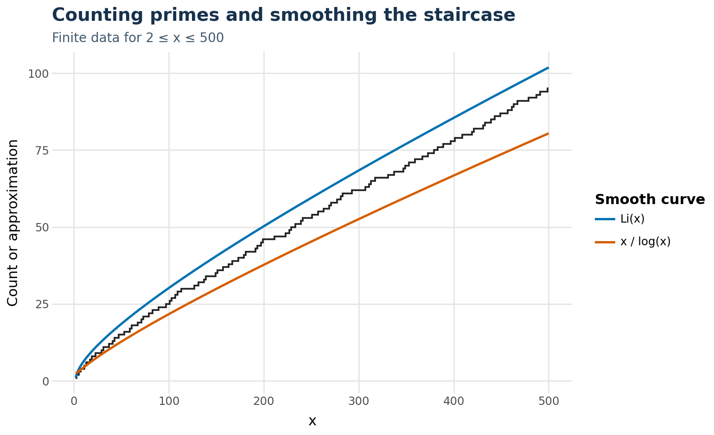

# Analytic Methods in Greater Depth {#sec-analytic-depth}

**Level and prerequisites: L4.** Prepare convergence of series, complex differentiation, contour integration and arithmetic functions. Use the [level-specific reading guide](index.md#who-this-book-is-for) for linked Euler preparation.

<div class="chapter-goals">

**Learning goals.** Manipulate Dirichlet series only in justified regions;
derive Euler products; use summation by parts; exploit character orthogonality;
understand the proof architecture behind primes in progressions and the prime
number theorem; state sieve and bounded-gap results without conflating them
with twin primes.

</div>

Analytic number theory turns arithmetic sequences into functions and then reads
arithmetic information from their analytic behavior. Infinite sums are not
formal decorations: convergence determines which rearrangements are legal.

<div class="callout callout-note">
<p class="callout-title">Scope and prerequisite checkpoint</p>

The concise primer supplies powers, logarithms, sequences, and finite sums. This
chapter also displays derivatives, integrals, and functions of a complex
variable. Every formula needed for the proof architecture is stated here, so
the chapter can be read conceptually without an outside course; proving the
deferred analytic theorems in full requires single-variable calculus followed
by complex analysis.

</div>

## Dirichlet series and Euler products

For an arithmetic function $a(n)$, its Dirichlet series is

$$
F(s)=\sum_{n=1}^{\infty}\frac{a(n)}{n^s},
\qquad s=\sigma+it.
$$

Absolute convergence at $s$ means
$\sum |a(n)|n^{-\sigma}<\infty$. Within an absolute-convergence half-plane,
terms can be regrouped safely.

For $a(n)=1$, the series is the Riemann zeta function

$$
\zeta(s)=\sum_{n\ge1}n^{-s},\qquad \sigma>1.
$$

Unique prime factorization gives Euler's product

$$
\zeta(s)=\prod_p(1-p^{-s})^{-1},\qquad\sigma>1.
$$

To justify it, first multiply over primes $p\le y$. Expanding their geometric
series lists exactly the reciprocals $n^{-s}$ for integers whose prime factors
are at most $y$. Absolute convergence lets $y\to\infty$. The product is not
established by multiplying infinitely many formal series without a convergence
argument.

Taking logarithms for real $s>1$ gives

$$
\log\zeta(s)
=\sum_p\sum_{k\ge1}\frac1{k p^{ks}}.
$$

As $s\downarrow1$, the left side diverges. The terms with $k\ge2$ remain
bounded, forcing $\sum_p p^{-s}$ and ultimately $\sum_p1/p$ to diverge. This
shows there are infinitely many primes in a quantitatively stronger way than
Euclid's proof.

## Summation by parts

Discrete summation by parts is the analogue of integration by parts. Let
$A(x)=\sum_{n\le x}a_n$. For a continuously differentiable function $f$,

$$
\sum_{n\le x}a_nf(n)
=A(x)f(x)-\int_1^x A(t)f'(t)\,dt,
$$

with harmless endpoint conventions when $x$ is not an integer.

**Derivation.** Write $a_n=A(n)-A(n-1)$, expand, and shift one finite sum. The
result telescopes; the integral form packages the remaining differences.

**Example.** Taking $a_n=1$, $A(t)=\lfloor t\rfloor$, and $f(t)=1/t$ relates
the harmonic sum to an integral. Since $\lfloor t\rfloor=t+O(1)$,

$$
\sum_{n\le x}\frac1n=\log x+O(1).
$$

The notation $O(1)$ means bounded independently of $x$; it does not mean zero
or negligible for every small input.

More generally, a bound on a counting function $A(x)$ becomes a bound on a
weighted sum. This transfer is one of the subject's standard moves.

## Characters and orthogonality

A **Dirichlet character modulo $q$** is periodic modulo $q$, completely
multiplicative, zero on integers not coprime to $q$, and a group character on
$(\mathbb Z/q\mathbb Z)^\times$. The principal character $\chi_0$ is $1$ on
units and $0$ otherwise.

Character orthogonality isolates a reduced residue class:

$$
\frac1{\varphi(q)}\sum_{\chi\bmod q}
\overline{\chi(a)}\chi(n)
= \begin{cases}
1,&n\equiv a\pmod q,\\
0,&n\not\equiv a\pmod q,
\end{cases}
$$

provided $\gcd(a,q)=1$. This is finite Fourier analysis on the unit group.

Modulo $5$, one real nonprincipal character is the Legendre symbol
$\chi(n)=(n/5)$: it is $1$ on residues $1,4$, $-1$ on $2,3$, and $0$ on
multiples of $5$. Summing it over a complete residue system gives zero, the
simplest cancellation identity.

## Dirichlet $L$-functions and primes in progressions

Attach to a character

$$
L(s,\chi)=\sum_{n\ge1}\frac{\chi(n)}{n^s}
=\prod_p(1-\chi(p)p^{-s})^{-1},\qquad\sigma>1.
$$

Orthogonality converts a question about primes $p\equiv a\pmod q$ into a
combination of logarithms of these $L$-functions. The principal character
contributes a zeta-like divergence. The essential theorem is that

$$
L(1,\chi)\ne0
$$

for every nonprincipal Dirichlet character. With careful limiting arguments,
this proves **Dirichlet's theorem**: every reduced residue class modulo $q$
contains infinitely many primes.

The nonvanishing proof differs for real and complex characters and is beyond
this chapter. What matters here is the architecture: encode a residue class by
characters, translate primes into Euler products, and prevent unwanted
characters from cancelling the principal divergence.

## From zeta to the prime number theorem

Let $\pi(x)$ count primes at most $x$. The prime number theorem states

$$
\pi(x)\sim\frac{x}{\log x},
$$

meaning the ratio tends to $1$. A technically convenient weighted function is

$$
\psi(x)=\sum_{p^k\le x}\log p.
$$

The logarithmic derivative of zeta is

$$
-\frac{\zeta'(s)}{\zeta(s)}
=\sum_{n\ge1}\frac{\Lambda(n)}{n^s},
$$

where $\Lambda(p^k)=\log p$ and is zero otherwise. Analytic information about
zeta is therefore tied to the growth of $\psi$.

A proof route first continues $\zeta(s)$ to the closed half-plane
$\operatorname{Re}(s)\ge1$, apart from its simple pole at $s=1$, and establishes
that it has no zeros on the line $\operatorname{Re}(s)=1$. A Tauberian theorem
then converts this boundary behavior into $\psi(x)\sim x$, from which the
statement for $\pi(x)$ follows by summation by parts and an estimate for prime
powers. We state the continuation, zero-free result, and Tauberian step without
proof. This is not the Riemann hypothesis, which concerns zeros inside the
critical strip and remains open.

<figure id="fig-analytic-depth-primes">


<figcaption>

Figure 21.1: The prime-counting staircase compared with its smooth asymptotic approximations.

</figcaption>
</figure>

The finite-range comparison in [Figure 21.1](#fig-analytic-depth-primes) is not a proof of
the prime number theorem. It shows what the asymptotic statement predicts and
why a relative-error claim is subtler than visual proximity over one window.

## Sieve methods and bounded gaps

A sieve removes integers divisible by selected primes to estimate those left.
Inclusion–exclusion gives exact formulas but develops too many terms; modern
sieves choose weights that trade exactness for controllable bounds.

The **parity problem** is a structural limitation: many sieve weights struggle
to distinguish numbers with an odd number of prime factors from those with an
even number. This helps explain why upper bounds for twin-prime candidates do
not automatically prove infinitely many twin primes.

A major theorem of modern sieve theory is that there exists some finite bound
$B$ for which infinitely many consecutive primes differ by at most $B$. The
specific best published numerical bound can change as methods improve, so we do
not freeze a value here. The theorem proves

$$
\liminf_{n\to\infty}(p_{n+1}-p_n)<\infty.
$$

The twin-prime conjecture would give the much sharper value $2$ infinitely
often; it is not a consequence of boundedness alone.

<div class="callout callout-warning">
<p class="callout-title">Three asymptotic distinctions</p>

$f(x)=O(g(x))$ is an upper bound, $f(x)\asymp g(x)$ gives two-sided bounds, and
$f(x)\sim g(x)$ means ratio tending to $1$. “Infinitely many” does not by itself
give positive density, and a heuristic main term is not an asymptotic theorem.

</div>

<!-- inline-formula-code:start -->
## Formula and finite computation

A useful formula in this chapter is

$$
\prod_{p\le y}(1-p^{-2})^{-1}
$$

The code evaluates a declared truncation of the Euler product. The following standalone Python block expresses that finite rule with its inputs and stopping conditions visible.

```python
from math import isqrt, pi

def primes_up_to(limit: int) -> list[int]:
    """Return every prime at most limit by exact trial division."""
    if limit < 2:
        raise ValueError("limit must be at least two")
    primes: list[int] = []
    for candidate in range(2, limit + 1):
        if all(candidate % divisor != 0 for divisor in range(2, isqrt(candidate) + 1)):
            primes.append(candidate)
    return primes

def finite_euler_product(limit: int) -> float:
    """Return the Euler product for s=2 over primes at most limit."""
    product = 1.0
    for prime in primes_up_to(limit):
        product /= 1.0 - 1.0 / (prime * prime)
    return product

for endpoint in (10, 100, 1_000):
    value = finite_euler_product(endpoint)
    print(endpoint, value, pi * pi / 6.0 - value)
```

**What the computation establishes.** The calculation checks a declared finite instance; the surrounding argument explains what is true beyond those inputs.
<!-- inline-formula-code:end -->

## Chapter summary

- Dirichlet series and Euler products encode multiplicative arithmetic, but
  regrouping is justified first in regions of absolute convergence.
- Summation by parts transfers information between counting functions and
  weighted sums; characters provide finite Fourier filters for residue classes.
- Dirichlet nonvanishing and zeta's analytic boundary behavior are the key
  inputs in the proof architectures for primes in progressions and the prime
  number theorem.
- Sieve methods prove strong distribution bounds while facing the parity
  barrier; bounded gaps are a theorem, whereas infinitely many twin primes
  remain conjectural.

## Exercises and status checks

<div class="exercise" id="number_theory-21-analytic-depth-ex-1">
<p class="exercise-title"><strong>Exercise 1</strong></p>

Derive the Euler product for $\sum \mu(n)n^{-s}$ when $\sigma>1$.

</div>

<div class="exercise" id="number_theory-21-analytic-depth-ex-2">
<p class="exercise-title"><strong>Exercise 2</strong></p>

Use summation by parts to show
$\sum_{n\le x}\log n=x\log x-x+O(\log x)$, assuming a standard integral
bound for the sum–integral difference.

</div>

<div class="exercise" id="number_theory-21-analytic-depth-ex-3">
<p class="exercise-title"><strong>Exercise 3</strong></p>

List all Dirichlet characters modulo $3$ and verify orthogonality directly.

</div>

<div class="exercise" id="number_theory-21-analytic-depth-ex-4">
<p class="exercise-title"><strong>Exercise 4</strong></p>

Show that $L(s,\chi_0)=\zeta(s)\prod_{p\mid q}(1-p^{-s})$ for the principal
character modulo $q$.

</div>

<div class="exercise" id="number_theory-21-analytic-depth-ex-5">
<p class="exercise-title"><strong>Exercise 5</strong></p>

Explain why a zero of $\zeta(s)$ cannot occur in $\sigma>1$ using the Euler
product.

</div>

<div class="exercise" id="number_theory-21-analytic-depth-ex-6">
<p class="exercise-title"><strong>Exercise 6</strong></p>

Translate $\psi(x)\sim x$ into $\pi(x)\sim x/\log x$ at the level of a proof
outline.

</div>

<div class="exercise" id="number_theory-21-analytic-depth-ex-7">
<p class="exercise-title"><strong>Exercise 7</strong></p>

Write one sentence each stating the bounded-gap theorem and twin-prime
conjecture without conflating them.

</div>

<div class="exercise" id="number_theory-21-analytic-depth-ex-8">
<p class="exercise-title"><strong>Exercise 8</strong></p>

Choose a current-looking numerical record from any source and explain why a
theorem statement should avoid depending on it.

</div>

**Selected answers.** In (1), squarefree choices give
$\sum\mu(n)n^{-s}=\prod_p(1-p^{-s})=1/\zeta(s)$. Modulo $3$, the principal
character is $1$ on $1,2$ and the other takes values $1,-1$; their inner product
over the unit group is zero. For (4), the principal Euler product omits exactly
the primes dividing $q$. In (5), every factor is nonzero and the absolutely
convergent product has a nonzero limit.

Analysis extracts global distribution from arithmetic transforms. The final
chapter asks how to make the underlying finite computations fast, exact, and
auditable.
