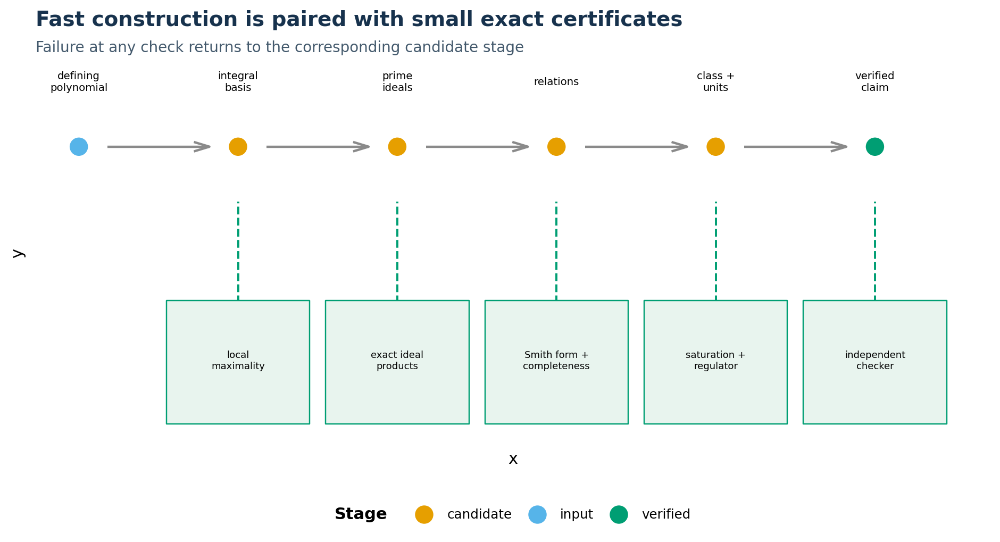

# Computational Number Theory {#sec-computational-nt}

**Level and prerequisites: L3.** Prepare Euclidean algorithms, modular arithmetic and finite algorithm correctness. Use the [level-specific reading guide](index.md#who-this-book-is-for) for linked Euler preparation.

<div class="chapter-goals">

**Learning goals.** Measure integer algorithms in bit operations; implement and
justify fast gcd and modular exponentiation; separate probable-prime tests from
primality proofs; understand major factorization and discrete-log strategies;
design certificates and reproducible exact experiments.

</div>

An algorithm is a proof with an execution cost. Number theory makes this
especially visible: integers can be exact yet enormous, and an operation that
looks like one algebraic step may process millions of bits.

## Input size and bit complexity

The binary length of a positive integer $n$ is
$L=\lfloor\log_2 n\rfloor+1$. Trial division through $\sqrt n$ takes roughly
$2^{L/2}$ candidate divisions, exponential in input length. Saying it is
“$O(\sqrt n)$” is correct as a function of value but hides the computational
scale.

Bit complexity also distinguishes arithmetic operations. Adding $L$-bit
integers costs $O(L)$ elementary bit operations. School multiplication costs
$O(L^2)$, while faster multiplication algorithms improve this for very large
inputs. We will count large-integer multiplications informally but always state
the representation and input length.

Space matters too. A sieve storing one Boolean per integer up to $N$ uses
$O(N)$ bits or more depending on representation. Segmentation can reduce memory
without changing the mathematical result.

## Fast gcd and extended gcd

Euclid repeatedly replaces $(a,b)$ by $(b,a\bmod b)$. The gcd is preserved
because common divisors of $a,b$ are exactly common divisors of
$b,a-qb$. Remainders decrease until zero, proving termination.

The worst-case remainder sequence is governed by consecutive Fibonacci
numbers, so the number of division steps is $O(L)$ for $L$-bit inputs. The
extended algorithm simultaneously maintains coefficients $s,t$ such that

$$
r=sa+tb.
$$

When the last nonzero remainder is $1$, $s$ is an inverse of $a$ modulo $b$.

**Audit example.** Euclid gives

$$
101=4\cdot23+9,\qquad 23=2\cdot9+5,\qquad
9=1\cdot5+4,\qquad 5=1\cdot4+1.
$$

Back-substitution yields $1=22\cdot23-5\cdot101$, hence
$101^{-1}\equiv-5\equiv18\pmod{23}$ and $23^{-1}\equiv22\pmod{101}$. Verify
by multiplication rather than trusting the coefficient trace.

## Modular powers without enormous intermediates

To compute $a^e\bmod n$, **binary exponentiation** scans the binary digits of
$e$, repeatedly squaring and conditionally multiplying, reducing modulo $n$
after every operation. It uses $O(\log e)$ modular multiplications.

For $7^{13}\bmod20$, write $13=8+4+1$:

$$
7^2\equiv9,\qquad 7^4\equiv1,\qquad 7^8\equiv1\pmod{20},
$$

so $7^{13}\equiv1\cdot1\cdot7=7$. Constructing the integer $7^{13}$ first is
unnecessary; at cryptographic exponents it would be disastrous.

The same repeated-squaring pattern operates in any monoid: matrices, polynomial
quotient rings, and elliptic-curve groups. The identity element and associative
operation are the true requirements.

## Primality: evidence, proof, and certificates

Fermat's little theorem gives a necessary condition: for prime $p$ and
$p\nmid a$, $a^{p-1}\equiv1\pmod p$. A composite passing this check to base
$a$ is a **Fermat pseudoprime** to that base. Carmichael numbers pass for every
coprime base, so Fermat testing alone is inadequate.

The Miller–Rabin test writes $n-1=2^sd$ with $d$ odd and checks whether the
squaring chain from $a^d$ behaves as it must in a field. For each odd composite
$n$, at most one quarter of the residue representatives $1\le a<n$ are strong
liars. Uniformly sampled independent bases therefore reduce error probability
exponentially—if the randomness and implementation assumptions hold.

A passing randomized test normally establishes **probable primality**, not
proof. For bounded machine-size integers, a published deterministic base set
may be exhaustive for that bound; the bound is part of the theorem and must be
recorded.

Primality can also have a checkable certificate. Pratt certificates recursively
certify the factorization of $p-1$ and exhibit an element whose order forces
$p$ to be prime. Elliptic-curve primality proving uses group orders on suitable
curves. The AKS theorem gives a deterministic polynomial-time primality test,
though other certified methods are generally faster in practice.

The crucial distinction is verifier cost: a certificate lets another program
check the conclusion without repeating an opaque search.

## Factorization strategies

No single method dominates every size and shape.

- **Trial division** quickly removes small primes.
- **Pollard rho** creates a pseudorandom sequence modulo $n$ and detects a
  collision modulo an unknown factor using gcd computations. Its heuristic
  time is about the square root of the smallest factor.
- **Pollard $p-1$** succeeds when a prime factor $p$ has smooth $p-1$.
- The **quadratic sieve** collects smooth relations
  $x_i^2\equiv Q(x_i)\pmod n$ and uses linear algebra modulo $2$ to combine
  them into one congruence $x^2\equiv y^2\pmod n$.
- The **number field sieve** generalizes this relation collection and is the
  leading classical method for large general integers.
- The **elliptic-curve method** is especially effective for finding a moderately
  sized factor independent of the remaining cofactor's size.

If $n>1$, $x^2\equiv y^2\pmod n$, and
$x\not\equiv\pm y\pmod n$, then

$$
1<\gcd(x-y,n)<n,
$$

so the gcd is a nontrivial factor. Relation-based algorithms invest most of
their work in manufacturing such a congruence.

A factorization claim should be accompanied by multiplication of the reported
factors and primality certificates or explicit probable-prime labels for the
components. A program stopping with a large unfactored cofactor has found a
partial factorization, not a complete one.

## Discrete logarithms and finite fields

In a cyclic group generated by $g$, the discrete-log problem asks for $x$ from
$g^x=h$. Brute force costs $O(r)$ operations in a group of order $r$.
Baby-step–giant-step uses a time–memory tradeoff of about $O(\sqrt r)$:
write $x=im+j$, store $g^j$, and search for $hg^{-im}$.

Pollard rho for logarithms achieves similar expected time with low memory.
Pohlig–Hellman reduces the problem to prime-power factors of the group order,
so secure parameters require a large prime-order subgroup.

Finite fields $\mathbb F_{p^k}$ can be represented as

$$
\mathbb F_p[t]/(f(t)),
$$

where $f$ is irreducible of degree $k$. Elements are polynomials of degree less
than $k$; addition is coefficientwise and multiplication is reduced modulo
$f$. If $f$ is reducible, the quotient has zero divisors and is not a field.
An implementation must validate irreducibility or use trusted parameters.

## Exact arithmetic and reproducibility

Number-theory programs should prefer arbitrary-precision integers and exact
rational representations. Floating-point approximations can guide searches but
must not decide equality, divisibility, or primality.

A reproducible experiment records:

- the precise claim and input domain;
- software version, code revision, and parameter values;
- deterministic seeds for randomized heuristics, while acknowledging that fixed
  seeds do not turn a probabilistic theorem into a deterministic one;
- independent checks, such as multiplying factors or substituting solutions;
- checkpoint and restart logic for long runs;
- a machine-readable result plus a human-readable interpretation.

Property-based tests fit arithmetic well. For random inputs, verify
$\gcd(a,b)$ divides both values, Bézout coefficients reconstruct the gcd,
modular exponentiation agrees with a slow implementation on small cases, and
CRT output satisfies every congruence. These tests expose bugs but do not replace
the proof of the algorithm.

## Capstone: an auditable arithmetic pipeline

Suppose the task is to classify every $n\le N$ that is a sum of two squares.
An auditable design has two independent paths:

1. factor each $n$ and apply the two-square theorem;
2. enumerate $x^2+y^2\le N$ and mark represented values.

Agreement checks both implementations against different mathematics. For each
unrepresented $n$, store a certificate: a prime $q\equiv3\pmod4$ occurring to
odd exponent. For each represented $n$, store $(x,y)$ and verify
$x^2+y^2=n$. Bound $0\le x,y\le\lfloor\sqrt N\rfloor$ proves enumeration is
complete. Report runtime against $N$ and input bits rather than one unexplained
wall-clock number.

<div class="callout callout-warning">
<p class="callout-title">The computer proves only what the protocol proves</p>

Exact arithmetic does not rescue an incomplete search bound. A million passing
tests do not establish an unbounded theorem. A randomized algorithm does not
have zero error unless a deterministic verification step certifies its output.

</div>

<!-- inline-formula-code:start -->
## Formula and finite computation

A useful formula in this chapter is

$$
n=\prod_{p\mid n}p^{v_p(n)}
$$

Trial division turns the factorization identity into a finite, exact ledger. The following standalone Python block expresses that finite rule with its inputs and stopping conditions visible.

```python
from math import isqrt

def prime_factorization(number: int) -> dict[int, int]:
    """Return the prime-exponent factorization of a positive integer."""
    if number <= 0:
        raise ValueError("number must be positive")
    remaining = number
    factors: dict[int, int] = {}
    candidate = 2
    while candidate <= isqrt(remaining):
        while remaining % candidate == 0:
            factors[candidate] = factors.get(candidate, 0) + 1
            remaining //= candidate
        candidate = 3 if candidate == 2 else candidate + 2
    if remaining > 1:
        factors[remaining] = factors.get(remaining, 0) + 1
    return factors

factors = prime_factorization(360360)
reconstructed = 1
for prime, exponent in factors.items():
    reconstructed *= prime**exponent
print(factors, reconstructed)
```

**What the computation establishes.** The calculation checks a declared finite instance; the surrounding argument explains what is true beyond those inputs.
<!-- inline-formula-code:end -->

## Exercises and implementation checks

<div class="exercise" id="number_theory-22-computational-ex-1">
<p class="exercise-title"><strong>Exercise 1</strong></p>

Trace extended Euclid on $(391,299)$ and verify the final identity.

</div>

<div class="exercise" id="number_theory-22-computational-ex-2">
<p class="exercise-title"><strong>Exercise 2</strong></p>

Compute $11^{123}\bmod97$ by binary exponentiation, showing the square table.

</div>

<div class="exercise" id="number_theory-22-computational-ex-3">
<p class="exercise-title"><strong>Exercise 3</strong></p>

Show that $341=11\cdot31$ is a Fermat pseudoprime to base $2$.

</div>

<div class="exercise" id="number_theory-22-computational-ex-4">
<p class="exercise-title"><strong>Exercise 4</strong></p>

Perform one full Miller–Rabin base-$2$ test on $n=221$.

</div>

<div class="exercise" id="number_theory-22-computational-ex-5">
<p class="exercise-title"><strong>Exercise 5</strong></p>

Explain why a nontrivial congruence of squares factors $n$, and identify the
two exceptional congruences.

</div>

<div class="exercise" id="number_theory-22-computational-ex-6">
<p class="exercise-title"><strong>Exercise 6</strong></p>

Use baby-step–giant-step to solve $2^x\equiv15\pmod{29}$.

</div>

<div class="exercise" id="number_theory-22-computational-ex-7">
<p class="exercise-title"><strong>Exercise 7</strong></p>

Construct $\mathbb F_9$ using an irreducible quadratic over $\mathbb F_3$
and compute the square of $1+t$.

</div>

<div class="exercise" id="number_theory-22-computational-ex-8">
<p class="exercise-title"><strong>Exercise 8</strong></p>

Specify inputs, outputs, invariants, failure states, and certificates for a
program solving simultaneous congruences with noncoprime moduli.

</div>

<div class="exercise" id="number_theory-22-computational-ex-9">
<p class="exercise-title"><strong>Exercise 9</strong></p>

Design two independent ways to verify a list of primes up to $N$.

</div>

**Selected answers.** For (1), $\gcd(391,299)=23$ and
$23=-3\cdot391+4\cdot299$. For (2), repeated squaring gives
$11^{123}\equiv27\pmod{97}$. For (3), $2^{10}\equiv1\pmod{11}$ and
$2^5\equiv1\pmod{31}$, so $2^{340}\equiv1$ modulo both factors and hence
modulo $341$. In (5), a factor is $\gcd(x-y,n)$; the unhelpful cases are
$x\equiv y$ and $x\equiv-y\pmod n$. For (6), one finds $x=27$ modulo the order
of $2$. In (7), choose $t^2+1$; then $(1+t)^2=1+2t+t^2=2t$ in $\mathbb F_9$.

## Visual checkpoint: auditable computation

<figure id="fig-nt-computational-certificate-pipeline">


<figcaption>

Figure 22.1: A certificate pipeline separates expensive computation from inexpensive checking.

</figcaption>
</figure>

[Figure 22.1](#fig-nt-computational-certificate-pipeline) is the architecture behind
the algorithms in this chapter. Fast output alone is not the goal: the program
should retain a witness, residual, factorization, or congruence that makes a
wrong implementation detectable.

## Chapter summary

- Complexity is measured against bit length, not merely the numerical value of
  the input.
- Euclid and binary exponentiation combine invariant-preserving reductions with
  logarithmically many large-arithmetic stages.
- Probable-prime tests, primality certificates, and partial factorizations make
  different claims; output labels and verifiers must preserve those distinctions.
- Factoring and discrete-log algorithms exploit different group or smoothness
  structures, so their cost and applicability depend on parameter shape.
- Proof explains an algorithm, exact computation executes it, independent checks
  certify finite output, and a scoped interpretation closes the loop.
