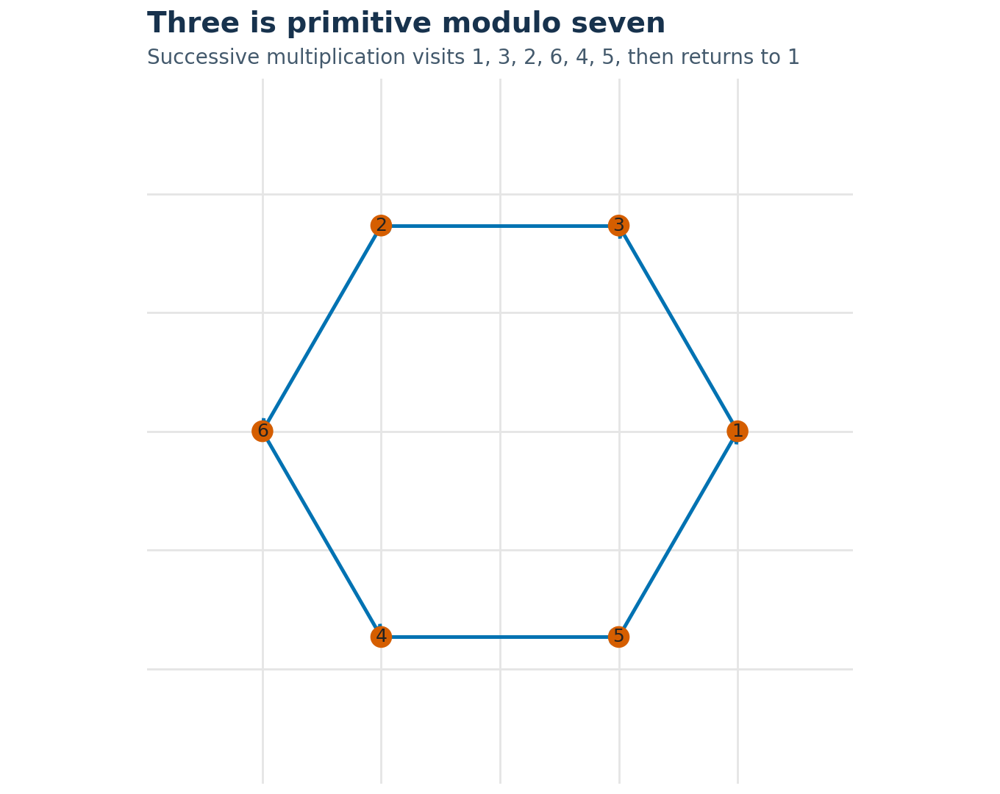

# Polynomial Arithmetic and Finite Fields {#sec-finite-fields}

**Level and prerequisites: L3.** Prepare polynomial rings, irreducibility, quotient rings and finite-dimensional linear algebra. Use the [level-specific reading guide](index.md#who-this-book-is-for) for linked Euler preparation.

Integers become more revealing when we reduce them modulo a prime. Polynomials
admit the same move: reduce their coefficients, divide with remainder, factor,
and sometimes impose a polynomial relation to create a new field. This chapter
builds that process from the algebra already used in Chapters 3–5. No prior
abstract-algebra course is assumed.

## Prerequisite checkpoint and goals

Recall that a **field** is a number system in which addition, subtraction,
multiplication, and division by a nonzero element are possible. Chapter 4 showed
that the residue classes modulo a prime form a field. The concise primer introduced
polynomials and Chapter 2 supplied the Euclidean algorithm.

By the end of the chapter you should be able to divide polynomials over a field,
compute polynomial gcds, test simple irreducibility criteria, construct a finite
extension field, and explain Frobenius, trace, and norm in concrete examples.

## Polynomial arithmetic over a field

Let $K$ be a field. The notation $K[x]$ means polynomials in the symbol $x$ with
coefficients in $K$. Degree behaves like size under multiplication:

$$
\deg(fg)=\deg f+\deg g
$$

for nonzero $f,g$. If $g\ne0$, polynomial long division gives unique $q,r$ with

$$
f=qg+r,\qquad \deg r<\deg g.
$$

The proof repeats ordinary long division: cancel the leading term, subtract,
and continue because degree strictly falls. Division makes $K[x]$ a Euclidean
domain, so gcds and Bézout identities work exactly as in Chapter 2.

**Worked gcd.** Over $\mathbb F_5$, let $f=x^3+2x+1$ and $g=x^2+1$.
Division gives

$$
f=xg+(x+1),\qquad
g=(x-1)(x+1)+2.
$$

Because $2$ is a unit, the final nonzero remainder has monic associate $1$;
therefore $\gcd(f,g)=1$. Reversing the remainder equations produces a Bézout
identity. Consequently the class of $g$ has a multiplicative inverse modulo
$f$.

Repeated roots are detected by the formal derivative. If a polynomial $f$ and
$f'$ have a nonconstant gcd, then $f$ has a repeated irreducible factor. In
characteristic $p$, a surprise occurs: $(x^p-a)'=0$. Zero derivative does not
mean constant polynomial; it means every exponent is divisible by $p$.

## Irreducibility

A nonconstant polynomial is **irreducible over $K$** if it cannot be written as
a product of two lower-degree nonconstant polynomials in $K[x]$. A polynomial
of degree two or three over a field is irreducible exactly when it has no root
in that field. For higher degree, absence of roots is not enough: a quartic may
factor into two irreducible quadratics.

**Example.** The polynomial $x^2+1$ has no root in $\mathbb F_3$ because the
squares are $0$ and $1$, so it is irreducible. In contrast, over $\mathbb F_5$
it factors as $(x-2)(x+2)$.

Three reusable tests are:

1. **Reduction.** Let $f\in\mathbb Z[x]$ be primitive and nonconstant. If
   $p$ is prime, $p$ does not divide the leading coefficient of $f$, and
   its reduction $\bar f\in\mathbb F_p[x]$ is irreducible, then $f$ is
   irreducible over $\mathbb Q$. The leading-coefficient condition says
   $\deg\bar f=\deg f$.
2. **Eisenstein.** If one prime divides every nonleading coefficient, does not
   divide the leading coefficient, and its square does not divide the constant
   coefficient, the polynomial is irreducible over $\mathbb Q$.
3. **Finite-field gcd test.** Over $\mathbb F_q$, irreducible factors of
   $x^{q^m}-x$ have degrees dividing $m$. Gcd computations can therefore test
   possible factor degrees without listing every factor.

Each test has hypotheses. Reduction to a reducible polynomial proves nothing,
and Eisenstein may become applicable only after a shift such as $x\mapsto x+1$.

## Reduction certificates and disappearing degrees {#sec-nt-reduction-certificate}

A polynomial with integer coefficients is **primitive** when their gcd is
one. Primitivity and preservation of degree do different jobs in the
reduction criterion. For example,

$$
f(x)=2x^2+3x+1=(2x+1)(x+1)
$$

is primitive and reducible over $\mathbb Q$. Modulo two it becomes the
irreducible linear polynomial $x+1$. The factor $2x+1$ becomes the constant
one: an irreducible reduction of smaller degree cannot certify the original
polynomial. The omitted leading term is exactly the problem.

### Why the corrected criterion works

Here is the form of **Gauss's lemma** needed for coefficients in $\mathbb Z$:
a primitive polynomial reducible over $\mathbb Q$ factors into two
nonconstant polynomials in $\mathbb Z[x]$. To see the content step, a product
of two primitive integer polynomials is primitive. Otherwise a prime would
divide every product coefficient, so their reductions would multiply to zero
in the integral domain $\mathbb F_p[x]$, forcing all coefficients of one
factor to be divisible by that prime. This contradicts its primitivity.

In a rational factorization, clear denominators in each factor and divide
out its coefficient gcd. This writes $f=(a/b)gh$ with primitive integer
$g,h$ and coprime integers $a,b$, $b>0$. The coefficient gcds of $bf$ and
$agh$ are respectively $b$ and $|a|$, so $b=|a|=1$. Absorb the possible
sign into one factor. This proves the stated lemma.

Now suppose $f=gh$ is such an integer factorization. Since
$\operatorname{lc}(f)=\operatorname{lc}(g)\operatorname{lc}(h)$ and
$p\nmid\operatorname{lc}(f)$, both factors keep their positive degrees
modulo $p$. Hence $\bar f=\bar g\bar h$ contradicts irreducibility of
$\bar f$. This proves the corrected criterion. The author notes of
[Romyar Sharifi, Proposition 5.3.6](https://www.math.ucla.edu/~sharifi/notes/algebra-ch05.html)
state the general reduction theorem with the same leading-coefficient
hypothesis.

This implication is sufficient, not necessary. A reducible reduction does
not prove reducibility over $\mathbb Q$: $x^2+1$ is irreducible there, yet
splits modulo five. It can be useful to try a different prime, but failure
to find a certifying prime is not a factorization of the original polynomial.

### An exact certificate for degree two or three

For these two degrees, a degree-preserving reduction is irreducible exactly
when it has no root. The following standalone function accepts primitive
integer polynomials of degree two or three, represented by coefficients
from constant term to leading term. It returns whether this particular
prime certifies irreducibility over $\mathbb Q$, together with the roots
of the reduced polynomial. A false certificate flag is inconclusive about
the rational polynomial, whether caused by degree loss or by a modular root.
The finite trial-division check of the prime is intended for small examples.

```python
from math import gcd, isqrt

def small_degree_reduction_certificate(
    coefficients: tuple[int, ...], prime: int
) -> tuple[bool, tuple[int, ...]]:
    """Return a sufficient Q-irreducibility flag and all roots modulo prime."""
    if type(coefficients) is not tuple:
        raise TypeError("coefficients must be a tuple")
    if any(type(value) is not int for value in coefficients):
        raise TypeError("coefficients must be integers, excluding bool")
    if len(coefficients) not in (3, 4) or coefficients[-1] == 0:
        raise ValueError("provide a degree-two or degree-three polynomial")
    if gcd(*coefficients) != 1:
        raise ValueError("the integer polynomial must be primitive")
    if type(prime) is not int:
        raise TypeError("prime must be an integer, excluding bool")
    if prime < 2 or any(prime % divisor == 0 for divisor in range(2, isqrt(prime) + 1)):
        raise ValueError("the modulus must be prime")
    roots = []
    for residue in range(prime):
        value = 0
        for coefficient in reversed(coefficients):
            value = (value * residue + coefficient) % prime
        if value == 0:
            roots.append(residue)
    degree_preserved = coefficients[-1] % prime != 0
    return degree_preserved and not roots, tuple(roots)

for coefficients, prime in (((1, 3, 2), 2), ((1, 0, 1), 3), ((1, 0, 1), 5)):
    print(coefficients, prime, small_degree_reduction_certificate(coefficients, prime))
```

The flags are false, true, false. The root tuples are respectively `(1,)`,
`()`, and `(2, 3)`. The first prime loses degree; the last preserves
degree but has roots. Only the middle calculation supplies a rational
irreducibility certificate. Root absence for a quartic would not suffice,
so that unsupported degree is rejected instead of silently reusing this rule.

### Changed task: select a prime, then test the converse {#sec-nt-reduction-task}

For $g(x)=6x^3+x+1$, compare reduction modulo two, three, and five. Record
the reduced degree and every modular root, and decide which prime supplies
a valid rational irreducibility certificate.

Then show that $x^4+1$ is irreducible over $\mathbb Q$ by applying
Eisenstein to $(x+1)^4+1$. Despite this, prove it is reducible modulo every
prime. For odd primes, use multiplicativity of the Legendre symbol from
[sec-residues](08-residues.md#sec-residues) to show at least one of $2,-2,-1$ is a square. For a square
root $a$ of one of these values, find the corresponding quadratic
factorization. Treat the prime two separately. The
[separate explanation](#sec-nt-reduction-solution) supplies the full
factor patterns; no search through primes proves the universal claim.

## Constructing extension fields

If $h\in K[x]$ is irreducible of degree $d$, then the quotient

$$
K[x]/(h)
$$

is a field. Every class has a unique representative of degree below $d$.
Writing $\alpha$ for the class of $x$ turns $h(\alpha)=0$ into an arithmetic
rule.

For $h=x^2+1$ over $\mathbb F_3$, every element of
$\mathbb F_3[x]/(h)$ is $a+b\alpha$, where $a,b\in\mathbb F_3$ and
$\alpha^2=-1=2$. There are $3^2=9$ elements. To invert $1+\alpha$, compute

$$
(1+\alpha)(2+\alpha)=2+3\alpha+\alpha^2=1.
$$

Irreducibility is essential. If $h=uv$ with lower-degree nonconstant factors,
then the nonzero classes of $u$ and $v$ multiply to zero, so the quotient is not
a field.

<div class="callout callout-warning">
<p class="callout-title">Representatives are not new indeterminates</p>

After quotienting, $\alpha$ satisfies its defining relation. Expressions must
be reduced after multiplication. Forgetting to replace $\alpha^2$ by $2$ in
the nine-element example silently leaves the field.

</div>

## Multiplicative groups and primitive elements

The nonzero elements of a finite field form a finite multiplicative group. A
fundamental theorem states that this group is cyclic. Thus in a field with
$q$ elements, some element $g$ has order $q-1$, and every nonzero element is a
power of $g$. Such a $g$ is **primitive**.

<figure id="fig-finite-field-cycle">


<figcaption>

Figure 23.1: Successive powers of a primitive element visit every nonzero residue in a prime field.

</figcaption>
</figure>

In $\mathbb F_7$, the powers of $3$ follow the six-cycle in
[Figure 23.1](#fig-finite-field-cycle). This proves that $3$ is primitive. The visual is a
finite example, not a proof that every finite subgroup of a field is cyclic;
the general proof uses the number of roots of $x^m-1$ and the structure of
finite abelian groups.

The equation $g^k=a$ asks for a **discrete logarithm**. Exponentiation is fast,
but reversing it can be difficult in a large field. Chapter 22 explained why
this asymmetry supports cryptographic protocols.

## Frobenius, trace, and norm

In characteristic $p$, the binomial coefficients between the endpoints of
$(a+b)^p$ are divisible by $p$. Hence

$$
(a+b)^p=a^p+b^p.
$$

The map $\varphi(a)=a^p$ is the **Frobenius automorphism** of every finite
field. In $\mathbb F_{p^d}$ it satisfies $\varphi^d=1$, and its fixed elements
are precisely $\mathbb F_p$.

For $a\in\mathbb F_{p^d}$, define

$$
\operatorname{Tr}(a)=a+a^p+\cdots+a^{p^{d-1}},
\qquad
\operatorname{N}(a)=a^{1+p+\cdots+p^{d-1}}.
$$

Trace lands in the base field and respects addition; norm lands in the base
field and respects multiplication. In the nine-element field above,
$\alpha^3=2\alpha$, so
$\operatorname{Tr}(\alpha)=\alpha+\alpha^3=0$ and
$\operatorname{N}(\alpha)=\alpha^4=1$.

There is, up to isomorphism, exactly one finite field of each prime-power size
$p^d$, and no finite field of any other size. Existence comes from the splitting
field of $x^{p^d}-x$; uniqueness comes from the fact that every field of that
size consists exactly of its roots. We have stated the splitting-field step;
[sec-galois-symmetry](31-galois-symmetry.md#sec-galois-symmetry) develops the Galois language behind it.

## Applications and limitations

Finite fields support checksums, Reed–Solomon-type error correction, secret
sharing, and elliptic-curve arithmetic. In error correction, a message is often
encoded as evaluations of a low-degree polynomial. Too many agreeing points
force two low-degree polynomials to be equal, so a limited number of corrupted
values can be located and repaired.

Implementation requires an explicit defining polynomial, basis, and reduction
convention. Two programs can represent isomorphic fields differently and emit
different bit patterns for the same abstract element. Reproducibility therefore
requires recording the modulus polynomial as well as the field size.

<!-- inline-formula-code:start -->
## Formula and finite computation

A useful formula in this chapter is

$$
\operatorname{ord}_m(a)=\min\{k\ge1:a^k\equiv1\pmod m\}
$$

The terminating search follows the minimum in the definition. The following standalone Python block expresses that finite rule with its inputs and stopping conditions visible.

```python
from math import gcd

def multiplicative_order(base: int, modulus: int) -> int:
    """Return the least positive r with base**r congruent to one modulo modulus."""
    if modulus <= 1:
        raise ValueError("modulus must exceed one")
    if gcd(base, modulus) != 1:
        raise ValueError("base must be a unit modulo modulus")
    residue = 1
    for exponent in range(1, modulus + 1):
        residue = (residue * base) % modulus
        if residue == 1:
            return exponent
    raise RuntimeError("finite residue repetition failed unexpectedly")

for base in (2, 3, 4, 6):
    print(base, multiplicative_order(base, 13))
```

**What the computation establishes.** The calculation checks a declared finite instance; the surrounding argument explains what is true beyond those inputs.
<!-- inline-formula-code:end -->

## Chapter summary

- Polynomial division turns $K[x]$ into a Euclidean domain.
- Irreducible polynomials play the role of primes.
- Quotienting by an irreducible degree-$d$ polynomial constructs $p^d$ field
  elements.
- The nonzero elements form a cyclic group.
- Frobenius organizes subfields, trace, norm, and finite-field symmetry.

Two later chapters use this Frobenius in different directions. In
[sec-local-fields](38-local-fields.md#sec-local-fields), residue extensions describe unramified local fields. In
[sec-curve-zeta](39-curve-zeta.md#sec-curve-zeta), Frobenius orbits and eigenvalues package point counts over
every $\mathbb F_{q^n}$ into a rational zeta function.

## Exercises and selected answers

<div class="exercise" id="number_theory-23-finite-fields-ex-1">
<p class="exercise-title"><strong>Exercise 1</strong></p>

Divide $x^4+1$ by $x^2+x+1$ over $\mathbb F_2$.

<details class="solution"><summary>Solution</summary>

For 1 the quotient is $x^2+x$ and the remainder is $x+1$.

</details>

</div>

<div class="exercise" id="number_theory-23-finite-fields-ex-2">
<p class="exercise-title"><strong>Exercise 2</strong></p>

Factor $x^4-1$ over $\mathbb F_5$ and identify repeated factors, if any.

</div>

<div class="exercise" id="number_theory-23-finite-fields-ex-3">
<p class="exercise-title"><strong>Exercise 3</strong></p>

Prove that $x^3+x+1$ has no root in $\mathbb F_2$ and is irreducible.

<details class="hint"><summary>Hint 1</summary>

For 3, checking the
two possible inputs suffices for a cubic.

</details>

</div>

<div class="exercise" id="number_theory-23-finite-fields-ex-4">
<p class="exercise-title"><strong>Exercise 4</strong></p>

List all elements of $\mathbb F_2[x]/(x^3+x+1)$ and invert $x$.

<details class="hint"><summary>Hint 1</summary>

In 4, $\alpha^{-1}=\alpha^2+1$ because
$\alpha^3=\alpha+1$.

</details>

</div>

<div class="exercise" id="number_theory-23-finite-fields-ex-5">
<p class="exercise-title"><strong>Exercise 5</strong></p>

Find the order of every nonzero element of $\mathbb F_7$.

</div>

<div class="exercise" id="number_theory-23-finite-fields-ex-6">
<p class="exercise-title"><strong>Exercise 6</strong></p>

Verify directly that Frobenius is additive in characteristic $3$.

</div>

<div class="exercise" id="number_theory-23-finite-fields-ex-7">
<p class="exercise-title"><strong>Exercise 7</strong></p>

Compute trace and norm of $1+\alpha$ in the nine-element example.

</div>

<div class="exercise" id="number_theory-23-finite-fields-ex-8">
<p class="exercise-title"><strong>Exercise 8</strong></p>

Explain why a field with $12$ elements cannot exist.

<details class="solution"><summary>Solution</summary>

Exercise 8 uses the fact that the additive group of a
finite field is a vector space over its prime subfield, so its size is a prime
power.

</details>

</div>

<div class="exercise" id="number_theory-23-finite-fields-ex-9">
<p class="exercise-title"><strong>Exercise 9</strong></p>

Solve the [degree-preserving reduction task](#sec-nt-reduction-task).

<details class="solution"><summary>Solution</summary>

The cubic is primitive. Modulo two and three, $6x^3+x+1$ becomes $x+1$,
with degree one and root respectively $1$ and $2$. Both reductions are
irreducible as linear polynomials, but lose degree and give no certificate.
Modulo five it is $x^3+x+1$, whose values at $0,1,2,3,4$ are
$1,3,1,1,4$. There is no root, so this degree-three reduction is
irreducible. The corrected criterion proves $g$ irreducible over
$\mathbb Q$.

For the quartic,

$$
(x+1)^4+1=x^4+4x^3+6x^2+4x+2
$$

is Eisenstein at two: every nonleading coefficient is even and the constant
term is not divisible by four. Translation is an invertible substitution
over $\mathbb Q$, so $x^4+1$ is irreducible there as well.

Modulo two, $x^4+1=(x+1)^4$. For an odd prime, if either $2$ or $-1$
is a square there is nothing to prove about existence of a square root.
If both are nonsquares, their product $-2$ is a square by multiplicativity
of the Legendre symbol. In the three cases the following identities supply
nonconstant factors in $\mathbb F_p[x]$:

$$
\begin{aligned}
a^2=2 &: &x^4+1&=(x^2+ax+1)(x^2-ax+1),\\
a^2=-2 &: &x^4+1&=(x^2+ax-1)(x^2-ax-1),\\
a^2=-1 &: &x^4+1&=(x^2+a)(x^2-a).
\end{aligned}
$$

Thus no prime gives an irreducible reduction of this rationally irreducible
quartic. A finite program can verify selected identities; the square-class
argument proves why the alternatives cover every odd prime.

</details>

</div>

**Support.**

For 1 the quotient is $x^2+x$ and the remainder is $x+1$. For 3, checking the
two possible inputs suffices for a cubic. In 4, $\alpha^{-1}=\alpha^2+1$ because
$\alpha^3=\alpha+1$. Exercise 8 uses the fact that the additive group of a
finite field is a vector space over its prime subfield, so its size is a prime
power.

### Changed-task explanation: rational and modular irreducibility {#sec-nt-reduction-solution}

The cubic is primitive. Modulo two and three, $6x^3+x+1$ becomes $x+1$,
with degree one and root respectively $1$ and $2$. Both reductions are
irreducible as linear polynomials, but lose degree and give no certificate.
Modulo five it is $x^3+x+1$, whose values at $0,1,2,3,4$ are
$1,3,1,1,4$. There is no root, so this degree-three reduction is
irreducible. The corrected criterion proves $g$ irreducible over
$\mathbb Q$.

For the quartic,

$$
(x+1)^4+1=x^4+4x^3+6x^2+4x+2
$$

is Eisenstein at two: every nonleading coefficient is even and the constant
term is not divisible by four. Translation is an invertible substitution
over $\mathbb Q$, so $x^4+1$ is irreducible there as well.

Modulo two, $x^4+1=(x+1)^4$. For an odd prime, if either $2$ or $-1$
is a square there is nothing to prove about existence of a square root.
If both are nonsquares, their product $-2$ is a square by multiplicativity
of the Legendre symbol. In the three cases the following identities supply
nonconstant factors in $\mathbb F_p[x]$:

$$
\begin{aligned}
a^2=2 &: &x^4+1&=(x^2+ax+1)(x^2-ax+1),\\
a^2=-2 &: &x^4+1&=(x^2+ax-1)(x^2-ax-1),\\
a^2=-1 &: &x^4+1&=(x^2+a)(x^2-a).
\end{aligned}
$$

Thus no prime gives an irreducible reduction of this rationally irreducible
quartic. A finite program can verify selected identities; the square-class
argument proves why the alternatives cover every odd prime.
