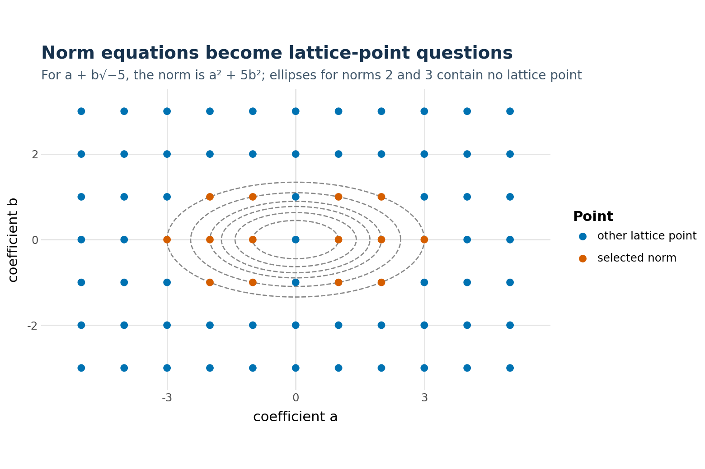

# Algebraic Integers, Ideals, and Dedekind Domains {#sec-ideals-dedekind}

**Level and prerequisites: L4.** Prepare rings, ideals, localisation, integral extensions and field extensions. Use the [level-specific reading guide](index.md#who-this-book-is-for) for linked Euler preparation.

Unique prime factorization makes the integers exceptionally convenient. In
larger number systems, elements can factor in genuinely different ways. The
repair is not to abandon factorization but to factor **ideals** instead. This
chapter constructs the needed language from sets, divisibility, and quotient
arithmetic already developed inside the book.

## Prerequisite checkpoint and goals

Chapter 13 introduced rings such as $\mathbb Z[i]$, Chapter 17 used binary
quadratic forms, and Chapter 23 treated quotient rings. You need only those
definitions. We will define number field, algebraic integer, ideal, prime ideal,
and Dedekind domain before using them.

The goals are to compute trace and norm in quadratic fields, recognize the ring
of integers in basic examples, diagnose failure of element factorization, and
see precisely how unique ideal factorization restores arithmetic.

## Number fields and embeddings

A **number field** $K$ is a finite-dimensional field extension of $\mathbb Q$.
Concretely, if $\theta$ is a root of an irreducible polynomial of degree $n$,
then

$$
K=\mathbb Q(\theta)
=\{a_0+a_1\theta+\cdots+a_{n-1}\theta^{n-1}:a_j\in\mathbb Q\}.
$$

The smallest monic polynomial of $\theta$ over $\mathbb Q$ is its **minimal
polynomial**. Its complex roots describe the embeddings of $K$ into
$\mathbb C$. Multiplication by an element $\alpha$ is a rational linear map on
$K$; its matrix trace and determinant are the field trace and norm:

$$
\operatorname{Tr}_{K/\mathbb Q}(\alpha),
\qquad
\operatorname{N}_{K/\mathbb Q}(\alpha).
$$

For $K=\mathbb Q(\sqrt d)$ and $\alpha=a+b\sqrt d$,

$$
\operatorname{Tr}(\alpha)=2a,
\qquad
\operatorname{N}(\alpha)=a^2-db^2.
$$

The norm is multiplicative because determinants are multiplicative.

## Algebraic integers and integral bases

An element is an **algebraic integer** if it satisfies a monic polynomial with
integer coefficients. The algebraic integers in $K$ form its **ring of
integers** $\mathcal O_K$. Rational algebraic integers are ordinary integers:
if $a/b$ in lowest terms satisfies a monic integer polynomial, multiplying by
the appropriate power of $b$ shows $b\mid a^n$, hence $b=1$.

For square-free $d$,

$$
\mathcal O_{\mathbb Q(\sqrt d)}=
\begin{cases}
\mathbb Z[(1+\sqrt d)/2],&d\equiv1\pmod4,\\
\mathbb Z[\sqrt d],&d\not\equiv1\pmod4.
\end{cases}
$$

Thus $\mathbb Z[\sqrt5]$ is not the whole ring of integers of
$\mathbb Q(\sqrt5)$; the missing element $(1+\sqrt5)/2$ is integral because it
satisfies $x^2-x-1=0$.

An **integral basis** $\omega_1,\ldots,\omega_n$ lets every element of
$\mathcal O_K$ be written uniquely with integer coefficients. The determinant
of the trace-pairing matrix
$\bigl(\operatorname{Tr}(\omega_i\omega_j)\bigr)$ is the field discriminant.
It records arithmetic volume and identifies primes where ramification may
occur.

## Failure of element factorization

In $R=\mathbb Z[\sqrt{-5}]$, the norm is $N(a+b\sqrt{-5})=a^2+5b^2$. We have

$$
6=2\cdot3=(1+\sqrt{-5})(1-\sqrt{-5}).
$$

These factorizations are not related by reordering or multiplication by units.
The only units have norm $1$, hence are $\pm1$. There is no element of norm
$2$ or $3$, so $2$, $3$, and $1\pm\sqrt{-5}$ are irreducible. Unique
factorization into irreducible elements has failed.

The distinction between **irreducible** and **prime** now matters. An
irreducible cannot be split into nonunits. A prime has the stronger divisibility
property: if it divides a product, it divides one factor. In a unique
factorization domain these notions agree; here $2$ divides
$(1+\sqrt{-5})(1-\sqrt{-5})$ but divides neither factor.

## Ideals

An **ideal** $I$ of a commutative ring $R$ is an additive subgroup closed under
multiplication by arbitrary elements of $R$: if $a,b\in I$ and $r\in R$, then
$a-b\in I$ and $ra\in I$. The principal ideal generated by $a$ is

$$
(a)=\{ra:r\in R\}.
$$

The ideal generated by $a_1,\ldots,a_m$ is
$(a_1,\ldots,a_m)=Ra_1+\cdots+Ra_m$. Ideals can be added and multiplied. The
product $IJ$ consists of finite sums of products $ab$ with $a\in I,b\in J$.

An ideal $\mathfrak p\ne R$ is **prime** if $ab\in\mathfrak p$ implies
$a\in\mathfrak p$ or $b\in\mathfrak p$. Equivalently, $R/\mathfrak p$ is an
integral domain. A proper ideal is **maximal** if no proper ideal lies strictly
between it and $R$; equivalently, its quotient is a field. In rings of integers,
every nonzero prime ideal is maximal.

## Ideal factorization in the running example

Let

$$
\mathfrak p_2=(2,1+\sqrt{-5}).
$$

The quotient $R/\mathfrak p_2$ has two elements, so the ideal norm
$N(\mathfrak p_2)=|R/\mathfrak p_2|$ equals $2$. Direct multiplication gives

$$
(2)=\mathfrak p_2^2.
$$

Similarly the polynomial $x^2+5$ reduces modulo $3$ to
$(x-1)(x+1)$, producing distinct prime ideals

$$
\mathfrak p_3=(3,1+\sqrt{-5}),\qquad
\overline{\mathfrak p}_3=(3,1-\sqrt{-5}),
$$

with $(3)=\mathfrak p_3\overline{\mathfrak p}_3$. The principal ideals of the
four element factors all decompose into the same prime-ideal multiset. The
apparent conflict at the element level disappears.

<figure id="fig-algebraic-integer-norms">


<figcaption>

Figure 24.1: Elements of the quadratic integer ring plotted by norm, with small-norm points highlighted.

</figcaption>
</figure>

[Figure 24.1](#fig-algebraic-integer-norms) makes the obstruction concrete: there are no
lattice points on the norm-$2$ or norm-$3$ ellipses. A picture over a finite
window does not prove absence, but the equation $a^2+5b^2=2$ or $3$ forces
$b=0$ and then has no integer $a$, giving the proof.

## Dedekind domains

A **Dedekind domain** is an integral domain in which every nonzero proper ideal
factors uniquely into nonzero prime ideals. One equivalent definition requires
the ring to be Noetherian, integrally closed in its fraction field, and of
Krull dimension one. Those terms organize the general theory; for this book the
central theorem is:

<div class="callout callout-note">
<p class="callout-title">Unique ideal factorization</p>

The ring of integers of every number field is a Dedekind domain. Every nonzero
fractional ideal therefore has a unique expression
$\prod_{\mathfrak p}\mathfrak p^{v_{\mathfrak p}}$ with finitely many nonzero
integer exponents.

</div>

A complete proof requires localization and integrality machinery. Its
architecture is visible here: show ideals are finitely generated, use inverses
of nonzero ideals, extract a prime divisor of a proper ideal, and induct on the
finite ideal norm. Uniqueness follows from cancellation and primality.

## Factoring rational primes

Suppose $\mathcal O_K=\mathbb Z[\theta]$ and the defining polynomial of
$\theta$ factors modulo a prime $p$ as

$$
\overline f=\overline f_1^{e_1}\cdots\overline f_g^{e_g}.
$$

When $p$ does not divide the relevant index
$[\mathcal O_K:\mathbb Z[\theta]]$, this factorization determines

$$
(p)=\mathfrak p_1^{e_1}\cdots\mathfrak p_g^{e_g},
$$

and $\deg\overline f_i$ is the residue degree. The index caveat is not
cosmetic: using a nonintegral power basis can give a wrong answer at exceptional
primes. Chapter 26 turns splitting, inertia, and ramification into the central
objects.

<!-- inline-formula-code:start -->
## Formula and finite computation

A useful formula in this chapter is

$$
N(a+bi)=a^2+b^2
$$

For principal Gaussian ideals, the same integer counts the residue classes. The following standalone Python block expresses that finite rule with its inputs and stopping conditions visible.

```python
gaussian_integer = (3, 2)
real, imaginary = gaussian_integer
norm = real * real + imaginary * imaginary
print(norm)
```

**What the computation establishes.** The output certifies only the declared finite case. The theorem, if one is claimed, still requires the argument developed in the chapter.
<!-- inline-formula-code:end -->

## Chapter summary

- Algebraic integers form the ring $\mathcal O_K$ inside a number field.
- Trace, norm, and discriminant translate arithmetic into linear algebra.
- Element factorization can fail because irreducible elements need not be prime.
- Ideals restore unique factorization in rings of integers.
- Factoring a defining polynomial modulo $p$ often reveals the prime-ideal
  factorization of $(p)$, with an essential index condition.

## Exercises and selected answers

<div class="exercise" id="number_theory-24-ideals-dedekind-ex-1">
<p class="exercise-title"><strong>Exercise 1</strong></p>

Compute trace and norm of $3+2\sqrt2$.

</div>

<div class="exercise" id="number_theory-24-ideals-dedekind-ex-2">
<p class="exercise-title"><strong>Exercise 2</strong></p>

Decide whether $(1+\sqrt{13})/2$ is an algebraic integer, and justify the
decision with a monic polynomial.

</div>

<div class="exercise" id="number_theory-24-ideals-dedekind-ex-3">
<p class="exercise-title"><strong>Exercise 3</strong></p>

Prove the only units of $\mathbb Z[\sqrt{-5}]$ are $\pm1$.

</div>

<div class="exercise" id="number_theory-24-ideals-dedekind-ex-4">
<p class="exercise-title"><strong>Exercise 4</strong></p>

Verify that $R/(2,1+\sqrt{-5})$ has two elements.

</div>

<div class="exercise" id="number_theory-24-ideals-dedekind-ex-5">
<p class="exercise-title"><strong>Exercise 5</strong></p>

Factor $x^2+1$ modulo $3,5,$ and $7$ and predict the behavior of those primes
in $\mathbb Z[i]$.

</div>

<div class="exercise" id="number_theory-24-ideals-dedekind-ex-6">
<p class="exercise-title"><strong>Exercise 6</strong></p>

Explain why ideal containment reverses divisibility for principal ideals.

</div>

<div class="exercise" id="number_theory-24-ideals-dedekind-ex-7">
<p class="exercise-title"><strong>Exercise 7</strong></p>

Show ideal norm is multiplicative in the displayed factorizations of $(2)$
and $(3)$.

</div>

<div class="exercise" id="number_theory-24-ideals-dedekind-ex-8">
<p class="exercise-title"><strong>Exercise 8</strong></p>

Give a precise reason why a reducible polynomial modulo one prime does not
prove reducibility over $\mathbb Q$.

For 1 the trace is $6$ and norm is $1$. In 2, because
$13\equiv1\pmod4$, $(1+\sqrt{13})/2$ is integral and satisfies
$x^2-x-3=0$. For 5, the
polynomial is irreducible modulo $3$ and $7$ but splits modulo $5$, matching the
classes $3\pmod4$ and $1\pmod4$.

</div>
