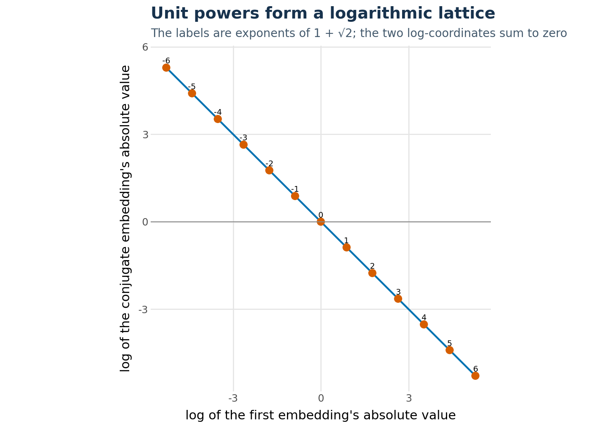

# Class Groups, Units, and Minkowski Theory {#sec-class-groups-units}

**Level and prerequisites: L4.** Prepare Dedekind domains, ideal classes, real embeddings and lattice volume. Use the [level-specific reading guide](index.md#who-this-book-is-for) for linked Euler preparation.

Unique factorization of ideals does not mean every ideal is generated by one
element. The **class group** measures exactly that remaining obstruction. A
second infinite object, the unit group, records multiplicative symmetries.
Minkowski's geometry turns both questions into lattices, bounded searches, and
finiteness theorems.

## Prerequisite checkpoint and goals

Chapter 18 introduced lattices and covolume. Chapter 24 defined number fields,
rings of integers, fractional ideals, norms, and discriminants. This chapter
reassembles those ingredients. No representation theory or topology beyond
Euclidean compactness is assumed.

You will learn to form ideal classes, use a Minkowski bound to reduce an
infinite problem to finitely many ideals, compute the class group of a small
quadratic field, and interpret Dirichlet's unit theorem through logarithmic
coordinates.

## Fractional ideals and the class group

A **fractional ideal** of a number field $K$ is an $\mathcal O_K$-submodule
$I\subset K$ for which some nonzero $d\in\mathcal O_K$ makes $dI$ an ordinary
integral ideal. Nonzero fractional ideals multiply and have inverses in a
Dedekind domain. Principal fractional ideals $(\alpha)=\alpha\mathcal O_K$ form
a subgroup.

Two nonzero fractional ideals $I,J$ are in the same **ideal class** when
$I=(\alpha)J$ for some $\alpha\in K^\times$. The quotient group

$$
\operatorname{Cl}(K)=
\{\text{nonzero fractional ideals}\}/\{\text{principal ideals}\}
$$

is the class group. Its identity consists of principal ideals. The class number
$h_K$ is its size.

Why is this the right obstruction? If every ideal is principal, prime-ideal
factorization can be translated back into prime-element factorization, so
$\mathcal O_K$ is a unique factorization domain. Conversely, unique
factorization of elements makes every nonzero ideal principal in a Dedekind
domain. Thus $h_K=1$ exactly captures the return of ordinary unique
factorization.

## Minkowski embedding

Let $K$ have $r_1$ real embeddings and $r_2$ conjugate pairs of complex
embeddings, so $n=r_1+2r_2$. The **Minkowski embedding** sends
$\alpha\in K$ to all its archimedean images:

$$
\sigma(\alpha)=
(\sigma_1(\alpha),\ldots,\sigma_{r_1}(\alpha),
\sqrt2\operatorname{Re}\tau_1(\alpha),
\sqrt2\operatorname{Im}\tau_1(\alpha),\ldots).
$$

The $\sqrt2$ convention makes Euclidean volume formulas clean. The image of
$\mathcal O_K$ is a full lattice in $\mathbb R^n$ with covolume
$\sqrt{|D_K|}$. More generally, an integral ideal $I$ maps to a sublattice of
covolume $N(I)\sqrt{|D_K|}$.

The field norm is a product of coordinates, while the ideal norm controls
lattice density. A convex body large enough compared with that covolume must
contain a nonzero ideal element by Minkowski's theorem.

## The Minkowski class bound

Applying a carefully chosen symmetric body gives the following theorem.

<div class="callout callout-note">
<p class="callout-title">Minkowski bound</p>

Every ideal class of a degree-$n$ number field with $r_2$ complex pairs contains
an integral ideal $I$ satisfying

$$
N(I)\le
\left(\frac4\pi\right)^{r_2}
\frac{n!}{n^n}\sqrt{|D_K|}.
$$

</div>

This proves the class group is finite: only finitely many ideals have norm below
a fixed bound. More importantly, it supplies an algorithm. Factor the finitely
many rational primes below the bound, form candidate prime ideals, and determine
their relations.

The theorem guarantees a representative in each class; it does not say every
ideal of small norm gives a different class.

## Computing the class group of the negative-five field

For $K=\mathbb Q(\sqrt{-5})$, we have $n=2$, $r_2=1$, and $D_K=-20$. The bound
is

$$
\frac4\pi\frac{2!}{2^2}\sqrt{20}
=\frac{2\sqrt{20}}\pi<3.
$$

Every class therefore contains an integral ideal of norm $1$ or $2$. Norm $1$
means the unit ideal. Chapter 24 exhibited
$\mathfrak p_2=(2,1+\sqrt{-5})$ of norm $2$.

This ideal is not principal. If $\mathfrak p_2=(\alpha)$, then
$|N(\alpha)|=2$, but $a^2+5b^2=2$ has no integer solution. Because
$\mathfrak p_2^2=(2)$ is principal, its class has order $2$. There can be no
other classes by the bound, so

$$
\operatorname{Cl}(\mathbb Q(\sqrt{-5}))\cong\mathbb Z/2\mathbb Z.
$$

An infinite factorization problem has become one norm equation and one ideal
relation.

## Units and logarithmic coordinates

A unit $u\in\mathcal O_K$ has norm $\pm1$. In an imaginary quadratic field,
all embeddings have the same modulus constraint, and the unit group is finite.
Real fields behave differently. In $\mathbb Q(\sqrt2)$,

$$
(1+\sqrt2)^m
$$

is a unit for every integer $m$ because $N(1+\sqrt2)=-1$. These powers are
distinct and grow exponentially in one embedding while shrinking in the other.

For a unit $u$, the product formula gives

$$
\sum_{i=1}^{r_1}\log|\sigma_i(u)|
+2\sum_{j=1}^{r_2}\log|\tau_j(u)|=0.
$$

Thus logarithms of absolute values lie in a hyperplane of dimension
$r_1+r_2-1$.

<figure id="fig-unit-log-lattice">


<figcaption>

Figure 25.1: Powers of a fundamental unit form an evenly spaced lattice after taking logarithms of the embeddings.

</figcaption>
</figure>

[Figure 25.1](#fig-unit-log-lattice) displays the powers of $1+\sqrt2$. Multiplication becomes
addition after logarithms, so a cyclic unit subgroup becomes a one-dimensional
lattice.

## Dirichlet's unit theorem

The general statement is:

$$
\mathcal O_K^\times\cong\mu_K\times\mathbb Z^{r_1+r_2-1},
$$

where $\mu_K$ is the finite group of roots of unity in $K$. A choice of basis
for the free part gives **fundamental units**. The covolume of their logarithmic
lattice is the **regulator**.

A proof has two halves. Discreteness follows because algebraic integers with
all embeddings bounded form a finite set. Existence of enough independent units
uses Minkowski geometry and a pigeonhole argument among principal ideals with
controlled generators. We state the final lattice-surjectivity step rather than
reproduce the full technical proof.

For a real quadratic field the rank is one. Solving Pell equations identifies a
fundamental unit, connecting Chapter 10's recurrences to the geometry of number
fields. In $\mathbb Q(\sqrt2)$, $1+\sqrt2$ generates the free part up to sign.

## Computation and precision

Class groups and regulators can be computed using relation matrices among prime
ideals. The Smith normal form reveals the finite abelian class group. Units are
found by lattice reduction in logarithmic space and certified exactly through
minimal-polynomial arithmetic.

Floating-point logarithms alone cannot prove an ideal relation or unit
independence. Near-linear relations may be numerical artifacts. A rigorous
workflow proposes relations numerically and verifies them with exact ideals,
norms, and algebraic-number arithmetic.

<div class="callout callout-warning">
<p class="callout-title">The bound depends on the field discriminant</p>

Using the discriminant of a convenient but nonintegral power basis can make the
search bound wrong. Determine the ring of integers and field discriminant first.

</div>

<!-- inline-formula-code:start -->
## Formula and finite computation

A useful formula in this chapter is

$$
N(x+y\sqrt2)=x^2-2y^2
$$

Small Pell units can be generated while preserving norm one. The following standalone Python block expresses that finite rule with its inputs and stopping conditions visible.

```python
x, y = 3, 2
units: list[tuple[int, int, int]] = []
for _ in range(6):
    units.append((x, y, x * x - 2 * y * y))
    x, y = 3 * x + 4 * y, 2 * x + 3 * y
print(units)
```

**What the computation establishes.** The output certifies only the declared finite case. The theorem, if one is claimed, still requires the argument developed in the chapter.
<!-- inline-formula-code:end -->

## Chapter summary

- The class group measures the failure of ideals to be principal.
- Minkowski embeds ideals as lattices and proves every class has a small-norm
  representative.
- The field $\mathbb Q(\sqrt{-5})$ has class group of order two.
- Unit logarithms form a lattice of rank $r_1+r_2-1$.
- Exact certification must accompany floating-point class-group and regulator
  computations.

## Exercises and selected answers

<div class="exercise" id="number_theory-25-class-groups-units-ex-1">
<p class="exercise-title"><strong>Exercise 1</strong></p>

Prove ideal-class equivalence is transitive.

</div>

<div class="exercise" id="number_theory-25-class-groups-units-ex-2">
<p class="exercise-title"><strong>Exercise 2</strong></p>

Recompute the Minkowski bound for $\mathbb Q(i)$ and show its class number is
one.

</div>

<div class="exercise" id="number_theory-25-class-groups-units-ex-3">
<p class="exercise-title"><strong>Exercise 3</strong></p>

Show no element of $\mathbb Z[\sqrt{-5}]$ has norm $2$.

</div>

<div class="exercise" id="number_theory-25-class-groups-units-ex-4">
<p class="exercise-title"><strong>Exercise 4</strong></p>

Verify $(1+\sqrt2)^2=3+2\sqrt2$ and connect it to a Pell solution.

</div>

<div class="exercise" id="number_theory-25-class-groups-units-ex-5">
<p class="exercise-title"><strong>Exercise 5</strong></p>

Plot the first seven positive and negative powers of $1+\sqrt2$ in logarithmic
coordinates.

</div>

<div class="exercise" id="number_theory-25-class-groups-units-ex-6">
<p class="exercise-title"><strong>Exercise 6</strong></p>

Determine the unit rank of a totally real cubic field and of a field with no
real embeddings and two complex pairs.

</div>

<div class="exercise" id="number_theory-25-class-groups-units-ex-7">
<p class="exercise-title"><strong>Exercise 7</strong></p>

Explain why finitely many ideals of bounded norm exist.

</div>

<div class="exercise" id="number_theory-25-class-groups-units-ex-8">
<p class="exercise-title"><strong>Exercise 8</strong></p>

Design an exact certificate that a proposed fractional ideal is principal.

For 2 the bound is
$\frac4\pi\frac{2!}{2^2}\sqrt4=4/\pi<2$. Because ideal norms are positive
integers, every class therefore contains an ideal of norm $1$, namely the unit
ideal. In 6 the ranks are respectively $2$ and $1$. For 8, exhibit $\alpha$ and verify equality
$I=(\alpha)$ by two containments or by one containment plus equal ideal norms.

</div>
