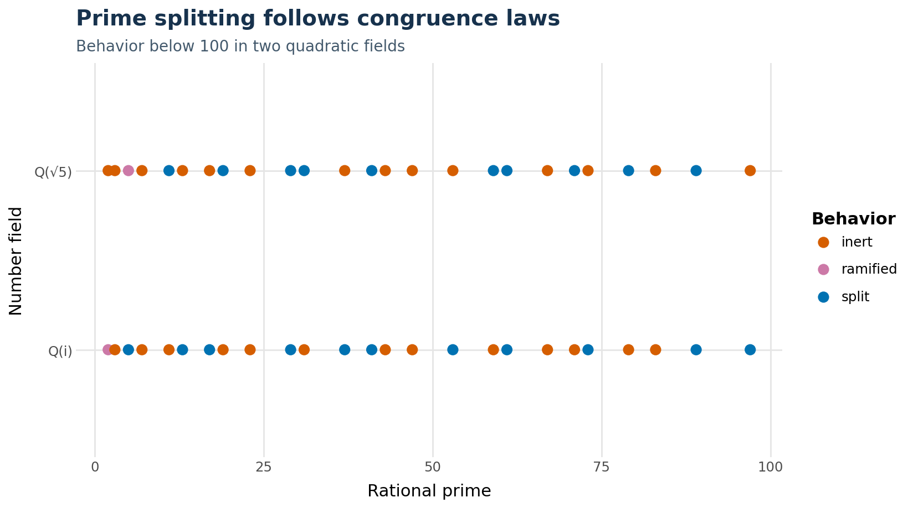

# Splitting, Ramification, and Reciprocity {#sec-splitting-reciprocity}

**Level and prerequisites: L4.** Prepare number fields, Dedekind ideals, residue fields and Galois extensions. Use the [level-specific reading guide](index.md#who-this-book-is-for) for linked Euler preparation.

A rational prime can remain prime, split into several prime ideals, or acquire
repeated prime factors in a number field. These patterns connect congruences,
quadratic reciprocity, finite fields, discriminants, and Galois symmetry. The
central idea is local: reduce a defining polynomial modulo the prime and study
what survives.

## Prerequisite checkpoint and goals

Chapters 8 and 17 developed quadratic residues and forms. Chapters 23–25
introduced finite fields, rings of integers, prime ideals, and class groups.
This chapter defines every new Galois term it uses. The goals are to compute
splitting in quadratic fields, interpret quadratic reciprocity as a symmetry of
splitting conditions, and understand what Frobenius and Chebotarev add.

## The decomposition equation

Let $K$ be a number field of degree $n$ and let $p$ be a rational prime. Unique
ideal factorization gives

$$
p\mathcal O_K=\mathfrak p_1^{e_1}\cdots\mathfrak p_g^{e_g}.
$$

The exponent $e_i$ is the **ramification index**. The quotient
$\mathcal O_K/\mathfrak p_i$ is a finite extension of $\mathbb F_p$; its degree
$f_i$ is the **residue degree**. They satisfy

$$
\sum_{i=1}^g e_if_i=n.
$$

In a quadratic field only three unexceptional patterns occur:

- split: $g=2$, with $e_1=e_2=f_1=f_2=1$;
- inert: $g=1$, with $e_1=1,f_1=2$;
- ramified: $g=1$, with $e_1=2,f_1=1$.

Ramified primes divide the field discriminant. This finite exceptional set is
where repeated factors and wild behavior can appear.

## Quadratic fields and residue symbols

Let $K=\mathbb Q(\sqrt d)$ have fundamental discriminant $D$. For an odd prime
$p\nmid D$, the Kronecker/Legendre symbol determines splitting:

$$
\left(\frac Dp\right)=
\begin{cases}
1,&p\text{ splits},\\
-1,&p\text{ is inert}.
\end{cases}
$$

If $p\mid D$, then $p$ ramifies. For $\mathbb Q(i)$, $D=-4$: the prime $2$
ramifies, primes $p\equiv1\pmod4$ split, and primes
$p\equiv3\pmod4$ are inert. This is the two-square theorem seen through ideal
factorization.

For $\mathbb Q(\sqrt5)$, $D=5$. Quadratic reciprocity gives

$$
\left(\frac5p\right)=\left(\frac p5\right),
$$

so primes congruent to $1$ or $4$ modulo $5$ split, those congruent to $2$ or
$3$ are inert, and $5$ ramifies.

<figure id="fig-prime-splitting">


<figcaption>

Figure 26.1: Rational primes separated by their splitting behavior in two quadratic fields.

</figcaption>
</figure>

The rows in [Figure 26.1](#fig-prime-splitting) show congruence laws, not random alternation.
The approximate balance of split and inert primes over this short range suggests
a density statement, but only a theorem controls the limiting distribution.

## Factoring a defining polynomial

Suppose $K=\mathbb Q(\theta)$ and, at a prime not dividing the power-basis
index, the minimal polynomial factors modulo $p$ as

$$
\overline f=\overline f_1^{e_1}\cdots\overline f_g^{e_g}.
$$

Then

$$
\mathfrak p_i=(p,f_i(\theta))
$$

has residue degree $\deg f_i$. For example, in $\mathbb Q(i)$ the polynomial
$x^2+1$ splits modulo $5$ as $(x-2)(x+2)$, giving

$$
(5)=(5,i-2)(5,i+2).
$$

Modulo $3$, $x^2+1$ is irreducible, so $(3)$ remains prime and the residue
field has nine elements.

The index hypothesis is essential. If $\mathcal O_K\ne\mathbb Z[\theta]$ at
$p$, polynomial factorization in the smaller order may misreport ramification.

## Quadratic reciprocity as a splitting symmetry

For distinct odd primes $p,q$, quadratic reciprocity says

$$
\left(\frac pq\right)
\left(\frac qp\right)
=(-1)^{(p-1)(q-1)/4}.
$$

The supplementary laws determine $(-1/p)$ and $(2/p)$. At an elementary level
this is a remarkable symmetry between two modular square questions. In field
language, $(q/p)=1$ asks whether $p$ splits in $\mathbb Q(\sqrt q)$, while
$(p/q)=1$ reverses their roles. Reciprocity is the compatibility law governing
these splitting conditions.

One proof counts lattice points in a rectangle (Gauss's lemma). Another uses
quadratic Gauss sums. A third views the theorem as the first case of global
class field theory. The book proves the elementary form in Chapter 8; here we
emphasize how the same formula organizes primes across fields.

## Frobenius

Assume $K/\mathbb Q$ is Galois and $p$ is unramified. Choose a prime ideal
$\mathfrak p$ above $p$. Reduction gives a finite residue field. The
**Frobenius element** is characterized by

$$
\operatorname{Frob}_{\mathfrak p}(x)\equiv x^p\pmod{\mathfrak p}.
$$

Changing $\mathfrak p$ conjugates the element, so a rational prime determines a
Frobenius conjugacy class. Its order is the residue degree. In an abelian Galois
group conjugacy classes are singletons, making splitting conditions especially
explicit.

Cyclotomic fields give a model. In $\mathbb Q(\zeta_m)$, an unramified prime
$p$ acts by $\zeta_m\mapsto\zeta_m^p$. Its residue degree is the multiplicative
order of $p$ modulo $m$. Thus the congruence class of $p$ is literally a Galois
action.

## Chebotarev density theorem

The broad distribution theorem is:

<div class="callout callout-note">
<p class="callout-title">Chebotarev density theorem — stated</p>

For a finite Galois extension with group $G$, the unramified primes whose
Frobenius lies in a conjugacy class $C$ have Dirichlet density $|C|/|G|$.

</div>

Dirichlet density weights primes through analytic series; it agrees with natural
density in this theorem, though that agreement is part of the conclusion, not
the definition. For a quadratic extension, $G$ has two elements, so split and
inert primes each have density $1/2$. Dirichlet's theorem on primes in
progressions and many polynomial factorization statistics are special cases or
close relatives.

Standard proofs use analytic continuation and nonvanishing for suitable
Dedekind zeta functions, together with character or induction arguments. They
do not require the still-conjectural assertion that every nontrivial Artin
$L$-function is entire. We state Chebotarev and use it as a destination;
Chapter 27 builds the complete Dirichlet-character case.

## Ramification cautions

Ramification is not just “another splitting color.” Repeated prime-ideal factors
create inertia, different, and discriminant contributions. If $p$ divides the
ramification index, behavior is **wild**; otherwise it is tame. Wild ramification
contains finer filtration data invisible in the triple $(e,f,g)$.

Likewise, a finite census cannot establish density. Congruence conditions may
create long early biases, and exceptional primes should be removed according to
the theorem's precise hypotheses before ratios are computed.

The three deferred structures now have separate continuations. Finite
extensions of completions and their tame/wild filtrations are developed in
[sec-local-fields](38-local-fields.md#sec-local-fields). Frobenius acting on finite-field curves is developed in
[sec-curve-zeta](39-curve-zeta.md#sec-curve-zeta). The abelian Artin map and its idele-class kernel are stated
precisely and computed explicitly in [sec-class-field-theory](40-class-field-theory.md#sec-class-field-theory).

<!-- inline-formula-code:start -->
## Formula and finite computation

A useful formula in this chapter is

$$
x^2\equiv D\pmod p
$$

A root count distinguishes split, inert, and ramified behavior in the quadratic model. The following standalone Python block expresses that finite rule with its inputs and stopping conditions visible.

```python
discriminant = 5
for prime in (3, 5, 7, 11, 13):
    roots = [x for x in range(prime) if (x * x - discriminant) % prime == 0]
    print(prime, roots)
```

**What the computation establishes.** The output certifies only the declared finite case. The theorem, if one is claimed, still requires the argument developed in the chapter.
<!-- inline-formula-code:end -->

## Chapter summary

- A rational prime factors with ramification indices and residue degrees whose
  weighted sum is the field degree.
- Quadratic splitting is governed by a discriminant residue symbol.
- Quadratic reciprocity is a symmetry law for splitting questions.
- Frobenius records the action of an unramified prime on its residue field.
- Chebotarev predicts densities of Frobenius classes; finite plots illustrate
  but do not prove it.

## Exercises and selected answers

<div class="exercise" id="number_theory-26-splitting-reciprocity-ex-1">
<p class="exercise-title"><strong>Exercise 1</strong></p>

Classify $3,5,7,11,13$ in $\mathbb Q(i)$.

</div>

<div class="exercise" id="number_theory-26-splitting-reciprocity-ex-2">
<p class="exercise-title"><strong>Exercise 2</strong></p>

Classify the same primes in $\mathbb Q(\sqrt5)$.

</div>

<div class="exercise" id="number_theory-26-splitting-reciprocity-ex-3">
<p class="exercise-title"><strong>Exercise 3</strong></p>

Factor $x^3-2$ modulo $5$ and predict residue degrees, noting any index issue
that must be checked.

</div>

<div class="exercise" id="number_theory-26-splitting-reciprocity-ex-4">
<p class="exercise-title"><strong>Exercise 4</strong></p>

Prove a ramified quadratic prime divides the field discriminant in the
displayed polynomial model.

</div>

<div class="exercise" id="number_theory-26-splitting-reciprocity-ex-5">
<p class="exercise-title"><strong>Exercise 5</strong></p>

Compute the order of $2$ modulo $7$ and predict its residue degree in
$\mathbb Q(\zeta_7)$.

</div>

<div class="exercise" id="number_theory-26-splitting-reciprocity-ex-6">
<p class="exercise-title"><strong>Exercise 6</strong></p>

Use quadratic reciprocity to evaluate $(29/43)$.

</div>

<div class="exercise" id="number_theory-26-splitting-reciprocity-ex-7">
<p class="exercise-title"><strong>Exercise 7</strong></p>

Explain why Frobenius is a conjugacy class rather than a canonical element
in a nonabelian extension.

</div>

<div class="exercise" id="number_theory-26-splitting-reciprocity-ex-8">
<p class="exercise-title"><strong>Exercise 8</strong></p>

Design a prime-splitting census that states its range and excludes ramified
primes explicitly.

For 1, $5$ and $13$ split, $3,7,11$ are inert. In 2, $5$ ramifies; $11$ splits;
$3,7,13$ are inert. In 5, the order is $3$. For 6, both primes are $1$ or $3$
modulo $4$ in a way that gives $(29/43)=(43/29)=(14/29)=-1$ after the
supplementary laws.

</div>
