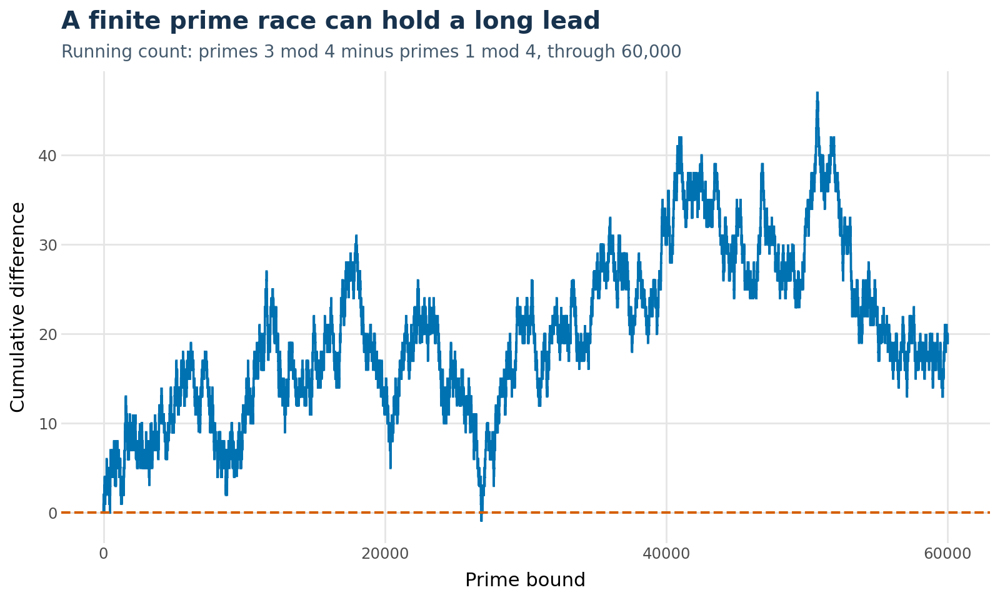

# Characters, L-Functions, and Primes in Progressions {#sec-l-functions}

**Level and prerequisites: L4.** Prepare finite abelian groups, character orthogonality, complex series and analytic nonvanishing. Use the [level-specific reading guide](index.md#who-this-book-is-for) for linked Euler preparation.

Euclid proved that primes never end. A subtler question asks whether primes keep
appearing in every admissible arithmetic progression
$a,a+q,a+2q,\ldots$. Dirichlet's answer combines finite harmonic analysis with
infinite series. Characters isolate one residue class; $L$-functions translate
their prime content into analytic behavior.

## Prerequisite checkpoint and goals

Chapters 4–5 supplied residue classes and units. Chapter 7 introduced
multiplicative functions, Chapter 21 introduced Dirichlet series, and Chapter 23
showed finite cyclic groups. We reconstruct the needed group and complex-number
language here.

You will build character tables, prove orthogonality, derive an Euler product,
and follow the proof architecture showing that every reduced residue class
contains infinitely many primes.

## Characters of finite abelian groups

Let $G$ be a finite abelian group. A **character** is a homomorphism

$$
\chi:G\longrightarrow\{z\in\mathbb C:|z|=1\}.
$$

Thus $\chi(gh)=\chi(g)\chi(h)$. Because every $g$ has finite order, character
values are roots of unity. The characters themselves form a group
$\widehat G$ under pointwise multiplication, and $|\widehat G|=|G|$.

For a cyclic group generated by $g$ of order $m$, the $m$ characters are

$$
\chi_j(g^k)=e^{2\pi ijk/m},\qquad 0\le j<m.
$$

Finite abelian groups are products of cyclic groups, so their characters are
products of these basic waves.

## Orthogonality

If $\chi$ is nontrivial, choose $h$ with $\chi(h)\ne1$. Multiplication by $h$
permutes $G$, so

$$
\sum_{g\in G}\chi(g)
=\sum_{g\in G}\chi(hg)
=\chi(h)\sum_{g\in G}\chi(g).
$$

The sum must be zero. From this one obtains the two orthogonality relations:

$$
\frac1{|G|}\sum_{g\in G}\chi(g)\overline{\psi(g)}
=\begin{cases}1,&\chi=\psi,\\0,&\chi\ne\psi,
\end{cases}
$$

and

$$
\frac1{|G|}\sum_{\chi\in\widehat G}
\chi(g)\overline{\chi(h)}
=\begin{cases}1,&g=h,\\0,&g\ne h.
\end{cases}
$$

The second formula is a residue-class detector. It replaces an awkward
congruence condition by a sum of multiplicative weights.

## Dirichlet characters

Take $G=(\mathbb Z/q\mathbb Z)^\times$. Extend a character to all integers by
periodicity and set $\chi(n)=0$ when $\gcd(n,q)>1$. The result is a **Dirichlet
character modulo $q$**. It is completely multiplicative:
$\chi(mn)=\chi(m)\chi(n)$.

Modulo $4$ there are two characters. The principal character $\chi_0$ is $1$
on odd integers and $0$ on even integers. The nonprincipal real character is

$$
\chi_4(n)=
\begin{cases}
0,&2\mid n,\\
1,&n\equiv1\pmod4,\\
-1,&n\equiv3\pmod4.
\end{cases}
$$

For $(a,q)=1$, orthogonality gives

$$
1_{n\equiv a\ (q)}
=\frac1{\varphi(q)}\sum_{\chi\bmod q}
\overline{\chi(a)}\chi(n)
$$

whenever $(n,q)=1$. This exact identity is the gateway to prime progressions.

A character may be induced from a smaller modulus. Its minimal modulus is the
**conductor**; a character at its conductor is **primitive**. Primitive
characters have the cleanest Gauss sums and functional equations.

## Dirichlet L-functions

For $\operatorname{Re}(s)>1$, define

$$
L(s,\chi)=\sum_{n=1}^{\infty}\frac{\chi(n)}{n^s}.
$$

Complete multiplicativity and absolute convergence give the Euler product

$$
L(s,\chi)=\prod_p\left(1-\frac{\chi(p)}{p^s}\right)^{-1}.
$$

For the principal character, $L(s,\chi_0)$ is the zeta function with finitely
many Euler factors removed and has a pole at $s=1$. For a nonprincipal
character, cancellation over each full period makes the series converge for
real $s>0$ by summation by parts; in particular $L(1,\chi)$ is meaningful.

Taking logarithms in the absolutely convergent region yields

$$
\log L(s,\chi)
=\sum_p\frac{\chi(p)}{p^s}+O(1)
$$

as $s\downarrow1$. The bounded error comes from prime powers with exponent at
least two.

## Nonvanishing at one

The decisive fact is

$$
L(1,\chi)\ne0
$$

for every nonprincipal Dirichlet character. For a real character, Dirichlet's
original proof can use positivity of carefully combined series and class-number
ideas. For complex characters, one forms a product over characters and exploits
nonnegative coefficients or uses analytic continuation with a positivity
argument.

We give the proof architecture rather than hide its hardest step:

1. periodic cancellation continues each nonprincipal $L$-series to a
   neighborhood of $1$;
2. suppose some $L(1,\chi)$ vanished;
3. combine all characters so poles and zeros would force an impossible order at
   $1$ while the Euler-product coefficients retain nonnegativity;
4. conclude every nonprincipal factor is nonzero.

The distinction between real and complex characters matters; an argument that
uses an ordering of real coefficients cannot simply be copied to complex values.

## Dirichlet's theorem

Apply the character detector to primes:

$$
\sum_{p\equiv a\ (q)}p^{-s}
=\frac1{\varphi(q)}
\sum_{\chi\bmod q}\overline{\chi(a)}
\sum_p\frac{\chi(p)}{p^s}.
$$

The principal character contributes
$\varphi(q)^{-1}\log(1/(s-1))$ as $s\downarrow1$. Nonprincipal contributions
remain bounded because their $L$-values at $1$ are nonzero. Therefore the left
side diverges, proving infinitely many primes $p\equiv a\pmod q$.

With deeper zero-free information one obtains the quantitative prime number
theorem for progressions:

$$
\pi(x;q,a)\sim\frac{1}{\varphi(q)}\frac{x}{\log x}.
$$

The qualitative theorem needs nonvanishing at $1$; uniform error estimates as
$q$ grows are substantially harder.

## Prime races

<figure id="fig-prime-race">


<figcaption>

Figure 27.1: The running difference between primes in two reduced residue classes changes sign over finite ranges.

</figcaption>
</figure>

[Figure 27.1](#fig-prime-race) compares two classes that have the same asymptotic density. A
long-lasting lead is compatible with equality in the limit. Bias questions are
connected to zeros of $L$-functions and to how a finite cutoff is chosen.
Neither a plot nor the prime number theorem alone determines the sign at a
particular large value.

<div class="callout callout-warning">
<p class="callout-title">A character sum is a filter, not a probability</p>

Orthogonality is an exact algebraic identity. Interpreting its terms as
independent random contributions can suggest useful heuristics, but independence
is an additional model and must be labeled.

</div>

Complete character orthogonality does not by itself control short partial sums.
Fourier completion, Pólya–Vinogradov and Burgess boundaries, and quadratic
Gauss-sum cancellation are organized in [sec-exponential-sums](37-exponential-sums.md#sec-exponential-sums). The passage
from these one-dimensional $L$-functions to local components of $GL_2$ is made
in [sec-automorphic-langlands](42-automorphic-langlands.md#sec-automorphic-langlands).

<!-- inline-formula-code:start -->
## Formula and finite computation

A useful formula in this chapter is the finite truncation

$$
L_X(s,\chi_4)=\sum_{n=1}^{X}\frac{\chi_4(n)}{n^s},
\qquad
\chi_4(n)=
\begin{cases}
0,&2\mid n,\\
1,&n\equiv1\pmod4,\\
-1,&n\equiv3\pmod4.
\end{cases}
$$

The code names the character explicitly and compares partial sums at $s=1$
with the proved value $L(1,\chi_4)=\pi/4$.

```python
from math import pi

def character_mod_four(integer: int) -> int:
    """Return the real primitive character modulo four at a positive integer."""
    if integer < 1:
        raise ValueError("integer must be positive")
    residue = integer % 4
    if residue % 2 == 0:
        return 0
    return 1 if residue == 1 else -1

def truncated_dirichlet_l(cutoff: int, exponent: float) -> float:
    """Return sum(chi_4(n) / n**exponent) for 1 <= n <= cutoff."""
    if cutoff < 1 or exponent <= 0:
        raise ValueError("require cutoff >= 1 and exponent > 0")
    return sum(
        character_mod_four(integer) / integer**exponent
        for integer in range(1, cutoff + 1)
    )

for cutoff in (10, 100, 1_000):
    approximation = truncated_dirichlet_l(cutoff, exponent=1.0)
    print(cutoff, approximation, approximation - pi / 4)
```

**What the computation establishes.** Each output is one finite partial sum.
The shrinking numerical error illustrates convergence but does not prove the
infinite-series identity or its analytic continuation.
<!-- inline-formula-code:end -->

## Chapter summary

- Characters are multiplicative waves on finite abelian groups.
- Orthogonality detects one residue class exactly.
- Dirichlet $L$-functions have Euler products encoding primes.
- Nonvanishing at $1$ prevents nonprincipal characters from canceling the main
  divergence.
- Every reduced residue class contains infinitely many primes, although finite
  prime races can be strongly biased.

## Exercises and selected answers

<div class="exercise" id="number_theory-27-l-functions-ex-1">
<p class="exercise-title"><strong>Exercise 1</strong></p>

Construct the full character table of $(\mathbb Z/5\mathbb Z)^\times$.

</div>

<div class="exercise" id="number_theory-27-l-functions-ex-2">
<p class="exercise-title"><strong>Exercise 2</strong></p>

Prove the first orthogonality relation directly for a cyclic group.

</div>

<div class="exercise" id="number_theory-27-l-functions-ex-3">
<p class="exercise-title"><strong>Exercise 3</strong></p>

Verify the residue detector modulo $4$ for all four residue classes.

</div>

<div class="exercise" id="number_theory-27-l-functions-ex-4">
<p class="exercise-title"><strong>Exercise 4</strong></p>

Compute the first six nonzero terms of $L(s,\chi_4)$.

</div>

<div class="exercise" id="number_theory-27-l-functions-ex-5">
<p class="exercise-title"><strong>Exercise 5</strong></p>

Derive the Euler product using unique factorization.

</div>

<div class="exercise" id="number_theory-27-l-functions-ex-6">
<p class="exercise-title"><strong>Exercise 6</strong></p>

Show the partial sums of a nonprincipal character are bounded.

</div>

<div class="exercise" id="number_theory-27-l-functions-ex-7">
<p class="exercise-title"><strong>Exercise 7</strong></p>

Explain exactly where $L(1,\chi)\ne0$ enters Dirichlet's theorem.

</div>

<div class="exercise" id="number_theory-27-l-functions-ex-8">
<p class="exercise-title"><strong>Exercise 8</strong></p>

Reproduce a prime race to a declared bound and report ties and sign changes.

For 3 the detector is intended only for reduced residue classes; even inputs have
both sides zero after the standard extension. In 4 the terms are
$1-3^{-s}+5^{-s}-7^{-s}+9^{-s}-11^{-s}$. For 6, split the sum into complete
periods, each of which has total zero, and one bounded remainder.

</div>
