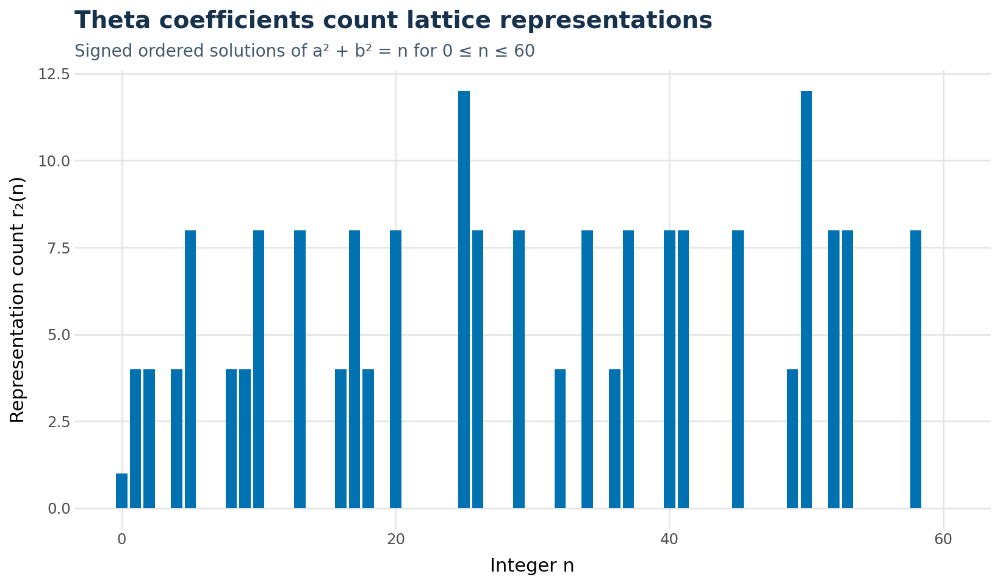

# Modular Forms and Arithmetic Generating Functions {#sec-modular-forms}

**Level and prerequisites: L4.** Prepare holomorphic functions, group actions, Fourier series and Dirichlet series. Use the [level-specific reading guide](index.md#who-this-book-is-for) for linked Euler preparation.

A generating function packages an infinite sequence into coefficients of a
power series. A modular form adds a remarkable symmetry: the same function
transforms predictably under fractional linear changes of its complex input.
That symmetry forces strong arithmetic identities among the coefficients.

## Prerequisite checkpoint and goals

The concise primer introduced exponentials and trigonometric notation, Chapter 7
introduced divisor sums, Chapter 16 used generating functions for partitions,
and Chapter 17 connected quadratic forms with representation counts. We will
define the complex upper half-plane, holomorphicity at the level needed here,
and every modular-form term. Full complex-analysis proofs are scoped explicitly.

You will read q-expansions, verify basic transformation rules, connect Eisenstein
series with divisor sums, use theta series to count representations, and explain
where Hecke operators and elliptic curves enter.

## The upper half-plane and modular action

Let

$$
\mathbb H=\{\tau\in\mathbb C:\operatorname{Im}\tau>0\}.
$$

A matrix

$$
\gamma=\begin{pmatrix}a&b\\c&d\end{pmatrix}
\in\operatorname{SL}_2(\mathbb Z)
$$

acts by

$$
\gamma\tau=\frac{a\tau+b}{c\tau+d}.
$$

The matrices $\gamma$ and $-\gamma$ act identically. Two basic transformations,
$T(\tau)=\tau+1$ and $S(\tau)=-1/\tau$, generate the modular group.

A function $f:\mathbb H\to\mathbb C$ is a modular form of even integer weight
$k$ for the full modular group when it is holomorphic, satisfies

$$
f(\gamma\tau)=(c\tau+d)^k f(\tau),
$$

and is holomorphic at the cusp $i\infty$. The last condition becomes concrete
because $T$-invariance makes $f$ periodic. With
$q=e^{2\pi i\tau}$, it has an expansion

$$
f(\tau)=\sum_{n=0}^{\infty}a_nq^n
$$

with no negative powers. A **cusp form** has $a_0=0$.

Holomorphic means complex differentiable on a neighborhood. We use standard
facts about power series and contour estimates without developing a full
complex-analysis course; Calculus Chapter 31 supplies a route into them.

## Eisenstein series

For even $k\ge4$, the lattice sum

$$
G_k(\tau)=
\sum_{(m,n)\in\mathbb Z^2\setminus\{(0,0)\}}
\frac1{(m\tau+n)^k}
$$

converges absolutely and transforms with weight $k$. After normalization, the
first examples are

$$
E_4=1+240\sum_{n\ge1}\sigma_3(n)q^n,
\qquad
E_6=1-504\sum_{n\ge1}\sigma_5(n)q^n.
$$

The divisor sums from Chapter 7 appear as Fourier coefficients of functions
defined by planar lattices. This is a recurring modular phenomenon: analytic
symmetry forces arithmetic structure.

The vector spaces of modular forms of fixed weight are finite-dimensional. For
the full modular group, every modular form is a polynomial in $E_4$ and $E_6$.
Proving this uses the valence formula and complex analysis; we state the
structure theorem and verify consequences from q-expansions.

## The discriminant cusp form

The product

$$
\Delta(\tau)=q\prod_{n=1}^{\infty}(1-q^n)^{24}
=\sum_{n=1}^{\infty}\tau(n)q^n
$$

is a weight-$12$ cusp form. Its coefficients define Ramanujan's tau function.
Because the weight-$12$ cusp space is one-dimensional, comparing the first
coefficient proves identities among $\Delta$, $E_4^3$, and $E_6^2$:

$$
E_4^3-E_6^2=1728\Delta.
$$

Coefficient comparison then yields nontrivial convolution identities for
divisor sums. Equality of infinitely many coefficients is justified by equality
of holomorphic functions, not by checking a long finite list.

## Theta series and quadratic forms

For $\operatorname{Im}\tau>0$, define

$$
\theta(\tau)=\sum_{n\in\mathbb Z}q^{n^2}.
$$

Then

$$
\theta(\tau)^2=
\sum_{m,n\in\mathbb Z}q^{m^2+n^2}
=\sum_{N\ge0}r_2(N)q^N,
$$

where $r_2(N)$ counts signed ordered representations as two squares. A
transformation formula for $\theta$ under $\tau\mapsto-1/\tau$ makes it a
modular form of half-integral weight on a suitable subgroup.

<figure id="fig-theta-representations">


<figcaption>

Figure 28.1: Coefficients of a theta series count lattice representations by a quadratic form.

</figcaption>
</figure>

In [Figure 28.1](#fig-theta-representations), each bar counts lattice points on a circle. The
congruence obstructions of Chapter 17 create zero bars, while multiplicative
divisor structure controls the heights. A coefficient plot does not establish
the transformation law; modularity is what turns the picture into exact
formulas.

More generally, a positive-definite integral quadratic form has a theta series.
Forms in the same genus often share averaged coefficient behavior, connecting
modular forms to local representation theory.

## Partitions and the eta function

Euler's product gives

$$
\sum_{n=0}^{\infty}p(n)q^n
=\prod_{m=1}^{\infty}(1-q^m)^{-1}.
$$

The closely related Dedekind eta function

$$
\eta(\tau)=q^{1/24}\prod_{m=1}^{\infty}(1-q^m)
$$

has a modular transformation rule with a multiplier. That symmetry underlies
the Hardy–Ramanujan asymptotic

$$
p(n)\sim\frac1{4n\sqrt3}
\exp\!\left(\pi\sqrt{\frac{2n}{3}}\right).
$$

The circle method extracts coefficients by integrating the generating function
around $|q|=r$. Modular transformations control the singular behavior near roots
of unity. We state the full error analysis; the exponential scale and leading
constant are explained by the dominant cusp contribution.

## Hecke operators

Hecke operators $T_n$ are commuting linear transformations on spaces of modular
forms. A normalized simultaneous eigenform
$f=\sum a_mq^m$ has multiplicative coefficients:

$$
a_{mn}=a_ma_n\quad\text{when }(m,n)=1,
$$

with a precise recurrence at prime powers. The associated Dirichlet series
$\sum a_nn^{-s}$ has an Euler product. Hecke symmetry therefore converts linear
algebra on function spaces into multiplicative number theory.

This route culminates in the modularity theorem: elliptic curves over
$\mathbb Q$ correspond to weight-$2$ modular forms of appropriate level. The
theorem was the decisive bridge in the proof of Fermat's Last Theorem. We state
that historical and mathematical connection without suggesting that this
chapter proves modularity.

The precise next step is [sec-automorphic-langlands](42-automorphic-langlands.md#sec-automorphic-langlands). It turns the prime-power
Hecke recurrence into a complete local Euler factor, interprets its roots as
Satake parameters, lifts a classical newform to an adelic representation, and
matches Hecke polynomials with Frobenius polynomials while preserving the
theorem-status boundary around global Langlands reciprocity.

<div class="callout callout-warning">
<p class="callout-title">A q-series is not automatically modular</p>

An attractive product, recurrence, or arithmetic coefficient sequence does not
guarantee a modular transformation law. Modularity requires analyticity,
growth at cusps, a specified group, weight, and often a multiplier system.

</div>

<!-- inline-formula-code:start -->
## Formula and finite computation

A useful formula in this chapter is

$$
\prod_{m\ge1}(1-q^m)^{-1}=\sum_{n\ge0}p(n)q^n
$$

A finite coefficient ledger multiplies the truncated generating product. The following standalone Python block expresses that finite rule with its inputs and stopping conditions visible.

```python
degree = 12
coefficients = [1] + [0] * degree
for part in range(1, degree + 1):
    for total in range(part, degree + 1):
        coefficients[total] += coefficients[total - part]
print(coefficients)
```

**What the computation establishes.** The output certifies only the declared finite case. The theorem, if one is claimed, still requires the argument developed in the chapter.
<!-- inline-formula-code:end -->

## Chapter summary

- Modular forms are holomorphic functions constrained by matrix symmetries.
- Their q-expansions encode arithmetic sequences.
- Eisenstein coefficients are divisor sums; theta coefficients count quadratic
  representations.
- Eta symmetry explains partition asymptotics.
- Hecke eigenforms have multiplicative coefficients and Euler products.

## Exercises and selected answers

<div class="exercise" id="number_theory-28-modular-forms-ex-1">
<p class="exercise-title"><strong>Exercise 1</strong></p>

Verify that $S$ and $T$ preserve the upper half-plane.

</div>

<div class="exercise" id="number_theory-28-modular-forms-ex-2">
<p class="exercise-title"><strong>Exercise 2</strong></p>

Show a weight-$k$ modular form is periodic under $T$.

</div>

<div class="exercise" id="number_theory-28-modular-forms-ex-3">
<p class="exercise-title"><strong>Exercise 3</strong></p>

Compute the coefficients of $E_4$ through $q^5$.

</div>

<div class="exercise" id="number_theory-28-modular-forms-ex-4">
<p class="exercise-title"><strong>Exercise 4</strong></p>

Enumerate $r_2(N)$ for $0\le N\le10$ directly from lattice points.

</div>

<div class="exercise" id="number_theory-28-modular-forms-ex-5">
<p class="exercise-title"><strong>Exercise 5</strong></p>

Expand Euler's partition product through $q^6$.

</div>

<div class="exercise" id="number_theory-28-modular-forms-ex-6">
<p class="exercise-title"><strong>Exercise 6</strong></p>

Use $E_4^3-E_6^2=1728\Delta$ to determine the first tau coefficient.

</div>

<div class="exercise" id="number_theory-28-modular-forms-ex-7">
<p class="exercise-title"><strong>Exercise 7</strong></p>

Explain why two modular forms in a known one-dimensional space are equal
after one normalization.

</div>

<div class="exercise" id="number_theory-28-modular-forms-ex-8">
<p class="exercise-title"><strong>Exercise 8</strong></p>

Contrast the evidence supplied by a q-expansion check with a proof of
modularity.

For 3, begin $E_4=1+240q+2160q^2+6720q^3+17520q^4+30240q^5+\cdots$.
For 4, $r_2(0)=1$, $r_2(1)=4$, $r_2(2)=4$, $r_2(4)=4$, $r_2(5)=8$, $r_2(8)=4$,
$r_2(9)=4$, $r_2(10)=8$, and the omitted positive values through ten are zero.
For 6, the coefficient of $q$ is $(3\cdot240)-2(-504)=1728$, so $\tau(1)=1$.

</div>
