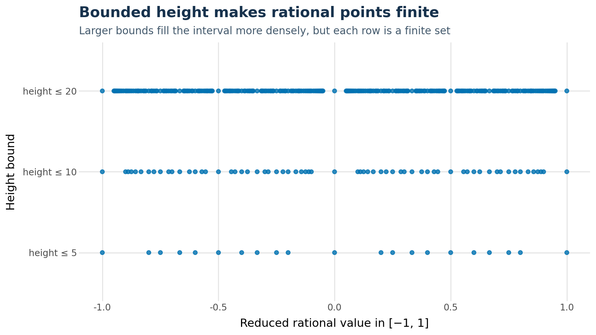

# Heights, Transcendence, and Diophantine Finiteness {#sec-heights-transcendence}

**Level and prerequisites: L4.** Prepare algebraic numbers, field embeddings and real logarithms. Use the [level-specific reading guide](index.md#who-this-book-is-for) for linked Euler preparation.

Diophantine equations ask for rational or integer points, but a finite answer
often requires measuring how complicated a point is. A **height** supplies that
measurement. Heights connect rational approximation, transcendence, elliptic
descent, and theorems asserting that only finitely many arithmetic points can
exist.

## Prerequisite checkpoint and goals

Chapter 9 developed rational approximation, Chapter 18 introduced Liouville and
Roth viewpoints, and Chapter 20 introduced elliptic curves and a first height.
Chapter 24 supplied algebraic numbers, conjugates, and the product formula. We
now unify those strands.

You will compute rational and algebraic heights, prove a basic finiteness result,
compare approximation theorems by quantifiers, and distinguish effective from
ineffective Diophantine conclusions.

## Height of a rational number

Write $x=a/b$ in lowest terms with $b>0$. Its multiplicative height is

$$
H(x)=\max(|a|,b),
$$

and its logarithmic height is $h(x)=\log H(x)$. The normalization prevents one
rational number from acquiring infinitely many descriptions: $1/2=2/4$ but the
second pair is not coprime.

There are finitely many rationals of bounded height. Indeed, $H(a/b)\le B$
forces $|a|\le B$ and $1\le b\le B$, leaving finitely many integer pairs. This
simple observation is the model for Northcott's theorem.

Projective coordinates remove scaling. For a primitive integer tuple
$[x_0:\cdots:x_n]$,

$$
H([x_0:\cdots:x_n])=\max_i|x_i|.
$$

Choosing primitive coordinates is essential; otherwise multiplying every
coordinate would change the displayed maximum without changing the point.

<figure id="fig-rational-height">


<figcaption>

Figure 29.1: Rational points of bounded height become a finite, increasingly dense set on the number line.

</figcaption>
</figure>

[Figure 29.1](#fig-rational-height) illustrates two facts that coexist: bounded height gives a
finite set, while allowing the bound to grow makes rational points dense. A
finiteness theorem must specify both the degree and the height bound.

## Algebraic height

Let $\alpha$ have degree $d$ and primitive minimal polynomial

$$
a_0\prod_{i=1}^{d}(x-\alpha_i)\in\mathbb Z[x].
$$

One multiplicative height is

$$
H(\alpha)^d=|a_0|\prod_{i=1}^{d}\max(1,|\alpha_i|).
$$

The logarithmic version averages local contributions. It satisfies useful
inequalities such as

$$
h(\alpha\beta)\le h(\alpha)+h(\beta),
\qquad
h(\alpha+\beta)\le h(\alpha)+h(\beta)+\log2.
$$

These resemble digit-length estimates. Height is not ordinary magnitude:
$2^{100}$ is large in both senses, but a root of unity may have ordinary complex
magnitude $1$ and logarithmic height $h=0$ (multiplicative height $H=1$)
regardless of its degree.

**Theorem 29.1 (Northcott's).** Algebraic numbers of bounded degree and bounded height
form a finite set. A proof bounds the integer coefficients of their minimal
polynomials using symmetric functions of the conjugates. Bounding height alone
without degree is insufficient: all roots of unity have logarithmic height
$h=0$ (multiplicative height $H=1$).

## Liouville and Roth compared

If $\alpha$ is algebraic of degree $d\ge2$, Liouville's inequality gives a
constant $c(\alpha)>0$ such that

$$
\left|\alpha-\frac pq\right|>
\frac{c(\alpha)}{q^d}
$$

for all rationals $p/q$ with $q>0$. The proof evaluates the minimal polynomial
at $p/q$, observes a nonzero integer after multiplying by $q^d$, and bounds the
remaining factors by the mean value theorem.

Roth's theorem is much stronger: for algebraic irrational $\alpha$ and every
$\varepsilon>0$, the inequality

$$
\left|\alpha-\frac pq\right|<q^{-2-\varepsilon}
$$

has only finitely many rational solutions. The exponent $2$ is essentially
best because continued fractions always produce infinitely many approximations
of order $q^{-2}$.

The quantifiers matter. Roth does not supply an elementary computable list of
all exceptional approximations. Its usual proof is **ineffective** in that
sense. Liouville's weaker exponent often gives an explicit constant.

## Worked clinic: certifying an algebraic relation {#sec-nt-relation-certificate}

A numerical calculation may suggest an integer polynomial $P$ whose value is
very small. That suggestion leaves three different questions: is the value
exactly zero, is $P$ the primitive minimal polynomial, and which root does the
number denote? Here a norm supplies an explicit precision threshold, while
exact field arithmetic answers the algebraic questions. The target's exact
description is part of the certificate; decimal digits alone do not supply it.

### A complete relation lattice {#sec-nt-relation-worked}

Let $t$ be the positive real cube root of $2$ and set
$$
t^3=2,\qquad \alpha=t+t^2.
$$
Eisenstein at $2$ proves $X^3-2$ irreducible, so $(1,t,t^2)$ is a rational
basis of $K=\mathbb Q(t)$. Reduction using $t^3=2$ gives
$$
\alpha^2=4+2t+t^2,\qquad
\alpha^3=6+6t+6t^2.
$$
For $P(X)=c_0+c_1X+c_2X^2+c_3X^3$, its value has coefficient triple
$$
P(\alpha)\longleftrightarrow
(c_0+4c_2+6c_3,\ c_1+2c_2+6c_3,\ c_1+c_2+6c_3).
$$
All three entries vanish exactly when
$$
c_2=0,\qquad c_1=-6c_3,\qquad c_0=-6c_3.
$$
Thus the complete integer relation lattice for $(1,\alpha,\alpha^2,\alpha^3)$
is
$$
\mathbb Z(-6,-6,0,1),
$$
and the minimal polynomial is
$$
f(X)=X^3-6X-6.
$$
The coefficient calculation proves minimality: a nonzero relation of degree
at most two would have $c_3=0$, forcing every coefficient to vanish.

Write
$$
B(P)=\max_j|c_j|
$$
for the **coefficient bound**, distinct from the absolute height $H(\alpha)$.
Every nonzero relation of degree at most three is $kf$, with
$k\in\mathbb Z\setminus\{0\}$. Its bound is $6|k|$, so no nonzero relation
exists at bound $5$, and precisely two exist at bound $6$. Dividing the
coefficient gcd and choosing a positive leading coefficient selects $f$.
A multiple with $|k|>1$ is an exact relation but is not primitive. Certifying
zero does not by itself certify this normalization or minimality.

The target satisfies $2<\alpha<3$: $1<t<13/10$ gives
$t+t^2<299/100<3$. Also $f(2)=-10$ and $f(3)=3$. For $2\le x<y\le3$,
$$
f(y)-f(x)=(y-x)(y^2+xy+x^2-6)>0.
$$
Consequently $(2,3)$ selects exactly one root. This is the root information
that a list of polynomial coefficients alone omits.

### Compute the absolute height {#sec-nt-relation-height}

Let $\zeta$ be a nonreal cube root of unity. The other two conjugates of
$\alpha$ are $t\zeta+t^2\zeta^2$ and its complex conjugate. Their squared
modulus is
$$
|t\zeta+t^2\zeta^2|^2=t^2+t^4-t^3=t^2+2t-2>1,
$$
because $t>1$. The real conjugate is also greater than $1$. Since $f$ is
monic and the product of its roots is $6$, the chapter's height definition
therefore gives
$$
H(\alpha)^3=6,\qquad h(\alpha)=\frac{\log6}{3}.
$$
Here $B(f)=6$ while $H(\alpha)=6^{1/3}$. The coefficient maximum and absolute
Weil height measure different objects.

### Derive a nonzero residual gap {#sec-nt-relation-gap}

If $P$ has integer coefficients, then $P(\alpha)$ belongs to $\mathbb Z[t]$.
Multiplication by it in $(1,t,t^2)$ has an integer matrix. If $P(\alpha)\ne0$,
that multiplication is invertible over $K$, so its determinant is a nonzero
integer. In terms of the three embeddings,
$$
1\le |N_{K/\mathbb Q}(P(\alpha))|
=\prod_{i=1}^{3}|P(\alpha_i)|.
$$
This uses a field basis and the monic relation for $t$; it does not require
claiming that this basis is a maximal integral basis.

The triangle inequality and $t+t^2<3$ bound every conjugate by $3$. If
$\deg P\le3$ and $B=B(P)>0$, then
$$
|P(\alpha_i)|\le B(1+3+9+27)=40B.
$$
Bounding the two other factors in the norm yields
$$
P(\alpha)\ne0\quad\Longrightarrow\quad
|P(\alpha)|\ge\frac1{(40B)^2}.
$$
For $f$, the explicit gap is $\delta=1/57600$.

More generally, for an exact algebraic-integer target in a cubic field whose
three conjugates have modulus below $R$, the same argument gives
$$
\delta_R(P)=
\frac1{\left[B(P)(1+R+R^2+R^3)\right]^2}.
$$
The field, integrality, conjugate bound and actual coefficient bound are
hypotheses. This is not a gap for arbitrary real numbers or decimal inputs.

### Certify precision and allow an undecided result {#sec-nt-relation-interval}

Suppose exact rational interval arithmetic encloses $P(\alpha)$ in $J$.
There are three outcomes:

1. If $0\notin J$, the value is nonzero.
2. If $\max(|\inf J|,|\sup J|)<\delta_R(P)$, the proved gap forces zero.
3. Otherwise this certificate has insufficient precision.

Merely containing zero is insufficient. Reaching either endpoint of the gap
does not meet the strict inequality. An undecided numerical certificate is
compatible with a separate exact algebraic proof of zero.

For a concrete finite certificate, take $S=10^{10}$ and $n=12599210498$.
Integer comparisons verify
$$
n^3<2S^3<(n+1)^3.
$$
Thus $n/S<t<(n+1)/S$. Applying the increasing function $x+x^2$ and rounding
outward by exact rational comparisons gives
$$
\alpha\in
\left[\frac{28473221015}{S},\frac{28473221019}{S}\right].
$$
Interval Horner arithmetic encloses $f(\alpha)$ in an interval containing
zero whose absolute endpoints are below $10^{-7}<1/57600$. This certifies
zero under the exact model. With the coarser target interval $[2,3]$,
ordinary interval Horner instead gives $[-12,3]$, so that numerical
certificate remains undecided. Interval enclosures can be wider than the
actual polynomial image because repeated occurrences of the input are
treated independently.

The rational endpoint
$$
r=\frac{28473221015}{10^{10}}
=\frac{5694644203}{2000000000}
$$
has $0<|f(r)|<10^{-7}$. It is not a root of the irreducible cubic, and its
rational height is $H(r)=5694644203$. The same small residual therefore
cannot prove an identity for an unknown decimal input. In particular, the
integer-norm gap for $\alpha$ cannot be transferred to this rational $r$.

### A narrow exact checker {#sec-nt-relation-code}

The following standalone program accepts only two declared targets:
$\alpha=t+t^2$ with $t^3=2$, and the changed target $\gamma=(u+u^2)^2$
with $u^3=3$. The bound $R=16$ for the latter is proved in the answer below.
The input integers certify a bracket for the positive cube root; they are
not arbitrary decimal approximations to the target. Every gap uses the
supplied polynomial's own $B(P)$, including common multiples.

A relation vector must be nonzero. The all-zero vector vanishes identically
but proves no nontrivial algebraic relation and would give $B=0$, so the
function rejects it. It also rejects malformed coefficients, booleans or
floats in integer positions, nonpositive scales, and invalid root brackets.

```python
from fractions import Fraction

Coefficients = tuple[int, int, int, int]
Interval = tuple[Fraction, Fraction]

def relation_certificate(
    model: str,
    coefficients: Coefficients,
    lower_numerator: int,
    upper_numerator: int,
    scale: int,
) -> tuple[str, Interval, Fraction]:
    """Check a nonzero cubic relation vector in one declared exact model."""
    if type(model) is not str:
        raise TypeError("model must be a string")
    if model not in ("alpha", "gamma"):
        raise ValueError("model must be alpha or gamma")
    if type(coefficients) is not tuple:
        raise TypeError("coefficients must be a tuple")
    if len(coefficients) != 4:
        raise ValueError("supply four coefficients in increasing degree")
    if any(type(value) is not int for value in coefficients):
        raise TypeError("coefficients must be exact integers")
    if not any(coefficients):
        raise ValueError("the zero vector is not a nontrivial relation")
    for value in (lower_numerator, upper_numerator, scale):
        if type(value) is not int:
            raise TypeError("root bracket data must be exact integers")
    if scale <= 0 or not 0 <= lower_numerator < upper_numerator:
        raise ValueError("use a positive scale and ordered nonnegative bounds")
    radicand, conjugate_bound = (2, 3) if model == "alpha" else (3, 16)
    if not (
        lower_numerator**3
        < radicand * scale**3
        < upper_numerator**3
    ):
        raise ValueError("the bracket must enclose the declared cube root")
    lower_root = Fraction(lower_numerator, scale)
    upper_root = Fraction(upper_numerator, scale)
    lower = lower_root + lower_root**2
    upper = upper_root + upper_root**2
    if model == "gamma":
        lower, upper = lower**2, upper**2
    enclosure = (Fraction(0), Fraction(0))
    for coefficient in reversed(coefficients):
        products = [a * b for a in enclosure for b in (lower, upper)]
        enclosure = (
            min(products) + coefficient,
            max(products) + coefficient,
        )
    coefficient_bound = max(abs(value) for value in coefficients)
    factor = sum(conjugate_bound**power for power in range(4))
    gap = Fraction(1, (coefficient_bound * factor) ** 2)
    if enclosure[1] < 0 or enclosure[0] > 0:
        status = "nonzero"
    elif max(abs(value) for value in enclosure) < gap:
        status = "zero"
    else:
        status = "insufficient"
    return status, enclosure, gap

cases = (
    ("alpha", (-6, -6, 0, 1), 12599210498, 12599210499, 10**10),
    (
        "gamma", (-144, 81, -18, 1),
        1442249570307408382, 1442249570307408383, 10**18,
    ),
    ("alpha", (-6, -6, 0, 1), 1, 2, 1),
    ("gamma", (-144, 81, -18, 1), 1, 2, 1),
    ("alpha", (1, 0, 0, 0), 1, 2, 1),
)
for case in cases:
    status, enclosure, gap = relation_certificate(*case)
    print(case[0], status)
```

The five printed statuses are, in order, zero, zero, insufficient,
insufficient, and nonzero. The broad cube-root bracket $[1,2]$ in the two
coarse cases produces target intervals $[2,6]$ and $[4,36]$; these are broader
than the manual target intervals above and below.

Interval multiplication takes the least and greatest of the four endpoint
products. By induction, each Horner step contains the exact partial
polynomial value. The cube inequalities and positive monotone transformations
bind that enclosure to the declared target. No caller-supplied gap or
arbitrary measured constant is accepted.

**What the computation establishes.** It checks finite integer and rational
inequalities and applies the proved model-specific gap. A zero status
certifies the supplied relation, not its primitive normalization,
irreducibility, or completeness among all relations. Those require the
coefficient arguments above and below. The code neither runs PSLQ nor decides
whether an arbitrary constant is algebraic or transcendental.

### Changed task with a squared generator {#sec-nt-relation-task}

Let $u$ be the positive real cube root of $3$, put $b=u+u^2$, and set
$\gamma=b^2$.

1. Find the coefficient triples of $\gamma,\gamma^2,\gamma^3$ in
   $(1,u,u^2)$. Determine all integer relations of degree at most three, their
   least nonzero coefficient bound, and the normalized minimal polynomial.
2. Prove that $\gamma$ has degree three and select its intended real root.
3. Compute $H(\gamma)$, justifying which conjugates have modulus greater than
   one. Keep this separate from the coefficient bound.
4. Derive a gap using $R=16$. Certify the narrow interval from the listing,
   explain the coarse certificate's undecided result, and explain why a
   nearby rational endpoint cannot inherit the model's zero certificate.

**Hint.** First derive $b^3=9b+12$ and use $b(\gamma-9)=12$ to recover $b$.
For the height, square the moduli of the conjugates of $b$. For the exact
bracket, use the two numerators $1442249570307408382$ and
$1442249570307408383$ with scale $10^{18}$.

### Explanation of the changed task {#sec-nt-relation-solution}

Reduction using $u^3=3$ gives $b^2=6+3u+u^2$ and
$b^3=12+9u+9u^2$. Consequently the three requested triples are
$$
\gamma=(6,3,1),\qquad
\gamma^2=(54,39,21),\qquad
\gamma^3=(630,459,297).
$$
A relation with coefficients $(c_0,c_1,c_2,c_3)$ therefore has equations
$$
\begin{aligned}
c_0+6c_1+54c_2+630c_3&=0,\\
3c_1+39c_2+459c_3&=0,\\
c_1+21c_2+297c_3&=0.
\end{aligned}
$$
Subtracting three times the last from the middle gives $c_2=-18c_3$.
Then $c_1=81c_3$ and $c_0=-144c_3$, so the complete lattice is
$$
\mathbb Z(-144,81,-18,1).
$$
The least nonzero coefficient bound is $144$; there is no nonzero relation
at bound $143$. At bound $144$, only the two opposite primitive vectors
occur. Gcd and positive-leading-coefficient normalization select
$$
g(X)=X^3-18X^2+81X-144.
$$

The intermediate polynomial $X^3-9X-12$ for $b$ is Eisenstein at $3$, so
$\mathbb Q(b)=\mathbb Q(u)$ has degree three. The identity
$b(\gamma-9)=12$ gives
$$
b=\frac{12}{\gamma-9}\in\mathbb Q(\gamma).
$$
Thus $\mathbb Q(\gamma)=\mathbb Q(b)$ and $g$ is minimal. Applying
Eisenstein directly to $g$ is not the worked example's shortcut here.

For a simple root interval, $36/25<u<29/20$ follows by cubing those rational
bounds. Squaring the corresponding bounds on $u+u^2$ puts $\gamma$ in
$(12,13)$. We have $g(12)=-36$ and $g(13)=64$. If $12\le x<y\le13$,
$$
g(y)-g(x)=(y-x)
\left(x^2+xy+y^2-18(x+y)+81\right)>0,
$$
since the expression in parentheses is at least $432-468+81=45$.
This interval selects exactly one root.

The two nonreal $b$ conjugates have squared modulus
$$
u^2+u^4-u^3=u^2+3u-3>1.
$$
Squaring those conjugates gives the other $\gamma$ conjugates, whose moduli
are also greater than one. The real $\gamma$ is greater than one, and its
norm is $12^2=144$. Therefore
$$
H(\gamma)^3=144,\qquad h(\gamma)=\frac{\log144}{3},
$$
while $B(g)=144$. The target's height is $144^{1/3}$, not $144$.

Since $u<3/2$, every $b$ conjugate has modulus at most $u+u^2<4$.
Every $\gamma$ conjugate consequently has modulus below $16$. The general
cubic gap becomes
$$
P(\gamma)\ne0\quad\Longrightarrow\quad
|P(\gamma)|\ge\frac1{(4369B(P))^2},
\qquad 4369=1+16+16^2+16^3.
$$
For $g$ this is $\delta=1/395812106496$.

With $S=10^{18}$ and $n=1442249570307408382$, integer cube comparisons
certify $n/S<u<(n+1)/S$. Transforming that interval and rounding outward
gives
$$
\gamma\in
\left[
\frac{12406832533974129252}{S},
\frac{12406832533974129281}{S}
\right].
$$
The exact Horner enclosure for $g$ contains zero and has absolute endpoints
below $10^{-13}<\delta$. The listing uses the unrounded transformed
cube-root interval, a subset of this outward enclosure, and therefore
certifies zero as well. In contrast, the manually proved coarse target
interval $[12,13]$ gives the Horner enclosure $[-108,129]$ and remains
insufficient. Rational endpoints still have nonzero residuals; they are not
the algebraic-integer target.

**Reference and proof boundary.** Ferguson, Bailey and Arno distinguish a
finite-precision proposed relation from its exact proof in
[*Analysis of PSLQ*, introduction](https://www.davidhbailey.com/dhbpapers/cpslq.pdf).
Feng, Chen and Wu explain why exact certification needs a gap and further
information about the exact data in
[*The PSLQ Algorithm for Empirical Data*, page 2](https://arxiv.org/pdf/1707.05037).
The cubic kernels, heights, gaps and interval certificates here were derived
explicitly; no general PSLQ correctness or finite-precision recognition
theorem is being proved by this checker.

## Constructing transcendental numbers

Liouville used the decimal

$$
L=\sum_{n=1}^{\infty}10^{-n!}.
$$

Truncating after $m$ terms gives a rational denominator $q=10^{m!}$ and error
smaller than roughly $q^{-(m+1)}$. If $L$ were algebraic of fixed degree $d$,
choosing $m>d$ would contradict Liouville's inequality. Therefore $L$ is
transcendental.

A number is **transcendental** if it satisfies no nonzero polynomial with
rational coefficients. Algebraic numbers are countable, while real numbers are
uncountable, so most real numbers are transcendental in a set-theoretic sense.
That argument does not identify familiar examples.

The Hermite–Lindemann theorem implies $e^\alpha$ is transcendental for every
nonzero algebraic $\alpha$. Lindemann–Weierstrass gives a broad linear-
independence statement for exponentials of distinct algebraic numbers and in
particular proves $e$ and $\pi$ transcendental. We state these theorems; their
proofs require complex analysis and auxiliary functions beyond this volume.

## Linear forms in logarithms

Many exponential Diophantine equations yield a quantity such as

$$
\Lambda=b_1\log\alpha_1+\cdots+b_m\log\alpha_m
$$

that is nonzero but extremely small. Baker's theory gives an explicit lower
bound for $|\Lambda|$ in terms of algebraic degrees, heights, and coefficient
sizes. Comparing that lower bound with an upper bound from the equation limits
the unknown exponents.

For example, if $2^m$ and $3^n$ are unusually close, then
$m\log2-n\log3$ is small. Continued fractions find good candidates; a
linear-forms theorem proves there cannot be candidates beyond an explicit
scale. This combination turns some infinite searches into finite computations.

The constants can be enormous. “Effective” means computable in principle, not
automatically practical.

## Heights on elliptic curves

For a rational point $P=(a/c^2,b/c^3)$ in lowest compatible form, a naive
x-coordinate height measures $\max(|a|,c^2)$. Under doubling, it grows roughly
quadratically but with bounded fluctuations. The **canonical height** removes
those fluctuations:

$$
\widehat h(P)=\lim_{n\to\infty}
\frac{h(x(2^nP))}{4^n}.
$$

It satisfies

$$
\widehat h(mP)=m^2\widehat h(P)
$$

and vanishes exactly on torsion points. Combined with descent, bounded-height
finiteness turns the Mordell–Weil group into a finitely generated abelian
group. The complete descent proof uses Selmer groups; Chapter 20 introduced its
architecture.

## Finiteness theorems for curves

Several famous results have similar wording but different domains:

- **Siegel:** an affine curve of suitable positive genus has finitely many
  integral points, with precise hypotheses on points at infinity.
- **Mordell–Faltings:** a smooth projective curve over a number field of genus
  at least two has finitely many rational points.
- **Mordell–Weil:** rational points on an elliptic curve form a finitely
  generated group, which may still be infinite.

Faltings's theorem does not provide a general algorithm listing all points.
Siegel's classical proof is often ineffective. Confusing “finite” with “known”
or “computably bounded” is a major logical error.

<div class="callout callout-warning">
<p class="callout-title">Height depends on normalization, finiteness does not</p>

Different sources scale logarithmic height by the field degree or choose
equivalent projective conventions. Record the normalization before comparing
constants. Equivalent heights differ by controlled amounts and support the same
bounded-height finiteness conclusions.

</div>

The canonical-height mechanism is applied to repeated rational maps in
[sec-arithmetic-dynamics](41-arithmetic-dynamics.md#sec-arithmetic-dynamics). There the bounded error
$h(\phi(P))-\deg(\phi)h(P)$ is telescoped into a dynamical height, Northcott
turns height zero into preperiodicity, and the power map is treated completely.

<!-- inline-formula-code:start -->
## Formula and finite computation

A useful formula in this chapter is

$$
H(a/b)=\max(|a|,|b|)\quad\text{when }\gcd(a,b)=1
$$

Python's exact Fraction normalization supplies the reduced numerator and denominator. The following standalone Python block expresses that finite rule with its inputs and stopping conditions visible.

```python
from fractions import Fraction

values = [Fraction(6, 15), Fraction(-17, 9), Fraction(355, 113)]
heights = [max(abs(value.numerator), value.denominator) for value in values]
print(list(zip(values, heights, strict=True)))
```

**What the computation establishes.** The output certifies only the declared finite case. The theorem, if one is claimed, still requires the argument developed in the chapter.
<!-- inline-formula-code:end -->

## Chapter summary

- Height measures arithmetic complexity rather than ordinary magnitude.
- Bounded degree and height give a finite set of algebraic numbers.
- Liouville and Roth limit rational approximation with different strength and
  effectiveness.
- Transcendence proofs construct approximations too good for algebraic numbers.
- Canonical heights and deep finiteness theorems organize rational points on
  curves.

## Exercises and selected answers

<div class="exercise" id="number_theory-29-heights-transcendence-ex-1">
<p class="exercise-title"><strong>Exercise 1</strong></p>

List all rationals in $[0,1]$ of height at most $4$.

</div>

<div class="exercise" id="number_theory-29-heights-transcendence-ex-2">
<p class="exercise-title"><strong>Exercise 2</strong></p>

Prove $H(x^{-1})=H(x)$ for nonzero rational $x$.

</div>

<div class="exercise" id="number_theory-29-heights-transcendence-ex-3">
<p class="exercise-title"><strong>Exercise 3</strong></p>

Explain why a degree bound is necessary in Northcott's theorem.

</div>

<div class="exercise" id="number_theory-29-heights-transcendence-ex-4">
<p class="exercise-title"><strong>Exercise 4</strong></p>

Show the $m$th truncation of the Liouville number has denominator
$10^{m!}$.

</div>

<div class="exercise" id="number_theory-29-heights-transcendence-ex-5">
<p class="exercise-title"><strong>Exercise 5</strong></p>

Compare the quantifiers in Liouville's inequality and Roth's theorem.

</div>

<div class="exercise" id="number_theory-29-heights-transcendence-ex-6">
<p class="exercise-title"><strong>Exercise 6</strong></p>

Compute the first three multiples of a rational point on an elliptic curve
from Chapter 20 and compare naive heights.

</div>

<div class="exercise" id="number_theory-29-heights-transcendence-ex-7">
<p class="exercise-title"><strong>Exercise 7</strong></p>

Classify each named curve theorem above as effective or generally
ineffective in its classical form.

</div>

<div class="exercise" id="number_theory-29-heights-transcendence-ex-8">
<p class="exercise-title"><strong>Exercise 8</strong></p>

Design a finite search whose completeness is certified by a hypothetical
explicit height bound.

For 1 the reduced values are $0,1/4,1/3,1/2,2/3,3/4,1$. In 2, swapping the
coprime numerator and denominator preserves their maximum. In 3, roots of unity
provide infinitely many algebraic numbers of height zero and unbounded degree.

</div>
