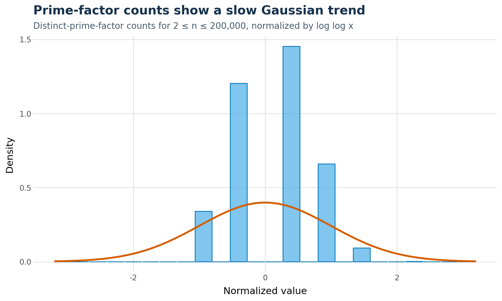

# Probabilistic Number Theory {#sec-probabilistic-number-theory}

**Level and prerequisites: L3–L4.** Prepare arithmetic functions, finite probability, expectations and asymptotic estimates. Use the [level-specific reading guide](index.md#who-this-book-is-for) for linked Euler preparation.

An integer is deterministic, yet statistics over many integers behave like
probability distributions. Probabilistic number theory makes this precise by
choosing an integer uniformly from a growing finite interval, studying
arithmetic functions as random variables, and only then taking a limit.

## Prerequisite checkpoint and goals

The concise primer introduced sequences, finite data, and computation. Chapter 7
introduced multiplicative and additive arithmetic functions; Chapter 21
introduced prime sums and sieves. No measure-theory course is assumed.

You will compute expectations from divisibility indicators, prove a normal-order
statement with a second-moment bound, interpret the Erdős–Kac theorem, and
audit where independence heuristics succeed or fail.

## Choosing a random integer

For each $x\ge1$, choose $N_x$ uniformly from
$\{1,2,\ldots,\lfloor x\rfloor\}$. An arithmetic function $f(N_x)$ is now a
finite random variable. A limiting claim means that its probabilities converge
as $x\to\infty$.

For a set $A$ of positive integers, the **natural density**, when it exists, is

$$
d(A)=\lim_{x\to\infty}\frac{|A\cap[1,x]|}{x}.
$$

Logarithmic density instead weights $n$ by $1/n$. The two notions can differ,
and either limit may fail to exist. A random-integer statement must specify the
sampling and density convention.

Divisibility by a fixed $d$ has probability

$$
\mathbb P(d\mid N_x)=\frac{\lfloor x/d\rfloor}{\lfloor x\rfloor}
\longrightarrow\frac1d.
$$

For distinct primes $p,q$, simultaneous divisibility tends to $1/(pq)$, exactly
the product of the limiting marginal probabilities. Finite collections of fixed
prime-divisibility events become asymptotically independent.

## Prime-factor counts as sums of indicators

Let $\omega(n)$ count distinct prime factors and $\Omega(n)$ count them with
multiplicity. Define

$$
X_p(n)=1_{p\mid n}.
$$

Then for $n\le x$,

$$
\omega(n)=\sum_{p\le x}X_p(n).
$$

Linearity of expectation does not require independence, so

$$
\mathbb E[\omega(N_x)]
=\sum_{p\le x}\frac{\lfloor x/p\rfloor}{\lfloor x\rfloor}
=\sum_{p\le x}\frac1p+O(1).
$$

Euler's prime reciprocal sum satisfies

$$
\sum_{p\le x}\frac1p=\log\log x+M+o(1).
$$

Thus a typical integer has about $\log\log x$ distinct prime factors, an
extremely slow-growing quantity.

## Variance and normal order

If the $X_p$ were independent Bernoulli variables with means $1/p$, their
variance sum would also be about $\log\log x$. They are not exactly independent
when primes or their products approach $x$, but truncating to small primes and
estimating the remainder controls the discrepancy.

Turán's theorem gives a second-moment estimate of the form

$$
\frac1x\sum_{n\le x}
\bigl(\omega(n)-\log\log x\bigr)^2
=O(\log\log x).
$$

Chebyshev's inequality then shows that for every function
$A(x)\to\infty$,

$$
|\omega(n)-\log\log x|
<A(x)\sqrt{\log\log x}
$$

for all but a proportion tending to zero of $n\le x$. In particular,
$\log\log n$ is the **normal order** of $\omega(n)$: the ratio tends to $1$ for
a density-one set of integers.

Normal order does not mean every integer is close. Primes have $\omega=1$;
primorials have unusually many distinct prime factors.

## Erdős–Kac theorem

The deeper theorem says the fluctuations are asymptotically Gaussian:

$$
\frac{\omega(N_x)-\log\log x}{\sqrt{\log\log x}}
\Longrightarrow \mathcal N(0,1).
$$

That arrow means convergence in distribution: for each real $z$, the proportion
of $n\le x$ with normalized value at most $z$ approaches the standard normal
CDF at $z$.

<figure id="fig-omega-normal">


<figcaption>

Figure 30.1: The normalized number of distinct prime factors approaches a bell-shaped distribution slowly.

</figcaption>
</figure>

[Figure 30.1](#fig-omega-normal) is finite and the convergence is slow because
$\log\log x$ remains small even for large computational ranges. The theorem is
not inferred from the histogram. Proofs compare moments or characteristic
functions with those of a sum of nearly independent Bernoulli variables after
truncating large primes.

The same limiting law holds for $\Omega(n)$ with suitable centering and scaling.
Prime powers change lower-order behavior but not the Gaussian limit.

## Smooth and rough integers

An integer is **y-smooth** if all its prime factors are at most $y$, and
**y-rough** if none is at most $y$. Smoothness controls factoring algorithms,
cryptographic parameter choices, and multiplicative structure.

If $y=x^{1/u}$ with fixed $u\ge1$, the proportion of $y$-smooth integers up to
$x$ approaches a function $\rho(u)$ governed by a delay differential equation,
the Dickman function. We state that asymptotic theory. Elementary inclusion–
exclusion already estimates rough integers by removing multiples of small
primes, but correlations and error terms require sieve methods.

A randomly chosen large integer is not assembled by independently including
every prime: the product constraint couples the choices. The independent model
is accurate for many additive statistics after truncation, not a literal
generative description.

## Random multiplicative functions

A **Rademacher random multiplicative function** assigns independent signs
$f(p)=\pm1$ to primes, sets $f(p^k)=0$ for $k\ge2$, and extends
multiplicatively. A **Steinhaus model** assigns independent random unit complex
numbers to primes and extends completely multiplicatively.

These models ask what cancellation should look like when multiplicativity is
retained but arithmetic alignment is randomized. Partial sums
$\sum_{n\le x}f(n)$ model aspects of Möbius or character sums. A result proved
for the random model is not automatically a theorem about the Möbius function;
it identifies a baseline and highlights which correlations arithmetic must
control.

## Dependence and model failure

Three common failures deserve explicit checks:

1. **Moving events.** Independence for fixed small primes does not remain
   uniform when the primes grow with $x$.
2. **Conditioning on size.** A product of many primes cannot stay below $x$;
   the upper bound creates negative dependence.
3. **Biased sampling.** Sampling factorizations, primes, or residue classes is
   not the same as sampling integers uniformly.

Sieve weights, moments, and generating functions are ways to quantify rather
than ignore these dependencies.

<div class="callout callout-warning">
<p class="callout-title">Density one does not mean all</p>

A property holding for a proportion tending to one may still fail infinitely
often. Probabilistic number theory describes typical structure; exceptional
integers often carry the most interesting Diophantine information.

</div>

<!-- inline-formula-code:start -->
## Formula and finite computation

A useful formula in this chapter is

$$
\omega(n)=\#\{p:p\mid n\}
$$

The distribution of distinct-prime-factor counts is a finite random-variable table. The following standalone Python block expresses that finite rule with its inputs and stopping conditions visible.

```python
def omega(number: int) -> int:
    """Return the number of distinct prime divisors of a positive integer."""
    if number < 1:
        raise ValueError("number must be positive")
    count, divisor = 0, 2
    remaining = number
    while divisor * divisor <= remaining:
        if remaining % divisor == 0:
            count += 1
            while remaining % divisor == 0:
                remaining //= divisor
        divisor += 1
    return count + int(remaining > 1)

print([omega(n) for n in range(2, 31)])
```

**What the computation establishes.** The output certifies only the declared finite case. The theorem, if one is claimed, still requires the argument developed in the chapter.
<!-- inline-formula-code:end -->

## Chapter summary

- Random-integer language is defined through finite uniform samples and limits.
- Distinct prime-factor count is a sum of divisibility indicators with mean
  about $\log\log x$.
- A second-moment estimate gives normal order; Erdős–Kac gives Gaussian
  fluctuations.
- Smoothness and random multiplicative functions provide powerful models.
- Independence must be justified at the scale where it is used.

## Exercises and selected answers

<div class="exercise" id="number_theory-30-probabilistic-ex-1">
<p class="exercise-title"><strong>Exercise 1</strong></p>

Compute exactly $\mathbb P(6\mid N_{100})$ and compare it with $1/6$.

</div>

<div class="exercise" id="number_theory-30-probabilistic-ex-2">
<p class="exercise-title"><strong>Exercise 2</strong></p>

Calculate $\omega(n)$ and $\Omega(n)$ for $1\le n\le20$.

</div>

<div class="exercise" id="number_theory-30-probabilistic-ex-3">
<p class="exercise-title"><strong>Exercise 3</strong></p>

Derive the expectation formula for the truncated count
$\sum_{p\le y}X_p$.

</div>

<div class="exercise" id="number_theory-30-probabilistic-ex-4">
<p class="exercise-title"><strong>Exercise 4</strong></p>

Use Chebyshev's inequality to turn Turán's estimate into a density statement.

</div>

<div class="exercise" id="number_theory-30-probabilistic-ex-5">
<p class="exercise-title"><strong>Exercise 5</strong></p>

Give an infinite family with unusually small $\omega(n)$ and one with
unusually large $\omega(n)$ relative to size.

</div>

<div class="exercise" id="number_theory-30-probabilistic-ex-6">
<p class="exercise-title"><strong>Exercise 6</strong></p>

Enumerate the $5$-smooth integers up to $100$.

</div>

<div class="exercise" id="number_theory-30-probabilistic-ex-7">
<p class="exercise-title"><strong>Exercise 7</strong></p>

Simulate a Rademacher multiplicative function with a recorded seed and plot
its partial sums.

</div>

<div class="exercise" id="number_theory-30-probabilistic-ex-8">
<p class="exercise-title"><strong>Exercise 8</strong></p>

Explain why sampling a random subset of primes cannot directly generate a
uniform random integer up to $x$.

For 1 the probability is $16/100$, close to $1/6$. In 5, primes have count one;
products of the first $k$ primes have $k$ distinct factors and demonstrate the
high side. In 6 the list is
$1,2,3,4,5,6,8,9,10,12,15,16,18,20,24,25,27,30,32,36,40,45,48,50,54,60,64,72,75,80,81,90,96,100$.

</div>
