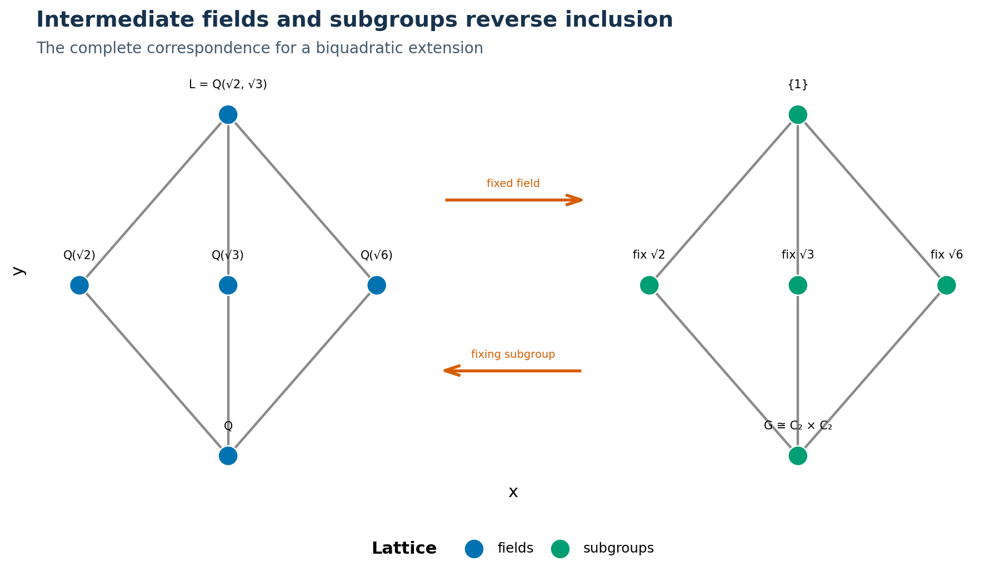

# Field Extensions and Galois Symmetry {#sec-galois-symmetry}

**Level and prerequisites: L5.** Prepare finite Galois theory, normal and separable extensions, and group actions. Use the [level-specific reading guide](index.md#who-this-book-is-for) for linked Euler preparation.

Why can a quadratic equation be solved by square roots, while a general
quintic cannot be solved by any formula assembled from radicals? The answer is
not that fifth-degree equations are merely longer. A polynomial carries a
hidden symmetry group, and the structure of that group controls which
operations can reveal its roots.

This chapter builds every new object before using it. A reader needs only the
book's earlier algebra: a **field** is a number system in which addition,
subtraction, multiplication, and division by nonzero elements are possible. The
rational, real, complex, and finite fields are examples. Chapter 23 introduced
finite fields, while Chapters 24–26 introduced rings, ideals, and prime
splitting; the repair kit below is enough if those chapters are not fresh.

## Preparation and local repair kit

A polynomial over a field $F$ is an expression

$$
a_0+a_1x+\cdots+a_nx^n,\qquad a_i\in F.
$$

Its degree is the largest exponent with nonzero coefficient. A polynomial is
**irreducible over $F$** if it cannot be written as a product of two
positive-degree polynomials with coefficients in $F$. The polynomial
$x^2-2$ is irreducible over $\mathbb Q$: a factorisation would produce a
rational root, but the usual lowest-terms argument shows that
$\sqrt2\notin\mathbb Q$. It is reducible over $\mathbb R$.

A **group** is a set with an associative operation, an identity, and inverses.
Permutation groups are the main examples here. Composition is performed
right-to-left. A subgroup is a subset that is itself a group under the same
operation.

These two ideas—irreducible equations and groups of permutations—will meet
through fields containing roots.

## Adjoining one algebraic element

Suppose $\alpha$ satisfies a polynomial over $F$. The smallest field containing
both $F$ and $\alpha$ is denoted $F(\alpha)$. If the irreducible polynomial of
$\alpha$ over $F$ has degree $n$, then every element of $F(\alpha)$ has a
unique form

$$
b_0+b_1\alpha+\cdots+b_{n-1}\alpha^{n-1},
\qquad b_i\in F.
$$

Thus $F(\alpha)$ is an $n$-dimensional vector space over $F$, and
$[F(\alpha):F]=n$ is its **extension degree**.

For $\alpha=\sqrt2$, every element is $a+b\sqrt2$. Division stays inside:

$$
\frac1{a+b\sqrt2}
=\frac{a-b\sqrt2}{a^2-2b^2}
$$

when the denominator is nonzero. The basis $\{1,\sqrt2\}$ makes the degree
two visible.

There is also an exact quotient construction. If $m(x)$ is irreducible, then
$F[x]/(m)$ is a field. The residue class of $x$ behaves like a root of $m$.
This constructs $F(\alpha)$ without first locating $\alpha$ in the complex
numbers.

Why does this quotient really have the advertised basis? Divide any polynomial
$g(x)$ by $m(x)$:

$$
g(x)=q(x)m(x)+r(x),\qquad \deg r<\deg m.
$$

In the quotient, $g$ and $r$ represent the same element because their
difference is a multiple of $m$. The remainder is unique. If a nonzero
polynomial of degree below $\deg m$ represented zero, it would be a multiple of
$m$, which is impossible by degree. This proves both spanning and uniqueness.
Moreover, if $r$ is nonzero, irreducibility gives
$\gcd(r,m)=1$. The extended Euclidean algorithm supplies polynomials $u,v$ with

$$
u(x)r(x)+v(x)m(x)=1.
$$

Reducing modulo $m$ shows that the class of $u$ is the inverse of the class of
$r$. Thus “the quotient is a field” is an algorithmic statement, not just a
name.

**Worked reduction.** Let $\alpha^3=2$. Expand first and reduce second:

$$
\begin{aligned}
(1+\alpha)^5
&=1+5\alpha+10\alpha^2+10\alpha^3+5\alpha^4+\alpha^5\\
&=1+5\alpha+10\alpha^2+20+10\alpha+2\alpha^2\\
&=21+15\alpha+12\alpha^2.
\end{aligned}
$$

The second line uses $\alpha^4=2\alpha$ and $\alpha^5=2\alpha^2$. The final
answer has degree below three, as the basis theorem requires. Substitution into
the unreduced expression gives an independent check.

**Tower law.** If $F\subseteq K\subseteq L$ and the degrees are finite, then

$$
[L:F]=[L:K][K:F].
$$

To see why, multiply a basis of $K$ over $F$ by a basis of $L$ over $K$.
Spanning follows by two successive expansions, and linear independence follows
by reversing them. The tower law is a powerful impossibility test: an element
in a tower of quadratic extensions has degree a power of two.

## Splitting fields and repeated roots

A **splitting field** of $f\in F[x]$ is a smallest extension in which $f$
factors completely into linear factors. For $x^2-2$, it is
$\mathbb Q(\sqrt2)$. For $x^3-2$, one real root $\sqrt[3]2$ is not enough.
If $\zeta=e^{2\pi i/3}$, the three roots are

$$
\sqrt[3]2,\qquad \zeta\sqrt[3]2,\qquad \zeta^2\sqrt[3]2,
$$

so the splitting field is $\mathbb Q(\sqrt[3]2,\zeta)$.

The formal derivative detects repeated roots. A polynomial $f$ has a repeated
root in a splitting field exactly when $\gcd(f,f')\ne1$. An irreducible
polynomial is **separable** when its roots are distinct. Every irreducible
polynomial over a field of characteristic zero is separable. In characteristic
$p$, $x^p-t$ over $\mathbb F_p(t)$ has derivative zero and needs extra care.
This is why Galois theory states separability explicitly.

An extension is **normal** if every irreducible polynomial over $F$ having one
root in the extension splits there. Finite extensions that are both normal and
separable are called **Galois extensions**. Splitting fields of separable
polynomials are the central examples.

## Automorphisms as invisible permutations

An $F$-automorphism of $L$ is a bijection $\sigma:L\to L$ preserving addition
and multiplication and fixing every element of $F$. Such a map is determined
by what it does to generators. If $\alpha$ has minimal polynomial $m$, then

$$
0=\sigma(m(\alpha))=m(\sigma(\alpha)),
$$

so $\sigma(\alpha)$ must be another root of $m$.

For $\mathbb Q(\sqrt2)$ there are exactly two automorphisms:

$$
a+b\sqrt2\longmapsto a+b\sqrt2
\quad\text{and}\quad
a+b\sqrt2\longmapsto a-b\sqrt2.
$$

They form the cyclic group $C_2$. For
$L=\mathbb Q(\sqrt2,\sqrt3)$, independently changing the signs of
$\sqrt2$ and $\sqrt3$ gives four automorphisms. Their group is
$C_2\times C_2$, not the cyclic group of order four: every nonidentity
element has order two.

The **Galois group** $\operatorname{Gal}(L/F)$ is the group of all
$F$-automorphisms. When $L/F$ is finite Galois,

$$
|\operatorname{Gal}(L/F)|=[L:F].
$$

Without normality, there may be fewer automorphisms than the degree. For
$\mathbb Q(\sqrt[3]2)/\mathbb Q$, only the real cube root lies in the field;
the other two conjugates do not, so the automorphism group is trivial even
though the degree is three.

## The fundamental correspondence

If $H$ is a subgroup of $\operatorname{Gal}(L/F)$, its **fixed field** is

$$
L^H=\{a\in L:\sigma(a)=a\text{ for every }\sigma\in H\}.
$$

Larger subgroups impose more conditions, so they have smaller fixed fields.
This reversal is the heart of the theorem.

**Theorem 31.1 (Fundamental of Galois theory).** For a finite Galois extension $L/F$,
the maps

$$
K\longmapsto\operatorname{Gal}(L/K),
\qquad
H\longmapsto L^H
$$

give inverse, inclusion-reversing correspondences between intermediate fields
$F\subseteq K\subseteq L$ and subgroups $H\le\operatorname{Gal}(L/F)$.
Moreover,

$$
[K:F]=[\operatorname{Gal}(L/F):H],
\qquad
[L:K]=|H|.
$$

The intermediate extension $K/F$ is Galois exactly when $H$ is normal, and
then its Galois group is the quotient group
$\operatorname{Gal}(L/F)/H$.

<figure id="fig-galois-lattice">


<figcaption>

Figure 31.1: An inclusion-reversing lattice pairs intermediate fields with automorphism subgroups.

</figcaption>
</figure>

In [Figure 31.1](#fig-galois-lattice), the top field $L$ corresponds to the smallest subgroup
$\{1\}$, while the base field $\mathbb Q$ corresponds to the whole group.
Each middle quadratic field is fixed by one two-element subgroup. The picture
is a complete finite example, not a generic shape theorem for every group.

**Worked fixed-field audit.** Every element of
$L=\mathbb Q(\sqrt2,\sqrt3)$ has a unique expression

$$
z=a+b\sqrt2+c\sqrt3+d\sqrt6.
$$

Let $\sigma$ change the sign of $\sqrt2$ and fix $\sqrt3$. Then

$$
\sigma(z)=a-b\sqrt2+c\sqrt3-d\sqrt6.
$$

The equality $\sigma(z)=z$ forces $b=d=0$ by uniqueness of the four basis
coefficients. Hence the fixed field is precisely $\mathbb Q(\sqrt3)$. There is
no guessing from the diagram: write a general element, apply the automorphism,
and compare coefficients. The subgroup $\{1,\sigma\}$ has order two, so the
degree checks agree:

$$
[L:\mathbb Q(\sqrt3)]=2,
\qquad
[\mathbb Q(\sqrt3):\mathbb Q]=4/2=2.
$$

## Discriminants and cubic groups

For a monic polynomial with roots $r_1,\ldots,r_n$, its discriminant is

$$
\Delta=\prod_{i<j}(r_i-r_j)^2.
$$

It vanishes exactly when roots repeat. Although written using roots, it is a
polynomial in the coefficients. For distinct roots over a base field of characteristic different from 2, a permutation of the roots changes the sign of
$\prod_{i<j}(r_i-r_j)$ according to the permutation's parity; therefore the
Galois group lies inside the alternating group $A_n$ exactly when $\Delta$ is a
square in the base field.

For an irreducible cubic over $\mathbb Q$, transitivity leaves two possibilities:
$A_3$ or $S_3$. A square discriminant gives $A_3$; a nonsquare gives $S_3$.
For

$$
f(x)=x^3-2,
\qquad \Delta=-108,
$$

the discriminant is not a rational square, so the Galois group is $S_3$.
Irreducibility plus a discriminant calculation certifies the conclusion.

For higher degrees, factorisation patterns modulo good primes reveal cycle
types in the Galois group. This is evidence only until combined with a group
argument proving that the observed cycle types force a unique candidate.

## Solvability by radicals

A polynomial is **solvable by radicals** if its roots lie in a tower obtained
by repeatedly adjoining $n$th roots. A finite group is **solvable** if it has a
normal series whose successive quotient groups are abelian.

The central theorem says that, in characteristic zero, a polynomial is
solvable by radicals exactly when its Galois group is solvable. Quadratic,
cubic, and quartic groups that arise are solvable. The symmetric group $S_5$
is not solvable because it contains the nonabelian simple group $A_5$.
Therefore a general formula by radicals for all quintics cannot exist.

This statement does **not** say that no quintic is solvable. The equation
$x^5-2=0$ plainly has radical expressions. It says there is no uniform radical
formula for arbitrary coefficients, because some quintics have Galois group
$S_5$.

### Theorem-scope audit

Three hypotheses in this chapter prevent common overstatements.

First, the subgroup–field correspondence in its clean inverse form requires a
**finite Galois** extension. The nonnormal extension
$\mathbb Q(\sqrt[3]2)/\mathbb Q$ has degree three but a trivial automorphism
group, so its subgroup list cannot encode its field degree. Second, the
discriminant parity test assumes distinct roots and characteristic different from 2. When $\Delta=0$, repeated
roots must be removed before treating the Galois group as a faithful
permutation group on $n$ distinct objects. Third, solvability by radicals is a
claim about the Galois group of the **splitting field**, not merely the visible
automorphisms of a field generated by one chosen root.

These are domain checks. They do not weaken the theorems; they identify the
objects to which the theorems actually apply.

<div class="callout callout-warning">
<p class="callout-title">A numerical root list is not a Galois group</p>

Decimal approximations can suggest how many roots are real, but automorphisms
act on exact algebraic relations. A valid group computation records
irreducibility, separability, discriminant information, and enough certified
cycle or resolvent data to exclude other groups.

</div>

<!-- inline-formula-code:start -->
## Formula and finite computation

A useful formula in this chapter is

$$
|\operatorname{Orb}(x)|=[G:\operatorname{Stab}(x)]
$$

A finite permutation action makes orbit and stabilizer counts explicit. The following standalone Python block expresses that finite rule with its inputs and stopping conditions visible.

```python
from itertools import permutations

group = list(permutations((0, 1, 2)))
point = 0
orbit = {permutation[point] for permutation in group}
stabilizer = [permutation for permutation in group if permutation[point] == point]
print(len(group), len(orbit), len(stabilizer), len(orbit) * len(stabilizer))
```

**What the computation establishes.** The output certifies only the declared finite case. The theorem, if one is claimed, still requires the argument developed in the chapter.
<!-- inline-formula-code:end -->

## Summary and vocabulary

An algebraic element creates a finite-dimensional field extension. A splitting
field contains every root; normality and separability make it Galois.
Automorphisms permute roots while preserving every base-field equation. The
fundamental correspondence turns intermediate fields into subgroups in reverse
order. Solvability by radicals is ultimately a property of this symmetry group.

Key terms are **minimal polynomial**, **extension degree**, **splitting field**,
**separable**, **normal**, **automorphism**, **fixed field**, **Galois group**,
**discriminant**, and **solvable group**.

## Exercises and support

<div class="exercise" id="number_theory-31-galois-symmetry-ex-1">
<p class="exercise-title"><strong>Exercise 1</strong></p>

Prove directly that the displayed reciprocal of $a+b\sqrt2$ is correct.

</div>

<div class="exercise" id="number_theory-31-galois-symmetry-ex-2">
<p class="exercise-title"><strong>Exercise 2</strong></p>

Reduce $(1+\alpha)^5$ to the basis $1,\alpha,\alpha^2$ when
$\alpha^3=2$.

</div>

<div class="exercise" id="number_theory-31-galois-symmetry-ex-3">
<p class="exercise-title"><strong>Exercise 3</strong></p>

Use the tower law to show that a field of degree six over $\mathbb Q$ cannot
occur inside a tower of quadratic extensions.

</div>

<div class="exercise" id="number_theory-31-galois-symmetry-ex-4">
<p class="exercise-title"><strong>Exercise 4</strong></p>

Find the splitting field and Galois group of $x^2-5$.

</div>

<div class="exercise" id="number_theory-31-galois-symmetry-ex-5">
<p class="exercise-title"><strong>Exercise 5</strong></p>

List the four sign-change automorphisms of
$\mathbb Q(\sqrt2,\sqrt3)$ and compose them.

</div>

<div class="exercise" id="number_theory-31-galois-symmetry-ex-6">
<p class="exercise-title"><strong>Exercise 6</strong></p>

Identify the fixed field of the automorphism changing only the sign of
$\sqrt2$.

</div>

<div class="exercise" id="number_theory-31-galois-symmetry-ex-7">
<p class="exercise-title"><strong>Exercise 7</strong></p>

Compute the discriminant of $x^3-3x+1$ and determine its cubic Galois group
after proving irreducibility.

</div>

<div class="exercise" id="number_theory-31-galois-symmetry-ex-8">
<p class="exercise-title"><strong>Exercise 8</strong></p>

Explain precisely why the impossibility theorem for the general quintic
does not apply to $x^5-32$.

</div>

<div class="exercise" id="number_theory-31-galois-symmetry-ex-9">
<p class="exercise-title"><strong>Exercise 9</strong></p>

Investigate factorisations modulo several primes for one irreducible quartic.
Label the result evidence until a group-theoretic exclusion is supplied.

</div>

For Exercise 2, replace every $\alpha^3$ by $2$ and collect the three basis
coefficients. For Exercise 6, elements fixed by that sign change contain no
$\sqrt2$ or $\sqrt6$ term, so the field is $\mathbb Q(\sqrt3)$. For Exercise
7, the rational-root test proves irreducibility; use
$\Delta=-4a^3-27b^2$ for $x^3+ax+b$.

**Short solution clinic for Exercise 7.** The only possible rational roots of
$x^3-3x+1$ are $\pm1$, and neither is a root, so the cubic is irreducible.
Here $a=-3$ and $b=1$, giving

$$
\Delta=-4(-3)^3-27(1)^2=108-27=81=9^2.
$$

An irreducible cubic has a transitive Galois group, hence either $A_3$ or
$S_3$. The nonzero square discriminant places the group inside $A_3$, so it is
$A_3\cong C_3$. Notice the order of the audit: irreducibility, separability,
discriminant, then group conclusion.
