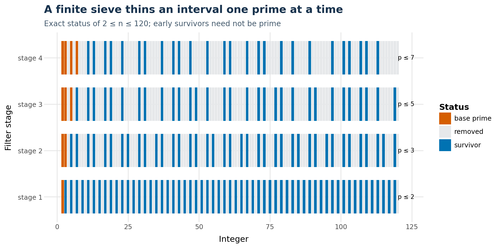

# Sieve Methods and Almost Primes {#sec-sieve-methods}

**Level and prerequisites: L5.** Prepare analytic number theory, summation estimates, inclusion–exclusion and arithmetic functions. Use the [level-specific reading guide](index.md#who-this-book-is-for) for linked Euler preparation.

A sieve removes integers that violate local divisibility conditions. The sieve
of Eratosthenes finds primes exactly in a finite interval, but modern sieve
theory asks subtler questions: how many integers avoid one forbidden residue
class for every small prime, how uniform is that count, and what conclusions
about primes or almost primes survive accumulated error?

No probability or advanced analysis is assumed. We rebuild finite
inclusion–exclusion, explain every asymptotic symbol, and separate exact
algorithms from theorem-producing estimates.

## From finite crossing-out to a counting problem

Let $A$ be a finite set of integers. For each prime $p$ in a finite set
$\mathcal P$, let $A_p$ contain the elements divisible by $p$. The sifted set is

$$
S(A,\mathcal P)=A\setminus\bigcup_{p\in\mathcal P}A_p.
$$

For $A=\{1,\ldots,x\}$ and primes below $z$, these are integers with no prime
factor below $z$. Inclusion–exclusion gives the exact identity

$$
|S(A,\mathcal P)|
=\sum_{d\mid P(z)}\mu(d)|A_d|,
\qquad
P(z)=\prod_{\substack{p<z\\p\in\mathcal P}}p,
$$

where $A_d$ consists of multiples of $d$ in $A$ and $\mu$ is the Möbius
function. The identity has $2^{|\mathcal P|}$ terms. Exactness has become
computationally expensive, and approximate truncation is the opening for sieve
theory.

For a general sequence $\mathcal A$, one tries to write

$$
|A_d|=Xg(d)+r_d.
$$

Here $X$ is the overall scale, $g(d)$ is the expected fraction surviving the
condition $d\mid a$, and $r_d$ is a remainder. The **main term** is what would
remain if all $r_d$ vanished; the proof must control the weighted total of the
remainders actually used.

The notation $R=O(E)$ means that $|R|\le CE$ for a constant $C$ over the stated
range. It is not permission to discard $R$. A sieve succeeds only when the
aggregate error is smaller than the conclusion it seeks.

**Worked main-term decomposition.** Take $A=\{1,\ldots,x\}$, with $x$ an
integer, and let $A_d$ be its multiples of $d$. Then

$$
|A_d|=\left\lfloor\frac xd\right\rfloor
=\frac xd+r_d,
\qquad -1<r_d\le0.
$$

Thus $X=x$ and $g(d)=1/d$ are not probabilistic guesses; they come from exact
division with remainder. Substitution into inclusion–exclusion gives

$$
|S(A,\mathcal P)|
=x\sum_{d\mid P(z)}\frac{\mu(d)}d
+\sum_{d\mid P(z)}\mu(d)r_d
=x\prod_{p\mid P(z)}\left(1-\frac1p\right)+R.
$$

The first equality separates prediction from error, and the second factors the
squarefree divisor sum. The naive estimate
$|R|<2^{|\mathcal P|}$ counts one possible unit-sized error for every divisor.
It soon overwhelms a useful main term. Modern sieve weights are designed not
because the individual floor errors are large, but because there are too many
of them to sum carelessly.

## Sieve dimension and local density

Suppose each prime $p$ removes $\omega(p)$ residue classes modulo $p$. The local
survival fraction is

$$
1-\frac{\omega(p)}p.
$$

The product

$$
V(z)=\prod_{p<z}\left(1-\frac{\omega(p)}p\right)
$$

is a first prediction for the surviving density. If roughly one class is
removed per prime, then $V(z)$ behaves like a constant divided by $\log z$;
this is a **dimension-one sieve**. If roughly two classes are removed, the
scale is $(\log z)^{-2}$.

For twin-prime candidates $n(n+2)$, the forbidden residues are
$n\equiv0,-2\pmod p$. There are two for odd $p>2$, but only one for $p=2$.
Local anomalies create a correction product, the singular series. Before
estimating anything, one must check **admissibility**: no prime may have all
residue classes forbidden.

For the pair $n,n+4$, the same audit is concrete. Modulo $2$, the classes
$0$ and $-4$ coincide, so one class is forbidden. Modulo $3,5,$ or $7$, they
are distinct, so two classes are forbidden. In each case at least one class
survives. Counting the polynomial's roots modulo each prime is the safe route;
the phrase “two linear factors” alone misses collisions at small primes.

## Brun's truncation

The Bonferroni inequalities arise by stopping inclusion–exclusion after an odd
or even number of levels. For any finite family of events,

$$
\sum |A_i|-\sum |A_i\cap A_j|
\le \left|\bigcup A_i\right|
\le \sum |A_i|.
$$

Longer alternating truncations sharpen the bounds. Brun's insight was to choose
the truncation depth and prime range together, obtaining useful bounds without
summing every divisor of $P(z)$.

Applied carefully to twin-prime candidates, this proves an upper bound of the
expected order

$$
\#\{n\le x:n,n+2\text{ prime}\}
\ll \frac{x}{(\log x)^2}.
$$

The symbol $\ll$ is another form of $O$. This does not prove infinitely many
twin primes, because an upper bound can also hold when the set is finite.
Brun's method does prove convergence of the sum of reciprocals of twin primes,
should there be infinitely many.

## Selberg's nonnegative weights

Selberg's upper-bound sieve starts with the pointwise inequality

$$
1_{\gcd(a,P(z))=1}
\le
\left(\sum_{\substack{d\mid a\\d\mid P(z)}}\lambda_d\right)^2,
\qquad \lambda_1=1.
$$

The right side is nonnegative. Summing over $a\in\mathcal A$ and expanding the
square gives

$$
S(\mathcal A,z)
\le
\sum_{d,e}\lambda_d\lambda_e
\,|A_{\operatorname{lcm}(d,e)}|.
$$

After inserting $Xg(\operatorname{lcm}(d,e))+r_{\operatorname{lcm}(d,e)}$,
one chooses the weights to minimise the main quadratic form while keeping the
remainder controllable. The exact optimal formula requires further notation;
the conceptual advance is already visible: a combinatorial indicator is
majorised by an optimisable square.

Because the square provides an upper bound naturally, lower bounds are harder.
This asymmetry is structural, not merely an imperfect choice of constants.

## Almost primes and the parity barrier

Let $\Omega(n)$ count prime factors with multiplicity. An integer with
$\Omega(n)\le r$ is called a $P_r$ or an **almost prime of order $r$**.
Semiprimes are $P_2$ numbers. Sieves can often prove that a sequence contains
many almost primes even when isolating actual primes is out of reach.

The **parity problem** is a fundamental limitation: standard combinatorial
sieves have difficulty distinguishing numbers with an even number of prime
factors from those with an odd number. Information encoded only through local
divisibility densities can look almost identical for the Möbius-twisted
sequence that changes sign according to factor parity.

Chen's theorem states that infinitely many primes $p$ have $p+2$ either prime
or a product of two primes. Its proof combines a refined weighted sieve with
distribution results and switching arguments. We state this theorem to mark
what almost-prime methods can achieve; a proof lies beyond this chapter.

<div class="callout callout-important">
<p class="callout-title">The parity barrier is a method boundary</p>

It is not evidence that the twin-prime conjecture is false, and more brute-force
sieving does not remove it. A proof needs input that detects correlations not
captured by ordinary local divisor counts.

</div>

## Level of distribution

For primes in arithmetic progressions, compare

$$
\pi(x;q,a)
\quad\text{with}\quad
\frac{\operatorname{li}(x)}{\varphi(q)}
$$

when $\gcd(a,q)=1$. A theorem has **level of distribution** $Q$ if its errors
can be controlled on average for moduli up to about $Q$. The
Bombieri–Vinogradov theorem gives, roughly, square-root level with strong
logarithmic savings on average. It supplies the uniformity that many sieve
weights need.

Modern bounded-gap proofs choose an admissible tuple
$\{n+h_1,\ldots,n+h_k\}$ and attach nonnegative multidimensional weights that
favour tuples containing several primes. Distribution in progressions then
controls the weighted error. The conclusion that infinitely many prime gaps
are bounded is a theorem; any numerical value for the best known bound is
time-dependent and is not needed here.

## A certified finite sieve

To find primes up to $N$, cross out multiples of every prime
$p\le\sqrt N$, beginning at $p^2$. Any composite $n\le N$ has a factor at most
$\sqrt n$, so this is a proof of completeness.

For large $N$, a **segmented sieve** holds only an interval $[L,R]$ in memory.
For each base prime $p\le\sqrt R$, its first multiple in the segment is

$$
\max\left(p^2,\left\lceil\frac Lp\right\rceil p\right).
$$

Implementation must define integer width, endpoints, and the treatment of
$0$ and $1$. If $p^2$ can overflow, compare $p\le R/p$ or use a wider exact
type.

<figure id="fig-sieve-survivors">


<figcaption>

Figure 32.1: Successive prime filters thin a finite interval while leaving both primes and unsieved composites.

</figcaption>
</figure>

[Figure 32.1](#fig-sieve-survivors) records exact finite stages. A survivor after sieving only
to $z$ is **$z$-rough**, not necessarily prime. It becomes certified prime in
$[2,N]$ only after all base primes through $\sqrt N$ have been used.

For example, after removing multiples of $2,3,$ and $5$, the number $49$
survives even though $49=7^2$. This is not a sieve failure: the declared prime
range has not yet reached $7$. If the target interval ends at $N=40$, primes
through $\sqrt{40}<7$ suffice and no such counterexample lies in range. If it
ends at $N=120$, the base prime $7$ is compulsory. A certificate therefore
records both the survivor list and the largest base prime processed.

## Worked comparison: primes versus twin candidates

For ordinary primality, each odd prime $p$ excludes one class $0\pmod p$.
For the pair $n,n+2$, it normally excludes two. Thus the heuristic ratio

$$
\prod_{p<z}\left(1-\frac2p\right)
\bigg/
\prod_{p<z}\left(1-\frac1p\right)^2
$$

approaches a nonzero correction product after handling $p=2$. This predicts a
constant times $x/(\log x)^2$. The exponent two comes from two simultaneous
prime-like conditions; the constant records their local dependence.

The prediction is persuasive and compatible with extensive data. It is not a
lower bound. Sieve theory explains both why the conjectured scale is natural
and why passing from candidates to two actual primes is difficult.

### Scope audit: four different outputs

A finite sieve, an asymptotic upper bound, an almost-prime theorem, and a prime
existence theorem are logically different products.

- A completed Eratosthenes sieve exactly classifies a declared finite interval.
- Brun or Selberg weights may prove that a counting function is **at most** a
  stated scale; they do not prove the count is nonzero.
- An almost-prime theorem controls $\Omega(n)$ but still permits a composite.
- A bounded-gap theorem proves the existence of at least two primes in suitable
  tuples infinitely often, using distribution input beyond elementary
  crossing-out.

When reading a sieve argument, locate the line that changes one output type
into another. If no theorem supplies that change, the conclusion has been
overstated.

<!-- inline-formula-code:start -->
## Formula and finite computation

A useful formula in this chapter is

$$
\pi(x)=\sum_{n\le x}\mathbf 1_{\{n\text{ prime}\}}
$$

A Boolean prime table realizes the indicator sum exactly on a finite interval. The following standalone Python block expresses that finite rule with its inputs and stopping conditions visible.

```python
from math import log

def prime_flags(limit: int) -> list[bool]:
    """Return a complete primality table from zero through limit."""
    if limit < 2:
        raise ValueError("limit must be at least two")
    flags = [True] * (limit + 1)
    flags[0] = flags[1] = False
    prime = 2
    while prime * prime <= limit:
        if flags[prime]:
            for multiple in range(prime * prime, limit + 1, prime):
                flags[multiple] = False
        prime += 1
    return flags

def prime_counting_audit(limit: int) -> tuple[int, float, float]:
    """Return pi(limit), limit/log(limit), and a discrete Li approximation."""
    flags = prime_flags(limit)
    exact = sum(flags)
    elementary = limit / log(limit)
    logarithmic_integral = sum(1.0 / log(integer) for integer in range(2, limit + 1))
    return exact, elementary, logarithmic_integral

for endpoint in (100, 1_000, 10_000):
    print(endpoint, prime_counting_audit(endpoint))
```

**What the computation establishes.** The calculation checks a declared finite instance; the surrounding argument explains what is true beyond those inputs.
<!-- inline-formula-code:end -->

## Summary and vocabulary

Sifting is exact set subtraction. Inclusion–exclusion is exact but
exponential in the number of filters. Modern sieves replace it by controlled
truncations or nonnegative weights. Local density predicts the main scale;
remainder sums and distribution levels determine what can be proved. Almost
primes are often accessible beyond the parity barrier.

Key terms are **sifted set**, **sieve dimension**, **singular series**,
**admissible tuple**, **sieve weight**, **almost prime**, **parity problem**,
**level of distribution**, and **segmented sieve**.

## Exercises and support

<div class="exercise" id="number_theory-32-sieve-methods-ex-1">
<p class="exercise-title"><strong>Exercise 1</strong></p>

Apply inclusion–exclusion to count integers from $1$ to $100$ divisible by
neither $2$, $3$, nor $5$.

</div>

<div class="exercise" id="number_theory-32-sieve-methods-ex-2">
<p class="exercise-title"><strong>Exercise 2</strong></p>

Prove that crossing out through $\sqrt N$ certifies every remaining integer
in $[2,N]$ as prime.

</div>

<div class="exercise" id="number_theory-32-sieve-methods-ex-3">
<p class="exercise-title"><strong>Exercise 3</strong></p>

For the pair $n,n+4$, determine the number of forbidden residues modulo
$2$, $3$, $5$, and $7$.

</div>

<div class="exercise" id="number_theory-32-sieve-methods-ex-4">
<p class="exercise-title"><strong>Exercise 4</strong></p>

Show that $\{0,2,4\}$ is not an admissible triple, then show that
$\{0,2,6\}$ is admissible.

</div>

<div class="exercise" id="number_theory-32-sieve-methods-ex-5">
<p class="exercise-title"><strong>Exercise 5</strong></p>

Derive the first two Bonferroni bounds for three finite sets.

</div>

<div class="exercise" id="number_theory-32-sieve-methods-ex-6">
<p class="exercise-title"><strong>Exercise 6</strong></p>

Verify Selberg's pointwise inequality when $a$ has no divisor of $P(z)$
except $1$, and explain why other $a$ cause no problem.

</div>

<div class="exercise" id="number_theory-32-sieve-methods-ex-7">
<p class="exercise-title"><strong>Exercise 7</strong></p>

List all $P_2$ integers through $50$, counting prime multiplicity.

</div>

<div class="exercise" id="number_theory-32-sieve-methods-ex-8">
<p class="exercise-title"><strong>Exercise 8</strong></p>

Write segmented-sieve pseudocode with explicit inclusive endpoints and an
overflow-safe stopping test.

</div>

<div class="exercise" id="number_theory-32-sieve-methods-ex-9">
<p class="exercise-title"><strong>Exercise 9</strong></p>

Explain in one paragraph why an upper bound of order
$x/(\log x)^2$ cannot prove infinitely many twin primes.

</div>

<div class="exercise" id="number_theory-32-sieve-methods-ex-10">
<p class="exercise-title"><strong>Exercise 10</strong></p>

Reproduce [Figure 32.1](#fig-sieve-survivors) for a different interval and attach a
machine-checkable list of base primes.

</div>

For Exercise 1, there are
$100-50-33-20+16+10+6-3=26$ survivors. In Exercise 3, list $0$ and $-4$
modulo each prime and merge them when they coincide. In Exercise 6, the inner
sum equals $\lambda_1=1$ for a survivor; otherwise its square is merely
nonnegative while the left side is zero.

**Concise solution clinic.** For Exercise 1, the three single counts are
$50,33,20$. Pairwise intersections are the multiples of $6,10,15$, numbering
$16,10,6$, and the triple intersection contributes the three multiples of
$30$. Inclusion–exclusion therefore gives $26$; listing only numbers coprime
to $30$ provides an independent check.

For Exercise 4, the shifts $\{0,2,4\}$ occupy all three classes modulo $3$.
Whatever $n$ is, one of $n,n+2,n+4$ is divisible by $3$, so the tuple is not
admissible. For $\{0,2,6\}$, modulo $2$ only one class is forbidden, modulo
$3$ only the classes $0$ and $1$ are forbidden, and for $p>3$ at most three of
the $p$ classes are forbidden. Thus every prime leaves a surviving residue
class, proving admissibility. This proves only the absence of a fixed local
obstruction; it does not prove that the tuple is prime infinitely often.
