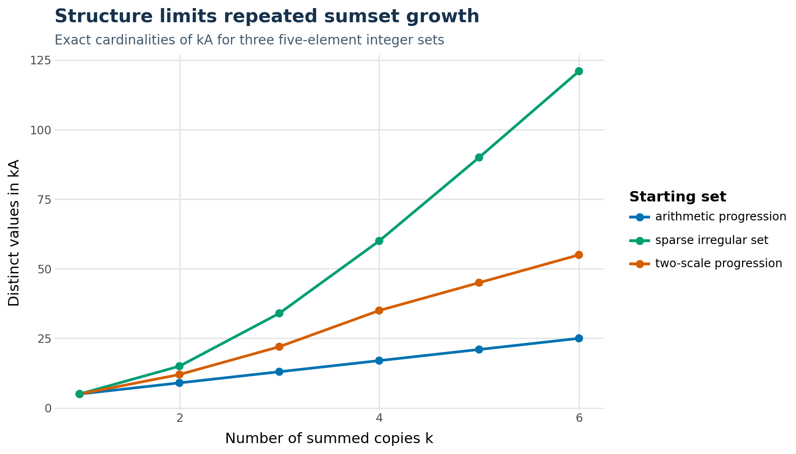

# Additive Combinatorics and Sumset Growth {#sec-additive-combinatorics}

**Level and prerequisites: L5.** Prepare finite Fourier analysis, additive groups, combinatorial inequalities and exponential sums. Use the [level-specific reading guide](index.md#who-this-book-is-for) for linked Euler preparation.

If a finite set contains many additive patterns, must it resemble an arithmetic
progression? If adding the set to itself creates few new values, what hidden
structure prevents growth? Additive combinatorics turns these questions into a
quantitative dictionary between **counting**, **energy**, **Fourier
concentration**, and **geometry**.

Only finite sets and elementary algebra are required. We first define every
operation in the integers, then move to the cyclic group
$\mathbb Z/p\mathbb Z$ where wraparound makes exact theorems possible.

An **abelian group** is a set with an associative, commutative addition, a zero
element, and an additive inverse for every element. The integers and residue
classes modulo $N$ are the two models used below. Cardinality bars such as
$|A|$ count distinct elements; they do not count how many formulas produce an
element.

## Sets under addition

For finite subsets $A,B$ of an abelian group, define

$$
A+B=\{a+b:a\in A,\ b\in B\},
\qquad
A-B=\{a-b:a\in A,\ b\in B\}.
$$

Repeated representations count only once in the set, but they matter later.
The **doubling constant** is

$$
K(A)=\frac{|A+A|}{|A|}.
$$

Every nonempty finite subset of the integers satisfies
$|A+A|\ge2|A|-1$. To prove it, order
$A=\{a_1<\cdots<a_n\}$ and observe the strictly increasing chain

$$
a_1+a_1<\cdots<a_1+a_n<a_2+a_n<\cdots<a_n+a_n.
$$

There are $2n-1$ displayed sums. Arithmetic progressions attain equality.
At the opposite extreme, powers of two have nearly all pair sums distinct and
produce a much larger sumset.

Translations and dilations preserve doubling:
$|(A+t)+(A+t)|=|A+A|$, and multiplication by a nonzero integer is injective.
Small doubling is therefore about shape, not location or scale.

## Cauchy–Davenport

All doubling and energy ratios in this chapter assume nonempty finite sets; the set operations and undivided representation counts and energies themselves also permit empty inputs. Let $A,B\subseteq\mathbb Z/p\mathbb Z$ be nonempty, with $p$ prime. The
Cauchy–Davenport theorem states

$$
|A+B|\ge\min(p,|A|+|B|-1).
$$

The prime modulus matters. In $\mathbb Z/6\mathbb Z$, the subgroup
$A=B=\{0,2,4\}$ has $A+B=A$, contradicting the analogous bound without a
subgroup correction.

Here is a polynomial proof route when $|A|+|B|-1\le p$. Suppose
$|A+B|\le |A|+|B|-2$. Enlarge $A+B$ to a set $C$ of exactly that size and form

$$
P(x,y)=\prod_{c\in C}(x+y-c).
$$

It vanishes on $A\times B$. Yet the coefficient of
$x^{|A|-1}y^{|B|-1}$ is
$\binom{|A|+|B|-2}{|A|-1}$, nonzero modulo $p$. The coefficient form of the
Combinatorial Nullstellensatz says a polynomial of this degree with that
nonzero coefficient cannot vanish on all of $A\times B$. The contradiction
proves the bound. This proof uses a named interpolation lemma; deriving that
lemma from one-variable Lagrange interpolation is a useful project.

The coefficient really is nonzero for an arithmetic reason. Put
$r=|A|-1$ and $s=|B|-1$. The assumed range gives $r+s\le p-1$, so none of
$r!$, $s!$, or $(r+s)!$ is divisible by $p$. Therefore

$$
\binom{r+s}{r}=\frac{(r+s)!}{r!s!}
$$

is a unit modulo $p$. This is exactly where prime modulus and the size
restriction enter the proof. If $|A|+|B|-1>p$, the desired conclusion is that
$A+B$ fills the whole group; one reduces to smaller subsets whose sizes add to
$p+1$ and applies the established case.

## Representation functions and additive energy

Define the representation count

$$
r_{A+B}(x)=|\{(a,b)\in A\times B:a+b=x\}|.
$$

Summing over $x$ counts all ordered pairs:

$$
\sum_x r_{A+B}(x)=|A||B|.
$$

The **additive energy**

$$
E(A,B)=\sum_x r_{A+B}(x)^2
$$

counts quadruples $(a,b,a',b')$ satisfying $a+b=a'+b'$. By
Cauchy–Schwarz,

$$
|A|^2|B|^2
=\left(\sum_{x\in A+B}r_{A+B}(x)\right)^2
\le |A+B|E(A,B).
$$

Therefore

$$
E(A,B)\ge\frac{|A|^2|B|^2}{|A+B|}.
$$

A small sumset forces many additive coincidences. Conversely, large energy
need not make the whole set structured: a dense structured subset can dominate
the count. The Balog–Szemerédi–Gowers theorem, stated here as a vista, says
that sufficiently large energy does produce a large subset with small
difference set.

**Example.** For $A=\{0,1,2\}$, the representation counts of $A+A$ are
$1,2,3,2,1$, so

$$
E(A,A)=1+4+9+4+1=19.
$$

The lower bound gives $81/5$, correctly below $19$.

**Worked energy table.** Let $A=\{0,1,3\}$. Write the ordered pair sums rather
than guessing multiplicities:

| sum $x$ | $0$ | $1$ | $2$ | $3$ | $4$ | $6$ |
|---|---:|---:|---:|---:|---:|---:|
| $r_{A+A}(x)$ | $1$ | $2$ | $1$ | $2$ | $2$ | $1$ |

The row totals $9=|A|^2$, which checks that every ordered pair was counted.
Squaring the entries gives

$$
E(A,A)=1+4+1+4+4+1=15.
$$

Since $|A+A|=6$, Cauchy–Schwarz gives only
$E(A,A)\ge |A|^4/|A+A|=81/6=13.5$. Energy is an integer, so this implies at
least $14$; the exact table gives $15$. The gap is expected because the
representation counts are not all equal, which is the equality condition in
Cauchy–Schwarz.

The representation function and energy can be computed without losing the
ordered-pair convention.  A frequency table is safer than constructing the
quadruples explicitly.

```python
from collections import Counter

def additive_energy(left_set: set[int], right_set: set[int]) -> tuple[int, int]:
    """Return |A+B| and E(A,B) for two finite integer sets."""
    if not left_set or not right_set:
        raise ValueError("both sets must be nonempty")
    representations = Counter(
        left_value + right_value
        for left_value in left_set
        for right_value in right_set
    )
    energy = sum(count * count for count in representations.values())
    return len(representations), energy

sample_set = {0, 1, 3}
sumset_size, energy = additive_energy(sample_set, sample_set)
lower_bound = len(sample_set) ** 4 / sumset_size
if energy < lower_bound:
    raise RuntimeError("the finite energy violated the Cauchy--Schwarz bound")
print(sumset_size, energy, lower_bound)
```

The output recovers $|A+A|=6$, $E(A,A)=15$, and the bound $13.5$.  It checks
the finite counting identity and inequality for this set, not the structural
inverse theorems that turn large energy into information about subsets.

## Ruzsa calculus

Ruzsa's triangle inequality is a set-cardinality analogue of a metric:

$$
|A-C|\,|B|\le |A-B|\,|B-C|.
$$

Choose, for each $x\in A-C$, one representation $x=a_x-c_x$. The map

$$
(x,b)\longmapsto(a_x-b,b-c_x)
$$

from $(A-C)\times B$ into $(A-B)\times(B-C)$ is injective, because the image
recovers $x$ by adding its coordinates and then recovers $b$. Counting source
and target proves the inequality.

The **Ruzsa covering lemma**, for finite $A,B$ in an abelian group with $B\ne\emptyset$ and $K\ge0$, says that if $|A+B|\le K|B|$, then $A$ is covered
by at most $K$ translates of $B-B$. Choose a maximal set
$X\subseteq A$ for which the translates $x+B$ are disjoint. Their union lies
in $A+B$, so $|X|\le K$. Maximality makes every $a+B$ intersect some $x+B$,
which gives $a\in x+B-B$.

These short injection and maximality proofs are reusable engines. Their
conclusions are exact; the constant $K$ must be tracked through later steps.

## Freiman structure

A **generalised arithmetic progression** of dimension $d$ is

$$
P=\{x_0+n_1x_1+\cdots+n_dx_d:0\le n_i<L_i\}.
$$

It is **proper** when each parameter tuple gives a different element. Such a
set has doubling at most about $2^d$ because each coefficient range roughly
doubles.

Freiman's theorem over the integers says that if $A$ is finite and nonempty and
$|A+A|\le K|A|$ for $K\ge1$, then $A$ is contained in a generalised arithmetic
progression of dimension at most $d(K)$ and size at most $C(K)|A|$. This inverse
theorem makes limited growth imply algebraic-geometric organization.

We do not prove the full theorem here. Its quantitative dependence is a major
subject, and versions in finite groups must account for subgroups. The theorem
does not say $A$ is itself one ordinary progression, nor that a pleasing plot
identifies the containing progression.

## Fourier analysis on a finite cyclic group

Let $G=\mathbb Z/N\mathbb Z$. For $f:G\to\mathbb C$, define

$$
\widehat f(r)=\sum_{x\in G}f(x)e^{-2\pi irx/N}.
$$

The inverse formula is

$$
f(x)=\frac1N\sum_{r\in G}\widehat f(r)e^{2\pi irx/N},
$$

and Parseval's identity is

$$
\sum_x|f(x)|^2=\frac1N\sum_r|\widehat f(r)|^2.
$$

Convolution,

$$
(f*g)(x)=\sum_y f(y)g(x-y),
$$

satisfies $\widehat{f*g}(r)=\widehat f(r)\widehat g(r)$. If $1_A$ is the
indicator of $A$, then $1_A*1_A$ is the representation function for $A+A$.
Fourier coefficients therefore convert additive coincidences into products.

The number of three-term arithmetic progressions
$(x,x+d,x+2d)$ in $A$ equals

$$
\frac1N\sum_{r\in G}
\widehat{1_A}(r)^2\widehat{1_A}(-2r)
$$

with this transform convention. The zero frequency supplies the random-density
main term. Large nonzero coefficients reveal bias toward structured residue
patterns.

Here is the normalization check. Put $f=1_A$ and rename the three terms
$x,y,z$. They form a progression exactly when $x-2y+z=0$ in $G$. Finite
character orthogonality writes the indicator of that equation as

$$
1_{x-2y+z=0}
=\frac1N\sum_{r\in G}e^{2\pi ir(x-2y+z)/N}.
$$

Multiply by $f(x)f(y)f(z)$ and sum over all triples. The three finite sums
separate, producing
$N^{-1}\sum_r\widehat f(r)^2\widehat f(-2r)$ after replacing $r$ by $-r$.
This count includes the $|A|$ trivial progressions with $d=0$. If a theorem
requires nontrivial progressions, subtract them explicitly. The factor $1/N$
is forced by orthogonality; changing Fourier conventions changes the displayed
normalization but not the integer count.

## Density increment architecture

Roth's theorem says that every subset of the integers with positive upper
density contains a nontrivial three-term arithmetic progression. A standard
finite proof route is:

1. move the set into a long cyclic interval;
2. express the progression count by Fourier analysis;
3. if the count is too small, find a large nonzero Fourier coefficient;
4. turn that coefficient into increased density on a long subprogression;
5. iterate until density would exceed one.

Every step spends interval length, so the quantitative bookkeeping is the hard
part. The iteration cannot continue indefinitely because density is bounded by
one. This is an instance of a broad principle: either a random-like count is
present, or failure exposes structure on a smaller scale.

<figure id="fig-sumset-growth">


<figcaption>

Figure 33.1: Arithmetic progressions grow slowly under addition while irregular sparse sets usually grow much faster.

</figcaption>
</figure>

[Figure 33.1](#fig-sumset-growth) uses small finite integer sets. It illustrates a diagnostic,
not Freiman's theorem: many different sets can share the same first few
cardinalities.

## Pitfalls and scope

- $A+B$ is a set; $r_{A+B}$ counts multiplicity.
- Small doubling depends on the ambient group because subgroups stop growth.
- High energy may be concentrated on a subset.
- A finite Fourier peak does not by itself prove an asymptotic density theorem.
- An inverse theorem gives containment and bounded complexity, not necessarily
  a unique model.

<!-- inline-formula-code:start -->
## Formula and finite computation

A useful formula in this chapter is

$$
A+A=\{a+b:a,b\in A\}
$$

The nested finite comprehension is identical to the sumset definition. The following standalone Python block expresses that finite rule with its inputs and stopping conditions visible.

```python
def finite_sumset(values: set[int]) -> set[int]:
    """Return A+A for a nonempty finite set of integers A."""
    if not values:
        raise ValueError("values must be nonempty")
    return {left + right for left in values for right in values}

families = {
    "interval": set(range(8)),
    "squares": {value * value for value in range(8)},
    "powers of two": {2**value for value in range(8)},
}
for name, values in families.items():
    result = finite_sumset(values)
    print(name, len(values), len(result), sorted(result))
```

**What the computation establishes.** The calculation checks a declared finite instance; the surrounding argument explains what is true beyond those inputs.
<!-- inline-formula-code:end -->

## Summary, exercises, and support

Sumset size measures additive expansion. Energy counts repeated sums and is
linked to small growth by Cauchy–Schwarz. Ruzsa inequalities transport one
growth estimate to others. Generalised progressions model structured sets, and
finite Fourier analysis detects hidden residue bias.

<div class="exercise" id="number_theory-33-additive-combinatorics-ex-1">
<p class="exercise-title"><strong>Exercise 1</strong></p>

Compute $A+A$, $A-A$, and $K(A)$ for $A=\{0,1,4\}$.

</div>

<div class="exercise" id="number_theory-33-additive-combinatorics-ex-2">
<p class="exercise-title"><strong>Exercise 2</strong></p>

Prove $|A+A|\ge2|A|-1$ for finite nonempty $A\subset\mathbb Z$ using the
displayed chain.

</div>

<div class="exercise" id="number_theory-33-additive-combinatorics-ex-3">
<p class="exercise-title"><strong>Exercise 3</strong></p>

Find subsets of $\mathbb Z/6\mathbb Z$ showing why Cauchy–Davenport needs a
prime modulus.

</div>

<div class="exercise" id="number_theory-33-additive-combinatorics-ex-4">
<p class="exercise-title"><strong>Exercise 4</strong></p>

Compute every representation count and the energy of
$A=\{0,1,3\}$.

</div>

<div class="exercise" id="number_theory-33-additive-combinatorics-ex-5">
<p class="exercise-title"><strong>Exercise 5</strong></p>

Write out the injectivity proof in Ruzsa's triangle inequality.

</div>

<div class="exercise" id="number_theory-33-additive-combinatorics-ex-6">
<p class="exercise-title"><strong>Exercise 6</strong></p>

Prove the covering lemma, including the maximality step.

</div>

<div class="exercise" id="number_theory-33-additive-combinatorics-ex-7">
<p class="exercise-title"><strong>Exercise 7</strong></p>

Show that a proper dimension-$d$ progression has
$|P+P|\le2^d|P|$.

</div>

<div class="exercise" id="number_theory-33-additive-combinatorics-ex-8">
<p class="exercise-title"><strong>Exercise 8</strong></p>

Verify the convolution identity directly by changing the order of two
finite sums.

</div>

<div class="exercise" id="number_theory-33-additive-combinatorics-ex-9">
<p class="exercise-title"><strong>Exercise 9</strong></p>

Count three-term progressions in $\{0,1,2,4\}\subset\mathbb Z/7\mathbb Z$,
first directly and then by a short exact program.

</div>

<div class="exercise" id="number_theory-33-additive-combinatorics-ex-10">
<p class="exercise-title"><strong>Exercise 10</strong></p>

Compare sumset growth for three sets of equal size. Record the sets as well
as the plot so that another reader can reproduce every point.

</div>

For Exercise 1, $A+A=\{0,1,2,4,5,8\}$ and
$A-A=\{-4,-3,-1,0,1,3,4\}$. For Exercise 3, use the even subgroup. For
Exercise 7, each coefficient in $P+P$ has fewer than $2L_i$ choices.

**Concise solution clinic.** For Exercise 4 with $A=\{0,1,3\}$, the worked
table above gives $A+A=\{0,1,2,3,4,6\}$ and energy $15$. Keeping ordered pairs
is essential: the sum $4$ occurs as both $1+3$ and $3+1$.

For Exercise 9, count ordered pairs $(x,d)$ in
$\mathbb Z/7\mathbb Z$. Besides the four trivial pairs with $d=0$, the six
nontrivial pairs are

$$
(0,1),(0,2),(0,4),(1,3),(2,6),(4,5).
$$

They form three progressions together with their reversals:
$\{0,1,2\}$, $\{0,2,4\}$, and $\{0,1,4\}$. Thus the Fourier formula must
return $10$ under the convention that counts oriented progressions and includes
$d=0$. Declaring this convention before comparing a program with a theorem
prevents a factor-of-two or additive-$|A|$ error.
