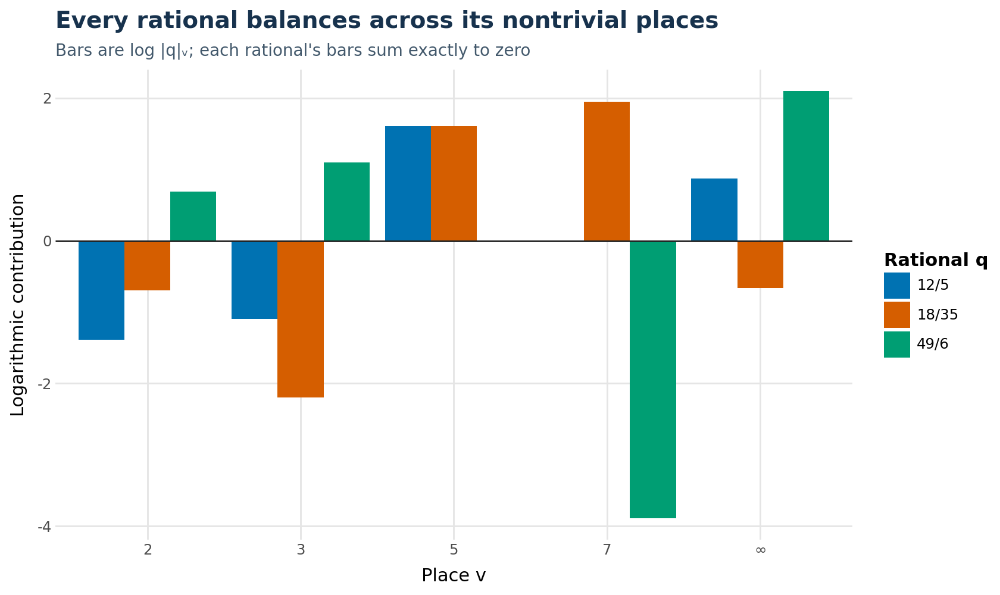

# Adeles, Ideles, and the Product Formula {#sec-adeles-ideles}

**Level and prerequisites: L5.** Prepare local fields, restricted products, topological groups and algebraic number fields. Use the [level-specific reading guide](index.md#who-this-book-is-for) for linked Euler preparation.

Number theory repeatedly studies the same rational number through different
lenses: ordinary size, divisibility by $2$, divisibility by $3$, and so on.
Adeles place all of these completions into one coordinated object. Ideles do
the same for nonzero multiplicative data. Their definitions look large, but a
restriction—almost every coordinate must be integral—keeps arithmetic and
topology under control.

This chapter rebuilds absolute values, completions, product topology, and Haar
measure in the special cases needed. Chapter 19 gives a fuller construction of
$\mathbb Q_p$, but the following repair kit is self-contained.

## Places and normalised absolute values

The ordinary absolute value $|\cdot|_\infty$ measures Archimedean size. For a
prime $p$, write a nonzero rational as

$$
x=p^k\frac ab,\qquad p\nmid ab,
$$

and define

$$
|x|_p=p^{-k},\qquad |0|_p=0.
$$

Thus a number is $p$-adically small when it is divisible by a high power of
$p$. Completing $\mathbb Q$ for $|\cdot|_\infty$ gives $\mathbb R$;
completing it for $|\cdot|_p$ gives $\mathbb Q_p$. A **place** of $\mathbb Q$
means one of these equivalence classes of absolute values. Ostrowski's theorem
says there are no others among nontrivial absolute values.

The ring of $p$-adic integers is

$$
\mathbb Z_p=\{x\in\mathbb Q_p:|x|_p\le1\}.
$$

It is compact and open. Its unit group
$\mathbb Z_p^\times$ consists of elements of absolute value one.

## Why a restricted product?

The direct product

$$
\mathbb R\times\prod_p\mathbb Q_p
$$

allows an arbitrary coordinate at every prime. A rational number embedded
diagonally has $p$-adic absolute value one for all but finitely many primes,
because its numerator and denominator have only finitely many prime factors.
The arithmetic condition to preserve is therefore

$$
x_p\in\mathbb Z_p\quad\text{for all but finitely many }p.
$$

The **adele ring** is the restricted product

$$
\mathbb A_{\mathbb Q}
=\mathbb R\times\prod_p' \mathbb Q_p
=\left\{(x_\infty,x_2,x_3,\ldots):
x_p\in\mathbb Z_p\text{ for almost all }p\right\}.
$$

“Almost all” here means all except finitely many; it is not a measure-theoretic
phrase.

Two examples separate the definition from diagonal intuition. The tuple

$$
x=(\sqrt2,0,0,0,\ldots)
$$

is an adele: every finite coordinate is in $\mathbb Z_p$. It is not diagonal,
because no rational number has real coordinate $\sqrt2$ and every finite
coordinate zero. By contrast, the tuple with $p$th coordinate $p^{-1}$ at
every finite prime is not an adele. At its $p$th coordinate,
$|p^{-1}|_p=p>1$, so infinitely many coordinates are nonintegral. Membership
is a statement about the entire indexed family, not about whether each
coordinate individually belongs to some local field.

A basic open neighbourhood chooses ordinary open sets at finitely many places
and uses $\mathbb Z_p$ at every remaining finite place. This **restricted
product topology** makes $\mathbb A_{\mathbb Q}$ locally compact. If arbitrary
open sets were chosen at infinitely many coordinates, the topology would be
too fine for the desired compactness and harmonic analysis.

Addition and multiplication occur coordinatewise. The integrality condition is
stable because the union of two finite exceptional sets is finite.

## Diagonal rationals and a fundamental region

Embed $\mathbb Q$ diagonally:

$$
q\longmapsto(q,q,q,\ldots).
$$

This copy of $\mathbb Q$ is discrete in the adeles. For example,

$$
(-1/2,1/2)\times\prod_p\mathbb Z_p
$$

contains no nonzero diagonal rational: integrality at every $p$ forces an
integer, while the real bound forces zero.

The quotient $\mathbb A_{\mathbb Q}/\mathbb Q$ is compact. A concrete reduction
explains why. Given an adele $x$, only finitely many $p$-coordinates are
nonintegral. By the Chinese remainder theorem and rational approximation, choose
$q\in\mathbb Q$ so that $x_p-q\in\mathbb Z_p$ for every finite $p$. Then add an
integer so that $x_\infty-q$ lies in a bounded interval such as $[0,1]$.
Therefore every coset has a representative in

$$
[0,1]\times\prod_p\mathbb Z_p,
$$

a compact set. Boundary representatives are not unique, just as $0$ and $1$
represent the same point on a circle quotient.

**Worked finite-coordinate reduction.** Consider an adele whose exceptional
finite coordinates are

$$
x_2=\frac14,\qquad x_3=\frac13,\qquad x_p=0\quad(p\ne2,3).
$$

Seek $q=a/12$. The condition $x_2-q\in\mathbb Z_2$ becomes
$a\equiv3\pmod4$, because $(a-3)/12$ must have no negative power of $2$.
Similarly, $x_3-q\in\mathbb Z_3$ becomes $a\equiv4\pmod3$. The choice
$a=7$ satisfies both. Directly,

$$
\frac14-\frac7{12}=-\frac13\in\mathbb Z_2,
\qquad
\frac13-\frac7{12}=-\frac14\in\mathbb Z_3.
$$

At every other prime, $7/12$ is integral because its denominator uses only
$2$ and $3$. If the real coordinate is $0$, replace $7/12$ by the congruent
rational $-5/12$; subtracting an integer does not disturb any finite
integrality condition, and $0-(-5/12)=5/12$ lies in $[0,1]$. This calculation
is the finite CRT mechanism inside the compactness argument.

This compact quotient is a global counterpart of a lattice fundamental
parallelogram.

## The rational product formula

For every nonzero $q\in\mathbb Q$,

$$
|q|_\infty\prod_p|q|_p=1.
$$

Only finitely many factors differ from one. Write

$$
q=\pm\prod_p p^{v_p(q)}.
$$

Then

$$
|q|_\infty=\prod_p p^{v_p(q)},
\qquad
\prod_p|q|_p=\prod_p p^{-v_p(q)},
$$

and the factors cancel.

Taking logarithms gives

$$
\log|q|_\infty+\sum_p\log|q|_p=0.
$$

Global size is balanced across all places. For $q=12/5$ the nontrivial values
are

$$
|q|_\infty=\frac{12}{5},\quad
|q|_2=\frac14,\quad
|q|_3=\frac13,\quad
|q|_5=5,
$$

whose product is one.

<figure id="fig-product-formula-places">


<figcaption>

Figure 34.1: The logarithmic contributions of all nontrivial places cancel in the rational product formula.

</figcaption>
</figure>

[Figure 34.1](#fig-product-formula-places) visualises exact prime exponents multiplied by
logarithms. Missing primes contribute zero; the apparent decimal cancellation
comes from an exact factorisation identity.

For a number field $K$, one chooses normalized absolute values $|\cdot|_v$ at
each place and local degrees so that

$$
\prod_v|a|_v^{n_v}=1
$$

for every $a\in K^\times$. Conventions differ about whether the exponent is
built into $|\cdot|_v$; a correct statement declares its normalization.

## Ideles and idele classes

Multiplication requires nonzero coordinates. The **idele group** is

$$
\mathbb A_{\mathbb Q}^{\times}
=\left\{(x_v)_v:
x_v\ne0,\ x_p\in\mathbb Z_p^\times
\text{ for almost all }p\right\}.
$$

This is not merely the set of invertible elements of the adele ring under the
subspace topology; its natural restricted-product topology also controls the
inverse coordinates. The diagonal copy of $\mathbb Q^\times$ is a subgroup,
and

$$
\mathbb A_{\mathbb Q}^{\times}/\mathbb Q^\times
$$

is the **idele class group**.

The idele norm

$$
\|(x_v)\|=\prod_v|x_v|_v
$$

is well defined because almost every factor is one. The product formula says
diagonal rational numbers have norm one, so the norm descends to idele classes.

One can separate an idele into valuation coordinates $p^{k_p}$ at finitely
many primes and unit coordinates everywhere. This packages principal ideals,
units, and Archimedean size in one group.

The unit condition is stronger than “every coordinate is nonzero.” Let
$y_\infty=1$ and $y_p=p$ in the $p$th coordinate for every finite prime. Since
$p\in\mathbb Z_p$, the tuple $y$ is an adele and has no zero coordinate. But
its coordinatewise inverse has $p$th coordinate $p^{-1}$, which is nonintegral
for every $p$ and hence is not an adele. Thus $y$ is not an idele. Requiring
$x_p\in\mathbb Z_p^\times$ almost everywhere guarantees that both a tuple and
its inverse satisfy the restricted condition.

## Additive characters and Poisson summation

An additive character is a continuous homomorphism from an additive group to
the unit circle. At the real place use

$$
\psi_\infty(x)=e^{-2\pi ix}.
$$

At each $p$ there is a standard character $\psi_p$ trivial on
$\mathbb Z_p$. The signs and fractional-part conventions can be coordinated so
that the global product character

$$
\psi(x)=\psi_\infty(x_\infty)\prod_p\psi_p(x_p)
$$

is trivial on diagonally embedded $\mathbb Q$.

With compatible self-dual Haar measures, an adelic Poisson summation formula
states schematically

$$
\sum_{q\in\mathbb Q}f(q)=\sum_{q\in\mathbb Q}\widehat f(q)
$$

for suitable test functions on $\mathbb A_{\mathbb Q}$. Choosing finite-place
functions to be indicators of $\mathbb Z_p$ recovers the classical Poisson
formula on the real line. The adelic statement explains why all local Fourier
transforms belong in one identity.

“Suitable” carries real content. A standard **Schwartz–Bruhat function** is
rapidly decreasing and smooth at the real place, locally constant with compact
support at each finite place, and equal to $1_{\mathbb Z_p}$ at almost every
prime in a decomposable example. Haar measures and character signs must use
matching self-dual normalisations. The displayed identity is therefore a
theorem vista, not a claim for an arbitrary function or an arbitrary product
of local measures. This scope condition is what makes both sums and the Fourier
transform meaningful.

## Strong approximation and reciprocity vista

Weak approximation says finitely many local targets can be approximated
simultaneously by one rational number. Strong approximation allows integrality
outside a chosen set of places and is the engine behind the compact fundamental
region above.

Class field theory turns the idele class group into the source of global
abelian Galois information. There is a reciprocity homomorphism from idele
classes to an abelianised Galois group; local components agree with local
reciprocity maps. Proving this is beyond the present chapter. Chapter
[sec-class-field-theory](40-class-field-theory.md#sec-class-field-theory) states the local and global reciprocity and existence
theorems precisely, identifies their norm kernels, and computes the Artin map
for $\mathbb Q(\zeta_5)/\mathbb Q$. The accurate takeaway here is that ideles
coordinate local multiplicative data, while reciprocity translates that
coordination into abelian field extensions.

<div class="callout callout-warning">
<p class="callout-title">One coordinate is not an adele</p>

An adele is a full tuple together with an almost-everywhere integrality
condition. A list of several decimal and p-adic approximations becomes an
adelic experiment only after the unspecified coordinates and the topology are
declared.

</div>

<!-- inline-formula-code:start -->
## Formula and finite computation

A useful formula in this chapter is

$$
|x|_\infty\prod_p|x|_p=1\qquad(x\in\mathbb Q^\times)
$$

Exact fractions let the rational product formula be checked without roundoff. The following standalone Python block expresses that finite rule with its inputs and stopping conditions visible.

```python
from fractions import Fraction

x = Fraction(18, 25)
valuations = {2: 1, 3: 2, 5: -2}
local_factors = [Fraction(prime) ** (-exponent) for prime, exponent in valuations.items()]
product = abs(x)
for factor in local_factors:
    product *= factor
print(local_factors, product)
```

**What the computation establishes.** The output certifies only the declared finite case. The theorem, if one is claimed, still requires the argument developed in the chapter.
<!-- inline-formula-code:end -->

## Summary, exercises, and support

The adeles form a locally compact restricted product of every completion of
$\mathbb Q$. Diagonal rationals are discrete and have compact quotient. The
product formula balances absolute values. Ideles retain multiplicative
invertibility and lead to the global reciprocity viewpoint.

<div class="exercise" id="number_theory-34-adeles-ideles-ex-1">
<p class="exercise-title"><strong>Exercise 1</strong></p>

Compute every nontrivial absolute value of $18/35$ and verify the product
formula.

</div>

<div class="exercise" id="number_theory-34-adeles-ideles-ex-2">
<p class="exercise-title"><strong>Exercise 2</strong></p>

Prove that sums and products of adeles are adeles.

</div>

<div class="exercise" id="number_theory-34-adeles-ideles-ex-3">
<p class="exercise-title"><strong>Exercise 3</strong></p>

Show that the displayed neighbourhood of zero meets diagonal $\mathbb Q$
only at zero.

</div>

<div class="exercise" id="number_theory-34-adeles-ideles-ex-4">
<p class="exercise-title"><strong>Exercise 4</strong></p>

Explain why $(p^{-1})_p$, with $p$th coordinate $p^{-1}$ for every prime,
is not an adele.

</div>

<div class="exercise" id="number_theory-34-adeles-ideles-ex-5">
<p class="exercise-title"><strong>Exercise 5</strong></p>

Construct an adele that is not diagonal.

</div>

<div class="exercise" id="number_theory-34-adeles-ideles-ex-6">
<p class="exercise-title"><strong>Exercise 6</strong></p>

Find a rational $q$ congruent to $2$ modulo $3^2$ and to $4$ modulo $5$.
Interpret this as finite local approximation.

</div>

<div class="exercise" id="number_theory-34-adeles-ideles-ex-7">
<p class="exercise-title"><strong>Exercise 7</strong></p>

Verify that the idele norm of a diagonal rational is one.

</div>

<div class="exercise" id="number_theory-34-adeles-ideles-ex-8">
<p class="exercise-title"><strong>Exercise 8</strong></p>

Describe the ambiguity at the boundary of
$[0,1]\times\prod_p\mathbb Z_p$.

</div>

<div class="exercise" id="number_theory-34-adeles-ideles-ex-9">
<p class="exercise-title"><strong>Exercise 9</strong></p>

State exactly which parts of the Poisson and reciprocity discussions were
proved and which were theorem vistas.

</div>

For Exercise 1, only the places $\infty,2,3,5,7$ are nontrivial. For Exercise
4, every coordinate is nonintegral, violating the finite-exception condition.
For Exercise 6, ordinary CRT gives $q=29$ modulo $45$.

**Concise solution clinic.** For Exercise 1,

$$
\left|\frac{18}{35}\right|_\infty=\frac{18}{35},\quad
\left|\frac{18}{35}\right|_2=\frac12,\quad
\left|\frac{18}{35}\right|_3=\frac19,\quad
\left|\frac{18}{35}\right|_5=5,\quad
\left|\frac{18}{35}\right|_7=7.
$$

Their product is
$(18/35)(1/2)(1/9)(5)(7)=1$; every other factor is one. For Exercise 5,
$(\sqrt2,0,0,\ldots)$ is the non-diagonal adele verified above. For Exercise
6, $29\equiv2\pmod9$ and $29\equiv4\pmod5$, while every number
$29+45k$ has the same two local residues. The construction controls only the
declared places; no condition at an undeclared place should be inferred.
