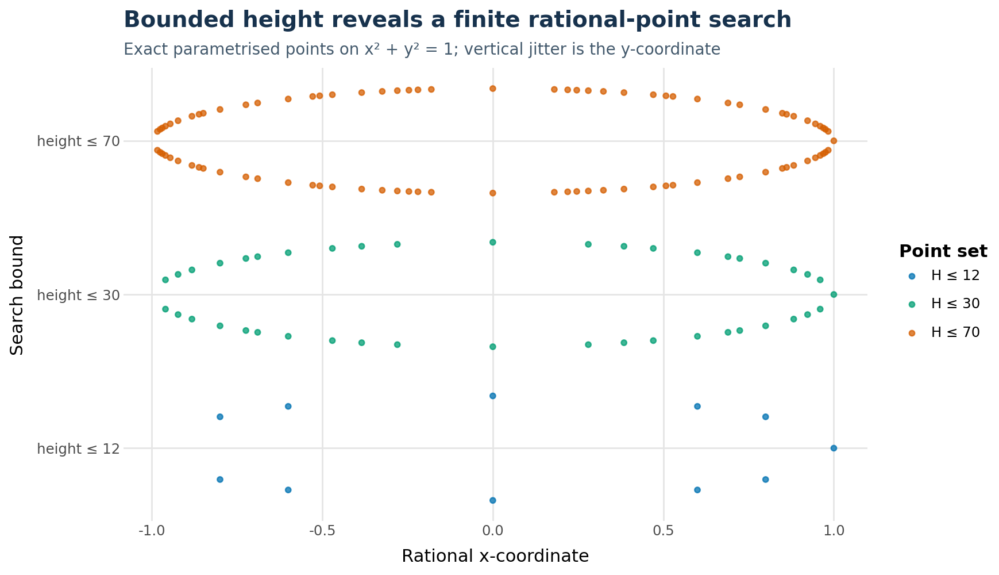

# Algebraic Curves, Jacobians, and Rational Points {#sec-curves-jacobians}

**Level and prerequisites: L5.** Prepare algebraic curves, divisors, projective varieties and Jacobians. Use the [level-specific reading guide](index.md#who-this-book-is-for) for linked Euler preparation.

An equation in two variables draws a curve, but number theory asks a discrete
question: which points on that curve have rational coordinates? A circle may
have infinitely many rational points, another conic may have none, an elliptic
curve carries a finitely generated group, and a higher-genus curve has only
finitely many rational points. Geometry organises these strikingly different
outcomes.

This chapter starts with coordinates and homogenisation. Chapter 20 developed
elliptic curves, Chapter 29 developed heights, and Chapter 19 introduced local
solvability; all specialised language needed here is repaired locally.

## Affine and projective curves

An **affine plane curve** over a field $K$ is the solution set

$$
C: f(x,y)=0
$$

for a nonconstant polynomial $f\in K[x,y]$. The field in the phrase “points
over $K$” matters:

$$
C(K)=\{(x,y)\in K^2:f(x,y)=0\}.
$$

To include directions at infinity, introduce homogeneous coordinates
$[X:Y:Z]$, where

$$
[X:Y:Z]=[\lambda X:\lambda Y:\lambda Z]
\quad(\lambda\ne0).
$$

If $f$ has degree $d$, its homogenisation is

$$
F(X,Y,Z)=Z^d f(X/Z,Y/Z).
$$

Points with $Z\ne0$ recover the affine chart $x=X/Z$, $y=Y/Z$; points with
$Z=0$ are at infinity.

For the circle $x^2+y^2=1$, the projective equation is
$X^2+Y^2=Z^2$. The rational point $[-1:0:1]$ lets a line of rational slope
$t$ meet the circle at one further rational point. Solving gives

$$
x=\frac{1-t^2}{1+t^2},
\qquad
y=\frac{2t}{1+t^2}.
$$

Every rational point except $[-1:0:1]$ arises this way. One rational point on a
conic can therefore parametrise all the others.

**Worked derivation.** Use the affine base point $(-1,0)$ and the line

$$
y=t(x+1),\qquad t\in\mathbb Q.
$$

Substitution into $x^2+y^2=1$ gives

$$
(1+t^2)x^2+2t^2x+(t^2-1)=0
=(x+1)\bigl((1+t^2)x+t^2-1\bigr).
$$

The known intersection contributes the factor $x+1$. The other factor gives

$$
x=\frac{1-t^2}{1+t^2},
\qquad
y=t(x+1)=\frac{2t}{1+t^2}.
$$

Conversely, a rational point with $x\ne-1$ has rational slope
$t=y/(x+1)$, so the construction recovers it. The omitted base point is not a
failure: it is the point used to launch the parametrisation and corresponds to
the limiting vertical direction. This two-intersection calculation is the
genus-zero prototype for later secant constructions.

## Smoothness and singularity

For $F(X,Y,Z)=0$, a projective point is **singular** if

$$
F=F_X=F_Y=F_Z=0
$$

there. Otherwise it is smooth. The curve $y^2=x^3$ has a cusp at the origin:
both partial derivatives vanish. In characteristic other than 2, the curve $y^2=x^2(x+1)$ has two tangent
directions at the origin, a node.

Singularities change arithmetic and genus. A singular cubic can often be
parametrised by lines through the singular point, while a smooth cubic is
usually an elliptic curve and is not rationally parametrised. Before applying a
theorem about smooth curves, checking partial derivatives is compulsory.

For the cusp $F(x,y)=y^2-x^3$, the derivatives are
$F_x=-3x^2$ and $F_y=2y$, so both vanish with $F$ at $(0,0)$. The lowest-degree
part is $y^2$, a repeated tangent direction. For the node
$G(x,y)=y^2-x^2(x+1)$, the lowest-degree part at the origin is

$$
y^2-x^2=(y-x)(y+x),
$$

which exposes two distinct tangent directions in characteristic other than 2. In that case both points are singular, but their local
geometries differ. Merely finding vanishing derivatives locates a singularity;
the first nonzero homogeneous terms begin its classification.

## Genus and the first trichotomy

The **genus** is a nonnegative integer measuring the intrinsic complexity of a
smooth projective curve. Over the complex numbers it counts topological
handles. Algebraically it can be defined through differential forms or
Riemann–Roch.

For a smooth plane curve of degree $d$,

$$
g=\frac{(d-1)(d-2)}2.
$$

Thus smooth conics have genus zero, smooth cubics genus one, and smooth plane
quartics genus three. Singularities lower the genus after normalization.

The adjectives are essential. The formula uses a **smooth projective plane
model**. Applying it directly to an affine equation can miss points or
singularities at infinity, and applying it to a singular plane model computes
the arithmetic genus rather than automatically giving the genus of its smooth
normalization. The safe order is homogenise, inspect every projective point for
smoothness, and only then invoke the degree formula.

The arithmetic landscape is:

- genus zero: a rational point typically yields a parametrisation and
  infinitely many rational points;
- genus one: after choosing a rational base point, the curve is an elliptic
  curve with a finitely generated rational-point group;
- genus at least two: the Mordell–Faltings theorem says $C(K)$ is finite for
  every number field $K$.

Finiteness is not automatically effective: a theorem may say the list ends
without supplying a practical bound large enough to find every point.

## Functions, valuations, and divisors

A rational function on $C$ is locally a quotient of polynomials, subject to the
curve equation. Here divisors are indexed by **closed points over the base
field $K$**. A closed point has a residue field $\kappa(P)$, the field of
coordinate values at that point, finite over $K$. Its **point degree** is

$$
d_P=[\kappa(P):K].
$$

For example, a finite closed point on $\mathbb P^1$ defined by a monic
irreducible polynomial $p\in K[x]$ has residue field $K[x]/(p)$ and degree
$\deg p$. A $K$-rational point has degree one.

At a smooth closed point $P$, a nonzero function $f$ has an integer
order

$$
\operatorname{ord}_P(f),
$$

positive for a zero, negative for a pole, and zero otherwise. Its
**principal divisor** is

$$
\operatorname{div}(f)
=\sum_P\operatorname{ord}_P(f)[P].
$$

Only finitely many terms are nonzero. On a complete smooth curve,

$$
\deg\operatorname{div}(f)
=\sum_P[\kappa(P):K]\operatorname{ord}_P(f)=0.
$$

Zeros and poles balance with both local multiplicity and point degree. A
general divisor is a finite formal integer combination $D=\sum n_P[P]$, with

$$
\deg D=\sum_P n_P[\kappa(P):K].
$$

Two divisors are linearly equivalent when their difference is principal.

There is also a correct **geometric-point convention**: index divisors on
$C_{\overline K}$ by points over an algebraic closure. Each point then has
degree one, so the unweighted formulas $\deg D=\sum_P n_P$ and
$\deg\operatorname{div}(f)=\sum_P\operatorname{ord}_P(f)=0$ apply.
The closed-point convention used here keeps the base field visible. The
worked clinic below relates these descriptions. Over finite fields,
[sec-curve-zeta](39-curve-zeta.md#sec-curve-zeta) already interprets closed-point degree as Frobenius orbit
length.

The Riemann–Roch theorem controls the dimension of functions whose poles are
bounded by $D$. Its formula

$$
\ell(D)-\ell(K_C-D)=\deg D+1-g
$$

is stated here as a map: $K_C$ is a canonical divisor and $\ell(D)$ is a vector
space dimension. The theorem is the engine behind embeddings,
parametrisations, and much of explicit curve arithmetic.

**Divisor check on the projective line.** Write the affine coordinate as
$x=X/Z$. It vanishes once at $[0:1]$ and has one pole at the point at infinity
$[1:0]$. In a local coordinate near infinity, $u=Z/X=1/x$, so $x=u^{-1}$ has
pole order one. Hence

$$
\operatorname{div}(x)=[0:1]-[1:0],
$$

whose degree is $1-1=0$. This calculation makes “zeros and poles balance”
concrete and shows why multiplicity and points at infinity cannot be omitted.

## Worked clinic: closed points and weighted degree {#sec-nt-divisor-degree}

The distinction above can be checked on the projective line, without computing
a Jacobian. The existing example $\operatorname{div}(x)=[0]-[\infty]$ has
only degree-one points. It is correct under either convention, so it cannot
detect a missing residue-field weight. We now keep the base field visible.

### Prove the rule on the projective line {#sec-nt-divisor-p1-proof}

Unique factorisation in $K[x]$ writes any nonzero rational function as

$$
f(x)=c\prod_p p(x)^{e_p},
\qquad c\in K^\times,\quad e_p\in\mathbb Z,
$$

where the $p$ are distinct monic irreducible polynomials and only finitely many
exponents are nonzero. At the closed point $P_p$, the polynomial $p$ is a
local parameter: the local ring $K[x]_{(p)}$ has maximal ideal generated by
$p$, and $\operatorname{ord}_{P_p}(p)=1$. Every other factor is a unit,
with nonzero value in $K[x]/(p)$. Thus

$$
\operatorname{ord}_{P_p}(f)=e_p,
\qquad \deg(P_p)=\deg(p).
$$

For infinity use $t=1/x$. A monic polynomial of degree $d$ becomes
$t^{-d}(1+\text{positive powers of }t)$; the parenthesised factor is a unit
with value one at $t=0$. Consequently

$$
\operatorname{ord}_{\infty}(f)
=-\sum_p e_p\deg(p).
$$

The point at infinity is rational, so its degree is one. Adding all weighted
contributions proves

$$
\deg\operatorname{div}(f)
=\sum_p e_p\deg(p)+\operatorname{ord}_{\infty}(f)=0.
$$

This is a complete proof on $\mathbb P^1$. The theorem for general complete
smooth curves remains the theorem stated above; this factorisation argument
does not prove it on an arbitrary curve.

### A finite certificate over the three-element field {#sec-nt-divisor-worked}

Work over $\mathbb F_3$ and set

$$
A=x^2+1,\qquad B=x^3-x-1,\qquad f=\frac{A^3}{B^2}.
$$

The polynomial $A$ is already used to construct $\mathbb F_9$ in
[sec-finite-fields](23-finite-fields.md#sec-finite-fields). The polynomial $B$ appears in the number-field basis
example of [sec-explicit-algebraic](36-explicit-algebraic.md#sec-explicit-algebraic); here it is used over $\mathbb F_3$.
Their values at $0,1,2$ are respectively $(1,2,2)$ and $(2,2,2)$. Neither
has a root. The degree-two and degree-three criterion from
[sec-finite-fields](23-finite-fields.md#sec-finite-fields) proves both irreducible, hence coprime. Also
$A'=2x$ and $B'=2$, so their geometric roots are simple.

Let $P_2$ and $P_3$ denote the closed points defined by $A$ and $B$. The
residue fields have $3^2$ and $3^3$ elements, and the point degrees are two
and three. The exponents in $f$ supply the local orders, not the point
degrees. Here $d_P=[\kappa(P):\mathbb F_3]$ and
$e_P=\operatorname{ord}_P(f)$; the last column is the weighted contribution.

| $P$ | $d_P$ | $e_P$ | $d_P e_P$ |
|:---|---:|---:|---:|
| $P_2$ | $2$ | $3$ | $6$ |
| $P_3$ | $3$ | $-2$ | $-6$ |
| $\infty$ | $1$ | $0$ | $0$ |

There is no other support. The infinity entry can be checked independently:

$$
f=\frac{(1+t^2)^3}{(1-t^2-t^3)^2}.
$$

Both numerator and denominator are units at $t=0$. Therefore

$$
\operatorname{div}(f)=3[P_2]-2[P_3],
\qquad \deg\operatorname{div}(f)=3\cdot2-2\cdot3=0.
$$

The sum of the two closed-point coefficients is $3-2=1$. That disproves an
unweighted *closed-point* calculation; it does not contradict the correct
unweighted formula over geometric points.

### Translate to geometric points and Frobenius {#sec-nt-divisor-frobenius}

Inside an algebraic closure choose $u$ with $u^2=-1$ and $v$ with
$v^3-v-1=0$. The two roots of $A$ are $u,-u$, and

$$
u^3=-u.
$$

The three roots of $B$ are $v,v+1,v+2$, because in characteristic three
adding an element of $\mathbb F_3$ leaves $x^3-x-1$ unchanged. In fact,

$$
v^3=v+1,\qquad v^9=v+2,\qquad v^{27}=v.
$$

Thus Frobenius exchanges the first pair and cycles the second triple. The
same divisor over the algebraic closure is

$$
\begin{aligned}
\operatorname{div}(f)
={}&3[u]+3[-u]\\
&-2[v]-2[v+1]-2[v+2].
\end{aligned}
$$

Now every displayed point has degree one, and the geometric coefficient sum
is $6-6=0$. Point degree counts the geometric members of an orbit here;
local order records the multiplicity at each member. They must not be
multiplied twice.

[sec-curve-zeta](39-curve-zeta.md#sec-curve-zeta) already develops closed points as Frobenius orbits.
Under base change to $\mathbb F_{3^r}$, a degree-$d$ orbit splits into
$\gcd(d,r)$ orbits, each of length $d/\gcd(d,r)$: taking the $r$th power
of Frobenius takes $r$ steps around a $d$-cycle. Over $\mathbb F_9$,
$P_2$ splits into two rational points while $P_3$ stays degree three.
Over $\mathbb F_{27}$, $P_3$ splits into three rational points while
$P_2$ stays degree two. Over $\mathbb F_{3^6}$ both split completely.
The weighted degree stays zero in each description. These finite fields
are perfect; no claim about distinct geometric points over arbitrary
imperfect fields is needed.

### Check the Riemann–Roch dimension {#sec-nt-divisor-dimension}

Let $L(P_2)$ consist of zero and the rational functions whose only allowed
pole is at $P_2$, of order at most one. Every such function can be written
$N(x)/A(x)$. The absence of other finite poles leaves no other denominator
factor, and the infinity condition is exactly $\deg N\le2$. Hence

$$
L(P_2)=
\left\{\frac{c_0+c_1x+c_2x^2}{A(x)}:
c_0,c_1,c_2\in\mathbb F_3\right\}.
$$

The numerator coefficients are unique, so a basis is
$1/A,x/A,x^2/A$. This space has dimension three and contains $3^3=27$
functions, including zero and the constants. The genus-zero
degree-plus-one formula gives $\ell(P_2)=2+1=3$. Calling $P_2$ degree one
would incorrectly predict dimension two. We obtained the dimension directly,
without assuming the general Riemann–Roch theorem.

### Changed task: equal values, different fibres {#sec-nt-divisor-task}

Keep the declared field and polynomials, but put $g=A^2/B$.

1. Find $\operatorname{div}(g)$, including infinity. Compare its weighted
   degree with the sum of its closed-point coefficients. Can a zero
   unweighted sum certify the convention?
2. An observer finds $g(a)=2$ for every affine $a\in\mathbb F_3$.
   Is $g$ the constant rational function two?
3. Factor the numerator of $g-2$ exactly and determine its full divisor.
   Compare the degrees and multiplicities in the zero fibres of $g$ and
   $g-2$, and their polar divisors.

<div class="callout callout-tip">
<p class="callout-title">Hint</p>

Handle finite irreducible factors first, then use denominator degree minus
numerator degree for the order at infinity. A table of three function values
does not prove equality of rational functions. Expand $A^2-2B$ in
$\mathbb F_3[x]$ and retain repeated factors.

</div>

### Full changed-task explanation {#sec-nt-divisor-solution}

The finite orders of $g$ are two at $P_2$ and minus one at $P_3$.
At infinity,

$$
g=t^{-1}\frac{(1+t^2)^2}{1-t^2-t^3},
$$

so the order is minus one. Therefore

$$
\operatorname{div}(g)=2[P_2]-[P_3]-[\infty].
$$

The weighted degree is $4-3-1=0$. The coefficient sum
$2-1-1=0$ happens to agree. This accidental equality cannot validate an
unweighted closed-point rule: the worked function $f$ already disproves it.

For $a\in\mathbb F_3$, the numerator value $A(a)^2$ is always one and
$B(a)=2$, giving $g(a)=2$. Nevertheless the pole at infinity proves that
$g$ is not constant. Direct expansion also gives

$$
\begin{aligned}
A^2-2B
&=x^4+x^3+2x^2+2x\\
&=(x^3-x)(x+1)\\
&=x(x-1)(x+1)^2,
\end{aligned}
$$

and thus

$$
g-2=\frac{x(x-1)(x+1)^2}{B}.
$$

The factor $x^3-x$ vanishes at all three base-field inputs, and the extra
$x+1$ retains the repeated zero at $-1$. There is no cancellation: $B$
is irreducible and has no root in $\mathbb F_3$. The zeros are simple at zero
and one and double at
$2=-1$. The poles remain simple at $P_3$ and infinity. Hence

$$
\operatorname{div}(g-2)
=[0]+[1]+2[2]-[P_3]-[\infty].
$$

Its weighted degree is $1+1+2-3-1=0$, while its closed-point coefficient
sum is two. The zero fibre of $g$ has two geometric points, each of order
two, compressed into $P_2$. The zero fibre of $g-2$ has three rational
points with orders one, one and two. Both zero divisors have degree four,
as does their common polar divisor $[P_3]+[\infty]$.
Base-field values alone record neither these multiplicities nor the
degree-three pole.

**Reference scope.** [The Stacks Project, Lemma 42.18.3](https://stacks.math.columbia.edu/tag/02RU)
states and proves the weighted principal-degree theorem for proper curves.
[Poonen, *Lectures on rational points on curves*, Section 2.2](https://math.mit.edu/~poonen/papers/curves.pdf#page=30)
defines closed-point degree and its orbit interpretation (printed page 24;
March 2006 draft). The proof above is elementary and specific to
$\mathbb P^1$.

## The Jacobian

Degree-zero divisors modulo principal divisors form a group

$$
\operatorname{Pic}^0(C).
$$

This group is represented geometrically by an abelian variety called the
**Jacobian** $J$ of $C$. Choosing a $K$-rational base point $P_0$ gives a map

$$
C\longrightarrow J,\qquad
P\longmapsto[P-P_0].
$$

The displayed pointwise formula applies to $K$-rational points, or to
geometric points after base change: both points then have degree one.
If instead a closed point $P$ of degree $d$ is packaged as a divisor over
$K$, its degree-zero adjustment is $[P]-d[P_0]$. This separates a pointwise
map from the arithmetic degree of a whole closed-point divisor.

For a genus-one curve with a rational base point, $J$ is the curve itself, and
this construction becomes the elliptic-curve chord-and-tangent law. For genus
$g$, the Jacobian has dimension $g$. Divisor classes can often be represented
by $g$ points, making group computations possible.

For a number field $K$, Mordell–Weil says $J(K)$ is finitely generated:

$$
J(K)\cong J(K)_{\mathrm{tors}}\oplus\mathbb Z^r.
$$

When $K$ is a number field, the curve has genus at least one, and the
chosen base point $P_0$ is $K$-rational, the map above embeds $C(K)$ into
this finitely generated group. This converts a geometric point problem into
an intersection problem between the curve and an arithmetic lattice.

## Local points and reduction

A rational point gives a point over $\mathbb R$ and over every
$\mathbb Q_p$. Therefore failure at one completion proves
$C(\mathbb Q)=\varnothing$. Reduction modulo a prime gives a fast first test.
If a primitive integral model has no point modulo $p$, then it has no rational
point whose reduction is defined.

When a solution modulo $p$ is nonsingular, Hensel's lemma often lifts it to a
$p$-adic point. Singular residues require finer analysis. Passing every local
test does not guarantee a global point: genus-one torsors and higher curves can
violate the Hasse principle.

**Example.** The equation

$$
x^2+y^2=3
$$

has no rational solution. Clear denominators to obtain a primitive integer
solution $X^2+Y^2=3Z^2$. Modulo $3$, both $X$ and $Y$ must be divisible by
$3$ because squares are $0$ or $1$, then the equation forces $Z$ divisible by
$3$, contradicting primitiveness. This is a local congruence obstruction.

## Heights and descent

For a reduced rational $x=a/b$, define

$$
h(x)=\log\max(|a|,|b|).
$$

Projective and divisor heights extend this measure of arithmetic complexity to
curves and Jacobians. Two properties make them effective:

1. only finitely many rational points have bounded height;
2. under multiplication on an abelian variety, canonical height grows
   quadratically:
   $\widehat h(nP)=n^2\widehat h(P)$.

Descent maps $J(K)/nJ(K)$ into a finite collection of local algebraic data. A
Selmer computation bounds the rank and produces covering curves. To certify
the full Mordell–Weil group, one must also prove saturation: known generators
are not hiding inside a subgroup of finite index.

<figure id="fig-curve-point-heights">


<figcaption>

Figure 35.1: Nested height searches reveal increasingly many exact rational points but do not by themselves certify completeness.

</figcaption>
</figure>

[Figure 35.1](#fig-curve-point-heights) is an exact bounded search on a parametrised conic.
Its finite rows illustrate the height principle; absence outside a declared
bound never proves that another curve has no additional rational points.

## Chabauty–Coleman architecture

Suppose $C/\mathbb Q$ has genus $g\ge2$ and the rank $r$ of $J(\mathbb Q)$ is
less than $g$. Embed $C$ into $J$ and then into the $p$-adic Lie group
$J(\mathbb Q_p)$. The closure of $J(\mathbb Q)$ has dimension at most $r$,
while the curve has dimension one. Suitable $p$-adic integrals vanish on
$J(\mathbb Q)$ and have only finitely many zeros on residue disks. Counting
those zeros bounds $C(\mathbb Q)$.

A complete Chabauty computation records:

- a good prime $p$;
- the Mordell–Weil rank proof and generators used;
- residue classes in $C(\mathbb F_p)$;
- power-series precision and zero bounds;
- treatment of every surviving disk.

Quadratic Chabauty and Mordell–Weil sieves can go beyond the basic rank
condition, but each adds hypotheses and certification requirements.

The inequality $r<g$ is a gateway, not a complete certificate by itself. One
still needs a proved rank bound, a verified embedding into the Jacobian, a good
prime and sufficient $p$-adic precision, and a zero count covering every
residue disk. A numerical integral that appears nonzero at current precision
cannot discard a disk until an error bound proves it stays nonzero. This is the
same discovery-versus-certification distinction seen in finite height searches,
now applied to $p$-adic analytic data.

## A hyperelliptic workflow

For $C:y^2=f(x)$ with squarefree $f$ of degree $2g+1$ or $2g+2$:

1. check squarefreeness and pass to the smooth projective normalization; the
   naive plane closure can require repair; count rational points at infinity on the smooth proper normalization;
2. search rational $x=a/b$ within a declared height, clearing denominators
   exactly;
3. test local solubility at the real place and selected primes;
4. compute information about $J(\mathbb Q)$ by descent;
5. apply Chabauty or a sieve when its hypotheses hold;
6. independently verify every listed point in the original equation.

The first two steps discover candidates. The final steps are what can turn the
list into a completeness theorem.

<div class="callout callout-warning">
<p class="callout-title">Finite is not the same as effectively listed</p>

Mordell–Faltings proves that a higher-genus curve has finitely many rational
points, but citing it does not certify that a bounded search found them all.
Effectivity requires additional bounds or a method such as Chabauty plus a
complete residue-class audit.

</div>

Over finite fields, [sec-curve-zeta](39-curve-zeta.md#sec-curve-zeta) assembles the present curve, genus,
Frobenius, and Jacobian ideas into extension-field point counts and a rational
zeta function. Under iteration rather than a group law,
[sec-arithmetic-dynamics](41-arithmetic-dynamics.md#sec-arithmetic-dynamics) develops the parallel canonical-height and reduction
machinery for rational self-maps of $\mathbb P^1$.

<!-- inline-formula-code:start -->
## Formula and finite computation

For an odd prime p and a nonconstant squarefree polynomial f over the field of p elements, a useful point-count formula is

$$
N_p=N_{\infty,p}+\#\{(x,y):y^2\equiv f(x)\pmod p\}
$$

Here the left side counts rational points on the smooth proper normalization, the set counts affine pairs over the field of p elements, and the first term counts rational points above infinity. In odd degree there is one rational point at infinity. In even degree there are two when the leading coefficient is a nonzero square modulo p, and none when it is a nonsquare. Count these normalized points, not a singular point of an ordinary plane closure. Finite-field point counts are the first coefficients entering a curve's zeta data. The following standalone Python block uses the squarefree degree-five polynomial modulo 13; its odd degree justifies the extra 1, so this unchanged block certifies that finite case only.

```python
prime = 13
points = [
    (x, y)
    for x in range(prime)
    for y in range(prime)
    if (y * y - (x**5 + x + 1)) % prime == 0
]
print(1 + len(points))
```

**What the computation establishes.** The output certifies only the declared finite case. The theorem, if one is claimed, still requires the argument developed in the chapter.
<!-- inline-formula-code:end -->

## Summary, exercises, and support

Projective completion reveals points at infinity, smoothness permits the
standard genus theory, divisors encode zeros and poles, and the Jacobian turns
points into group classes. Local tests eliminate impossible curves; heights,
descent, and $p$-adic methods can make finite searches rigorous.

<div class="exercise" id="number_theory-35-curves-jacobians-ex-1">
<p class="exercise-title"><strong>Exercise 1</strong></p>

Homogenise $y=x^2+1$ and find its points at infinity.

</div>

<div class="exercise" id="number_theory-35-curves-jacobians-ex-2">
<p class="exercise-title"><strong>Exercise 2</strong></p>

Derive the rational parametrisation of the unit circle from a line through
$(-1,0)$.

</div>

<div class="exercise" id="number_theory-35-curves-jacobians-ex-3">
<p class="exercise-title"><strong>Exercise 3</strong></p>

Locate and classify the singularity of $y^2=x^3$ using partial derivatives.

</div>

<div class="exercise" id="number_theory-35-curves-jacobians-ex-4">
<p class="exercise-title"><strong>Exercise 4</strong></p>

Compute the genus of smooth plane curves of degrees $2,3,4,5$.

</div>

<div class="exercise" id="number_theory-35-curves-jacobians-ex-5">
<p class="exercise-title"><strong>Exercise 5</strong></p>

On the projective line, verify that the function $x$ has one simple zero
and one simple pole.

</div>

<div class="exercise" id="number_theory-35-curves-jacobians-ex-6">
<p class="exercise-title"><strong>Exercise 6</strong></p>

For a $K$-rational base point $P_0$ and a $K$-rational point $P$,
explain why the divisor class $[P-P_0]$ has degree zero.

</div>

<div class="exercise" id="number_theory-35-curves-jacobians-ex-7">
<p class="exercise-title"><strong>Exercise 7</strong></p>

Use congruences to prove or disprove local solubility of
$x^2+y^2=7$ at $p=4$ is badly phrased; repair the statement and solve it
modulo an appropriate prime.

</div>

<div class="exercise" id="number_theory-35-curves-jacobians-ex-8">
<p class="exercise-title"><strong>Exercise 8</strong></p>

Enumerate rational points on $y^2=x^3-x$ under height $20$ and verify each
exactly.

</div>

<div class="exercise" id="number_theory-35-curves-jacobians-ex-9">
<p class="exercise-title"><strong>Exercise 9</strong></p>

Write a certificate checklist distinguishing discovery from completeness
for a higher-genus curve.

</div>

For Exercise 1, the homogeneous equation is $YZ=X^2+Z^2$, and setting $Z=0$
forces $X=0$. For Exercise 7, $4$ is not prime and hence not a place; work
modulo $8$ or over $\mathbb Q_2$, and state which one you mean.

**Concise solution clinic.** In Exercise 1, setting $Z=0$ leaves $X^2=0$, so
the unique projective point at infinity is $[0:1:0]$. Scaling means
$[0:\lambda:0]$ is the same point for every nonzero $\lambda$.

For the repaired Exercise 7, use the modulus $8$. Suppose a rational solution
to $x^2+y^2=7$ existed and clear denominators to a primitive triple

$$
X^2+Y^2=7Z^2.
$$

If $Z$ is odd, the right side is $7$ modulo $8$, but a sum of two square
residues from $\{0,1,4\}$ is never $7$. Hence $Z$ is even. Reducing the
equation modulo $4$ now makes the right side zero; since squares modulo $4$ are
$0$ or $1$, both $X$ and $Y$ must be even. All three coordinates are then
even, contradicting primitiveness. Thus there is no rational solution. The
modulus calculation is a finite congruence test; describing the same result as
failure over $\mathbb Q_2$ requires the additional completion language.
