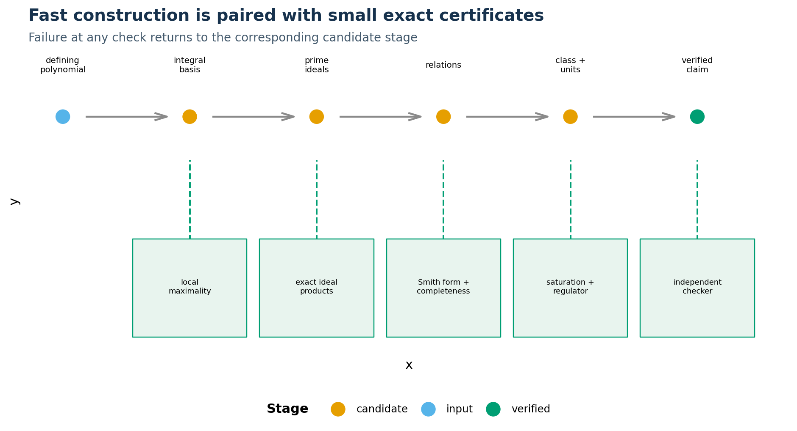

# Explicit Algebraic Number Theory and Certificates {#sec-explicit-algebraic}

**Level and prerequisites: L5.** Prepare Dedekind domains, class groups, units, Galois extensions and exact algorithms. Use the [level-specific reading guide](index.md#who-this-book-is-for) for linked Euler preparation.

Abstract theorems say that a number field has a ring of integers, a finite class
group, and a finitely generated unit group. Explicit algebraic number theory
turns those existence statements into exact data—and records enough evidence
that an independent program or reader can verify the answer.

The mathematical objects come first; algorithms are then organized around
representations, invariants, and certificates. No software system is treated
as an oracle.

## Representing a number field

Let $f\in\mathbb Z[x]$ be monic and irreducible of degree $n$, and let
$\alpha$ be a formal root. Then

$$
K=\mathbb Q(\alpha)\cong\mathbb Q[x]/(f).
$$

Every element has a unique power-basis representation

$$
a_0+a_1\alpha+\cdots+a_{n-1}\alpha^{n-1},
\qquad a_i\in\mathbb Q.
$$

Addition is coefficientwise. For multiplication, multiply polynomials and
reduce powers $\alpha^n$ using $f(\alpha)=0$. Exact rational coefficients avoid
rounding ambiguity.

**Worked power-basis reduction.** Suppose
$\alpha^3=\alpha+1$, so the defining polynomial is
$x^3-x-1$. Reduce powers one step at a time:

$$
\begin{aligned}
\alpha^4&=\alpha^2+\alpha,\\
\alpha^5&=\alpha^2+\alpha+1,\\
\alpha^6&=\alpha^2+2\alpha+1,\\
\alpha^7&=2\alpha^2+2\alpha+1.
\end{aligned}
$$

Therefore

$$
\alpha^7+2\alpha^4
=4\alpha^2+4\alpha+1.
$$

Every line follows by multiplying the preceding line by $\alpha$ and replacing
$\alpha^3$ by $\alpha+1$. The output uses only the basis
$1,\alpha,\alpha^2$. A verifier need not know how the candidate was found: it
can multiply the claimed remainder relation by hand and check that the
difference is divisible by $x^3-x-1$ in $\mathbb Q[x]$.

Different polynomials may define isomorphic fields, and different elements may
generate the same field. Therefore a data format must store the defining
polynomial and the chosen basis, not only a field label or decimal root.

The embeddings $\sigma_i:K\hookrightarrow\mathbb C$ send $\alpha$ to the
complex roots of $f$. The trace and norm are

$$
\operatorname{Tr}_{K/\mathbb Q}(a)=\sum_i\sigma_i(a),
\qquad
N_{K/\mathbb Q}(a)=\prod_i\sigma_i(a).
$$

They are rational and, for algebraic integers, integral. They can be computed
exactly as the trace and determinant of the multiplication matrix of $a$.

## Orders, integral bases, and discriminants

An algebraic integer satisfies a monic polynomial in $\mathbb Z[x]$. All such
elements form the ring of integers $\mathcal O_K$. The power order
$\mathbb Z[\alpha]$ may be smaller:

$$
\mathbb Z[\alpha]\subseteq\mathcal O_K.
$$

A $\mathbb Z$-basis $\omega_1,\ldots,\omega_n$ of $\mathcal O_K$ is an
**integral basis**. Its discriminant is

$$
\operatorname{disc}(\omega_1,\ldots,\omega_n)
=\det\bigl(\operatorname{Tr}(\omega_i\omega_j)\bigr).
$$

If an order $\mathcal O$ has index $m$ in $\mathcal O_K$, then

$$
\operatorname{disc}(\mathcal O)
=m^2\operatorname{disc}(\mathcal O_K).
$$

Thus only primes whose squares divide the current discriminant can divide the
index. A maximal-order algorithm improves the order locally at those primes
until no enlargement is possible.

**Example.** For squarefree $d$,

$$
\mathcal O_{\mathbb Q(\sqrt d)}
= \begin{cases}
\mathbb Z[(1+\sqrt d)/2],&d\equiv1\pmod4,\\
\mathbb Z[\sqrt d],&d\not\equiv1\pmod4.
\end{cases}
$$

When $d=5$, the power basis $1,\sqrt5$ has discriminant $20$, while
$1,(1+\sqrt5)/2$ has discriminant $5$ and index two.

Here is the exact trace calculation. Conjugation sends $\sqrt5$ to
$-\sqrt5$, so in the basis $(1,\sqrt5)$ the trace-pairing matrix is

$$
\begin{pmatrix}
\operatorname{Tr}(1)&\operatorname{Tr}(\sqrt5)\\
\operatorname{Tr}(\sqrt5)&\operatorname{Tr}(5)
\end{pmatrix}
= \begin{pmatrix}2&0\\0&10\end{pmatrix},
$$

with determinant $20$. For $\omega=(1+\sqrt5)/2$, we have
$\operatorname{Tr}(\omega)=1$ and $\omega^2=\omega+1$, so
$\operatorname{Tr}(\omega^2)=3$. The new matrix

$$
\begin{pmatrix}2&1\\1&3\end{pmatrix}
$$

has determinant $5$. Finally, $\sqrt5=2\omega-1$, and the change from
$(1,\omega)$ to $(1,\sqrt5)$ has determinant $2$. This independently verifies
both the index and the square relation $20=2^2\cdot5$.

A certificate for an integral basis supplies the basis transformation, proves
each element integral, computes the discriminant, and gives local maximality
checks at every possible index prime.

## Ideals as lattices

An integral ideal $I\subseteq\mathcal O_K$ is a rank-$n$ integer lattice stable
under multiplication by $\mathcal O_K$. Relative to an integral basis, store a
basis matrix in Hermite normal form. Equality then reduces to a canonical
integer-matrix comparison.

The ideal norm is

$$
N(I)=|\mathcal O_K/I|,
$$

the absolute determinant of its lattice basis. Ideal products are generated by
all products of basis elements and then reduced to a lattice basis. A
fractional ideal allows rational scaling.

Every nonzero ideal in a Dedekind domain factors uniquely into prime ideals.
To verify a claimed factorisation

$$
I=\mathfrak p_1^{e_1}\cdots\mathfrak p_r^{e_r},
$$

check that each $\mathfrak p_i$ is prime, multiply exactly, compare canonical
lattices, and compare norms. Norm equality alone is not enough because distinct
ideals can have the same norm.

**Worked ideal lattice.** In $\mathbb Z[\sqrt{-5}]$, consider

$$
I=(2,1+\sqrt{-5}).
$$

Relative to the basis $(1,\sqrt{-5})$, the two displayed generators are the
columns $(2,0)$ and $(1,1)$. Their determinant is $2$, so the generated lattice
has index and ideal norm $2$. Stability under multiplication by
$\sqrt{-5}$ can be checked on the generators:

$$
2\sqrt{-5}=-(2)+2(1+\sqrt{-5}),
$$

and

$$
\sqrt{-5}(1+\sqrt{-5})=-5+\sqrt{-5}
=-3(2)+(1+\sqrt{-5}).
$$

Thus the lattice is indeed an ideal, not merely an additive subgroup with the
right determinant. Both closure and index belong in its certificate.

## Lattice reduction

The Minkowski embedding sends $K$ into
$\mathbb R^{r_1}\times\mathbb C^{r_2}\cong\mathbb R^n$. Ideals become Euclidean
lattices. Short vectors correspond to algebraic integers with controlled
embeddings and are useful for class groups, units, and principal-ideal tests.

The LLL algorithm takes an integer lattice basis and returns a reduced basis in
polynomial time. It alternates:

1. **size reduction**, subtracting integer multiples to make
   Gram–Schmidt coefficients small;
2. **swaps**, enforcing the Lovász condition so orthogonalised lengths do not
   fall too sharply.

For parameter $1/4<\delta<1$, the first vector satisfies an exponential
approximation bound to the shortest nonzero vector. LLL does not generally find
the exact shortest vector.

Exact rational Gram–Schmidt arithmetic is certifiable but can grow expensive.
Floating-point variants need precision guards and a final exact check of the
reduction conditions.

## Class groups and units

Minkowski's theorem implies every ideal class contains an integral ideal with
norm at most

$$
M_K=\left(\frac4\pi\right)^{r_2}
\frac{n!}{n^n}\sqrt{|D_K|}.
$$

Factor rational primes up to this bound. Their prime ideals generate the class
group; relations among them can be stored in an integer matrix. Smith normal
form turns a full relation lattice into invariant factors

$$
\operatorname{Cl}(K)\cong
\mathbb Z/d_1\mathbb Z\oplus\cdots\oplus\mathbb Z/d_s\mathbb Z.
$$

The decisive word is **full**. Collected relations show only that a presented
quotient maps onto the true class group unless a completeness argument proves
no relations or generators are missing.

Dirichlet's unit theorem says

$$
\mathcal O_K^\times
\cong \mu(K)\times\mathbb Z^{r_1+r_2-1}.
$$

Logarithms of absolute values of embeddings send units to a lattice in the
hyperplane where coordinates sum to zero. The covolume is the regulator.
Candidate units require:

- exact verification that their norm is $\pm1$;
- linear independence in the logarithmic lattice;
- a saturation or index proof showing they generate the full free part.

## Decomposing rational primes

If $p$ does not divide the index
$[\mathcal O_K:\mathbb Z[\alpha]]$, factor

$$
f(x)\bmod p=\prod_i g_i(x)^{e_i}.
$$

Dedekind's theorem gives

$$
p\mathcal O_K=\prod_i\mathfrak p_i^{e_i},
\qquad
\mathfrak p_i=(p,g_i(\alpha)),
$$

with residue degree $\deg g_i$. When $p$ divides the index, blindly applying
this rule can be wrong; one must use a $p$-maximal order or a more general local
algorithm.

The identity

$$
\sum_i e_if_i=n
$$

is a valuable consistency check but not a proof of the computed ideals.
Ramified primes divide the field discriminant.

**Worked splitting audit.** Use the integral generator
$\omega=(1+\sqrt5)/2$ with $f(x)=x^2-x-1$, so the index issue is absent.
Modulo $2$ and $3$, the polynomial has no root and remains irreducible; those
primes are inert. Modulo $5$,

$$
x^2-x-1=(x-3)^2,
$$

so $5$ ramifies and the prime ideal $(5,\omega-3)$ occurs with exponent two.
Modulo $7$, the discriminant $5$ is a nonsquare because the nonzero squares
are $1,2,4$, so the polynomial is again irreducible and $7$ is inert. In each
case the check $\sum e_if_i=2$ matches the field degree, but the actual
factorisation of $f$ is what supplies the prime ideals.

## Worked clinic: when the power basis loses the splitting data {#sec-nt-index-obstruction}

A repeated factor modulo a prime can signal genuine ramification, but first
one must identify the ring whose quotient was computed. The index condition
above connects the power-basis quotient to the quotient of the full ring of
integers. This clinic makes that connection into a checkable certificate.
The existing example with $\mathbb Q(\sqrt5)$ used an integral generator and
therefore passed this check automatically.

### Two generators of the same field {#sec-nt-index-worked}

Let
$$
K=\mathbb Q(\sqrt{13}),\qquad
\omega=\frac{1+\sqrt{13}}2,\qquad
\theta=3\omega.
$$
Since $13$ is squarefree and $13\equiv1\pmod4$, the quadratic integral-basis
theorem gives $\mathcal O_K=\mathbb Z[\omega]$. We have
$$
\omega^2=\omega+3,\qquad
\theta^2=3\theta+27.
$$
Both $\omega$ and $\theta$ are integral generators of $K$, with monic minimal
polynomials
$$
g(T)=T^2-T-3,\qquad f(T)=T^2-3T-27.
$$
These are minimal because neither generator is rational. Their discriminants
are $13$ and $117$, respectively. In the integral basis $(1,\omega)$,
the basis $(1,\theta)$ has change matrix
$$
M=\begin{pmatrix}1&0\\0&3\end{pmatrix}.
$$
Thus the smaller order $A=\mathbb Z[\theta]$ has index
$[\mathcal O_K:A]=|\det M|=3$, and
$$
\operatorname{disc}(A)=117=3^2\cdot13.
$$
The prime $3$ divides the index but not the field discriminant. It cannot
ramify in $K$.

Now reduce the two polynomials modulo $3$:
$$
\overline f(T)=T^2,\qquad
\overline g(T)=T(T-1).
$$
Both reductions preserve degree. The difference has nothing to do with the
degree-loss obstruction in [Section 23.4](23-finite-fields.md#sec-nt-reduction-certificate).

If we ignore the index condition, $\overline f=T^2$ appears to give
$(3)=P^2$ with $P=(3,\theta)$ of norm $3$. The degree check would even return
$ef=2\cdot1=2$. But these ideal generators are being interpreted in
$\mathcal O_K$, where $\theta=3\omega$ already belongs to $(3)$. Consequently
$$
P=(3,\theta)=(3),\qquad N(P)=9,\qquad P^2=(9)\ne(3).
$$
In the quotient $\mathcal O_K/(3)$, the nonzero classes of
$\omega$ and $\omega-1$ multiply to zero. Neither class is zero because
its coefficient pair in the basis $(1,\omega)$ is nonzero modulo $3$.
Therefore $P$ is not even prime. The false certificate passes the degree
total but fails the actual ideal and residue-field checks.

### Certify the corrected ideals {#sec-nt-index-ideals}

Using the integral generator instead gives
$$
P_0=(3,\omega),\qquad P_1=(3,\omega-1).
$$
In the basis $(1,\omega)$, these ideals have lattice bases given by the
columns of
$$
B_0=\begin{pmatrix}3&0\\0&1\end{pmatrix},
\qquad
B_1=\begin{pmatrix}3&-1\\0&1\end{pmatrix}.
$$
To check that the two displayed column spans really are ideals, multiply
their generators by $\omega$ and use $\omega^2=\omega+3$.
For the second span, $\omega(\omega-1)=3$ is already a generator, while
$3\omega=3(\omega-1)+3$. Both spans are stable under $\mathbb Z[\omega]$.
Their determinants are $3$, so each ideal has norm $3$.

There is also a direct quotient certificate. Evaluation at $\omega=0$ and
$\omega=1$ defines surjections onto $\mathbb F_3$ whose kernels are $P_0$
and $P_1$, respectively. Hence both are prime. They are distinct, since
their simultaneous containment of $\omega$ and $\omega-1$ would put $1$ in
a proper ideal.

Finally, the product ideal is generated by
$$
9,\quad3\omega,\quad3(\omega-1),\quad\omega(\omega-1)=3.
$$
Every generator belongs to $(3)$ and the last generator is $3$ itself.
This proves, in both directions,
$$
(3)=P_0P_1.
$$
We have verified the generators, primality, norms, and product. The additional
check $\sum e_if_i=1+1=2$ now confirms a certificate already established by
exact identities.

### Why the index hypothesis connects the quotients {#sec-nt-index-map}

Here is the mechanism behind the theorem's hypothesis. Let
$A=\mathbb Z[\alpha]\subseteq B=\mathcal O_K$ have finite index $m$, and let
$p$ be prime. The inclusion induces a ring homomorphism
$$
\iota_p:A/pA\longrightarrow B/pB,\qquad
a+pA\longmapsto a+pB.
$$
The domain really is $A/pA$, not $A/(A\cap pB)$; these need not agree.

If $p\nmid m$, choose integers $u,v$ with $um+vp=1$. The finite additive
group $B/A$ has order $m$, so $mB\subseteq A$. For any $b\in B$,
$$
b=umb+vpb\equiv umb\pmod{pB},
$$
and $umb\in A$. Thus $\iota_p$ is surjective. For injectivity, if $a\in A$
maps to zero, write $a=pb$ with $b\in B$. The same identity gives
$$
b=umb+va\in A,
$$
so $a\in pA$. This proves $\iota_p$ is an isomorphism under the stated
hypothesis. It is the link that permits polynomial factorization to describe
the maximal-order quotient. We continue to use the stated Dedekind theorem
for the full prime-ideal conclusion.

In our example, that link fails:
$$
A/3A\cong\mathbb F_3[T]/(T^2),\qquad
B/3B\cong\mathbb F_3[W]/(W^2-W).
$$
The class of $\theta$ is nonzero in $A/3A$: its coefficient pair in the basis
$(1,\theta)$ is $(0,1)$. Its square is zero there. But $\theta=3\omega$
maps to zero in $B/3B$. More explicitly, the induced map on coefficient
pairs is
$$
(a,b)\longmapsto(a,0)\pmod3.
$$
Its kernel has three elements, and its image contains only the three constant
classes, although both rings have nine elements.

For the maximal-order quotient, the map
$$
a+b\omega\longmapsto(a,a+b)\pmod3
$$
is a ring isomorphism onto $\mathbb F_3\times\mathbb F_3$.
Evaluation at $0$ and $1$ preserves multiplication; its inverse sends
$(r,s)$ to $r+(s-r)\omega$. Under this identification the constants form the
diagonal. A product of fields has no nonzero nilpotent element, whereas
$A/3A$ has the nonzero square-zero classes $\theta$ and $2\theta$.
Equal cardinality does not make these quotient rings isomorphic.

### A finite coefficient-pair checker {#sec-nt-index-code}

For the declared finite ring
$$
R_{\ell,c}=\mathbb F_3[T]/(T^2-\ell T-c),
$$
represent $a+bT$ by $(a,b)$. Multiplication is the exact rule
$$
(a,b)(d,e)=(ad+cbe,\ ae+bd+\ell be)\pmod3.
$$
Every class has a unique such pair with entries in $\{0,1,2\}$, by division
by the monic quadratic. The following standalone code uses only these nine
classes. It accepts arbitrary integer representatives and reduces the output;
it rejects malformed pairs and noninteger coefficients.

```python
Pair = tuple[int, int]

def quotient_product(
    first_pair: Pair,
    second_pair: Pair,
    relation_linear: int,
    relation_constant: int,
) -> Pair:
    """Multiply in F3[T]/(T² - relation_linear*T - relation_constant)."""
    if type(relation_linear) is not int or type(relation_constant) is not int:
        raise TypeError("relation coefficients must be exact integers")
    for coefficient_pair in (first_pair, second_pair):
        if type(coefficient_pair) is not tuple:
            raise TypeError("each coefficient pair must be a tuple")
        if len(coefficient_pair) != 2:
            raise ValueError("each coefficient pair must have length two")
        if any(type(value) is not int for value in coefficient_pair):
            raise TypeError("pair coefficients must be exact integers")
    a, b = first_pair
    d, e = second_pair
    return (
        (a * d + relation_constant * b * e) % 3,
        (a * e + b * d + relation_linear * b * e) % 3,
    )

def quotient_census(
    relation_linear: int, relation_constant: int
) -> dict[str, tuple[Pair, ...]]:
    """List square-zero elements, idempotents, and units in a nine-class ring."""
    if type(relation_linear) is not int or type(relation_constant) is not int:
        raise TypeError("relation coefficients must be exact integers")
    elements = tuple((a, b) for a in range(3) for b in range(3))
    square_zero = []
    idempotents = []
    units = []
    for element in elements:
        square = quotient_product(
            element, element, relation_linear, relation_constant
        )
        if square == (0, 0):
            square_zero.append(element)
        if square == element:
            idempotents.append(element)
        if any(
            quotient_product(
                element, other, relation_linear, relation_constant
            ) == (1, 0)
            for other in elements
        ):
            units.append(element)
    return {
        "square_zero": tuple(square_zero),
        "idempotents": tuple(idempotents),
        "units": tuple(units),
    }

for label, linear, constant in (
    ("nonmaximal order", 0, 0),
    ("sqrt13 integers", 1, 3),
    ("sqrt17 integers", 1, 4),
):
    print(label, quotient_census(linear, constant))
```

The first two censuses count square-zero elements, idempotents
(elements $e$ with $e^2=e$), and units as follows. The last row is for the
changed task below.

| Declared quotient | Square-zero elements | Idempotents | Units |
|---|---:|---:|---:|
| Nonmaximal order modulo three | 3 | 2 | 6 |
| Integers of the square-root-of-thirteen field modulo three | 1 | 4 | 4 |
| Integers of the square-root-of-seventeen field modulo three | 1 | 2 | 8 |

**What the computation establishes.** The code exhausts exactly the nine
elements in each declared quadratic quotient. It supplies a reproducible
finite check on the ring distinctions and their multiplication. It does not
compute a ring of integers, prove that a supplied basis is maximal, or turn
a polynomial factorization into an ideal factorization without hypotheses.
Those identifications and the explicit ideal identities were proved above.
In particular, the code's nonmaximal-order row must not be relabelled as the
maximal-order quotient merely because their sizes agree.

### Changed task: the same reduction, a different certificate {#sec-nt-index-task}

Take
$$
K'=\mathbb Q(\sqrt{17}),\qquad
\eta=\frac{1+\sqrt{17}}2,\qquad \beta=3\eta.
$$
Without treating the last census row as a proof:

1. Find the integral basis, the minimal polynomials of $\eta$ and $\beta$,
   the power-basis index, and both discriminants.
2. Reduce both polynomials modulo $3$ and determine the true prime-ideal
   factorization of $(3)$, including $e$, $f$, and norm.
3. Audit the proposed certificate $(3)=Q^2$, $Q=(3,\beta)$, $N(Q)=3$.
   Which assertions fail? Is $Q$ itself prime this time?
4. Identify both nine-element quotient rings, their natural inclusion-induced
   map, and the three census counts. Explain why checking only primality of
   the proposed factor would be insufficient.

**Hint.** Use $\eta^2=\eta+4$ and the change matrix
$\operatorname{diag}(1,3)$. For a quadratic over a field, a root table decides
irreducibility. Keep the ring containing an ideal explicit when computing its
norm.

### Explanation of the changed task {#sec-nt-index-solution}

Since $17$ is squarefree and congruent to $1$ modulo $4$, the integral basis is
$(1,\eta)$ and the field discriminant is $17$. The minimal polynomials are
$$
T^2-T-4,\qquad T^2-3T-36.
$$
The change determinant is $3$, so $[\mathcal O_{K'}:\mathbb Z[\beta]]=3$,
and the second polynomial has discriminant
$$
9+144=153=3^2\cdot17.
$$
Modulo $3$, the second polynomial is again $T^2$. The first has values
$2,2,1$ at $0,1,2$, respectively. It has no root, hence is irreducible.
Because $\eta$ is an integral generator, Dedekind's theorem applies and
$(3)$ is inert, with $e=1$, $f=2$, and norm $3^2=9$.

Here $Q=(3,\beta)=(3)$ really is prime. However, $N(Q)=9$ and
$Q^2=(9)\ne(3)$, so the proposed norm and exponent are false.
Its guessed $ef=2\cdot1=2$ still passes the degree-total check.
A checker must verify the actual norm, product, and basis hypothesis in
addition to primality.

The smaller-order quotient remains $\mathbb F_3[T]/(T^2)$, but the
maximal-order quotient is now the field
$$
\mathbb F_3[W]/(W^2-W-4)\cong\mathbb F_9.
$$
The natural map again sends $(a,b)$ to $(a,0)$, with three-element kernel
and image. In the field, zero is the only square-zero element. Since
$e(e-1)=0$ in a field forces $e=0$ or $1$, there are two idempotents.
Every nonzero element is a unit, giving eight units. These arguments explain
the last row independently of the enumeration. The smaller-order row has
square-zero elements $(0,b)$, idempotents $(0,0),(1,0)$, and units precisely
the pairs with nonzero constant coefficient, giving counts $3,2,6$.

The two worked fields therefore have the same repeated reduction for the
chosen nonmaximal generator but different true splitting types at $3$.
The prerequisite checks determine which finite quotient describes the field.

**Reference and proof boundary.** The prime-to-index theorem and quotient-map
mechanism appear in Keith Conrad's
[*Factoring After Dedekind*, Theorem 1 and its proof](https://kconrad.math.uconn.edu/blurbs/gradnumthy/dedekindf.pdf).
The integral-basis theorem and Dedekind theorem are the established inputs;
the ideal and quotient certificates in this clinic are derived explicitly.

## Primality certificates

Number-field algorithms depend on rational prime factorisations, so even
ordinary primality output needs a trust model. Trial division certifies small
numbers. Pocklington's theorem can certify $N$ prime when enough of $N-1$ is
factored and witnesses satisfy modular conditions. Pratt certificates recurse
through factors of $N-1$. Elliptic-curve primality proving supplies compact
certificates for much larger inputs.

A **probable prime** passing Miller–Rabin tests is excellent screening evidence
but is not, without a proved deterministic range or certificate, the same
claim as prime. The file format should distinguish statuses such as
composite-with-factor, probable-prime, and proved-prime-with-certificate.

## A certificate pipeline

<figure id="fig-algebraic-certificate-pipeline">


<figcaption>

Figure 36.1: A certificate pipeline separates candidate generation from small independent verification steps.

</figcaption>
</figure>

[Figure 36.1](#fig-algebraic-certificate-pipeline) emphasises separation of concerns:

1. **input validation:** monic irreducible polynomial, coefficient encoding, and
   basis convention;
2. **candidate construction:** fast algorithms may use heuristics and floating
   point;
3. **certificate emission:** exact matrices, factorizations, witnesses,
   precision bounds, and hashes;
4. **independent verification:** a smaller checker recomputes invariant
   identities;
5. **claim labeling:** unconditional, conditional on a quoted theorem or
   unproved hypothesis, or heuristic.

Reproducibility also requires software versions, deterministic seeds,
parameters, and explicit failure branches. A process that silently increases
precision until a plausible answer appears has not documented why the final
precision suffices.

<div class="callout callout-warning">
<p class="callout-title">One invariant never certifies the whole object</p>

Matching norms, discriminants, or group orders is a strong check but may admit
false positives. Certificates verify defining relations and canonical
representations, then use invariants as independent redundancy.

</div>

## Worked micro-example: $\mathbb Q(\sqrt5)$

Let $\omega=(1+\sqrt5)/2$, satisfying $\omega^2-\omega-1=0$.

- The integral basis is $(1,\omega)$ and the field discriminant is $5$.
- Multiplication by $a+b\omega$ has matrix

  $$
  \begin{pmatrix}
  a&b\\
  b&a+b
  \end{pmatrix},
  $$

  so its trace is $2a+b$ and norm $a^2+ab-b^2$.
- $\omega$ is a unit because $N(\omega)=-1$.
- The Minkowski bound is below $2$, so every ideal class contains the unit ideal
  and the class group is trivial.

Each bullet is independently checkable from a two-by-two integer matrix. This
is the model for larger computations even when the matrices become enormous.

<!-- inline-formula-code:start -->
## Formula and finite computation

A useful formula in this chapter is the multiplication matrix in the integral
basis $(1,\omega)$ of $\mathbb Q(\sqrt5)$:

$$
M_{a+b\omega}=
\begin{pmatrix}a&b\\b&a+b\end{pmatrix},
\qquad
\operatorname{Tr}(a+b\omega)=2a+b,
\qquad
N(a+b\omega)=a^2+ab-b^2.
$$

The determinant and matrix trace give independently checkable exact
certificates.

```python
def multiplication_matrix_q_sqrt_five(
    constant_coefficient: int, omega_coefficient: int
) -> tuple[tuple[int, int], tuple[int, int]]:
    """Return multiplication by a + b*omega in the basis (1, omega)."""
    return (
        (constant_coefficient, omega_coefficient),
        (omega_coefficient, constant_coefficient + omega_coefficient),
    )

def trace_and_norm_q_sqrt_five(
    constant_coefficient: int, omega_coefficient: int
) -> tuple[int, int]:
    """Return the field trace and norm of a + b*omega."""
    matrix = multiplication_matrix_q_sqrt_five(
        constant_coefficient, omega_coefficient
    )
    trace = matrix[0][0] + matrix[1][1]
    norm = matrix[0][0] * matrix[1][1] - matrix[0][1] * matrix[1][0]
    return trace, norm

matrix = multiplication_matrix_q_sqrt_five(3, 2)
trace, norm = trace_and_norm_q_sqrt_five(3, 2)
print(matrix, trace, norm)
```

**What the computation establishes.** The output verifies the matrix, trace,
and norm for $3+2\omega$. The basis theorem and the general identification of
determinant with field norm remain mathematical results.
<!-- inline-formula-code:end -->

## Summary, exercises, and support

Explicit algebraic number theory stores fields and ideals in exact bases,
controls integral closure locally, reduces embedded lattices, and proves
completeness for class and unit computations. A certificate makes the trust
boundary visible.

<div class="exercise" id="number_theory-36-explicit-algebraic-ex-1">
<p class="exercise-title"><strong>Exercise 1</strong></p>

Reduce $\alpha^7+2\alpha^4$ in
$\mathbb Q(\alpha)$ when $\alpha^3=\alpha+1$.

</div>

<div class="exercise" id="number_theory-36-explicit-algebraic-ex-2">
<p class="exercise-title"><strong>Exercise 2</strong></p>

Build the multiplication matrix of $2+\sqrt2$ and recover its trace and
norm.

</div>

<div class="exercise" id="number_theory-36-explicit-algebraic-ex-3">
<p class="exercise-title"><strong>Exercise 3</strong></p>

Compute both quadratic-field discriminants described in the example.

</div>

<div class="exercise" id="number_theory-36-explicit-algebraic-ex-4">
<p class="exercise-title"><strong>Exercise 4</strong></p>

Explain why a squarefree discriminant of an order certifies maximality.

</div>

<div class="exercise" id="number_theory-36-explicit-algebraic-ex-5">
<p class="exercise-title"><strong>Exercise 5</strong></p>

Represent the ideal $(2,\sqrt{-5}+1)$ as a lattice in the basis
$(1,\sqrt{-5})$ and compute its index.

</div>

<div class="exercise" id="number_theory-36-explicit-algebraic-ex-6">
<p class="exercise-title"><strong>Exercise 6</strong></p>

State the exact checks needed for an alleged prime-ideal factorisation.

</div>

<div class="exercise" id="number_theory-36-explicit-algebraic-ex-7">
<p class="exercise-title"><strong>Exercise 7</strong></p>

Factor $x^2-x-1$ modulo $2,3,5,7$ and predict splitting away from the index
issue.

</div>

<div class="exercise" id="number_theory-36-explicit-algebraic-ex-8">
<p class="exercise-title"><strong>Exercise 8</strong></p>

Use the Minkowski bound to prove the class group of
$\mathbb Q(\sqrt5)$ is trivial.

</div>

<div class="exercise" id="number_theory-36-explicit-algebraic-ex-9">
<p class="exercise-title"><strong>Exercise 9</strong></p>

Design a JSON-like certificate schema for an integral basis without relying
on decimal embeddings.

</div>

<div class="exercise" id="number_theory-36-explicit-algebraic-ex-10">
<p class="exercise-title"><strong>Exercise 10</strong></p>

Explain the difference among a probable prime, a deterministic
   fixed-range test, and a general primality certificate.

</div>

For Exercise 2, multiplication by $2+\sqrt2$ in the basis
$(1,\sqrt2)$ has columns $(2,1)$ and $(2,2)$, hence trace $4$ and determinant
$2$. For Exercise 4, the index square divides the order discriminant; an index
greater than one would force a square factor.

**Concise solution clinic.** Exercise 1 is the worked reduction at the start of
the chapter, yielding $1+4\alpha+4\alpha^2$. For Exercise 5, the lattice matrix

$$
\begin{pmatrix}2&1\\0&1\end{pmatrix}
$$

has determinant $2$, so the ideal has index $2$. Exercise 7 gives inert primes
$2,3,7$ and a ramified prime $5$ for the chosen integral generator.

For Exercise 8, the quadratic field has degree $2$, no complex pairs, and
discriminant $5$, so Minkowski's bound is

$$
\frac{2!}{2^2}\sqrt5=\frac{\sqrt5}{2}<2.
$$

Every ideal class therefore contains an integral ideal of positive integer norm
less than $2$. Its norm must be $1$, and an integral ideal of norm $1$ is the
whole ring. Hence every class is principal. The numerical inequality becomes a
class-group proof only after invoking the theorem that every class has a
representative below the bound.
