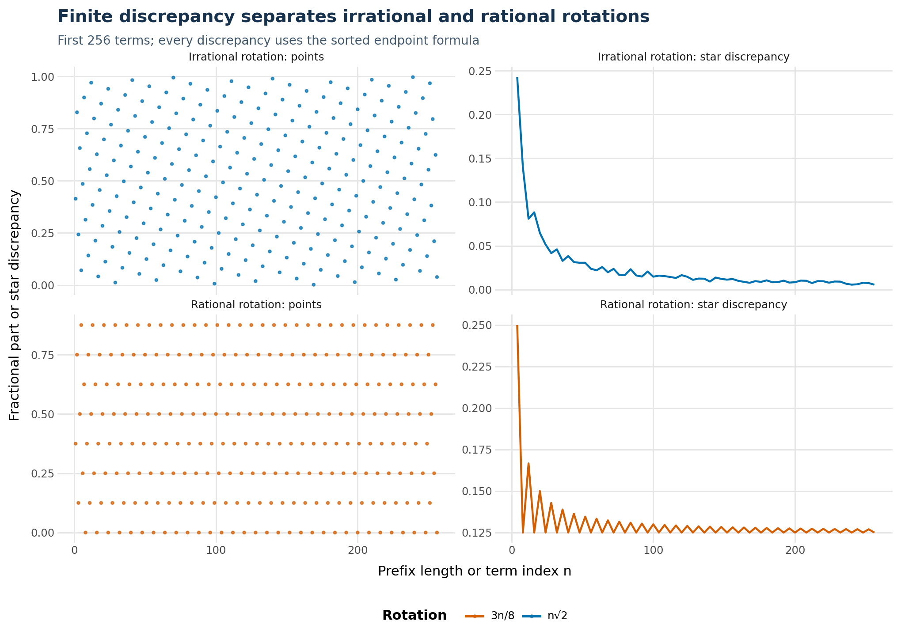

# Exponential Sums, Equidistribution, and Cancellation {#sec-exponential-sums}

**Level and prerequisites: L5.** Prepare finite characters, Fourier orthogonality, analytic estimates and equidistribution. Use the [level-specific reading guide](index.md#who-this-book-is-for) for linked Euler preparation.

How can a sum of $N$ complex numbers, each of absolute value one, have size
closer to $\sqrt N$ than to $N$? The answer is cancellation: phases pointing in
different directions partially erase one another. That geometric observation
becomes an arithmetic method when the phases encode congruences, polynomial
values, or multiplicative characters.

This chapter supplies the cancellation toolkit used implicitly in the
circle-method vista of [sec-additive](16-additive.md#sec-additive), the character sums of [sec-l-functions](27-l-functions.md#sec-l-functions),
and the finite Fourier analysis of [sec-additive-combinatorics](33-additive-combinatorics.md#sec-additive-combinatorics). By the end you
should be able to distinguish complete from incomplete sums, prove
equidistribution of an irrational rotation, derive the square-root magnitude
of a quadratic Gauss sum, use differencing responsibly, and audit whether a
quoted estimate is strong enough for an application.

## Preparation from this book

The shortest route is congruence arithmetic in [sec-congruence](04-congruence.md#sec-congruence), arithmetic
functions in [sec-functions](07-functions.md#sec-functions), rational approximation in [sec-fractions](09-fractions.md#sec-fractions), and
additive characters in [sec-additive](16-additive.md#sec-additive). For the applications, [sec-analytic-depth](21-analytic-depth.md#sec-analytic-depth)
supplies summation notation, [sec-finite-fields](23-finite-fields.md#sec-finite-fields) supplies finite-field language,
[sec-l-functions](27-l-functions.md#sec-l-functions) supplies Dirichlet characters, and
[sec-additive-combinatorics](33-additive-combinatorics.md#sec-additive-combinatorics) supplies convolution and Parseval. The repair kit
below makes those later chapters helpful rather than compulsory.

Write

$$
e(t)=\exp(2\pi i t),
\qquad
e_q(a)=e(a/q).
$$

The identity $e(t+1)=e(t)$ means that $e_q(a)$ depends only on $a$ modulo
$q$. The fractional part is $\{x\}=x-\lfloor x\rfloor\in[0,1)$, and

$$
\lVert x\rVert=\min_{m\in\mathbb Z}|x-m|
$$

is the distance to the nearest integer. Averages are written

$$
\mathbb E_{n\le N}a_n=\frac1N\sum_{n=1}^{N}a_n.
$$

No probability is implied by this notation. It is a finite normalized sum.

For $h\in\mathbb Z$, the function $x\mapsto e(hx)$ is an additive character
of $\mathbb R/\mathbb Z$. For $h\bmod q$, the function
$x\mapsto e_q(hx)$ is an additive character of $\mathbb Z/q\mathbb Z$.
The basic orthogonality identity is

<div id="eq-additive-orthogonality" class="equation">

$$
\sum_{x\bmod q}e_q(hx)
= \begin{cases}
q,&q\mid h,\\
0,&q\nmid h.
\end{cases} \tag{37.1}
$$

</div>

When $q\nmid h$, this is a geometric series with ratio not equal to one and
with $q$th power equal to one.

## Complete and incomplete sums

An exponential sum has the form

$$
S=\sum_{n\in I}a_n e(f(n)),
$$

where the coefficients $a_n$ and phase $f(n)$ record arithmetic data. A sum
over every residue modulo $q$ is **complete**; a sum restricted to an interval
or subset is **incomplete**. Completion is not cosmetic. Orthogonality often
evaluates a complete sum exactly, while a sharp incomplete estimate may
require Fourier expansion of the cutoff and lose a logarithmic factor.

The triangle inequality gives the **trivial bound**

$$
|S|\le\sum_{n\in I}|a_n|.
$$

If $|a_n|=1$, this is $|S|\le |I|$. A smaller bound demonstrates
cancellation. The phrase **square-root cancellation** usually means a scale
comparable to $|I|^{1/2}$, perhaps multiplied by powers of logarithms. It is a
description, not an automatic theorem.

Consider two nonexamples. If $f(n)$ is always an integer, every term equals
one and there is no cancellation. If $f(n)=\alpha n$ with $\alpha$ extremely
close to an integer on the scale $1/N$, the first $N$ phases occupy a short arc
and the sum can again have order $N$. Oscillation must be quantitative relative
to the summation length.

## Discrepancy and equidistribution

A sequence $(x_n)$ is **equidistributed modulo one** when, for every interval
$[a,b)\subseteq[0,1)$,

$$
\frac1N\#\{1\le n\le N:\{x_n\}\in[a,b)\}\longrightarrow b-a.
$$

Equidistribution asks whether the empirical mass of every interval tends to
its length. It does not say successive points are independent, random, or
even irregular.

For finite data, the star discrepancy is

$$
D_N^*=\sup_{0\le t\le1}
\left|
\frac1N\#\{n\le N:\{x_n\}<t\}-t
\right|.
$$

If the sorted fractional parts are $0\le y_1\le\cdots\le y_N<1$, then

<div id="eq-star-discrepancy" class="equation">

$$
D_N^*=\max_{1\le j\le N}
\max\left(\frac jN-y_j,\ y_j-\frac{j-1}{N}\right). \tag{37.2}
$$

</div>

Thus the supremum is exactly computable from finitely many endpoints. Vanishing
star discrepancy implies equidistribution; ordinary interval discrepancy is at
most twice the star discrepancy.

If $\alpha=a/q$ is rational, the sequence $n\alpha$ visits at most $q$
locations, so it is not equidistributed in the continuous circle. This is an
important nonexample: the locations may look evenly spaced, but a sufficiently
small interval between them has empirical mass zero forever. The irrational
case is fundamentally different.

## Exact endpoints and the sharp finite lower bound {#sec-nt-exact-discrepancy}

The endpoint formula involves **both sides** of the empirical distribution's
jumps. Write $F_N(t)=N^{-1}\#\{j:y_j<t\}$, using the strict inequality in
the definition. Between consecutive distinct sample values, $F_N$ is constant
and $F_N(t)-t$ is affine, so the supremum of its absolute value comes from
endpoints or their one-sided limits.

If a value $a$ occurs in sorted positions $r,\ldots,s$, then
$F_N(a)=(r-1)/N$, while the limit from the right is $s/N$. The two possible
largest deviations at this jump are therefore
$a-(r-1)/N$ and $s/N-a$. The intermediate indices at a tie give no larger
value, so [Equation 37.2](#eq-star-discrepancy) remains valid with repeated points. A point
at zero contributes its jump through the right limit; at one the empirical
mass is one and the deviation is zero. For example, if every sample is zero,
$D_N^*=1$ is approached as $t$ decreases to zero from above, even though
the deviation at $t=0$ itself is zero. The definition is a supremum, not
necessarily a value attained at a sample endpoint.

For each index $j$, the two quantities inside the endpoint maximum sum to
$1/N$. More precisely,

$$
\max\left(\frac jN-y_j,\ y_j-\frac{j-1}{N}\right)
=\frac1{2N}+\left|y_j-\frac{2j-1}{2N}\right|.
$$

Consequently

<div id="eq-sharp-star-discrepancy" class="equation">

$$
D_N^*=\frac1{2N}
+\max_{1\le j\le N}\left|y_j-\frac{2j-1}{2N}\right|
\ge\frac1{2N}. \tag{37.3}
$$

</div>

Equality holds exactly when every sorted point is the corresponding cell
midpoint $y_j=(2j-1)/(2N)$. Thus $1/(2N)$ is the sharp universal lower
bound; $1/N$ is not a valid lower bound. The four points
$1/8,3/8,5/8,7/8$ have discrepancy $1/8$, smaller than $1/4$.
The equivalent midpoint formula appears in
[Christian Weiß, Lemma 3.2](https://link.springer.com/article/10.1007/s00010-023-00958-x).
The preceding argument proves the result directly under this chapter's
endpoint convention.

### Exact rational certificates, including ties and zero

This standalone function uses exact fractions. Inputs are a nonempty tuple
of integers or `Fraction` values already in $[0,1)$; it does not silently
wrap invalid coordinates or convert floating approximations into exact data.
In particular, floats, NaN, infinity, and Boolean values are rejected as
unsupported types. The sorted endpoint formula gives a finite certificate
for these rational data, including ties.

```python
from fractions import Fraction

def exact_star_discrepancy(points: tuple[int | Fraction, ...]) -> Fraction:
    """Return exact anchored discrepancy of rational points in [0, 1)."""
    if type(points) is not tuple:
        raise TypeError("points must be a tuple")
    if not points:
        raise ValueError("at least one point is required")
    if any(type(value) not in (int, Fraction) for value in points):
        raise TypeError("use integers or Fraction values, excluding bool")
    ordered = sorted(Fraction(value) for value in points)
    if ordered[0] < 0 or ordered[-1] >= 1:
        raise ValueError("points must already lie in [0, 1)")
    count = len(ordered)
    return max(
        max(Fraction(index, count) - value, value - Fraction(index - 1, count))
        for index, value in enumerate(ordered, start=1)
    )

midpoints = tuple(Fraction(2 * index - 1, 8) for index in range(1, 5))
shifted_six = tuple((Fraction(index) + Fraction(1, 3)) / 6 for index in range(6))
print(exact_star_discrepancy(midpoints), exact_star_discrepancy(shifted_six))
```

The outputs are $1/8$ and $1/9$. To check the listing independently, count
the fractions strictly below each distinct value and count those at most
that value for its right limit. Taking the largest absolute deviation in
these two lists, together with the boundary values, must give the same
answer. This oracle uses empirical counts rather than sorted-index formulas.

### Changed task: shifting an equally spaced grid {#sec-nt-discrepancy-task}

For $N\ge1$ and $0\le\theta<1$, put

$$
y_j=\frac{j-1+\theta}{N},\qquad 1\le j\le N.
$$

Find its star discrepancy as a function of $\theta$, and identify the
unique phase attaining the finite minimum. Every such grid has the same
circular gap lengths; explain why its anchored discrepancy still changes.
For $N=6$ and $\theta=1/3$, list all points and compute the discrepancy,
their mean, and the signed equal-weight quadrature error for $f(x)=x$
against $\int_0^1x\,dx$. Exclude $\theta=1$: it would put the last point
at one, outside the declared input convention.

Finally, compute the discrepancy of the first $8m$ terms of $3n/8$ for
every $m\ge1$. Why does selecting an optimal finite grid separately for
each $N$ say nothing by itself about prefixes of this one fixed sequence?
The [separate explanation](#sec-nt-discrepancy-solution) gives the phase
formula, exact six-point values, and repeated-rotation calculation.

## Weyl's criterion and a complete linear proof

**Weyl's criterion.** A real sequence $(x_n)$ is equidistributed modulo one if
and only if, for every nonzero integer $h$,

<div id="eq-weyl-criterion" class="equation">

$$
\frac1N\sum_{n=1}^{N}e(hx_n)\longrightarrow0. \tag{37.4}
$$

</div>

The easy direction tests the sequence against the continuous function
$e(hx)$, whose integral over $[0,1]$ is zero. The converse approximates interval
indicators from above and below by trigonometric polynomials. The approximation
step is where one must handle discontinuous endpoints; simply saying that an
indicator has a Fourier series is not enough for uniform control.

We now prove the central linear case completely. Let $\alpha$ be irrational
and fix $h\ne0$. The ratio $z=e(h\alpha)$ is not one, for otherwise
$h\alpha\in\mathbb Z$ and $\alpha$ would be rational. Therefore

$$
\sum_{n=1}^{N}e(hn\alpha)
=z\frac{1-z^N}{1-z}.
$$

Since $|1-z^N|\le2$,

$$
\left|\frac1N\sum_{n=1}^{N}e(hn\alpha)\right|
\le\frac{2}{N|1-e(h\alpha)|}
\longrightarrow0.
$$

Weyl's criterion now shows that $(n\alpha)$ is equidistributed modulo one.
The denominator depends on the fixed frequency $h$. This proof does not give a
uniform bound for frequencies growing with $N$; quantitative discrepancy needs
additional Diophantine information about $\alpha$.

## Exact linear-phase bounds

For any real $\theta\notin\mathbb Z$,

$$
\sum_{n=M+1}^{M+N}e(n\theta)
=e((M+1)\theta)\frac{1-e(N\theta)}{1-e(\theta)}.
$$

The elementary comparison

$$
2\lVert\theta\rVert
\le |\sin(\pi\theta)|
\le\pi\lVert\theta\rVert
$$

for $\lVert\theta\rVert\le1/2$, together with
$|1-e(\theta)|=2|\sin(\pi\theta)|$, yields

<div id="eq-linear-phase-bound" class="equation">

$$
\left|\sum_{n=M+1}^{M+N}e(n\theta)\right|
\le \min\left(N,\frac{1}{2\lVert\theta\rVert}\right). \tag{37.5}
$$

</div>

The minimum records two regimes. Far from an integer, angular motion forces
cancellation. Near an integer, the trivial bound may be better. Major-arc and
minor-arc decompositions in the circle method systematise precisely this
distinction.

## Van der Corput differencing

For a sequence $z_1,\ldots,z_N$ with $|z_n|\le1$, differencing replaces the
original sum by shifted correlations $z_{n+h}\overline{z_n}$. One useful form
is the following.

**Van der Corput inequality.** If $1\le H\le N$, then

<div id="eq-vdc" class="equation">

$$
\left|\sum_{n=1}^{N}z_n\right|^2
\le
\frac{N+H}{H}
\left(
N+2\sum_{h=1}^{H-1}
\left|\sum_{n=1}^{N-h}z_{n+h}\overline{z_n}\right|
\right). \tag{37.6}
$$

</div>

Here is the mechanism. Extend $z_n$ by zero outside $1\le n\le N$ and write
each $z_n$ approximately $H$ times in

$$
H\sum_nz_n=\sum_n\sum_{h=0}^{H-1}z_{n+h}
$$

up to boundary terms. Cauchy–Schwarz bounds the square by the number of outer
indices times the sum of squared inner sums. Expanding those squares groups
terms by the difference between two shifts. The diagonal contributes $HN$;
the two orientations of a positive difference give the factor two. Dividing
by $H^2$ and slightly enlarging the boundary contribution gives
[Equation 37.6](#eq-vdc).

For $z_n=e(f(n))$, the correlation phase is
$f(n+h)-f(n)$. A degree-$d$ polynomial becomes degree $d-1$. Repeated
differencing eventually reduces a polynomial phase to the linear estimate
[Equation 37.5](#eq-linear-phase-bound). The price is that each Cauchy–Schwarz step weakens the
exponent and introduces a parameter that must be chosen. “Apply van der
Corput” is not a complete estimate until $H$ and every rational-approximation
hypothesis are stated.

For $f(n)=\alpha n^2$, one difference is

$$
f(n+h)-f(n)=2\alpha hn+\alpha h^2,
$$

so each correlation is a linear phase. If $\alpha$ is close to $a/q$, the
quality and denominator of that approximation control how often
$2\alpha h$ lies near an integer. This is the elementary spine of Weyl's
inequality for quadratic sums.

## Fourier completion and quantitative discrepancy

Finite Fourier inversion explains both the power and the cost of replacing an
incomplete sum by complete sums. For a function
$F:\mathbb Z/q\mathbb Z\to\mathbb C$, choose the normalization

$$
\widehat F(h)=\sum_{x\bmod q}F(x)e_q(-hx).
$$

Then orthogonality gives

$$
F(x)=\frac1q\sum_{h\bmod q}\widehat F(h)e_q(hx)
$$

and Parseval gives

$$
\sum_{x\bmod q}|F(x)|^2
=\frac1q\sum_{h\bmod q}|\widehat F(h)|^2.
$$

The factors of $q$ change if one normalises the transform differently. There
is no universally correct convention, but mixing conventions produces false
estimates.

Let $I=\{M+1,\ldots,M+N\}$ modulo $q$, with $N\le q$, and let
$1_I$ be its indicator. For any periodic sequence $a(x)$,

<div id="eq-fourier-completion" class="equation">

$$
\sum_{x\in I}a(x)
=\frac1q\sum_{h\bmod q}
\widehat {1_I}(h)
\sum_{x\bmod q}a(x)e_q(hx). \tag{37.7}
$$

</div>

The inner expression is now a complete twisted sum. The zero-frequency
coefficient is $\widehat {1_I}(0)=N$. For $h\ne0$, the geometric-series bound
gives

$$
|\widehat {1_I}(h)|
\le \min\left(N,\frac{1}{2\lVert h/q\rVert}\right).
$$

Pairing $h$ with $q-h$ and summing the harmonic tail shows

$$
\sum_{h\bmod q}|\widehat {1_I}(h)|\ll q\log(2q).
$$

Consequently, a uniform bound $B$ for all nonzero complete twists in
[Equation 37.7](#eq-fourier-completion) normally gives an incomplete bound of scale
$B\log q$, plus the zero-frequency contribution. This is the elementary
architecture behind completion arguments such as Pólya–Vinogradov. The
logarithm is not mysterious: it is the total Fourier mass of a sharp interval
cutoff. Smoother weights have faster-decaying transforms and may reduce that
cost.

There is a parallel bridge from exponential sums back to discrepancy.
One version of the **Erdős–Turán inequality** says that for points
$x_1,\ldots,x_N$ and an integer $H\ge1$,

<div id="eq-erdos-turan" class="equation">

$$
D_N^*
\le C\left(
\frac1{H+1}
+\sum_{h=1}^{H}
\frac1h
\left|\frac1N\sum_{n=1}^{N}e(hx_n)\right|
\right), \tag{37.8}
$$

</div>

where $C$ is an absolute constant. We quote the trigonometric majorant needed
for this exact inequality, but its logic is transparent. Low frequencies test
large-scale unevenness, the factors $1/h$ reflect Fourier coefficients of an
interval, and $1/(H+1)$ measures the unresolved fine scale.

The inequality also clarifies Weyl's criterion. If every fixed nonzero
frequency average tends to zero, first hold $H$ fixed and let $N$ tend to
infinity. The finite sum disappears. Then let $H$ tend to infinity, making the
remaining reciprocal term vanish. Reversing those two limits without a bound
uniform in $h$ would be invalid.

**Completion nonexample.** Suppose one knows a strong estimate only for the
untwisted complete sum $\sum_xa(x)$, not for
$\sum_xa(x)e_q(hx)$ at every $h$. Formula [Equation 37.7](#eq-fourier-completion) does not then
control an interval sum: the interval indicator activates all frequencies.
One exact cancellation identity at frequency zero is not a substitute for a
uniform family of twisted estimates.

As a normalization check, take $q=4$ and let $F$ be the indicator of
$I=\{0,1\}$. Direct calculation gives

$$
\widehat F(0)=2,\quad
\widehat F(1)=1-i,\quad
\widehat F(2)=0,\quad
\widehat F(3)=1+i.
$$

At $x=1$, inversion returns

$$
\frac14\left(2+(1-i)i+(1+i)(-i)\right)=1.
$$

At $x=2$, it returns zero. Parseval also checks the scale:

$$
|2|^2+|1-i|^2+0+|1+i|^2=8
=4\sum_x|F(x)|^2.
$$

The transform and inverse can be kept in one finite convention check.  The
complex exponential signs below match the displayed forward and inverse
formulas exactly.

```python
from cmath import exp
from math import isclose, isfinite, tau

def finite_fourier(values: list[complex]) -> list[complex]:
    """Return the unnormalized finite Fourier transform on Z/qZ."""
    if not values:
        raise ValueError("provide at least one residue value")
    if any(
        not isfinite(value.real) or not isfinite(value.imag) for value in values
    ):
        raise ValueError("Fourier values must have finite real and imaginary parts")
    modulus = len(values)
    return [
        sum(
            value * exp(-1j * tau * frequency * residue / modulus)
            for residue, value in enumerate(values)
        )
        for frequency in range(modulus)
    ]

def inverse_finite_fourier(transform: list[complex]) -> list[complex]:
    """Invert the unnormalized finite Fourier transform."""
    if not transform:
        raise ValueError("provide at least one transform coefficient")
    if any(
        not isfinite(value.real) or not isfinite(value.imag) for value in transform
    ):
        raise ValueError("transform values must be finite")
    modulus = len(transform)
    return [
        sum(
            coefficient * exp(1j * tau * frequency * residue / modulus)
            for frequency, coefficient in enumerate(transform)
        )
        / modulus
        for residue in range(modulus)
    ]

indicator = [1.0 + 0.0j, 1.0 + 0.0j, 0.0j, 0.0j]
transform = finite_fourier(indicator)
recovered = inverse_finite_fourier(transform)
parseval_left = sum(abs(value) ** 2 for value in indicator)
parseval_right = sum(abs(value) ** 2 for value in transform) / len(indicator)
if not isclose(parseval_left, parseval_right, abs_tol=1e-12):
    raise RuntimeError("Parseval normalization failed")
print(transform)
print(recovered)
```

The values reproduce $(2,1-i,0,1+i)$ and recover the interval indicator up to
roundoff.  This audits the finite normalization; it does not prove the
completion or discrepancy inequalities that use the transform.

This four-point example is small, but it is an effective audit whenever a
longer computation seems to gain or lose a factor of $q$. It also demonstrates
why complex conjugation belongs in the inverse sign convention. Omitting it
may accidentally work for real symmetric data while failing on a translated
interval.

## Quadratic Gauss sums: the square-root derivation

Let $p$ be an odd prime and $p\nmid a$. Define

$$
G(a;p)=\sum_{x\bmod p}e_p(ax^2).
$$

We prove its magnitude without quoting quadratic reciprocity. Complex
conjugation changes the sign of the phase, so

$$
|G(a;p)|^2
=\sum_{x,y\bmod p}e_p\bigl(a(x^2-y^2)\bigr).
$$

Because $p$ is odd, $2$ is invertible modulo $p$. The change of variables

$$
u=x-y,
\qquad
v=x+y
$$

is therefore a bijection on pairs modulo $p$, with inverse
$x=(u+v)/2$ and $y=(v-u)/2$. Since $x^2-y^2=uv$,

$$
|G(a;p)|^2
=\sum_{u\bmod p}\sum_{v\bmod p}e_p(auv).
$$

For $u=0$, the inner sum is $p$. For every $u\ne0$, the coefficient $au$ is
nonzero modulo $p$, so additive orthogonality [Equation 37.1](#eq-additive-orthogonality) makes
the inner sum zero. Consequently

<div id="eq-gauss-magnitude" class="equation">

$$
|G(a;p)|^2=p,
\qquad
|G(a;p)|=\sqrt p. \tag{37.9}
$$

</div>

The formula translates directly into a finite computation:

```python
from cmath import exp, pi
from math import isqrt, sqrt

def is_odd_prime(number: int) -> bool:
    """Return whether number is an odd prime by exact trial division."""
    return number > 2 and all(
        number % divisor != 0 for divisor in range(2, isqrt(number) + 1)
    )

def quadratic_gauss_sum(prime_modulus: int, coefficient: int) -> complex:
    """Return sum exp(2*pi*i*a*x^2/p) over residues x modulo an odd prime."""
    if not is_odd_prime(prime_modulus):
        raise ValueError("prime_modulus must be an odd prime")
    if coefficient % prime_modulus == 0:
        raise ValueError("coefficient must be nonzero modulo the prime")
    return sum(
        exp(2j * pi * coefficient * residue**2 / prime_modulus)
        for residue in range(prime_modulus)
    )

gauss_sum = quadratic_gauss_sum(prime_modulus=29, coefficient=3)
print(abs(gauss_sum), sqrt(29), abs(abs(gauss_sum) - sqrt(29)))
```

Floating complex arithmetic leaves a tiny rounding error, so the last number
should be close to zero rather than exactly zero. The preceding change-of-
variables proof, not the floating output, establishes the identity for every
odd prime.

Every hypothesis has a role. If $p\mid a$, all terms are one and the magnitude
is $p$. If the modulus is even, the displayed change of variables is not
bijective. Determining the phase of $G(a;p)$, not merely its magnitude, requires
additional information: one obtains a Legendre-symbol factor and a fourth root
of unity depending on $p\bmod4$.

As a finite Fourier application, let
$r(t)=\#\{(x,y)\bmod p:x^2+y^2=t\}$. Orthogonality gives the exact identity

$$
r(t)=\frac1p\sum_{h\bmod p}e_p(-ht)G(h;p)^2.
$$

The $h=0$ term contributes $p$. The remaining terms have absolute value one
after division by $p$, by [Equation 37.9](#eq-gauss-magnitude). Thus the elementary magnitude
argument alone proves $|r(t)-p|\le p-1$. A sharper exact formula needs the
phase that we deliberately did not derive. This is a useful scope lesson:
knowing the size of every Fourier coefficient need not determine their signed
sum.

## Character and Kloosterman boundaries

For a nonprincipal Dirichlet character $\chi\bmod q$, complete orthogonality
gives $\sum_{a\bmod q}\chi(a)=0$. The incomplete partial sums

$$
S(M,N;\chi)=\sum_{M<n\le M+N}\chi(n)
$$

are harder. The Pólya–Vinogradov theorem gives, uniformly in $M,N$ for a
primitive character, a bound of scale $\sqrt q\log q$. Burgess's theorem can
beat this in shorter ranges, at the cost of a subtler exponent and proof.
These results are **quoted theorems** here; Chapter 27 supplies the character
language but not their complete proofs.

A Kloosterman sum is

$$
K(a,b;p)=\sum_{x\in\mathbb F_p^\times}e_p(ax+bx^{-1}).
$$

There is genuine two-sided oscillation because inversion is nonlinear. Weil's
bound

$$
|K(a,b;p)|\le2\sqrt p
$$

when $ab\ne0$ is another **quoted theorem**. The constant and hypotheses
matter. The bound is not an application of the triangle inequality, and its
deep proof is connected to the finite-field curve ideas in [sec-curve-zeta](39-curve-zeta.md#sec-curve-zeta).

## Reproducible discrepancy case study

The figure uses no random data. For $1\le n\le256$, it computes the fractional
parts of $n\sqrt2$ and $3n/8$. For each prefix length, it sorts the points and
uses [Equation 37.2](#eq-star-discrepancy) exactly up to floating evaluation of $\sqrt2$; the
rational sequence is evaluated from integer residues.

<figure id="fig-weyl-discrepancy">


<figcaption>

Figure 37.1: An irrational rotation spreads through the unit interval while a rational rotation repeats eight locations; the lower panel compares their exact finite star discrepancies.

</figcaption>
</figure>

[Figure 37.1](#fig-weyl-discrepancy) shows two distinct facts. The rational orbit repeats a
finite pattern, so gaps remain permanently. The irrational orbit fills the
strip more evenly and its displayed discrepancy falls. The second observation
is finite evidence, not a proof: the proof is the geometric-series argument and
Weyl's criterion. Nor does the plot supply an optimal rate; that rate depends
on continued-fraction approximations to $\sqrt2$.

The data record is reproducible from three declarations: the two rotations,
the prefix range $1\le N\le256$, and the endpoint formula
[Equation 37.2](#eq-star-discrepancy). Rounding is used only to draw the irrational coordinates;
the theorem is not tested by asking whether a computed decimal is exactly
zero. A robust implementation sorts each prefix independently or updates a
documented ordered structure, checks that every coordinate lies in $[0,1)$,
and verifies the discrepancy is between $1/(2N)$ and one, using the
[sharp finite bound](#sec-nt-exact-discrepancy). Those elementary
invariants catch endpoint and off-by-one errors that an attractive plot can
hide.
This audit is deterministic and independently repeatable.

## Theorem-scope ledger

- **Proved here:** additive orthogonality, irrational linear equidistribution,
  the linear-phase estimate, the mechanism of van der Corput differencing, and
  the magnitude of quadratic Gauss sums.
- **Used with proof architecture:** Weyl's criterion and the displayed van der
  Corput inequality.
- **Quoted:** quantitative polynomial Weyl bounds, Pólya–Vinogradov, Burgess,
  and Weil's Kloosterman estimate.
- **Not inferred from plots:** asymptotic equidistribution, an optimal
  discrepancy rate, or square-root cancellation for a new family of sums.

The next connection is from these estimates back to the circle method in
[sec-additive](16-additive.md#sec-additive) and sieve remainders in [sec-sieve-methods](32-sieve-methods.md#sec-sieve-methods). Geometrically,
Kloosterman and character sums lead forward to Frobenius and curve zeta
functions in [sec-curve-zeta](39-curve-zeta.md#sec-curve-zeta).

One final audit principle applies across all these estimates. The modulus,
summation length, coefficient bound, and uniformity range are part of a
theorem, not annotations added after the proof. A bound valid for each fixed
modulus may be useless when the modulus grows with $N$; a constant depending
on the phase may conceal that failure. Before inserting an estimate into
another argument, write every varying parameter over the inequality and list
which constants may depend on fixed data.

<!-- inline-formula-code:start -->
## Formula and finite computation

A useful formula in this chapter is

$$
S(a;p)=\sum_{n=0}^{p-1}e^{2\pi ian/p}
$$

Complex arithmetic evaluates the complete finite sum and exposes cancellation. The following standalone Python block expresses that finite rule with its inputs and stopping conditions visible.

```python
from cmath import exp, pi

def complete_linear_sum(modulus: int, coefficient: int) -> complex:
    """Return the complete additive-character sum modulo modulus."""
    if modulus <= 1:
        raise ValueError("modulus must exceed one")
    return sum(
        exp(2j * pi * coefficient * residue / modulus)
        for residue in range(modulus)
    )

total = complete_linear_sum(modulus=17, coefficient=3)
print(total, abs(total))
```

**What the computation establishes.** The output certifies only the declared finite case. The theorem, if one is claimed, still requires the argument developed in the chapter.
<!-- inline-formula-code:end -->

## Summary and vocabulary

An additive character converts congruence conditions into oscillation.
Complete sums often yield to orthogonality; incomplete sums require control of
cutoffs. Weyl's criterion converts equidistribution into cancellation at every
fixed nonzero frequency. Van der Corput differencing lowers polynomial degree.
Quadratic Gauss sums exhibit exact square-root magnitude, but deeper character
and Kloosterman bounds require correspondingly deeper theorems.

Key terms are **additive character**, **complete sum**, **incomplete sum**,
**discrepancy**, **equidistribution**, **Weyl criterion**, **differencing**,
**Gauss sum**, and **Kloosterman sum**.

## Exercises

<div class="exercise" id="number_theory-37-exponential-sums-ex-1">
<p class="exercise-title"><strong>Exercise 1</strong></p>

Prove additive orthogonality [Equation 37.1](#eq-additive-orthogonality) directly as a
geometric series, including the case $q\mid h$.

</div>

<div class="exercise" id="number_theory-37-exponential-sums-ex-2">
<p class="exercise-title"><strong>Exercise 2</strong></p>

Evaluate $\sum_{n=1}^{20}e(n/5)$ without calculating decimal sines or
cosines.

</div>

<div class="exercise" id="number_theory-37-exponential-sums-ex-3">
<p class="exercise-title"><strong>Exercise 3</strong></p>

Show that $n/7$ is not equidistributed modulo one by choosing an interval
containing none of its seven possible fractional parts.

</div>

<div class="exercise" id="number_theory-37-exponential-sums-ex-4">
<p class="exercise-title"><strong>Exercise 4</strong></p>

Prove that deleting or changing finitely many terms does not affect
equidistribution.

</div>

<div class="exercise" id="number_theory-37-exponential-sums-ex-5">
<p class="exercise-title"><strong>Exercise 5</strong></p>

Use the geometric-series proof to show that $n\alpha+\beta$ is
equidistributed whenever $\alpha$ is irrational.

<details class="hint"><summary>Hint 1</summary>

the factor $e(h\beta)$ has absolute value one, so only the
  geometric sum in $n\alpha$ controls the normalized average.

</details>

</div>

<div class="exercise" id="number_theory-37-exponential-sums-ex-6">
<p class="exercise-title"><strong>Exercise 6</strong></p>

Compute $D_N^*$ from [Equation 37.2](#eq-star-discrepancy) for the points
$0,1/4,1/2,3/4$.

</div>

<div class="exercise" id="number_theory-37-exponential-sums-ex-7">
<p class="exercise-title"><strong>Exercise 7</strong></p>

Derive [Equation 37.5](#eq-linear-phase-bound), with an explicit argument for the case
$\theta\in\mathbb Z$.

</div>

<div class="exercise" id="number_theory-37-exponential-sums-ex-8">
<p class="exercise-title"><strong>Exercise 8</strong></p>

For $f(n)=\alpha n^3$, calculate the first and second finite differences
and identify their degrees.

<details class="hint"><summary>Hint 1</summary>

one finite difference of a cubic is quadratic; a second is
  linear. Keep the constant terms even though they do not affect magnitude.

</details>

</div>

<div class="exercise" id="number_theory-37-exponential-sums-ex-9">
<p class="exercise-title"><strong>Exercise 9</strong></p>

Compute $G(1;5)$ exactly enough to verify both its real-imaginary form and
its magnitude.

</div>

<div class="exercise" id="number_theory-37-exponential-sums-ex-10">
<p class="exercise-title"><strong>Exercise 10</strong></p>

Identify the failed step if the Gauss-sum proof is attempted modulo $8$.

</div>

<div class="exercise" id="number_theory-37-exponential-sums-ex-11">
<p class="exercise-title"><strong>Exercise 11</strong></p>

Use orthogonality to express the number of solutions of
$x^2+y^2=t\pmod p$ as a sum over $h$.

<details class="hint"><summary>Hint 1</summary>

insert
  $p^{-1}\sum_h e_p(h(x^2+y^2-t))$ as the indicator of the congruence.

</details>

</div>

<div class="exercise" id="number_theory-37-exponential-sums-ex-12">
<p class="exercise-title"><strong>Exercise 12</strong></p>

Design a finite cancellation audit for
$\sum_{n\le N}e(\sqrt2n^2)$: report $N$, the normalization, and which
universal claim the computation cannot establish.

</div>

<div class="exercise" id="number_theory-37-exponential-sums-ex-13">
<p class="exercise-title"><strong>Exercise 13</strong></p>

Solve the [shifted-grid discrepancy task](#sec-nt-discrepancy-task),
including its exact linear quadrature error and repeated rational orbit.

</div>

## Selected solutions

### Changed-task explanation: phase and anchored discrepancy {#sec-nt-discrepancy-solution}

For the shifted grid, the two deviations at index $j$ are independent of $j$:

$$
\frac jN-y_j=\frac{1-\theta}{N},\qquad
y_j-\frac{j-1}{N}=\frac\theta N.
$$

Therefore $D_N^*=\max(\theta,1-\theta)/N$, with unique minimum $1/(2N)$
at $\theta=1/2$. Circular gaps ignore a common rotation; the initial
intervals $[0,t)$ defining star discrepancy retain their anchor at zero.

For $N=6$, $\theta=1/3$, the points are

$$
\frac1{18},\ \frac29,\ \frac7{18},\ \frac59,\ \frac{13}{18},\ \frac89.
$$

Their two deviations are $1/9$ and $1/18$, so their discrepancy is $1/9$.
In general their mean is

$$
\frac1N\sum_{j=1}^Ny_j
=\frac12+\frac{\theta-1/2}{N}.
$$

The six-point mean is $17/36$. Since $\int_0^1x\,dx=1/2$, the signed
quadrature error is $-1/36$, whose magnitude is below $D_6^*=1/9$ in this
example. The linear-error calculation is exact; it does not assert that
discrepancy equals integration error for every function.

Multiplication by three permutes residues modulo eight. In the first $8m$
terms of $3n/8$, each of $0,1/8,\ldots,7/8$ occurs $m$ times. The
empirical distribution is the same for all $m$, so its star discrepancy is
$1/8$. Directly, at a repeated value $k/8$, the first tied index gives
negative-side deviation zero and the last gives positive-side deviation
$1/8$. The endpoint formula therefore has maximum $1/8$.

The midpoint optimum concerns a freely selected $N$-point set. Repeating
eight fixed locations does not produce that optimum as $N$ grows, and its
discrepancy does not tend to zero. This exact calculation agrees with the
chapter's separate proof that a rational rotation is not equidistributed.

**Solution to Exercise 3.** The fractional parts of $n/7$ belong to
$\{0,1/7,\ldots,6/7\}$. Choose, for example,
$I=(1/14,1/10)$. This interval has positive length but contains none of those
seven points. Its empirical frequency is therefore zero for every $N$, whereas
equidistribution would require the limit to equal $|I|>0$. Even spacing on a
finite grid is not continuous equidistribution.

**Solution to Exercise 6.** In sorted order the points are
$y_j=(j-1)/4$ for $j=1,2,3,4$. The two one-sided deviations are

$$
\frac j4-y_j=\frac14,
\qquad
y_j-\frac{j-1}{4}=0.
$$

Their maximum is $D_4^*=1/4$. The value is not zero because the empirical
distribution jumps by $1/4$ at each sample point; a finite point set cannot
equal continuous length on every initial interval.

**Solution to Exercise 9.** The nonzero squares modulo $5$ are $1$ and $4$,
each attained twice. Hence

$$
G(1;5)=1+2e(1/5)+2e(4/5)
=1+4\cos(2\pi/5).
$$

Using $\cos(2\pi/5)=(\sqrt5-1)/4$ gives $G(1;5)=\sqrt5$. Thus its magnitude
is $\sqrt5$, in agreement with [Equation 37.9](#eq-gauss-magnitude). This exact positive phase
is special to $p=5$; the magnitude proof alone would not determine the sign.
