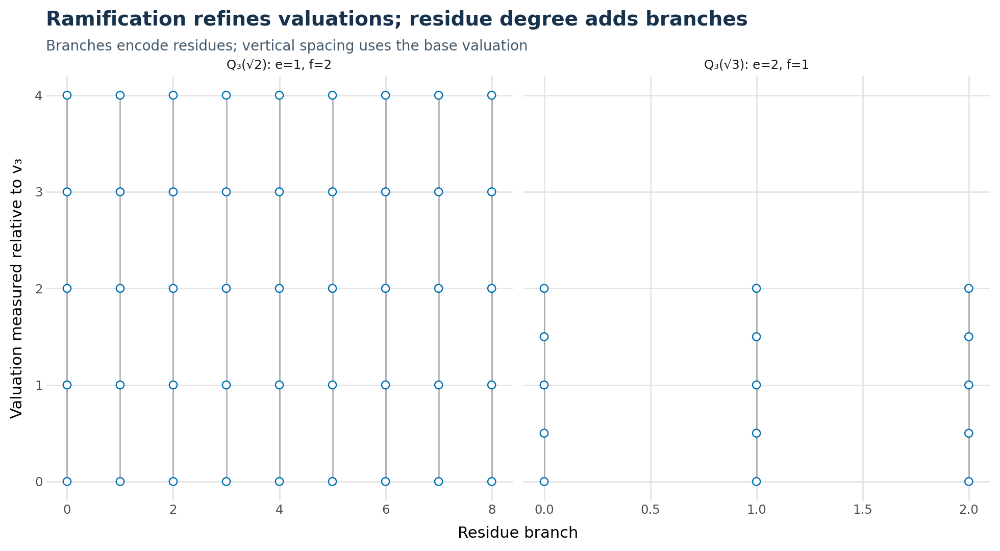

# Local Fields, Ramification, and Norms {#sec-local-fields}

**Level and prerequisites: L5.** Prepare complete discretely valued fields, finite extensions, Galois groups and ramification. Use the [level-specific reading guide](index.md#who-this-book-is-for) for linked Euler preparation.

Over $\mathbb Q_3$, the polynomials $x^2-2$ and $x^2-3$ are both irreducible,
yet the fields obtained by adjoining their roots behave in opposite ways. In
one extension the residue field grows and the value group does not; in the
other the value group grows and the residue field does not. This chapter builds
the language that detects that difference and prepares the norm groups used by
class field theory in [sec-class-field-theory](40-class-field-theory.md#sec-class-field-theory).

The goals are to work with complete discretely valued fields, compute
ramification index and residue degree, recognize unramified and Eisenstein
extensions, calculate local traces, norms, differents, and discriminants, and
separate exact local arithmetic from finite-precision evidence.

## Preparation from this book

Valuations and completions are developed in [sec-local-p-adic](19-local-p-adic.md#sec-local-p-adic). Polynomial
quotients and residue extensions come from [sec-finite-fields](23-finite-fields.md#sec-finite-fields). Rings of
integers and ideal discriminants appear in [sec-ideals-dedekind](24-ideals-dedekind.md#sec-ideals-dedekind), while
[sec-splitting-reciprocity](26-splitting-reciprocity.md#sec-splitting-reciprocity) introduces $e$, $f$, inertia, and Frobenius from a
global viewpoint. Field degrees and automorphisms are repaired in
[sec-galois-symmetry](31-galois-symmetry.md#sec-galois-symmetry). The present chapter puts these ingredients at one fixed
place.

A **discrete valuation** on a field $K$ is a surjective map

$$
v:K^\times\longrightarrow\mathbb Z
$$

such that

$$
v(xy)=v(x)+v(y),
\qquad
v(x+y)\ge\min(v(x),v(y))
$$

when $x+y\ne0$. Set $v(0)=+\infty$. A corresponding absolute value is
$|x|=c^{-v(x)}$ for a fixed $c>1$. The valuation ring, maximal ideal, unit
group, and residue field are

$$
\mathcal O_K=\{x:v(x)\ge0\},\quad
\mathfrak m_K=\{x:v(x)>0\},\quad
\mathcal O_K^\times=\{x:v(x)=0\},\quad
k_K=\mathcal O_K/\mathfrak m_K.
$$

An element $\pi_K$ with $v(\pi_K)=1$ is a **uniformizer**. Every nonzero
$x\in K$ has a unique form $x=\pi_K^nu$ with $n\in\mathbb Z$ and
$u\in\mathcal O_K^\times$.

A **non-Archimedean local field** is a field complete for a discrete valuation
and having finite residue field. The main examples are finite extensions of
$\mathbb Q_p$ and fields $\mathbb F_q((T))$ of Laurent series. The rational
field $\mathbb Q$ with $v_p$ is a nonexample because it is not complete.
The real field is complete but its ordinary absolute value does not arise from
a discrete non-Archimedean valuation. Both conditions matter.

## Finite extensions and the extended valuation

Let $L/K$ be a finite extension of a non-Archimedean local field. The absolute
value on $K$ extends uniquely to $L$. One convenient formula is

$$
|x|_L=|N_{L/K}(x)|_K^{1/[L:K]},
$$

followed by a normalization if integer-valued valuations are desired. The
field $L$ is complete, its valuation ring $\mathcal O_L$ is the integral
closure of $\mathcal O_K$ in $L$, and its residue field $k_L$ is finite.

Uniqueness is special to completeness. Over a noncomplete valued field, an
absolute value may have several extensions corresponding to different primes
above the original place. Globally, that is exactly why a rational prime can
split into several prime ideals. Completing at one chosen prime isolates one
local factor.

The integral closure description is useful computationally. If
$L=K(\alpha)$ and $\alpha$ satisfies a monic polynomial with coefficients in
$\mathcal O_K$, then $\alpha\in\mathcal O_L$. It need not follow that
$\mathcal O_L=\mathcal O_K[\alpha]$; the same order-versus-maximal-order
warning from [sec-explicit-algebraic](36-explicit-algebraic.md#sec-explicit-algebraic) survives locally.

## Ramification index and residue degree

Normalize $v_K(K^\times)=\mathbb Z$ and
$v_L(L^\times)=\mathbb Z$. For $x\in K^\times$ there is an integer $e$ such
that

$$
v_L(x)=e\,v_K(x).
$$

The integer $e=e(L/K)$ is the **ramification index**. Equivalently,
$\mathfrak m_K\mathcal O_L=\mathfrak m_L^e$. The **residue degree** is

$$
f=f(L/K)=[k_L:k_K].
$$

For finite extensions of local fields,

<div id="eq-local-degree" class="equation">

$$
[L:K]=ef. \tag{38.1}
$$

</div>

Here is the dimension count behind the formula. Choose representatives
$u_1,\ldots,u_f\in\mathcal O_L$ whose residues form a basis of $k_L$ over
$k_K$. The $ef$ elements

$$
u_i\pi_L^j,\qquad 1\le i\le f,\quad0\le j<e,
$$

span successive layers of $\mathcal O_L/\pi_K\mathcal O_L$, because
$\pi_K$ is a unit times $\pi_L^e$. Nakayama-style lifting then produces an
$\mathcal O_K$-basis after the appropriate integral argument. This gives the
proof architecture; a complete proof verifies independence and handles the
fractional ideals explicitly.

General valued fields can exhibit a **defect**, making degree larger than the
visible ramification and residue factors. That phenomenon does not occur for
the finite extensions of $\mathbb Q_p$ treated here. Formula [Equation 38.1](#eq-local-degree)
should not be exported without its hypotheses.

An extension is **unramified** when $e=1$ and **totally ramified** when
$e=[L:K]$. It can have both $e>1$ and $f>1$ in larger degree, so these two
extremes do not exhaust all extensions.

### Towers and the unramified–ramified decomposition

For a tower $M/L/K$ of finite local extensions, value-group and residue-field
indices multiply:

$$
e(M/K)=e(M/L)e(L/K),
\qquad
f(M/K)=f(M/L)f(L/K).
$$

This follows from multiplying subgroup indices in the value groups and field
degrees in the residue fields. It is an essential consistency check. If a
calculation claims degrees $[L:K]=2$ and $[M:L]=3$ but reports total
$e=4$, at least one local invariant is wrong because the ramification indices
in the two stages must multiply to a divisor of six.

Every finite extension $L/K$ contains a largest unramified intermediate
extension $K^{\mathrm{nr}}_L$. Its degree over $K$ is $f(L/K)$, and
$L/K^{\mathrm{nr}}_L$ is totally ramified of degree $e(L/K)$. In the Galois
case, the fixed field of inertia supplies this intermediate field. Thus the
two extreme types are not merely examples: they form canonical layers of every
finite Galois local extension.

Base change requires care. An unramified extension remains unramified after a
totally ramified base change under the standard finite separable hypotheses,
but arbitrary composita can alter degrees through a nontrivial intersection.
Multiplying two advertised degrees without checking that intersection is a
local version of assuming linear disjointness without proof.

## Unramified extensions and Frobenius

For each $n\ge1$, a local field $K$ with residue field $\mathbb F_q$ has, up
to $K$-isomorphism, a unique unramified extension of degree $n$. Its residue
field is $\mathbb F_{q^n}$. One construction lifts a monic irreducible
polynomial $\overline g\in\mathbb F_q[x]$ of degree $n$ to a monic
$g\in\mathcal O_K[x]$ and adjoins a root. Hensel's lemma preserves the
unramified residue structure.

Every nonzero residue $a\in\mathbb F_{q^n}$ has a unique
**Teichmüller lift** $[a]\in\mathcal O_L^\times$ satisfying

$$
[a]\equiv a\pmod{\mathfrak m_L},
\qquad
[a]^{q^n-1}=1.
$$

Together with $[0]=0$, these lifts give canonical multiplicative
representatives, not additive representatives: generally
$[a+b]\ne[a]+[b]$.

When $L/K$ is finite unramified, it is Galois and its Galois group is generated
by arithmetic Frobenius, characterised on residues by

$$
\overline x\longmapsto\overline x^{\,q}.
$$

Some authors call its inverse geometric Frobenius. Every later formula must
declare which convention is being used; Chapter 39 returns to the same
normalization issue.

## Totally ramified and Eisenstein extensions

A polynomial

$$
f(x)=x^n+a_{n-1}x^{n-1}+\cdots+a_0
\in\mathcal O_K[x]
$$

is **Eisenstein at $\pi_K$** when $v_K(a_i)\ge1$ for every $i<n$ and
$v_K(a_0)=1$. The Eisenstein criterion proves irreducibility. If $\alpha$ is a
root, then $L=K(\alpha)$ is totally ramified of degree $n$, $\alpha$ is a
uniformizer, and $\mathcal O_L=\mathcal O_K[\alpha]$ in this setting.

The valuation conclusion can be seen from the norm. Up to sign,
$N_{L/K}(\alpha)=a_0$ has $K$-valuation one. Once the norm-valuation formula
below is known, $1=fv_L(\alpha)$; total ramification gives $f=1$, hence
$v_L(\alpha)=1$.

Eisenstein is sufficient, not necessary. A totally ramified extension may be
generated by an element whose displayed minimal polynomial is not Eisenstein;
changing the generator can reveal the structure. Conversely, irreducibility
alone does not imply total ramification. The unramified quadratic example below
is the decisive nonexample.

A Newton polygon plots the points $(i,v_K(a_i))$ and takes their lower convex
hull. Slopes constrain root valuations and factor degrees. It is an exact
valuation diagnostic when coefficients are exact. A polygon drawn from
uncertified approximate valuations can change if a coefficient has hidden
cancellation, so precision metadata are part of the input.

## The different and discriminant

For the different and discriminant statements in this section, assume a finite separable extension. Inseparable extensions can have zero trace, so their trace-dual set need not be a fractional ideal. The trace pairing

$$
(x,y)\longmapsto\operatorname{Tr}_{L/K}(xy)
$$

defines the inverse different

$$
\mathfrak D_{L/K}^{-1}
=\{x\in L:\operatorname{Tr}_{L/K}(x\mathcal O_L)
\subseteq\mathcal O_K\}.
$$

Its inverse fractional ideal $\mathfrak D_{L/K}$ is the **different**. If
$\mathcal O_L=\mathcal O_K[\alpha]$ and $f$ is the minimal polynomial of
$\alpha$, then

<div id="eq-monogenic-different" class="equation">

$$
\mathfrak D_{L/K}=(f'(\alpha)). \tag{38.2}
$$

</div>

The discriminant ideal is the norm of the different. A finite extension is
unramified precisely when its different is the unit ideal. Thus the different
measures the failure of the trace pairing to be integrally perfect.

The polynomial discriminant of a chosen generator equals the discriminant of
the power basis. If that power basis is not integral or not maximal, it need
not equal the field discriminant. This repeats a warning from Chapters 24 and
36 in local form.

## Ramification groups: tame and wild

Assume $L/K$ is finite Galois with group $G$. Because there is one extended
valuation, every element of $G$ preserves $\mathcal O_L$ and induces an
automorphism of $k_L$. The inertia group is

$$
G_0=I=\ker\bigl(G\longrightarrow\operatorname{Gal}(k_L/k_K)\bigr).
$$

Its order is $e$, while the quotient records residue-field Frobenius. The first
wild ramification group may be defined by

$$
G_1=\{\sigma\in G:
v_L(\sigma(a)-a)\ge2\text{ for every }a\in\mathcal O_L\}.
$$

The extension is **tamely ramified** when the residue characteristic does not
divide $e$; equivalently in the Galois case, $G_1$ is trivial. Otherwise it is
**wildly ramified**. Wild ramification is not merely “large ramification.”
A quadratic extension of $\mathbb Q_3$ can be totally ramified yet tame,
whereas ramification index two over $\mathbb Q_2$ is wild.

Higher groups $G_i$ measure increasingly fine congruence to the identity.
Upper numbering, defined through Herbrand's function, behaves well under
quotients. We state that structural fact without developing the full
filtration theory. It is needed for refined conductor formulas, not for the
quadratic calculations here.

## Trace, norm, and local norm groups

For $x\in L^\times$, normalized integer valuations satisfy

<div id="eq-norm-valuation" class="equation">

$$
v_K(N_{L/K}(x))=f\,v_L(x). \tag{38.3}
$$

</div>

To see why, factor the principal fractional ideal
$(x)=\mathfrak m_L^{v_L(x)}$. Its ideal norm is
$\mathfrak m_K^{f v_L(x)}$, because one residue layer has $q^f$ elements.
The principal ideal generated by the field norm has the same exponent.

The image $N_{L/K}(L^\times)$ is the **local norm group**. Formula
[Equation 38.3](#eq-norm-valuation) immediately constrains its valuations. For an unramified
extension of degree $n$, norm valuations are multiples of $n$, while the norm
on units is surjective. In a totally ramified extension, every integer
valuation can occur, but the unit norm subgroup carries the nontrivial index.
Local reciprocity in [sec-class-field-theory](40-class-field-theory.md#sec-class-field-theory) turns these norm subgroups into
Galois groups.

Trace and norm are exact algebraic maps, but computing them from approximate
roots is poor practice. In a declared basis, multiplication by $x$ is a matrix
over $K$; its matrix trace and determinant give
$\operatorname{Tr}_{L/K}(x)$ and $N_{L/K}(x)$ without choosing embeddings or
rounding roots.

Both maps compose in towers:

$$
\operatorname{Tr}_{M/K}
=\operatorname{Tr}_{L/K}\circ\operatorname{Tr}_{M/L},
\qquad
N_{M/K}=N_{L/K}\circ N_{M/L}.
$$

The norm identity follows by taking determinants twice, or by multiplying all
embeddings in the separable case. It prevents a common error: the norm of an
element of the base field $a\in K$ is $a^{[L:K]}$, not $a$. For example, in
the unramified quadratic field below, $N(3)=9$ even though $3$ remains a
uniformizer. Its $L$-valuation is one, and [Equation 38.3](#eq-norm-valuation) correctly gives
$v_3(N(3))=f=2$.

Trace behaves differently on base elements:
$\operatorname{Tr}_{L/K}(a)=[L:K]a$. In residue characteristic dividing the
degree, that trace can have positive valuation even when $a$ is a unit. This
does not make the extension ramified; ramification is measured by $e$, the
different, or inertia, not by one unusually divisible trace value.

## Complete quadratic comparison over $\mathbb Q_3$

First let $L_u=\mathbb Q_3(\alpha)$ with $\alpha^2=2$. Modulo $3$, the
polynomial becomes $x^2+1$, which has no root in $\mathbb F_3$ and is therefore
irreducible. Its derivative $2x$ is nonzero at every nonzero residue root in
the extension. The residue field is

$$
k_{L_u}\cong\mathbb F_3[x]/(x^2+1)\cong\mathbb F_9.
$$

Thus $e=1$, $f=2$, and $L_u/\mathbb Q_3$ is unramified. The element $3$
remains a uniformizer. We have

$$
\mathcal O_{L_u}=\mathbb Z_3[\alpha],\quad
\operatorname{Tr}(a+b\alpha)=2a,\quad
N(a+b\alpha)=a^2-2b^2.
$$

The power-basis discriminant is $8$, a $3$-adic unit. Equivalently,
$f'( \alpha)=2\alpha$ is a unit, so [Equation 38.2](#eq-monogenic-different) gives different
exponent zero.

Now let $L_r=\mathbb Q_3(\pi)$ with $\pi^2=3$. The polynomial $x^2-3$ is
Eisenstein at $3$, so it is irreducible and the extension is totally ramified:

$$
e=2,\qquad f=1,\qquad\mathcal O_{L_r}=\mathbb Z_3[\pi].
$$

The element $\pi$ is a uniformizer and $3=\pi^2$. The residue field remains
$\mathbb F_3$. Conjugation sends $\pi$ to $-\pi$, giving

$$
\operatorname{Tr}(a+b\pi)=2a,\qquad
N(a+b\pi)=a^2-3b^2.
$$

The polynomial discriminant is $12$, with $v_3(12)=1$. Also
$f'(\pi)=2\pi$, whose $L_r$-valuation is one, so the different is
$(\pi)$ and its norm has $3$-adic valuation one. Because the ramification
index is two and the residue characteristic is three, this totally ramified
extension is tame. Its Galois group has order two, inertia is the whole group,
and wild inertia is trivial.

This comparison is fully exact. It uses residue polynomial arithmetic,
Eisenstein's criterion, and two-by-two conjugation formulas; no decimal
approximation to a $3$-adic root occurs.

<figure id="fig-local-extension-ef">


<figcaption>

Figure 38.1: Unramified and totally ramified quadratic extensions separate residue branching from valuation refinement.

</figcaption>
</figure>

In [Figure 38.1](#fig-local-extension-ef), horizontal levels encode valuation steps and branch
labels encode residue classes. The unramified extension enlarges three residue
classes to nine while keeping $e=1$. The ramified extension refines the base
valuation step into two local steps while retaining three residue classes.
The diagram is a structural encoding of $e$ and $f$, not a Euclidean picture of
the fields.

## Precision and certification ledger

An element known modulo $\pi_L^N$ has **absolute precision $N$**. Addition can
gain valuation through cancellation, while division by $\pi_L^r$ loses $r$
digits of absolute precision. A statement such as “the norm is congruent to
$a$ modulo $3^m$” must derive $m$ from the input precision and the degree; it
must not print every digit produced by a floating implementation.

For the quadratic fields above, represent $a+b\alpha$ by exact coefficient
pairs when $a,b\in\mathbb Q_3$ are themselves given exactly or modulo a
declared power. Verify a claimed norm by multiplication with the conjugate.
Verify $e$ and $f$ through a defining criterion and residue degree, not through
a plot. Verify a discriminant exponent from an exact determinant or different.
These independent checks make the local computation reproducible.

A minimal machine-readable record should therefore contain the base prime,
the defining polynomial, its irreducibility or Eisenstein witness, the chosen
integral basis, valuation normalization, residue polynomial, and requested
precision. Derived fields such as the ramification index should be checked from
those inputs rather than trusted as metadata. If a program changes generators,
it should also provide the exact transition matrix; otherwise a displayed
discriminant cannot be compared reliably with the earlier basis. This is the
local analogue of the certificate discipline in [sec-explicit-algebraic](36-explicit-algebraic.md#sec-explicit-algebraic).

## Theorem-scope ledger

- **Proved or derived here:** the quadratic examples, trace and norm formulas,
  their different exponents, and the norm-valuation formula through ideals.
- **Given with proof architecture:** uniqueness of the extended valuation and
  the degree formula $[L:K]=ef$ for local fields.
- **Quoted structural results:** uniqueness of unramified extensions,
  Teichmüller lifting in full generality, higher ramification filtration
  functoriality, and surjectivity of the unit norm in unramified extensions.
- **Deferred:** reciprocity maps and classification of norm groups, treated in
  the class-field-theory chapter [sec-class-field-theory](40-class-field-theory.md#sec-class-field-theory).

<!-- inline-formula-code:start -->
## Formula and finite computation

A useful formula in this chapter is

$$
N_{K/F}(a+b\sqrt d)=a^2-db^2
$$

Multiplying the two conjugates gives an exact quadratic-extension norm. The following standalone Python block expresses that finite rule with its inputs and stopping conditions visible.

```python
def quadratic_norm(
    constant_coefficient: int,
    radical_coefficient: int,
    radicand: int,
) -> int:
    """Return the norm of a + b*sqrt(d) in a quadratic extension."""
    if radicand in (0, 1):
        raise ValueError("radicand must define a genuine quadratic extension")
    return (
        constant_coefficient**2
        - radicand * radical_coefficient**2
    )

radicand = 5
elements = [(1, 1), (3, 2), (5, -1)]
norms = {
    element: quadratic_norm(
        constant_coefficient=element[0],
        radical_coefficient=element[1],
        radicand=radicand,
    )
    for element in elements
}
print(norms)
```

**What the computation establishes.** The output certifies only the declared finite case. The theorem, if one is claimed, still requires the argument developed in the chapter.
<!-- inline-formula-code:end -->

## Summary and vocabulary

A finite local extension can enlarge the value group, the residue field, or
both. Ramification index $e$ measures the first effect, residue degree $f$ the
second, and local fields satisfy $[L:K]=ef$. Unramified extensions are governed
by finite residue fields and Frobenius; Eisenstein polynomials construct totally
ramified extensions. The different detects ramification through the trace
pairing. Norm groups carry exactly the multiplicative information that
reciprocity will classify.

Key terms are **local field**, **uniformizer**, **ramification index**,
**residue degree**, **unramified**, **totally ramified**, **different**,
**inertia**, **wild inertia**, and **local norm group**.

## Exercises

<div class="exercise" id="number_theory-38-local-fields-ex-1">
<p class="exercise-title"><strong>Exercise 1</strong></p>

Show that every nonzero $x\in K$ has a unique expression
$\pi_K^nu$ with $u\in\mathcal O_K^\times$.

</div>

<div class="exercise" id="number_theory-38-local-fields-ex-2">
<p class="exercise-title"><strong>Exercise 2</strong></p>

Explain separately why $\mathbb Q$ with $v_5$ and $\mathbb R$ with its usual
absolute value are not non-Archimedean local fields.

</div>

<div class="exercise" id="number_theory-38-local-fields-ex-3">
<p class="exercise-title"><strong>Exercise 3</strong></p>

Prove that $x^2+1$ is irreducible over $\mathbb F_3$ and list the nine
elements of its quadratic quotient.

<details class="hint"><summary>Hint 1</summary>

test the three residues directly; after adjoining a root, reduce
  every element to $a+b\alpha$.

</details>

</div>

<div class="exercise" id="number_theory-38-local-fields-ex-4">
<p class="exercise-title"><strong>Exercise 4</strong></p>

In $\mathbb Q_3(\sqrt2)$, compute the trace and norm of
$1+2\sqrt2$ and verify the norm by a multiplication matrix.

</div>

<div class="exercise" id="number_theory-38-local-fields-ex-5">
<p class="exercise-title"><strong>Exercise 5</strong></p>

Apply Eisenstein's criterion to $x^3-3$ and determine $e$ and $f$ for the
resulting extension of $\mathbb Q_3$.

</div>

<div class="exercise" id="number_theory-38-local-fields-ex-6">
<p class="exercise-title"><strong>Exercise 6</strong></p>

Give an irreducible polynomial over $\mathbb Q_3$ whose extension is not
totally ramified, and explain why irreducibility alone was insufficient.

</div>

<div class="exercise" id="number_theory-38-local-fields-ex-7">
<p class="exercise-title"><strong>Exercise 7</strong></p>

Verify directly that the discriminant of the basis $(1,\sqrt3)$ is $12$.

<details class="hint"><summary>Hint 1</summary>

compute the determinant of the trace-pairing matrix, not merely
  the discriminant of an unverified polynomial basis.

</details>

</div>

<div class="exercise" id="number_theory-38-local-fields-ex-8">
<p class="exercise-title"><strong>Exercise 8</strong></p>

Use [Equation 38.3](#eq-norm-valuation) to determine the possible valuations of norms from
the unramified quadratic extension of $\mathbb Q_3$.

<details class="hint"><summary>Hint 1</summary>

apply $v_K(Nx)=f v_L(x)$ and then use the quoted surjectivity of
  the norm on units for the converse.

</details>

</div>

<div class="exercise" id="number_theory-38-local-fields-ex-9">
<p class="exercise-title"><strong>Exercise 9</strong></p>

Decide whether a totally ramified quadratic extension of $\mathbb Q_5$ is
tame or wild; repeat over $\mathbb Q_2$.

</div>

<div class="exercise" id="number_theory-38-local-fields-ex-10">
<p class="exercise-title"><strong>Exercise 10</strong></p>

Draw the Newton polygon of $x^3+3x+9$ over $\mathbb Q_3$ and state only
the root-valuation information justified by its slopes.

</div>

<div class="exercise" id="number_theory-38-local-fields-ex-11">
<p class="exercise-title"><strong>Exercise 11</strong></p>

Show that Teichmüller lifting cannot generally preserve addition by testing
nonzero residues whose sum is zero.

</div>

<div class="exercise" id="number_theory-38-local-fields-ex-12">
<p class="exercise-title"><strong>Exercise 12</strong></p>

Specify a certificate for the claim that a quadratic local extension is
unramified, including every exact input needed by an independent checker.

</div>

## Selected solutions

**Solution to Exercise 4.** Conjugation sends $\alpha=\sqrt2$ to $-\alpha$.
Therefore

$$
\operatorname{Tr}(1+2\alpha)=2,\qquad
N(1+2\alpha)=(1+2\alpha)(1-2\alpha)=1-8=-7.
$$

Multiplication by $1+2\alpha$ in the basis $(1,\alpha)$ sends
$1$ to $1+2\alpha$ and $\alpha$ to $4+\alpha$. Its matrix, with images as
columns, is

$$
\begin{pmatrix}1&4\\2&1\end{pmatrix}.
$$

The trace is $2$ and determinant is $1-8=-7$, independently checking both
formulas.

**Solution to Exercise 7.** The conjugates of $\sqrt3$ are $\sqrt3$ and
$-\sqrt3$. The trace-pairing matrix for $(1,\sqrt3)$ is

$$
\begin{pmatrix}
\operatorname{Tr}(1)&\operatorname{Tr}(\sqrt3)\\
\operatorname{Tr}(\sqrt3)&\operatorname{Tr}(3)
\end{pmatrix}
= \begin{pmatrix}2&0\\0&6\end{pmatrix}.
$$

Its determinant is $12$. Thus the local discriminant exponent at three is one.
The calculation uses the integral basis supplied by Eisenstein, so no hidden
index correction is required.

**Solution to Exercise 8.** Here $f=2$. For every
$x\in L^\times$, [Equation 38.3](#eq-norm-valuation) gives

$$
v_3(N_{L/\mathbb Q_3}(x))=2v_L(x).
$$

Hence every norm has even valuation. Conversely, unit norms are surjective in
an unramified extension, and $N(3)=3^2$, so every element of
$\mathbb Q_3^\times$ with even valuation is a norm. The valuation condition
alone proves necessity; the converse additionally uses the quoted unit-norm
theorem.
