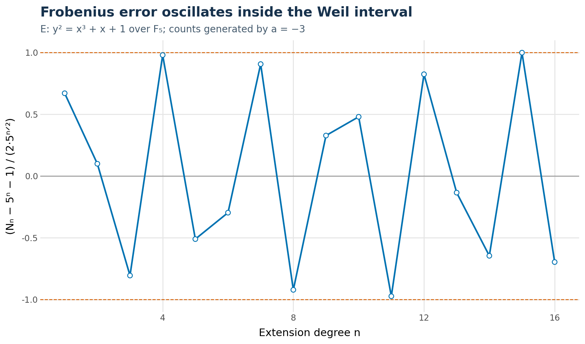

# Zeta Functions of Curves over Finite Fields {#sec-curve-zeta}

**Level and prerequisites: L5.** Prepare finite fields, algebraic curves, Frobenius and divisor theory. Use the [level-specific reading guide](index.md#who-this-book-is-for) for linked Euler preparation.

Counting points on a curve over $\mathbb F_q$ gives one integer. Counting over
every extension $\mathbb F_{q^n}$ gives a sequence, and that sequence remembers
the action of Frobenius. The zeta function packages all those counts into one
rational function. Its numerator records genus, Jacobian size, oscillating
error terms, and local factors that later enter global $L$-functions.

The motivating question is concrete: if a curve has nine points over
$\mathbb F_5$, can we predict how many it has over $\mathbb F_{25}$ without
enumerating twenty-five squared coordinate pairs? For an elliptic curve the
answer is yes, because two Frobenius eigenvalues satisfy a quadratic
recurrence.

## Preparation from this book

Euler products and generating series begin in [sec-functions](07-functions.md#sec-functions) and
[sec-analytic](12-analytic.md#sec-analytic). Finite fields, Frobenius, trace, and norm are developed in
[sec-finite-fields](23-finite-fields.md#sec-finite-fields). Prime Frobenius appears globally in
[sec-splitting-reciprocity](26-splitting-reciprocity.md#sec-splitting-reciprocity), elliptic point counts in [sec-elliptic-curves](20-elliptic-curves.md#sec-elliptic-curves), and
curves, genus, divisors, and Jacobians in [sec-curves-jacobians](35-curves-jacobians.md#sec-curves-jacobians). Cancellation
language from [sec-exponential-sums](37-exponential-sums.md#sec-exponential-sums) is useful for interpreting error terms.

Only a small repair is required. A **formal power series**
$A(T)=\sum_{n\ge0}a_nT^n$ is manipulated coefficient by coefficient; no
numerical value of $T$ is required. Formal differentiation, exponentiation of a
series with zero constant term, and logarithms of a series with constant term
one are valid algebraic operations. Thus the first definition below makes
sense before any analytic convergence question.

A curve in this chapter is smooth, projective, and geometrically connected
unless stated otherwise. Projectivity ensures points at infinity are included;
smoothness excludes singular correction terms; geometric connectedness
prevents the constant field from secretly growing. Affine or singular examples
remain useful, but their formulas should not be inserted into the smooth
projective theorem without adjustment.

## Extension-field point counts

Let $C$ be a curve defined over $\mathbb F_q$. Set

$$
N_n=\#C(\mathbb F_{q^n}),\qquad n\ge1.
$$

An $\mathbb F_{q^n}$-point is a geometric point fixed by the $n$th power of
arithmetic Frobenius on coordinates,

$$
\operatorname{Frob}_q:(x_0:\cdots:x_m)
\longmapsto(x_0^q:\cdots:x_m^q).
$$

The sequence $(N_n)$ is not normally obtained by treating each extension as an
unrelated field. Every geometric point has a Frobenius orbit. If its orbit has
length $d$, the point is defined over $\mathbb F_{q^n}$ exactly when $d\mid n$.

A **closed point of degree $d$** is one such orbit of $d$ geometric points.
If $B_d$ denotes the number of degree-$d$ closed points, then

<div id="eq-closed-point-count" class="equation">

$$
N_n=\sum_{d\mid n}dB_d. \tag{39.1}
$$

</div>

The factor $d$ counts the geometric points in each orbit. Möbius inversion
recovers

$$
dB_d=\sum_{r\mid d}\mu(d/r)N_r.
$$

This supplies an integrality audit: the right side must be a nonnegative
multiple of $d$. An arbitrary plausible-looking sequence of point counts need
not come from a curve.

For example, over $\mathbb F_2$ the projective line has
$N_1=3$, $N_2=5$, and $N_3=9$. Consequently

$$
B_1=3,\qquad
B_2=\frac{N_2-N_1}{2}=1,\qquad
B_3=\frac{N_3-N_1}{3}=2.
$$

The degree-one points are $0$, $1$, and infinity. The one degree-two closed
point is the orbit of the two roots of the irreducible polynomial
$x^2+x+1$. The two degree-three points correspond to the two monic irreducible
cubics over $\mathbb F_2$. Thus the abstract orbit formula recovers familiar
irreducible-polynomial counting.

## The zeta function and Euler product

The **zeta function of $C/\mathbb F_q$** is

<div id="eq-curve-zeta-definition" class="equation">

$$
Z(C,T)
=\exp\left(\sum_{n\ge1}N_n\frac{T^n}{n}\right). \tag{39.2}
$$

</div>

To derive the closed-point Euler product, substitute
[Equation 39.1](#eq-closed-point-count):

$$
\begin{aligned}
\log Z(C,T)
&=\sum_{n\ge1}\sum_{d\mid n}dB_d\frac{T^n}{n}\\
&=\sum_{d\ge1}B_d\sum_{m\ge1}\frac{T^{dm}}m\\
&=-\sum_{d\ge1}B_d\log(1-T^d).
\end{aligned}
$$

Exponentiating gives

<div id="eq-curve-euler-product" class="equation">

$$
Z(C,T)=\prod_{x\in|C|}\frac1{1-T^{\deg x}}
=\prod_{d\ge1}(1-T^d)^{-B_d}, \tag{39.3}
$$

</div>

where $|C|$ denotes the closed points. This is a complete formal derivation:
each coefficient of $T^m$ involves only degrees dividing $m$, so no illicit
rearrangement of an analytically divergent infinite sum occurs.

The variable $T$ is often later replaced by $q^{-s}$. The curve zeta function
then resembles the Riemann zeta function's prime Euler product, with closed
points playing the role of primes. The analogy is structural, not an
identification of the two functions.

## Affine line, multiplicative group, and projective line

For the affine line $\mathbb A^1$, every field element is a point, so
$N_n=q^n$. Since $\sum_{n\ge1}X^n/n=-\log(1-X)$,

$$
Z(\mathbb A^1,T)
=\exp\left(\sum_{n\ge1}q^n\frac{T^n}{n}\right)
=\frac1{1-qT}.
$$

For the multiplicative group $\mathbb G_m=\mathbb A^1\setminus\{0\}$,
$N_n=q^n-1$, and therefore

$$
Z(\mathbb G_m,T)=\frac{1-T}{1-qT}.
$$

The projective line adds one point at infinity over every extension:
$N_n=q^n+1$. Hence

<div id="eq-projective-line-zeta" class="equation">

$$
\begin{aligned}
Z(\mathbb P^1,T)
&=\exp\left(\sum_{n\ge1}(q^n+1)\frac{T^n}{n}\right)\\
&=\exp\left(-\log(1-qT)-\log(1-T)\right)\\
&=\frac1{(1-T)(1-qT)}.
\end{aligned} \tag{39.4}
$$

</div>

This derivation also illustrates a failure mode. Using the affine count
$q^n$ for a projective curve loses the factor $(1-T)^{-1}$. One omitted point
at infinity changes every extension count and therefore an entire Euler
factor.

A finite set of $r$ rational points has zeta function $(1-T)^{-r}$. Removing
such points divides a projective zeta function by those factors. Removing a
closed point of degree $d$ instead contributes a factor $1-T^d$. The degree
cannot be replaced by the number of orbit representatives chosen for a
calculation.

The formal logarithm shows that the zeta function and the entire count sequence
contain exactly the same information. Given every $N_n$, definition
[Equation 39.2](#eq-curve-zeta-definition) constructs $Z$. Conversely,

$$
T\frac{d}{dT}\log Z(C,T)=\sum_{n\ge1}N_nT^n
$$

recovers every count as a coefficient. Rationality therefore means the infinite
sequence is controlled by finitely many polynomial coefficients. It does not
mean the set of points is finite independent of $n$.

## Frobenius conventions and rationality

Arithmetic Frobenius raises coordinates to the $q$th power. Geometric
Frobenius is its inverse on geometric points. Both conventions occur in the
literature, and eigenvalues are inverted accordingly. This book writes point
counts using reciprocal roots $\alpha_i$ with ordinary complex magnitude
$\sqrt q$:

<div id="eq-weil-point-count" class="equation">

$$
N_n=q^n+1-\sum_{i=1}^{2g}\alpha_i^n. \tag{39.5}
$$

</div>

**Theorem 39.1 (Weil for curves).** If $C/\mathbb F_q$ is smooth, projective, and
geometrically connected of genus $g$, then

<div id="eq-weil-rationality" class="equation">

$$
Z(C,T)=\frac{P_C(T)}{(1-T)(1-qT)}, \tag{39.6}
$$

</div>

where $P_C(T)\in\mathbb Z[T]$, $P_C(0)=1$, and $\deg P_C=2g$. It satisfies

<div id="eq-curve-functional-equation" class="equation">

$$
P_C(T)=q^gT^{2g}P_C(1/(qT)), \tag{39.7}
$$

</div>

and can be written

$$
P_C(T)=\prod_{i=1}^{2g}(1-\alpha_iT)
$$

with $|\alpha_i|=\sqrt q$ under every complex embedding.

We quote this general theorem. Rationality can be proved by several routes;
the modern cohomological route expresses $N_n$ as an alternating trace of
Frobenius. The magnitude statement is the finite-field analogue called the
Riemann hypothesis for curves. It is a proved theorem. It neither proves nor
assumes the classical Riemann hypothesis for $\zeta(s)$.

Taking logarithms of [Equation 39.6](#eq-weil-rationality) and comparing coefficients gives
[Equation 39.5](#eq-weil-point-count). The magnitude of the reciprocal roots immediately yields

<div id="eq-curve-weil-bound" class="equation">

$$
|N_n-(q^n+1)|\le2gq^{n/2}. \tag{39.8}
$$

</div>

For $g=0$, the numerator has degree zero and equals one, recovering
[Equation 39.4](#eq-projective-line-zeta).

### Rationality produces linear recurrences

Write

$$
P_C(T)=1+c_1T+\cdots+c_{2g}T^{2g}.
$$

Newton identities express the power sums
$A_n=\sum_i\alpha_i^n$ in terms of the coefficients $c_j$. Once the first
$2g$ power sums are known, later ones satisfy

$$
A_n+c_1A_{n-1}+\cdots+c_{2g}A_{n-2g}=0
\qquad(n>2g).
$$

Since $N_n=q^n+1-A_n$, finitely many initial point counts and a certified
numerator determine all later counts. In genus two, for example, the numerator
has the constrained shape

$$
P_C(T)=1+c_1T+c_2T^2+qc_1T^3+q^2T^4
$$

under the convention [Equation 39.7](#eq-curve-functional-equation). Two independent
coefficients carry the information; the remaining two are forced by duality.
This is why genus-two point-counting algorithms seek enough modular information
to reconstruct a small collection of coefficients rather than enumerate every
extension field.

There are two cautions. First, a rational generating function can satisfy a
recurrence without coming from a smooth projective curve; integrality,
nonnegative closed-point counts, the functional equation, and root magnitudes
remain necessary. Second, reconstructing a numerator from too few counts can
produce several candidates. The functional equation reduces the search space
but does not replace a uniqueness bound.

## Elliptic curves and the Frobenius recurrence

For an elliptic curve $E/\mathbb F_q$, genus is one, so

$$
P_E(T)=1-aT+qT^2,
\qquad
a=q+1-\#E(\mathbb F_q).
$$

Let $\alpha,\beta$ be the roots of $X^2-aX+q$. Then

$$
\alpha+\beta=a,\qquad\alpha\beta=q,\qquad
\#E(\mathbb F_{q^n})=q^n+1-\alpha^n-\beta^n.
$$

Define $S_n=\alpha^n+\beta^n$. Because both roots satisfy
$X^2=aX-q$, we obtain the exact integer recurrence

<div id="eq-frobenius-recurrence" class="equation">

$$
S_0=2,\qquad S_1=a,\qquad
S_n=aS_{n-1}-qS_{n-2}. \tag{39.9}
$$

</div>

The recurrence is integer arithmetic; reciprocal roots never need to be
approximated.

```python
def elliptic_extension_counts(
    field_size: int,
    frobenius_trace: int,
    maximum_degree: int,
) -> list[int]:
    """Return predicted point counts over degrees 1 through maximum_degree."""
    if field_size < 2 or maximum_degree < 1:
        raise ValueError("require field_size >= 2 and maximum_degree >= 1")
    if frobenius_trace**2 > 4 * field_size:
        raise ValueError("frobenius_trace violates the Hasse bound")
    two_steps_back, one_step_back = 2, frobenius_trace
    counts = [field_size + 1 - frobenius_trace]
    for degree in range(2, maximum_degree + 1):
        current_power_sum = (
            frobenius_trace * one_step_back
            - field_size * two_steps_back
        )
        counts.append(field_size**degree + 1 - current_power_sum)
        two_steps_back, one_step_back = one_step_back, current_power_sum
    return counts

print(elliptic_extension_counts(5, frobenius_trace=-3, maximum_degree=6))
```

This verifies all displayed consequences once $q$ and $a$ are supplied. It
does not certify that $q$ is a prime power or that the trace came from the
claimed curve; the base-field count provides that separate certificate.

This is more than a numerical shortcut. One base-field count determines every
extension-field count for an elliptic curve, provided the curve and field are
correct and the first count includes the point at infinity.

The Hasse bound $|a|\le2\sqrt q$ is the genus-one case of
[Equation 39.8](#eq-curve-weil-bound). It is a necessary audit on any claimed point count. A
value within the bound need not be correct; many wrong counts also lie within
the permitted interval.

## Complete case study over $\mathbb F_5$

Consider

$$
E:y^2=x^3+x+1
$$

over $\mathbb F_5$. Its cubic discriminant is nonzero modulo five, so the
projective curve is nonsingular. The square residues modulo five are
$0,1,4$. Evaluate the right side:

| $x$ | $x^3+x+1\bmod5$ | number of $y$ |
|---:|---:|---:|
| $0$ | $1$ | $2$ |
| $1$ | $3$ | $0$ |
| $2$ | $1$ | $2$ |
| $3$ | $1$ | $2$ |
| $4$ | $4$ | $2$ |

There are eight affine points and one point at infinity, so $N_1=9$. Hence

$$
a=5+1-9=-3,\qquad
P_E(T)=1+3T+5T^2.
$$

From [Equation 39.9](#eq-frobenius-recurrence),

$$
S_2=aS_1-5S_0=(-3)^2-10=-1.
$$

Therefore

<div id="eq-elliptic-f25-count" class="equation">

$$
N_2=5^2+1-S_2=26-(-1)=27. \tag{39.10}
$$

</div>

This predicts the count over $\mathbb F_{25}$ without enumerating all points.
For an independent finite certificate, construct

$$
\mathbb F_{25}=\mathbb F_5[u]/(u^2-2),
$$

since $2$ is a nonsquare modulo five. Represent each element uniquely as
$a+bu$, reduce products using $u^2=2$, enumerate all twenty-five $x$ and
$y$ values, test the equation exactly, and add the projective point. The result
is $27$, matching [Equation 39.10](#eq-elliptic-f25-count). Using $u^2+1$ would be invalid here
because $-1=4$ is already a square modulo five, so that quotient is not a
field.

Here are the exact arithmetic rules needed for that certificate. Store
$a+bu$ as the pair $(a,b)$ with entries reduced modulo five. Then

$$
(a,b)+(c,d)=(a+c,b+d)
$$

and, because $u^2=2$,

$$
(a,b)(c,d)=(ac+2bd,ad+bc)
\pmod5.
$$

The Frobenius map is obtained by exponentiation to the fifth power, and a
nonzero element $z$ is a square precisely when $z^{12}=1$. Thus one may count
more efficiently by evaluating the cubic at each of the twenty-five possible
$x$ values: a zero output contributes one $y$, a nonzero square contributes
two, and a nonsquare contributes none. The alternative double loop over all
$625$ ordered pairs is slower but supplies an independent check using only the
multiplication rule. Both routes must return the same eight-affine-plus-one
base-field count when restricted to pairs with $b=0$.

This representation also exposes a subtle implementation error. Integer
exponentiation followed by coefficientwise reduction is not field
exponentiation unless multiplication reduces $u^2$ at every step. Binary
exponentiation must call the declared pair multiplication. A table of twenty-five
labels without a verified modulus polynomial is merely a labeled ring, not a
finite-field certificate.

## Jacobians and genus

The Jacobian $J_C$ from [sec-curves-jacobians](35-curves-jacobians.md#sec-curves-jacobians) organises degree-zero divisor
classes. Its Frobenius characteristic polynomial is $P_C(T)$ in the convention
above, and

<div id="eq-jacobian-count" class="equation">

$$
\#J_C(\mathbb F_q)=P_C(1). \tag{39.11}
$$

</div>

For genus one with a chosen rational point, $J_E\cong E$, and indeed

$$
P_E(1)=1-a+q=\#E(\mathbb F_q).
$$

For higher genus, the curve and its Jacobian are different-dimensional
objects. The formula does not say that $\#C(\mathbb F_q)=P_C(1)$. It says that
the same reciprocal roots controlling curve counts also control rational
points on the Jacobian.

The numerator degree $2g$ explains why genus measures arithmetic complexity:
one needs $2g$ Frobenius eigenvalues rather than two. Enough initial point
counts can reconstruct a candidate numerator using the functional equation and
integrality, but a candidate still needs a proof or certificate that no
counting error entered.

## Point-counting algorithms and certificates

Brute force over $\mathbb F_q$ costs roughly $q$ evaluations for a
hyperelliptic equation if one uses a quadratic-character table rather than
testing every pair. Over extension fields, the representation polynomial must
be declared and proved irreducible. Character sums connect this computation to
[sec-exponential-sums](37-exponential-sums.md#sec-exponential-sums):

$$
\#E(\mathbb F_q)
=q+1+\sum_{x\in\mathbb F_q}\chi(x^3+Ax+B),
$$

where $\chi(0)=0$. The Weil bound is therefore a square-root cancellation
theorem for a structured character sum.

Schoof's algorithm determines the elliptic trace $a$ modulo many small primes
by studying Frobenius on torsion, then reconstructs the unique integer in the
Hasse interval. We quote its correctness and polynomial-time bound. A useful
certificate records the curve model, field, good-reduction check, congruences
for $a$, product of auxiliary moduli, and the argument that the product is
large enough for unique reconstruction.

For a recurrence certificate, store $q$, $a$, initial values $S_0,S_1$, and
the requested range. Every later $S_n$ and $N_n$ is then checked with integer
arithmetic. This certifies consequences of the supplied $a$; it does not by
itself certify that the original base-field point count was correct.

Base change provides another useful audit. Regard the same curve as defined
over $\mathbb F_{q^r}$. Its first point count is the old $N_r$, and its
reciprocal roots are $\alpha_1^r,\ldots,\alpha_{2g}^r$. Therefore

$$
Z(C/\mathbb F_{q^r},T)
=\frac{\prod_i(1-\alpha_i^rT)}
{(1-T)(1-q^rT)}.
$$

This is generally not obtained by substituting $T^r$ into
$Z(C/\mathbb F_q,T)$. Such a substitution would retain only exponents
divisible by $r$ in the logarithm but would weight them incorrectly. For the
case-study elliptic curve, base change from $\mathbb F_5$ to
$\mathbb F_{25}$ changes the trace from $a=-3$ to
$S_2=-1$, so the new numerator is

$$
1+T+25T^2.
$$

Its first count is $25+1-(-1)=27$, as required. This one-line consistency
test catches confusion between “extension degree two” and “replace the zeta
variable by its square.”

<figure id="fig-frobenius-error">


<figcaption>

Figure 39.1: The normalized Frobenius error for one elliptic curve oscillates inside the Weil interval over extension fields.

</figcaption>
</figure>

[Figure 39.1](#fig-frobenius-error) is generated entirely from the integer recurrence with
$q=5$ and $a=-3$. The vertical coordinate is

$$
\frac{N_n-(5^n+1)}{2\cdot5^{n/2}}
=-\frac{S_n}{2\cdot5^{n/2}}.
$$

Its oscillation reflects a conjugate pair of reciprocal roots on the circle of
radius $\sqrt5$. The displayed interval verifies the finite recurrence output
against the Weil bound; it does not prove the general magnitude theorem.

The generator computes $S_n$ with integers before converting only the final
normalized coordinate to a real plotting value. This ordering avoids
catastrophic subtraction between $N_n$ and $5^n+1$: their exact difference is
stored as $-S_n$. Labels record the extension degree rather than a misleading
continuous time variable. Re-running the recurrence from both the quadratic
polynomial and the displayed initial values gives an inexpensive independent
check of every plotted point.

## Theorem-scope ledger

- **Proved here:** the closed-point Euler product, all three elementary zeta
  functions, the elliptic recurrence, and the counts $N_1=9$, $N_2=27$ in the
  case study.
- **Quoted precisely:** Weil rationality, the functional equation, reciprocal
  root magnitudes, the Jacobian count formula, and Schoof's complexity theorem.
- **Computationally certified:** finite-field enumeration and recurrence values
  in a declared field representation.
- **Not claimed:** a proof of general Weil cohomology, the classical Riemann
  hypothesis, or a rank statement about a lift of the elliptic curve to
  $\mathbb Q$.

The local factors here feed the automorphic discussion in
[sec-automorphic-langlands](42-automorphic-langlands.md#sec-automorphic-langlands). The use of Frobenius at unramified places also
connects to Artin maps in [sec-class-field-theory](40-class-field-theory.md#sec-class-field-theory).

Singular curves illustrate why the hypotheses remain visible. A nodal cubic
can be parametrised by a projective line with two geometric points identified;
its zeta function contains a correction determined by how Frobenius acts on
those branches. Calling the equation a “genus-one cubic” from its degree alone
and inserting an elliptic quadratic numerator would be wrong. Smoothness must
be checked before genus, Jacobian, or Hasse formulas are applied.

<!-- inline-formula-code:start -->
## Formula and finite computation

A useful formula in this chapter is

$$
a_p=p+1-\#E(\mathbb F_p)
$$

A finite point count gives the local trace coefficient exactly. The following standalone Python block expresses that finite rule with its inputs and stopping conditions visible.

```python
from math import isqrt

def is_prime(number: int) -> bool:
    """Return whether number is prime by exact trial division."""
    if number < 2:
        return False
    return all(
        number % divisor != 0 for divisor in range(2, isqrt(number) + 1)
    )

def elliptic_curve_point_count(
    prime_modulus: int,
    linear_coefficient: int,
    constant_coefficient: int,
) -> tuple[int, int]:
    """Return #E(F_p) and its trace for y^2=x^3+A*x+B, with p > 3."""
    if not is_prime(prime_modulus) or prime_modulus <= 3:
        raise ValueError("prime_modulus must be a prime greater than three")
    discriminant_factor = (
        4 * linear_coefficient**3 + 27 * constant_coefficient**2
    )
    if discriminant_factor % prime_modulus == 0:
        raise ValueError("the short Weierstrass equation is singular")
    affine_count = sum(
        (
            y_coordinate**2
            - (
                x_coordinate**3
                + linear_coefficient * x_coordinate
                + constant_coefficient
            )
        )
        % prime_modulus
        == 0
        for x_coordinate in range(prime_modulus)
        for y_coordinate in range(prime_modulus)
    )
    point_count = 1 + affine_count
    trace = prime_modulus + 1 - point_count
    return point_count, trace

print(
    elliptic_curve_point_count(
        prime_modulus=17,
        linear_coefficient=2,
        constant_coefficient=2,
    )
)
```

**What the computation establishes.** The output certifies only the declared finite case. The theorem, if one is claimed, still requires the argument developed in the chapter.
<!-- inline-formula-code:end -->

## Summary and vocabulary

Extension-field counts decompose into Frobenius orbits, and closed points give
an Euler product. Smooth projective curve zeta functions are rational. Their
numerator has degree twice the genus, satisfies a functional equation, and has
reciprocal roots of magnitude $\sqrt q$. For elliptic curves, one trace gives
a second-order recurrence for every extension count. Exact field
representations and a declared point at infinity are indispensable parts of a
certificate.

Key terms are **closed point**, **curve zeta function**, **reciprocal root**,
**arithmetic Frobenius**, **geometric Frobenius**, **Weil bound**, and
**Frobenius polynomial**.

## Exercises

<div class="exercise" id="number_theory-39-curve-zeta-ex-1">
<p class="exercise-title"><strong>Exercise 1</strong></p>

Derive $Z(\mathbb A^1,T)$ directly from the exponential definition.

</div>

<div class="exercise" id="number_theory-39-curve-zeta-ex-2">
<p class="exercise-title"><strong>Exercise 2</strong></p>

Use removal of the origin to derive $Z(\mathbb G_m,T)$ from the affine-line
formula.

</div>

<div class="exercise" id="number_theory-39-curve-zeta-ex-3">
<p class="exercise-title"><strong>Exercise 3</strong></p>

If $N_1=4$, $N_2=10$, compute $B_1$ and $B_2$ using
[Equation 39.1](#eq-closed-point-count) and test the required divisibility.

<details class="hint"><summary>Hint 1</summary>

degree-one closed points contribute to both $N_1$ and $N_2$;
  degree-two closed points contribute twice only to $N_2$.

</details>

</div>

<div class="exercise" id="number_theory-39-curve-zeta-ex-4">
<p class="exercise-title"><strong>Exercise 4</strong></p>

Show from the Euler product that removing a degree-three closed point
multiplies the zeta function by $1-T^3$.

</div>

<div class="exercise" id="number_theory-39-curve-zeta-ex-5">
<p class="exercise-title"><strong>Exercise 5</strong></p>

Prove the recurrence [Equation 39.9](#eq-frobenius-recurrence) directly from the quadratic
equation for $\alpha$ and $\beta$.

</div>

<div class="exercise" id="number_theory-39-curve-zeta-ex-6">
<p class="exercise-title"><strong>Exercise 6</strong></p>

Continue the case-study recurrence to compute $N_3$ and $N_4$.

<details class="hint"><summary>Hint 1</summary>

advance the power sums $S_n$, then use
  $N_n=5^n+1-S_n$; do not recur the point counts with the same homogeneous
  relation.

</details>

</div>

<div class="exercise" id="number_theory-39-curve-zeta-ex-7">
<p class="exercise-title"><strong>Exercise 7</strong></p>

Verify that $u^2-2$ is irreducible over $\mathbb F_5$, while $u^2+1$ is
reducible.

</div>

<div class="exercise" id="number_theory-39-curve-zeta-ex-8">
<p class="exercise-title"><strong>Exercise 8</strong></p>

For an elliptic curve with $q=7$ and $a=4$, check Hasse's bound and compute
its predicted count over $\mathbb F_{49}$.

</div>

<div class="exercise" id="number_theory-39-curve-zeta-ex-9">
<p class="exercise-title"><strong>Exercise 9</strong></p>

Explain why $P_C(1)$ counts Jacobian points rather than curve points when
$g>1$.

</div>

<div class="exercise" id="number_theory-39-curve-zeta-ex-10">
<p class="exercise-title"><strong>Exercise 10</strong></p>

Use [Equation 39.7](#eq-curve-functional-equation) to show that the leading coefficient of
$P_C$ is $q^g$.

<details class="hint"><summary>Hint 1</summary>

compare coefficients in
  $P(T)=q^gT^{2g}P(1/(qT))$ from the two ends.

</details>

</div>

<div class="exercise" id="number_theory-39-curve-zeta-ex-11">
<p class="exercise-title"><strong>Exercise 11</strong></p>

Write a certificate schema for a claimed $N_2$ obtained by brute force over
a quadratic finite-field extension.

</div>

<div class="exercise" id="number_theory-39-curve-zeta-ex-12">
<p class="exercise-title"><strong>Exercise 12</strong></p>

Find two distinct incorrect base counts within the Hasse interval to show
why passing the bound is not a correctness certificate.

</div>

## Selected solutions

**Solution to Exercise 3.** For $n=1$, [Equation 39.1](#eq-closed-point-count) gives
$N_1=B_1$, so $B_1=4$. For $n=2$ it gives

$$
10=B_1+2B_2=4+2B_2,
$$

hence $B_2=3$. The inversion numerator $N_2-N_1=6$ is nonnegative and
divisible by two, as required. These checks do not prove a curve with the
specified sequence exists; they only pass the first orbit-integrality tests.

**Solution to Exercise 6.** With $q=5$, $a=-3$, $S_0=2$, and $S_1=-3$, the
recurrence gives

$$
S_2=-1,\qquad
S_3=(-3)(-1)-5(-3)=18,
$$

and

$$
S_4=(-3)(18)-5(-1)=-49.
$$

Therefore

$$
N_3=125+1-18=108,\qquad
N_4=625+1-(-49)=675.
$$

The Weil checks are $|18|\le2\cdot5^{3/2}$ and
$49\le2\cdot5^2=50$.

**Solution to Exercise 8.** The Hasse interval requires
$|a|\le2\sqrt7$, and $4<2\sqrt7$, so the input is possible. We have

$$
S_2=a^2-2q=16-14=2.
$$

Thus

$$
\#E(\mathbb F_{49})=49+1-2=48.
$$

This is a conditional calculation: it is the forced extension count for an
elliptic curve over $\mathbb F_7$ with trace four, not proof that a particular
unexamined equation has that trace.
