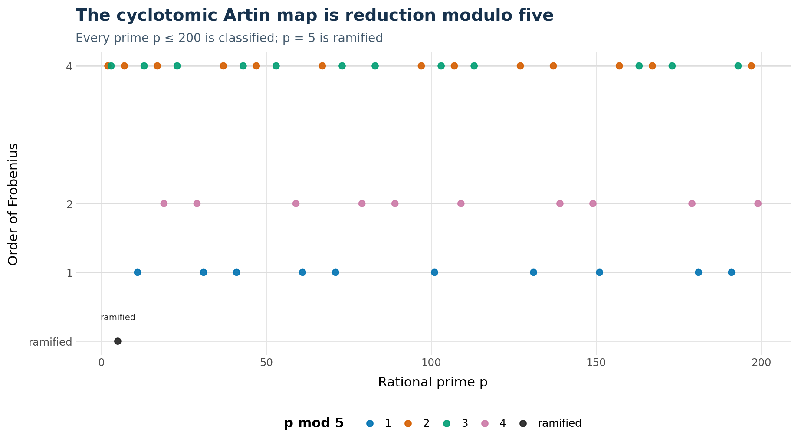

# Local and Global Class Field Theory {#sec-class-field-theory}

**Level and prerequisites: L5.** Prepare local and global fields, norm groups, profinite Galois theory and ideal classes. Use the [level-specific reading guide](index.md#who-this-book-is-for) for linked Euler preparation.

Suppose $L/K$ is a finite abelian extension. Can one recover its Galois group
from multiplicative arithmetic in $K$ rather than from a defining polynomial
for $L$? Class field theory says yes. Locally, quotients of $K^\times$ by norm
groups classify finite abelian extensions. Globally, quotients of the idele
class group do the same, and prime ideals act through Frobenius.

This chapter is an exact map of that theory, with complete cyclotomic
calculations and honest proof boundaries. A single chapter cannot prove the
local and global existence theorems. It can state them precisely, show how
their pieces fit, and derive every claim in a representative extension.

## Preparation from this book

Quadratic reciprocity begins in [sec-residues](08-residues.md#sec-residues). Ideals, class groups, splitting,
conductors, characters, and Frobenius are built in Chapters
[sec-ideals-dedekind](24-ideals-dedekind.md#sec-ideals-dedekind), [sec-class-groups-units](25-class-groups-units.md#sec-class-groups-units),
[sec-splitting-reciprocity](26-splitting-reciprocity.md#sec-splitting-reciprocity), and [sec-l-functions](27-l-functions.md#sec-l-functions). Galois groups are repaired in
[sec-galois-symmetry](31-galois-symmetry.md#sec-galois-symmetry), adeles and ideles in [sec-adeles-ideles](34-adeles-ideles.md#sec-adeles-ideles), and finite local
extensions and norm groups in [sec-local-fields](38-local-fields.md#sec-local-fields).

Two group ideas are needed. A subgroup $H$ of a topological group $G$ is
**open of finite index** when it is open and $G/H$ is finite. Continuity then
makes the quotient discrete. The **profinite completion** of a group relative
to its finite-index subgroups records all compatible finite quotients. Class
field theory classifies finite abelian extensions first; the infinite maximal
abelian extension is understood through the inverse system of those finite
quotients.

For an abelian extension, conjugation acts trivially on the Galois group, so a
Frobenius conjugacy class becomes a single element. This is one reason the
abelian case admits a direct reciprocity homomorphism. In a nonabelian
extension, Frobenius is generally defined only up to conjugacy, and no quotient
of an abelian group such as $K^\times$ can recover a nonabelian Galois group.
That is the decisive nonexample to overextending class field theory.

## The classification problem

For a finite Galois extension $L/K$, the norm group

$$
N_{L/K}(L^\times)\subseteq K^\times
$$

is multiplicative. If $L/K$ is local and abelian, class field theory gives a
canonical isomorphism

<div id="eq-local-reciprocity-quotient" class="equation">

$$
K^\times/N_{L/K}(L^\times)
\cong\operatorname{Gal}(L/K). \tag{40.1}
$$

</div>

The statement does more than compare orders: it specifies which element of the
Galois group corresponds to a uniformizer or unit. Conversely, every open
finite-index subgroup of $K^\times$ is the norm group of a unique finite
abelian extension inside a fixed algebraic closure.

Globally, $K^\times$ alone is too small. Principal elements must be compared
simultaneously at every place, so the correct group is the idele class group

$$
C_K=\mathbb A_K^\times/K^\times.
$$

For a finite abelian extension of number fields,

<div id="eq-global-reciprocity-quotient" class="equation">

$$
C_K/N_{L/K}(C_L)\cong\operatorname{Gal}(L/K). \tag{40.2}
$$

</div>

These two finite-quotient statements are the working heart of local and global
reciprocity.

## Local reciprocity

Fix a non-Archimedean local field $K$. The **local Artin map** is a continuous
homomorphism

$$
\operatorname{Art}_K:K^\times
\longrightarrow\operatorname{Gal}(K^{\mathrm{ab}}/K).
$$

Its image is dense rather than literally all of this profinite group. Equivalently,
the induced map from the profinite completion of $K^\times$ is an isomorphism,
and every finite abelian quotient below is reached surjectively.

We choose the arithmetic normalization: if $L/K$ is finite unramified and
$\pi_K$ is a uniformizer, the image of $\pi_K$ in
$\operatorname{Gal}(L/K)$ acts on the residue field by

$$
x\longmapsto x^{|k_K|}.
$$

Some references send a uniformizer to the inverse, geometric Frobenius.
Changing convention in one local factor but not another reverses Artin symbols
and corrupts global formulas.

For every finite abelian $L/K$, composition with restriction gives a surjection

$$
\operatorname{Art}_{L/K}:K^\times
\longrightarrow\operatorname{Gal}(L/K)
$$

whose kernel is exactly $N_{L/K}(L^\times)$. This proves
[Equation 40.1](#eq-local-reciprocity-quotient) once local reciprocity is granted.

The structure

$$
K^\times\cong\pi_K^{\mathbb Z}\times\mathcal O_K^\times
$$

separates unramified and ramified information. The uniformizer coordinate maps
to Frobenius in the maximal unramified quotient. Units map into inertia. Deeper
unit groups

$$
U_K^n=1+\mathfrak m_K^n
$$

detect higher ramification and conductor depth. A unit need not act trivially;
that would erase every ramified abelian extension.

## Local norm groups and the existence theorem

If $L/K$ is unramified of degree $n$, [Equation 38.3](38-local-fields.md#eq-norm-valuation) from
[sec-local-fields](38-local-fields.md#sec-local-fields) gives

$$
v_K(Nx)=n\,v_L(x),
$$

and the norm on units is surjective. Therefore

$$
N_{L/K}(L^\times)
=\pi_K^{n\mathbb Z}\mathcal O_K^\times.
$$

The quotient is cyclic of order $n$, generated by the class of $\pi_K$, exactly
matching the cyclic unramified Galois group generated by Frobenius.

For a totally ramified extension, norm valuations can be arbitrary because
$f=1$, but the unit norm group has finite index. Thus ramification moves the
information from the valuation coordinate into the unit filtration.

**Theorem 40.1 (Local existence, quoted).** The assignment

$$
L\longmapsto N_{L/K}(L^\times)
$$

gives an inclusion-reversing bijection between finite abelian extensions
$L/K$ in a fixed algebraic closure and open finite-index subgroups of
$K^\times$. If $L_1\subseteq L_2$, then every norm from $L_2$ is a norm from
$L_1$, explaining the reversal.

Not every subgroup is allowed: openness is essential. A dense proper subgroup
can have an algebraically finite-looking quotient presentation while failing to
define the continuous finite Galois action required by local reciprocity.

## Hilbert symbols and local norm tests

Assume for simplicity that $K$ has characteristic not two. For
$a,b\in K^\times$, the quadratic Hilbert symbol is

$$
(a,b)_K=
\begin{cases}
1,&b\in N_{K(\sqrt a)/K}(K(\sqrt a)^\times),\\
-1,&\text{otherwise}.
\end{cases}
$$

If $a$ is already a square, the extension is trivial and the symbol is one.
The symbol depends only on the square classes of $a$ and $b$, is symmetric,
and is multiplicative in each variable. Equivalently,

$$
(a,b)_K=1
$$

exactly when the conic $z^2=ax^2+by^2$ has a nontrivial $K$-point, with a
consistent choice of convention.

For a number field $K$ and $a,b\in K^\times$, the Hilbert reciprocity law is

<div id="eq-hilbert-product" class="equation">

$$
\prod_v(a,b)_v=1, \tag{40.3}
$$

</div>

where $v$ runs over all places. All but finitely many factors are one. We quote
the local explicit formulas and the global product theorem. Their consequence
is already striking: if a norm equation is locally solvable at every place but
one, it is solvable at the last place too. The theorem does not say that every
variety satisfying all local conditions has a global point; that broader
Hasse principle can fail.

## Ordinary, narrow, and ray class groups

Let $K$ be a number field. A modulus is a formal product

$$
\mathfrak m=\mathfrak m_0\mathfrak m_\infty,
$$

where $\mathfrak m_0$ is a nonzero integral ideal and
$\mathfrak m_\infty$ is a set of real places. Let $I_{\mathfrak m}$ be the
fractional ideals coprime to $\mathfrak m_0$. Let
$P_{\mathfrak m,1}$ be generated by principal ideals $(a)$ such that

$$
a\equiv1\pmod{\mathfrak m_0}
$$

in the local ideal sense and $a$ is positive at every real place in
$\mathfrak m_\infty$. The **ray class group** is

$$
\operatorname{Cl}_{\mathfrak m}(K)
=I_{\mathfrak m}/P_{\mathfrak m,1}.
$$

With trivial finite and infinite modulus one recovers the ordinary class
group. Including all real places but no finite congruence gives the narrow
class group. Over $\mathbb Q$, positivity matters because $-1$ is a unit:
forgetting the infinite component can identify principal generators that
should remain distinct in a narrow condition.

Ray class groups are finite. Their quotients correspond to abelian extensions
whose ramification is bounded by the modulus. The smallest admissible modulus
is the conductor. A modulus may be larger than the conductor, just as a
Dirichlet character may be displayed modulo a multiple of its primitive
conductor.

Over $\mathbb Q$, every fractional ideal is principal, but the ray quotient is
not trivial because its generator is constrained modulo the finite part and by
sign at infinity. For the modulus $5\infty$, choose the unique positive
generator of an ideal prime to five and reduce it modulo five. This identifies
the ray class group with

$$
(\mathbb Z/5\mathbb Z)^\times.
$$

If positivity were omitted, generators $a$ and $-a$ would be identified and
the quotient would collapse by the subgroup $\{\pm1\}$. The infinite component
therefore distinguishes the full fifth cyclotomic field from its real
quadratic subfield. This small calculation makes the role of infinite places
concrete rather than ceremonial.

More generally there is an exact sequence assembled from local residue-unit
groups, global units, the ray class group, and the ordinary class group. It
allows ray class groups to be computed from a unit congruence map and ideal
class data. We do not write one universal sequence because its left edge
changes with the treatment of signs, but any computation must declare that
convention before quoting an order.

## The global Artin map

Let $L/K$ be finite abelian and let $\mathfrak p$ be a prime ideal unramified in
$L$. Because the Galois group is abelian, the Frobenius element
$\operatorname{Frob}_{\mathfrak p}$ is independent of the prime of $L$ chosen
above $\mathfrak p$. Extending multiplicatively gives an Artin map

$$
\operatorname{Art}_{L/K}:I_{\mathfrak m}
\longrightarrow\operatorname{Gal}(L/K)
$$

for any modulus containing the ramified primes and sufficient conductor
exponents.

There is no Frobenius element at a ramified prime in this ideal-theoretic map.
Ramified local information is carried by units and inertia in the idele
formulation. Assigning an arbitrary Frobenius to a ramified prime is not a
minor convention change; it destroys the defining residue-field action.

**Artin reciprocity, quoted.** For a modulus divisible by the conductor, the
Artin map is surjective and contains $P_{\mathfrak m,1}$ in its kernel. At the
conductor, the resulting ray class quotient maps onto the Galois group, and
the precise kernel determines the corresponding class field.

The idele formulation unifies all moduli. Local Artin maps assemble into a
global map whose restriction to diagonal $K^\times$ is trivial. Hence the map
descends to $C_K$, and its finite quotient for $L$ has kernel
$N_{L/K}(C_L)$, giving [Equation 40.2](#eq-global-reciprocity-quotient). The triviality on
diagonal elements is the reciprocity law: local contributions balance
globally, as the absolute values did in the product formula of
[sec-adeles-ideles](34-adeles-ideles.md#sec-adeles-ideles).

**Theorem 40.2 (Global existence, quoted).** Open finite-index subgroups of $C_K$
correspond, inclusion-reversingly, to finite abelian extensions of $K$ inside
a fixed algebraic closure. If $H\subseteq C_K$ corresponds to $L$, then

$$
C_K/H\cong\operatorname{Gal}(L/K).
$$

The topology cannot be suppressed: the connected positive-real component at
Archimedean places belongs to every finite-index open kernel, while compact
local unit groups encode finite conductor conditions. In the ideal language,
choosing a modulus replaces the topological kernel by a finite ray class
quotient large enough to see the desired extension.

The phrase **the class field of a subgroup** means the extension supplied by
this theorem. It does not promise that a simple defining polynomial is known.
Existence and explicit construction are separate algorithmic problems. Even
when a ray class group is computed exactly, selecting a quotient only specifies
the corresponding extension abstractly until generators or defining equations
are constructed and verified.

The degree check is immediate but valuable. If an index-$m$ open subgroup is
claimed to define an extension of degree $n\ne m$, the data are inconsistent.
Agreement of degrees is necessary, not sufficient: the Artin map and norm
kernel must also match.

## Cyclotomic reciprocity over $\mathbb Q$

Let

$$
L=\mathbb Q(\zeta_5),
$$

where $\zeta_5$ is a primitive fifth root of unity. Every automorphism is
determined by

$$
\sigma_a(\zeta_5)=\zeta_5^a,
\qquad
a\in(\mathbb Z/5\mathbb Z)^\times.
$$

Thus

$$
\operatorname{Gal}(L/\mathbb Q)
\cong(\mathbb Z/5\mathbb Z)^\times,
$$

a cyclic group of order four. The prime $5$ is totally ramified; every other
prime is unramified. For $p\ne5$, reduction of fifth roots of unity gives the
complete Artin formula

<div id="eq-cyclotomic-frobenius" class="equation">

$$
\operatorname{Frob}_p(\zeta_5)=\zeta_5^p. \tag{40.4}
$$

</div>

The residue degree is the order of $p$ in
$(\mathbb Z/5\mathbb Z)^\times$, and the number of primes above $p$ is
$4/f$. Therefore:

| $p$ | $p\bmod5$ | Frobenius order $f$ | splitting in $L$ |
|---:|---:|---:|:---|
| $2$ | $2$ | $4$ | one prime of degree $4$ |
| $3$ | $3$ | $4$ | one prime of degree $4$ |
| $11$ | $1$ | $1$ | four primes of degree $1$ |
| $19$ | $4$ | $2$ | two primes of degree $2$ |
| $5$ | $0$ | not defined | totally ramified |

This table is derived, not guessed. For example, $2^1,2^2,2^3,2^4$ are
$2,4,3,1$ modulo five, so $2$ has order four. The residue field at its unique
prime therefore has $2^4$ elements. In contrast, $11\equiv1\pmod5$, so
Frobenius is the identity and the prime splits completely.

The conductor is five. The global Artin map on ideals prime to five reduces a
positive generator modulo five:

$$
(\mathbb Z/5\mathbb Z)^\times
\xrightarrow{\ \sim\ }
\operatorname{Gal}(L/\mathbb Q).
$$

This is the explicit reciprocity isomorphism for the case study. The
Kronecker–Weber theorem, quoted here, says every finite abelian extension of
$\mathbb Q$ lies in some cyclotomic field. It does not say every abelian
extension of an arbitrary number field is generated by roots of unity.

<figure id="fig-cyclotomic-artin">


<figcaption>

Figure 40.1: Primes away from five map by their residue class to exact Frobenius orders in the fifth cyclotomic field.

</figcaption>
</figure>

[Figure 40.1](#fig-cyclotomic-artin) plots the exact modular order for each prime at most
$200$. It visualises the Artin map, not a density theorem. Equal-looking
frequencies in a finite window do not prove equidistribution of primes among
the four residue classes. Dirichlet's theorem proves that statement here;
Chebotarev generalises it to Frobenius conjugacy classes.

The generator first verifies primality by a deterministic sieve, excludes five,
and computes the least positive $f$ with $p^f\equiv1\pmod5$. Each plotted
order must divide four, and the derived number of primes $4/f$ must be an
integer. The ramified marker is produced by a separate branch rather than
assigning order zero. These checks preserve the mathematical distinction
between an undefined unramified Frobenius and a group element of small order.

## Quadratic reciprocity as a global shadow

For a quadratic extension $K(\sqrt d)/K$, local reciprocity turns the quotient
of $K_v^\times$ by local norms into a group of order at most two. Hilbert
symbols record the resulting characters. The global product
[Equation 40.3](#eq-hilbert-product) says the local characters multiply to one on a diagonal
global element. Over $\mathbb Q$, evaluating the odd-prime and $2$-adic factors
recovers quadratic reciprocity and its supplementary laws.

This is an explanation of architecture, not a second proof here. Chapter 8
contains an elementary reciprocity route. The class-field route explains why
the apparently separate sign at infinity, the exceptional prime two, and all
odd-prime symbols belong to one product formula.

## Theorem-scope ledger

- **Proved here:** the norm quotient for unramified local extensions assuming
  the unit norm theorem, and the complete cyclotomic Frobenius and splitting
  calculations for $\mathbb Q(\zeta_5)$.
- **Quoted central theorems:** local reciprocity, local existence, Artin
  reciprocity, global existence, Hilbert reciprocity, and Kronecker–Weber.
- **Explained but not proved:** higher unit conductors, the idele assembly of
  all local maps, and the class-field derivation of quadratic reciprocity.
- **Excluded:** classification of nonabelian extensions. Its representation-
  theoretic successor begins in [sec-automorphic-langlands](42-automorphic-langlands.md#sec-automorphic-langlands).

<!-- inline-formula-code:start -->
## Formula and finite computation

A useful formula in this chapter is

$$
\operatorname{Frob}_p\longmapsto p\bmod m
$$

For a cyclotomic example, residue classes provide the finite reciprocity dictionary. The following standalone Python block expresses that finite rule with its inputs and stopping conditions visible.

```python
from math import gcd, isqrt

def is_prime(number: int) -> bool:
    """Return whether number is prime by exact trial division."""
    if number < 2:
        return False
    return all(
        number % divisor != 0 for divisor in range(2, isqrt(number) + 1)
    )

def euler_totient(number: int) -> int:
    """Return the number of invertible residue classes modulo number."""
    if number < 1:
        raise ValueError("number must be positive")
    return sum(gcd(residue, number) == 1 for residue in range(1, number + 1))

def multiplicative_order(residue: int, modulus: int) -> int:
    """Return the order of an invertible residue modulo modulus."""
    if modulus <= 1 or gcd(residue, modulus) != 1:
        raise ValueError("residue must be invertible modulo a modulus > 1")
    current = 1
    for exponent in range(1, euler_totient(modulus) + 1):
        current = current * residue % modulus
        if current == 1:
            return exponent
    raise RuntimeError("Euler's theorem guarantees an order in this range")

def cyclotomic_splitting_data(
    unramified_prime: int, conductor: int
) -> tuple[int, int, int]:
    """Return Frobenius residue, residue degree, and number of primes above p."""
    if not is_prime(unramified_prime) or conductor <= 1:
        raise ValueError("require a prime and conductor > 1")
    if gcd(unramified_prime, conductor) != 1:
        raise ValueError("the prime must be unramified in the cyclotomic field")
    frobenius_residue = unramified_prime % conductor
    residue_degree = multiplicative_order(frobenius_residue, conductor)
    number_of_primes = euler_totient(conductor) // residue_degree
    return frobenius_residue, residue_degree, number_of_primes

for unramified_prime in (2, 3, 7, 11, 13, 17, 19):
    print(unramified_prime, cyclotomic_splitting_data(unramified_prime, 5))
```

**What the computation establishes.** The output certifies only the declared finite case. The theorem, if one is claimed, still requires the argument developed in the chapter.
<!-- inline-formula-code:end -->

## Summary and vocabulary

Local reciprocity identifies finite abelian Galois groups with multiplicative
quotients of a local field by norm groups. Global reciprocity replaces the
field's multiplicative group by its idele class group and sends unramified prime
ideals to Frobenius. Ray class groups impose finite and infinite congruence
conditions. Cyclotomic fields make every part explicit: a prime acts by raising
a root of unity to its $p$th power.

Key terms are **local Artin map**, **norm group**, **Hilbert symbol**,
**ray class group**, **conductor**, **global Artin map**, **reciprocity**, and
**class field**.

## Exercises

<div class="exercise" id="number_theory-40-class-field-theory-ex-1">
<p class="exercise-title"><strong>Exercise 1</strong></p>

For an unramified extension of local degree $n$, derive the quotient
$K^\times/N(L^\times)$ from valuation and unit factors.

<details class="hint"><summary>Hint 1</summary>

split $K^\times$ into uniformizer powers and units. Norms have
  valuation divisible by $n$, while every unit is a norm in the unramified
  case.

</details>

</div>

<div class="exercise" id="number_theory-40-class-field-theory-ex-2">
<p class="exercise-title"><strong>Exercise 2</strong></p>

Explain why a quotient of $K^\times$ cannot be isomorphic to a nonabelian
Galois group.

</div>

<div class="exercise" id="number_theory-40-class-field-theory-ex-3">
<p class="exercise-title"><strong>Exercise 3</strong></p>

If $L_1\subseteq L_2$ are finite abelian local extensions, prove the
inclusion between their norm groups in the correct direction.

</div>

<div class="exercise" id="number_theory-40-class-field-theory-ex-4">
<p class="exercise-title"><strong>Exercise 4</strong></p>

Show that $(a,b)_K=1$ whenever $a$ is a square in $K^\times$.

</div>

<div class="exercise" id="number_theory-40-class-field-theory-ex-5">
<p class="exercise-title"><strong>Exercise 5</strong></p>

Explain why all but finitely many terms in [Equation 40.3](#eq-hilbert-product) are one.

</div>

<div class="exercise" id="number_theory-40-class-field-theory-ex-6">
<p class="exercise-title"><strong>Exercise 6</strong></p>

Distinguish ordinary, narrow, and ray principal conditions for a real
quadratic field.

</div>

<div class="exercise" id="number_theory-40-class-field-theory-ex-7">
<p class="exercise-title"><strong>Exercise 7</strong></p>

Compute the order modulo five of $p=7,13,17,29$, then give the residue degree
and number of primes above each in $\mathbb Q(\zeta_5)$.

<details class="hint"><summary>Hint 1</summary>

the residue degree is the multiplicative order modulo five, and
  the number of primes is four divided by that order.

</details>

</div>

<div class="exercise" id="number_theory-40-class-field-theory-ex-8">
<p class="exercise-title"><strong>Exercise 8</strong></p>

Explain why $\operatorname{Frob}_5$ is absent from [Equation 40.4](#eq-cyclotomic-frobenius).

</div>

<div class="exercise" id="number_theory-40-class-field-theory-ex-9">
<p class="exercise-title"><strong>Exercise 9</strong></p>

Verify directly that $x^4+x^3+x^2+x+1$ splits into four distinct linear
factors modulo $11$.

</div>

<div class="exercise" id="number_theory-40-class-field-theory-ex-10">
<p class="exercise-title"><strong>Exercise 10</strong></p>

State how the cyclotomic Artin formula changes if geometric rather than
arithmetic Frobenius is chosen.

<details class="hint"><summary>Hint 1</summary>

geometric Frobenius is the inverse group element, so invert the
  exponent modulo five rather than changing its sign as an integer.

</details>

</div>

<div class="exercise" id="number_theory-40-class-field-theory-ex-11">
<p class="exercise-title"><strong>Exercise 11</strong></p>

Give an example of a modulus larger than a primitive Dirichlet character's
conductor and explain the analogous class-field warning.

</div>

<div class="exercise" id="number_theory-40-class-field-theory-ex-12">
<p class="exercise-title"><strong>Exercise 12</strong></p>

Design a finite Artin-map certificate listing exact inputs, ramified
exclusions, group law, and independent checks.

</div>

## Selected solutions

**Solution to Exercise 3.** Norms compose:

$$
N_{L_2/K}=N_{L_1/K}\circ N_{L_2/L_1}.
$$

Therefore every element in $N_{L_2/K}(L_2^\times)$ is also an element of
$N_{L_1/K}(L_1^\times)$. Hence

$$
N_{L_2/K}(L_2^\times)
\subseteq N_{L_1/K}(L_1^\times).
$$

The larger extension has the smaller norm subgroup, matching the
inclusion-reversing existence theorem.

**Solution to Exercise 7.** Reduce each prime modulo five. We have
$7\equiv2$, whose order is four; $13\equiv3$, also of order four;
$17\equiv2$, again order four; and $29\equiv4=-1$, of order two. The first
three remain one prime of residue degree four. The prime $29$ becomes
$4/2=2$ primes, each of residue degree two. None is ramified because none
equals five.

**Solution to Exercise 10.** Geometric Frobenius is the inverse of arithmetic
Frobenius. Thus

$$
\operatorname{Frob}^{\mathrm{geom}}_p(\zeta_5)
=\zeta_5^{p^{-1}\bmod5}.
$$

The order and therefore the splitting type are unchanged, because an element
and its inverse have the same order. The actual Artin element is inverted.
Mixing this formula with arithmetic normalization at other places would break
the claimed global homomorphism.
