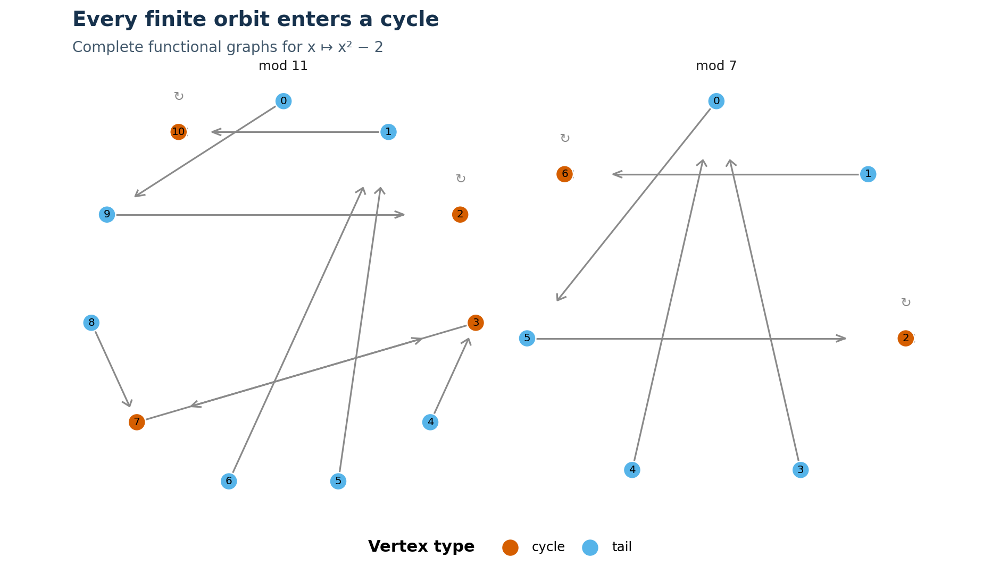

# Arithmetic Dynamics: Orbits, Reduction, and Heights {#sec-arithmetic-dynamics}

**Level and prerequisites: L5.** Prepare rational maps on projective space, heights, valuations and finite-field reduction. Use the [level-specific reading guide](index.md#who-this-book-is-for) for linked Euler preparation.

Number theory often asks for solutions of one equation. Arithmetic dynamics
asks what happens when an arithmetic rule is applied repeatedly. Does an orbit
eventually repeat? Can reduction modulo primes rule out a rational cycle? Does
the arithmetic complexity of the iterates grow predictably? These questions
bring congruence graphs, $p$-adic analysis, projective geometry, Galois theory,
and heights into one framework.

The central complete example is $f(x)=x^2$. Its canonical dynamical height is
exactly the ordinary logarithmic height, so its rational preperiodic points can
be classified. A second example, $x^2-2$, has a useful semiconjugacy to
squaring and produces finite functional graphs that can be reproduced exactly.

## Preparation from this book

Iteration modulo $m$ begins in [sec-congruence](04-congruence.md#sec-congruence), and the Collatz discussion in
[sec-frontiers](14-frontiers.md#sec-frontiers) supplies a careful stopping-rule model. Exact orbit algorithms
come from [sec-computational-nt](22-computational.md#sec-computational-nt). Local distance and Hensel lifting are in
[sec-local-p-adic](19-local-p-adic.md#sec-local-p-adic). Elliptic multiplication and repeated group operations occur
in [sec-elliptic-curves](20-elliptic-curves.md#sec-elliptic-curves), while logarithmic height and Northcott finiteness are
built in [sec-heights-transcendence](29-heights-transcendence.md#sec-heights-transcendence). Curves and rational maps are supported by
[sec-curves-jacobians](35-curves-jacobians.md#sec-curves-jacobians).

The projective line is

$$
\mathbb P^1(K)=\{[X:Y]:(X,Y)\ne(0,0)\}/\sim,
$$

where $[X:Y]=[\lambda X:\lambda Y]$ for $\lambda\in K^\times$. The affine
coordinate $x=X/Y$ covers points with $Y\ne0$, and $[1:0]$ is infinity.
A rational function $\phi(x)\in K(x)$ of degree $d$ extends to

$$
\phi([X:Y])=[F(X,Y):G(X,Y)],
$$

where $F,G$ are homogeneous of degree $d$ with no common nonconstant factor.
The absence of a common projective zero ensures the map is defined everywhere.
A pair such as $[X^2:XY]$ is a nonexample: the common factor $X$ must be
cancelled, and the apparent degree two is false.

## Orbits and portraits

For $P\in\mathbb P^1(K)$, its forward orbit is

$$
\mathcal O_\phi(P)
=\{P,\phi(P),\phi^2(P),\ldots\}.
$$

The point is **periodic of exact period $n$** if
$\phi^n(P)=P$ and no smaller positive iterate fixes it. It is
**preperiodic** if its orbit is finite, equivalently if some two iterates are
equal. A nonpreperiodic point is **wandering**. Its **tail length** is the
number of steps before entering its eventual cycle.

A finite set with one outgoing arrow from every vertex forms a
**functional graph**. Every connected component contains one directed cycle
with directed trees feeding into it. Over a finite field, every orbit is
preperiodic by the pigeonhole principle. Over $\mathbb Q$, that conclusion
fails because the state space is infinite.

For example, $x\mapsto x+1$ on $\mathbb F_p$ is one cycle of length $p$, while
$x\mapsto x+1$ on $\mathbb Q$ has no periodic points in the affine line.
Identical formulas over different state spaces can have opposite orbit
behavior.

A **critical point** of a polynomial is a root of its derivative; for a
rational map, criticality is defined invariantly by local degree. Critical
orbits organize ramification in the iterated covers
$\phi^n:\mathbb P^1\to\mathbb P^1$. A map is
**postcritically finite** when every critical point is preperiodic.

## Conjugacy and semiconjugacy

A fractional linear transformation

$$
\gamma(x)=\frac{ax+b}{cx+d},
\qquad ad-bc\ne0,
$$

is an automorphism of $\mathbb P^1$. The conjugate map

$$
\psi=\gamma^{-1}\circ\phi\circ\gamma
$$

has the same dynamical structure in different coordinates:

$$
\psi^n=\gamma^{-1}\circ\phi^n\circ\gamma.
$$

Periods, tail lengths, and critical orbit relations are preserved. Coefficient
size is not preserved, so a naive height calculation in one coordinate need
not equal the one in another, although canonical heights differ in a controlled
way.

A **semiconjugacy** permits a many-to-one map $\pi$ satisfying
$\pi\circ g=\phi\circ\pi$. It transfers orbits from $g$ to $\phi$ but may
identify different points and periods. For

$$
\pi(z)=z+z^{-1},
\qquad g(z)=z^2,
\qquad\phi(x)=x^2-2,
$$

we have the complete identity

<div id="eq-chebyshev-semiconjugacy" class="equation">

$$
\phi(\pi(z))
=(z+z^{-1})^2-2
=z^2+z^{-2}
=\pi(g(z)). \tag{41.1}
$$

</div>

Thus iterating $x^2-2$ is the quotient of repeated squaring on the
multiplicative group under the identification $z\sim z^{-1}$. It is a
semiconjugacy, not a conjugacy, because $\pi(z)=\pi(z^{-1})$.

## Good and bad reduction

Let $K$ be a number field and choose a homogeneous model
$[F:G]$ with coefficients integral at a prime $\mathfrak p$ and at least one
unit coefficient. Reduction modulo $\mathfrak p$ gives
$[\overline F:\overline G]$. The map has **good reduction** when the reduced
forms retain degree $d$ and have no common projective zero. Equivalently, the
homogeneous resultant is a unit at $\mathfrak p$. Otherwise reduction is bad.

Good reduction gives compatibility:

$$
\widetilde{\phi(P)}
=\widetilde\phi(\widetilde P)
$$

for integral projective representatives. Consequently, a rational periodic
point of exact period $n$ reduces to a point whose period divides $n$. It need
not retain exact period: distinct rational orbit points can collide modulo
$\mathfrak p$.

This supplies an obstruction method. If a rational point had period $n$, then
its reductions at every good prime would have periods dividing $n$, with
additional restrictions from the multiplier. Combining several primes can
leave few possibilities. The converse is false. A cycle modulo many primes
does not automatically lift to a rational cycle, and a different modular point
may realise the period at each prime.

The map $\phi(x)=x^2-2$ has integral coefficients and leading coefficient one,
so it has good reduction at every finite prime. By contrast,
$\psi(x)=x^2/p$ represented as $[X^2:pY^2]$ loses a genuine degree-two second
coordinate modulo $p$; the resultant is divisible by $p$, so reduction is bad.
One cannot use its collapsed modular portrait as though degree were preserved.

For a rational periodic point at a good prime, the reduced period $m$ is only
the first layer of information. The multiplier of the reduced $m$-cycle has a
finite order $r$ in the residue field when it is nonzero. A refined local
period theorem says that the rational period is constrained to have the form

$$
n=m,\qquad n=mr,\qquad\text{or}\qquad n=mrp^e
$$

under the standard nondegeneracy hypotheses, with a bounded range of possible
$e$. We quote the refined theorem rather than prove its formal-group and local
lifting analysis. Its practical lesson is precise: reduction supplies
divisibility candidates, and the multiplier removes many candidates, but one
must not declare $n=m$ automatically.

Combining good primes is also subtler than intersecting the sets of observed
cycle lengths. The same rational point must reduce compatibly at every prime.
If a computation merely finds some cycle of length two modulo five and a
different cycle of length three modulo seven, it has not found a rational point
whose period is simultaneously related to both. A valid obstruction follows a
candidate point or uses a theorem applying to every cycle, with bad primes
listed separately.

## Local dynamics and lifting cycles

Over a complete valued field, a fixed point $P$ has a **multiplier**
$\lambda=\phi'(P)$ in a local affine coordinate. It is attracting when
$|\lambda|<1$, indifferent when $|\lambda|=1$, and repelling when
$|\lambda|>1$. For a cycle, use the derivative of the full return map; the
chain rule makes it the product of derivatives around the cycle.

If $F(x)=\phi^n(x)-x$ and a residue point $\overline P$ satisfies

$$
F(\overline P)\equiv0\pmod p,
\qquad
F'(\overline P)\not\equiv0\pmod p,
$$

Hensel's lemma lifts it uniquely to a root of $F$ in $\mathbb Z_p$. This
produces a point of period dividing $n$. Exact-period verification still
requires ruling out proper divisors. If $F'$ vanishes modulo $p$, multiple
lifts, no lift, or a period change may occur; the simple-root Hensel theorem is
then unavailable.

For $\phi(x)=x^2-2$, fixed points solve

$$
x^2-x-2=(x-2)(x+1)=0.
$$

The multipliers are $4$ at $2$ and $-2$ at $-1$. Over $\mathbb R$, both have
absolute value greater than one. Over $\mathbb Q_2$, both are attracting
because their $2$-adic absolute values are less than one. Attraction is
place-dependent rather than an intrinsic adjective without a chosen absolute
value.

## Canonical dynamical heights

For a rational point $P=[a:b]$ with coprime integers $a,b$, the logarithmic
height is

$$
h(P)=\log\max(|a|,|b|).
$$

Let $\phi\in\mathbb Q(x)$ have degree $d\ge2$. A basic height estimate says

<div id="eq-height-error" class="equation">

$$
|h(\phi(P))-d\,h(P)|\le C_\phi \tag{41.2}
$$

</div>

for all $P$. The constant absorbs coefficient size, common-factor cancellation,
and behavior at infinity.

Define

<div id="eq-canonical-dynamical-height" class="equation">

$$
\widehat h_\phi(P)
=\lim_{n\to\infty}d^{-n}h(\phi^n(P)). \tag{41.3}
$$

</div>

We justify convergence. Put

$$
\epsilon_n=h(\phi^{n+1}(P))-d\,h(\phi^n(P)),
$$

so $|\epsilon_n|\le C_\phi$. Then

$$
d^{-N}h(\phi^N(P))
=h(P)+\sum_{n=0}^{N-1}d^{-n-1}\epsilon_n.
$$

The series converges absolutely because
$\sum d^{-n-1}=1/(d-1)$. Therefore the limit exists, and

$$
|\widehat h_\phi(P)-h(P)|
\le\frac{C_\phi}{d-1}.
$$

Shifting the limit by one index gives the functional equation

<div id="eq-dynamical-height-functional" class="equation">

$$
\widehat h_\phi(\phi(P))=d\,\widehat h_\phi(P). \tag{41.4}
$$

</div>

This is the central derivation. The only quoted input is the uniform estimate
[Equation 41.2](#eq-height-error), whose proof uses homogeneous coefficient bounds.

### Local contributions and denominator growth

The ordinary height decomposes as a sum over places:

$$
h([a:b])
=\sum_v\log\max(|a|_v,|b|_v)
$$

with normalized absolute values and the usual field-degree weights. For a
primitive rational pair, finite places record denominator or common
divisibility information, while the real place records Archimedean size. The
product formula makes the expression invariant under scaling projective
coordinates.

Canonical heights have corresponding local Green functions whose sum is
$\widehat h_\phi$. At good primes, the local term often has a simple
$\log^+$ form; bad primes carry coefficient and cancellation corrections. We
quote this local decomposition as a structural vista. It explains why the
global bounded error in [Equation 41.2](#eq-height-error) is supported by finitely many
coefficient places rather than by uncontrolled noise at every prime.

For the power map and $x=a/b$ in lowest terms,

$$
\phi^n(x)=\frac{a^{2^n}}{b^{2^n}}.
$$

The following ledger computes the ordinary and normalized heights without
ever converting the rational orbit to floating point.

```python
from fractions import Fraction
from math import log

def squaring_height_ledger(
    starting_value: Fraction, maximum_iteration: int
) -> list[tuple[int, Fraction, float, float]]:
    """Return exact iterates and heights for x -> x^2."""
    if maximum_iteration < 0:
        raise ValueError("maximum_iteration must be nonnegative")
    rows: list[tuple[int, Fraction, float, float]] = []
    current_value = starting_value
    for iteration in range(maximum_iteration + 1):
        height = log(
            max(abs(current_value.numerator), current_value.denominator)
        )
        rows.append(
            (iteration, current_value, height, height / 2**iteration)
        )
        current_value *= current_value
    return rows

for row in squaring_height_ledger(Fraction(3, 2), maximum_iteration=4):
    print(row)
```

For this power map, the last column is constant up to floating rounding. This
finite ledger verifies the exact numerator/denominator growth used in the
proof; it does not establish the general canonical-height theorem.

No cancellation occurs, so numerator and denominator grow at exactly the same
exponential height scale. For a general polynomial, cancelling a common factor
after homogenized iteration can change the naive numerator record; projective
normalization must occur before every reported height. Decimal magnitude of the
affine coordinate alone misses a large denominator and is not an arithmetic
height.

## Complete classification for the squaring map

Take $\phi(x)=x^2$. If $P=[a:b]$ is primitive, then
$\phi^n(P)=[a^{2^n}:b^{2^n}]$ remains primitive and

$$
h(\phi^n(P))=2^nh(P).
$$

Hence

<div id="eq-power-map-height" class="equation">

$$
\widehat h_\phi(P)=h(P) \tag{41.5}
$$

</div>

exactly, with no error constant. If $P$ is preperiodic, two iterates agree.
Applying [Equation 41.4](#eq-dynamical-height-functional) at those iterates gives
$2^m\widehat h(P)=2^n\widehat h(P)$ for $m\ne n$, so
$\widehat h(P)=0$. Conversely, [Equation 41.5](#eq-power-map-height) and $h(P)=0$ force a
primitive pair with $\max(|a|,|b|)=1$. The rational points are

$$
0,\quad\infty,\quad1,\quad-1.
$$

They are indeed preperiodic:

$$
0\mapsto0,\qquad
\infty\mapsto\infty,\qquad
1\mapsto1,\qquad
-1\mapsto1.
$$

This completely classifies $\phi$-preperiodic points in
$\mathbb P^1(\mathbb Q)$. The statement would be false over
$\overline{\mathbb Q}$: every root of unity is preperiodic under squaring.
The field is part of the theorem.

## Northcott finiteness and its boundary

Northcott's theorem says that algebraic points of bounded degree and bounded
height form a finite set. Since $\widehat h_\phi=h+O(1)$, it follows that for a
degree-$d\ge2$ rational map over a number field,

$$
\widehat h_\phi(P)=0
\quad\Longleftrightarrow\quad
P\text{ is preperiodic}
$$

for algebraic $P$. The forward implication uses Northcott on the orbit; the
reverse uses the functional equation as above.

For fixed $\phi$ and fixed number field, preperiodic points are therefore
finite. The **uniform boundedness conjecture** asks for a bound depending only
on map degree and field degree, not on the coefficients of $\phi$. In its
general rational-map form this remains open. A plot containing few rational
cycles for several maps is not evidence strong enough to promote the
conjecture to a theorem.

Degree one is a nonexample to the height theory above. The geometric series
used for convergence has ratio one when $d=1$, translations can have wandering
points of only logarithmically growing height, and the canonical normalization
must be redesigned.

## Dynatomic polynomials and exact periods

The equation $\phi^n(x)=x$ finds points whose period divides $n$, not
necessarily points of exact period $n$. Möbius inversion motivates the
**dynatomic expression**

<div id="eq-dynatomic" class="equation">

$$
\Phi_{\phi,n}^*(x)
=\prod_{m\mid n}\bigl(\phi^m(x)-x\bigr)^{\mu(n/m)}. \tag{41.6}
$$

</div>

After cancellations this is a polynomial in the polynomial-map setting. Its
roots usually correspond to exact period $n$, but there can be roots of smaller
period when their cycle multiplier is an appropriate root of unity. Such roots
have **formal period** $n$.

For $n=2$,

$$
\Phi_{\phi,2}^*(x)
=\frac{\phi^2(x)-x}{\phi(x)-x}.
$$

Divisibility is an algebraic theorem, not permission to divide numerical
values at a fixed point where numerator and denominator both vanish. Compute
and cancel polynomials first. Multiplicity, characteristic, and bad reduction
can all change the relationship between formal and exact period.

## Critical orbits and Galois vistas

For $\phi_c(x)=x^2+c$, the only finite critical point is zero. Its orbit

$$
0,\ c,\ c^2+c,\ldots
$$

controls ramification in the equations $\phi_c^n(x)=t$. When the critical orbit
is finite, the map is postcritically finite and its iterated Galois groups have
special constraints. When it is infinite, one studies the action of the
absolute Galois group on the rooted tree of iterated preimages. This is an
**arboreal Galois representation**.

Primitive prime divisors of orbit differences and eventual stability of
iterated polynomials are active themes. We state the vocabulary but no general
surjectivity theorem. The analogy with elliptic divisibility sequences is
helpful, yet a polynomial orbit has no automatic group law.

## Reproducible functional graphs

For $f(x)=x^2-2$ modulo seven,

$$
0\to5\to2\to2,\qquad
1\to6\to6,\qquad
3\to0,\qquad4\to0.
$$

Thus the cycles are the fixed points $2$ and $6$, with every other residue in
a directed tree feeding one of them. The graph modulo eleven is computed by
the same exact rule for residues $0$ through $10$.

<figure id="fig-arithmetic-functional-graphs">


<figcaption>

Figure 41.1: Finite functional graphs for x squared minus two show cycles with directed trees feeding them modulo seven and eleven.

</figcaption>
</figure>

[Figure 41.1](#fig-arithmetic-functional-graphs) uses deterministic circular coordinates,
but the arrows are exact modular computations. Node placement carries no
metric meaning. The figure proves the finite portraits because every residue is
listed and every outgoing edge is evaluated; it says nothing by itself about
rational or real orbits.

A compact certificate stores the modulus, canonical residues, one image for
each residue, and the cycle/tail classification. A checker recomputes every
image, verifies out-degree one, follows arrows until repetition, and confirms
that the reported components partition the vertex set. Coordinates and colors
are presentation data only. Separating graph data from layout makes the proof
of the finite portrait independent of Plotnine.

## Why this does not settle Collatz

The Collatz map is piecewise:

$$
T(n)=
\begin{cases}
n/2,&n\text{ even},\\
3n+1,&n\text{ odd}.
\end{cases}
$$

It is not one degree-$d\ge2$ rational self-map of $\mathbb P^1$. Its branch
depends on a congruence condition, division changes height differently from
multiplication, and the uniform estimate [Equation 41.2](#eq-height-error) with one fixed
$d>1$ does not hold. Congruence graphs and $p$-adic extensions can still be
informative, but the canonical-height theorem cannot simply be cited for
Collatz.

This comparison connects with [sec-frontiers](14-frontiers.md#sec-frontiers): arithmetic dynamics
provides a rigorous language for polynomial and rational iteration, while also
showing precisely why piecewise integer dynamics needs additional machinery.

## Theorem-scope ledger

- **Proved here:** the semiconjugacy [Equation 41.1](#eq-chebyshev-semiconjugacy), convergence
  and functional equation of the canonical height from [Equation 41.2](#eq-height-error), and
  the complete rational preperiodic classification for $x^2$.
- **Quoted:** the uniform height estimate, Northcott's theorem, and general
  dynatomic divisibility facts.
- **Defined as vistas:** postcritical finiteness, primitive orbit divisors, and
  arboreal Galois representations.
- **Open:** uniform boundedness in general. No Collatz conclusion is drawn.

The Galois-tree vista links back to [sec-galois-symmetry](31-galois-symmetry.md#sec-galois-symmetry). Local cycle lifting
uses [sec-local-fields](38-local-fields.md#sec-local-fields), and the representation viewpoint points forward to
[sec-automorphic-langlands](42-automorphic-langlands.md#sec-automorphic-langlands) without asserting a direct Langlands correspondence
for arbitrary dynamical systems.

<!-- inline-formula-code:start -->
## Formula and finite computation

A useful formula in this chapter is

$$
x_{n+1}=x_n^2+c\pmod p
$$

A state dictionary separates the preperiod from the eventual cycle. The following standalone Python block expresses that finite rule with its inputs and stopping conditions visible.

```python
def quadratic_orbit_portrait(
    modulus: int,
    constant_term: int,
    starting_value: int,
) -> tuple[list[int], list[int]]:
    """Return the preperiod and cycle of x -> x^2 + constant_term modulo m."""
    if modulus <= 1:
        raise ValueError("modulus must exceed one")
    first_seen: dict[int, int] = {}
    orbit: list[int] = []
    state = starting_value % modulus
    for _ in range(modulus + 1):
        if state in first_seen:
            cycle_start = first_seen[state]
            return orbit[:cycle_start], orbit[cycle_start:]
        first_seen[state] = len(orbit)
        orbit.append(state)
        state = (state * state + constant_term) % modulus
    raise RuntimeError("a repeated state must occur within modulus + 1 steps")

print(
    quadratic_orbit_portrait(
        modulus=19,
        constant_term=1,
        starting_value=2,
    )
)
```

**What the computation establishes.** The output certifies only the declared finite case. The theorem, if one is claimed, still requires the argument developed in the chapter.
<!-- inline-formula-code:end -->

## Summary and vocabulary

Arithmetic dynamics studies repeated maps over arithmetic state spaces.
Conjugacy preserves portraits; good reduction transfers rational cycles to
finite fields with possible period collapse; local multipliers depend on the
chosen place. Canonical height removes bounded coefficient noise and turns
iteration into exact multiplication by the degree. Dynatomic polynomials
separate formal periods only after multiplicity audits.

Key terms are **periodic**, **preperiodic**, **wandering**, **good reduction**,
**multiplier**, **canonical dynamical height**, **dynatomic polynomial**,
**critical orbit**, and **postcritically finite**.

## Exercises

<div class="exercise" id="number_theory-41-arithmetic-dynamics-ex-1">
<p class="exercise-title"><strong>Exercise 1</strong></p>

Prove that every component of a finite functional graph contains exactly one
directed cycle.

</div>

<div class="exercise" id="number_theory-41-arithmetic-dynamics-ex-2">
<p class="exercise-title"><strong>Exercise 2</strong></p>

List the orbit, tail length, and exact period of every residue under
$x^2-2\bmod7$.

</div>

<div class="exercise" id="number_theory-41-arithmetic-dynamics-ex-3">
<p class="exercise-title"><strong>Exercise 3</strong></p>

Verify [Equation 41.1](#eq-chebyshev-semiconjugacy) and explain why $\pi$ is not injective.

</div>

<div class="exercise" id="number_theory-41-arithmetic-dynamics-ex-4">
<p class="exercise-title"><strong>Exercise 4</strong></p>

Show that conjugate maps have corresponding exact periods.

</div>

<div class="exercise" id="number_theory-41-arithmetic-dynamics-ex-5">
<p class="exercise-title"><strong>Exercise 5</strong></p>

Give a rational periodic point whose reduction at a good prime has smaller
exact period.

<details class="hint"><summary>Hint 1</summary>

choose a rational point of exact period at least two whose distinct orbit points become
  equal after reduction; good reduction preserves period divisibility, not
  exactness.

</details>

</div>

<div class="exercise" id="number_theory-41-arithmetic-dynamics-ex-6">
<p class="exercise-title"><strong>Exercise 6</strong></p>

Determine whether the fixed points $2$ and $-1$ of $x^2-2$ are attracting
at the real, $2$-adic, and $3$-adic places.

</div>

<div class="exercise" id="number_theory-41-arithmetic-dynamics-ex-7">
<p class="exercise-title"><strong>Exercise 7</strong></p>

Fill in the telescoping identity used to prove convergence of [Equation 41.3](#eq-canonical-dynamical-height).

</div>

<div class="exercise" id="number_theory-41-arithmetic-dynamics-ex-8">
<p class="exercise-title"><strong>Exercise 8</strong></p>

Classify the rational preperiodic points of $x^3$ on $\mathbb P^1$.

</div>

<div class="exercise" id="number_theory-41-arithmetic-dynamics-ex-9">
<p class="exercise-title"><strong>Exercise 9</strong></p>

Compute $\Phi_{\phi,2}^*$ for $\phi(x)=x^2-1$ and test the exact periods of
its roots.

<details class="hint"><summary>Hint 1</summary>

compute $\phi^2(x)-x$ as a polynomial and divide by
  $\phi(x)-x$ before substituting roots.

</details>

</div>

<div class="exercise" id="number_theory-41-arithmetic-dynamics-ex-10">
<p class="exercise-title"><strong>Exercise 10</strong></p>

Explain why solving $\phi^6(x)=x$ includes possible periods
$1,2,3$, and $6$.

</div>

<div class="exercise" id="number_theory-41-arithmetic-dynamics-ex-11">
<p class="exercise-title"><strong>Exercise 11</strong></p>

Give a certificate schema for a functional graph modulo a prime, including
completeness and edge checks.

</div>

<div class="exercise" id="number_theory-41-arithmetic-dynamics-ex-12">
<p class="exercise-title"><strong>Exercise 12</strong></p>

Identify each failed hypothesis in an attempted application of the
degree-two canonical-height theorem to the Collatz map.

<details class="hint"><summary>Hint 1</summary>

identify the single rational map, fixed degree at least two, and
  uniform height-growth estimate that the piecewise Collatz rule lacks.

</details>

</div>

## Selected solutions

**Solution to Exercise 1.** Starting at any vertex and following outgoing
arrows eventually repeats a vertex because the component is finite. The
repeated segment is a directed cycle. If one weakly connected component
contained two directed cycles, no forward path could leave either cycle.
Ignoring arrow directions, a path between them would have to contain a vertex
whose forward arrow eventually chooses both cycles, impossible because every
vertex has exactly one outgoing edge. Hence each component has exactly one
cycle.

**Solution to Exercise 6.** The multiplier is $f'(x)=2x$. At $2$ it is $4$;
at $-1$ it is $-2$. Their real absolute values exceed one, so both are
repelling over $\mathbb R$. Their $2$-adic absolute values are
$|4|_2=1/4$ and $|-2|_2=1/2$, so both are attracting over $\mathbb Q_2$.
Their $3$-adic absolute values are both one, so they are indifferent over
$\mathbb Q_3$. The orbit relation is global, but the stability label is local.

**Solution to Exercise 8.** For $\phi(x)=x^3$ and primitive
$P=[a:b]$,

$$
h(\phi^n(P))=3^nh(P),
$$

so $\widehat h_\phi=h$. A rational preperiodic point must have height zero,
hence is one of $0,\infty,1,-1$. All four are periodic:
$0,\infty,1$ are fixed and $-1$ is fixed because $(-1)^3=-1$.
Therefore these are exactly the rational preperiodic points.
