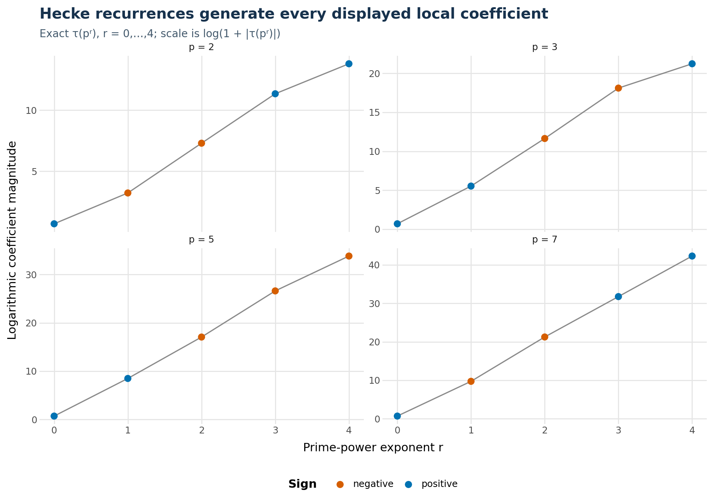

# Automorphic Forms and the Langlands Dictionary {#sec-automorphic-langlands}

**Level and prerequisites: L5.** Prepare adeles, harmonic analysis on groups, smooth representations and Galois representations. Use the [level-specific reading guide](index.md#who-this-book-is-for) for linked Euler preparation.

Earlier chapters produced several kinds of local arithmetic data: Dirichlet
characters, Frobenius elements, Hecke eigenvalues, point-count traces, and
local Euler factors. Why do these data assemble into global functions with
functional equations, and when do two apparently different arithmetic objects
encode the same information? Automorphic representation theory supplies a
common language. The Langlands programme proposes a far-reaching reciprocity
dictionary between such representations and Galois data.

This chapter builds that dictionary from the inside of the book. It proves the
Euler product attached to a Hecke eigenform from its coefficient recurrence,
computes exact Ramanujan tau examples, and explains the local-to-global
representation architecture. Established theorems, special cases, and broad
conjectures are separated explicitly.

## Preparation from this book

Characters and Euler products come from [sec-l-functions](27-l-functions.md#sec-l-functions). Classical modular
forms and Hecke operators are developed in [sec-modular-forms](28-modular-forms.md#sec-modular-forms). Galois
representations begin with the field symmetries in [sec-galois-symmetry](31-galois-symmetry.md#sec-galois-symmetry), while
adeles and restricted products are in [sec-adeles-ideles](34-adeles-ideles.md#sec-adeles-ideles). Frobenius
polynomials of curves appear in [sec-curve-zeta](39-curve-zeta.md#sec-curve-zeta), and class field theory in
[sec-class-field-theory](40-class-field-theory.md#sec-class-field-theory) is the complete one-dimensional model.

The only genuinely new prerequisite is linear representation theory. Let $G$
be a group and $V$ a finite-dimensional vector space over a field $F$. A
**representation** is a homomorphism

$$
\rho:G\longrightarrow GL(V).
$$

A subspace $W\subseteq V$ is invariant when $\rho(g)W\subseteq W$ for every
$g\in G$. The representation is **irreducible** when its only invariant
subspaces are $0$ and $V$. Two representations are equivalent if a change of
basis $A:V\to V'$ intertwines them:

$$
A\rho(g)=\rho'(g)A.
$$

The **character** is $\chi_\rho(g)=\operatorname{tr}(\rho(g))$. It is constant
on conjugacy classes. A one-dimensional representation is simply a
multiplicative character $G\to F^\times$.

## Representations: examples and nonexamples

Let $C_n=\langle g\rangle$. Over a field containing all $n$th roots of unity,
every irreducible representation of $C_n$ is one-dimensional:

$$
\rho_j(g)=\zeta_n^j.
$$

This diagonal behavior reflects that finite abelian groups have only
one-dimensional complex irreducibles. It is the representation-theoretic
reason class field theory is a $GL_1$ theory.

The permutation action of $S_3$ on $F^3$ is reducible: the line spanned by
$(1,1,1)$ is invariant. Its complement

$$
\{(x_1,x_2,x_3):x_1+x_2+x_3=0\}
$$

is a two-dimensional invariant subspace when the characteristic does not
divide six. The resulting two-dimensional representation is irreducible over
$\mathbb C$. Merely writing noncommuting matrices does not prove
irreducibility; one must rule out every common invariant subspace.

A matrix is not itself a representation. Assigning a matrix to one group
element must respect all relations. For a generator of $C_3$, a proposed
matrix $A$ must satisfy $A^3=I$. Likewise, matching traces for a few elements
does not prove two representations equivalent without a theorem guaranteeing
that the tested character data are sufficient.

For topological groups such as $GL_2(\mathbb Q_p)$, representations are also
required to satisfy continuity or smoothness conditions. A representation is
**smooth** when every vector is fixed by some open compact subgroup. This is
the natural algebraic category for non-Archimedean local groups.

## The $GL_1$ model: Hecke characters

Class field theory identifies continuous finite-order characters of the idele
class group

$$
C_K=\mathbb A_K^\times/K^\times
$$

with one-dimensional abelian Galois characters. More general continuous
characters

$$
\chi:C_K\longrightarrow\mathbb C^\times
$$

with controlled Archimedean behavior are **Hecke characters**. They factor as
a restricted product of local characters $\chi_v:K_v^\times\to\mathbb C^\times$.
At almost every finite place, $\chi_v$ is unramified, meaning it is trivial on
$\mathcal O_v^\times$ and determined by its value on a uniformizer.

The associated Euler factor is

$$
L_v(s,\chi_v)
=\frac1{1-\chi_v(\pi_v)q_v^{-s}}
$$

at an unramified finite place. Ramified local factors require a declared
convention and may equal one for a primitive finite-order character in the
classical Dirichlet normalization. Multiplying the unramified factors recovers
the Hecke $L$-function. For $K=\mathbb Q$, finite-order Hecke characters with
the appropriate infinity component recover primitive Dirichlet characters and
their $L$-functions from [sec-l-functions](27-l-functions.md#sec-l-functions).

Global reciprocity sends the idele class character to a character of the
abelianized Galois group. Thus the equality of local Euler factors on the two
sides is not analogy: it is the $GL_1$ reciprocity theorem. This case is
proved by class field theory. The higher-dimensional Langlands programme asks
for an analogous relationship when one-dimensional characters are replaced by
representations of $GL_n$.

## Local $GL_2$ and the spherical Hecke algebra

Fix a prime $p$. Let

$$
G_p=GL_2(\mathbb Q_p),
\qquad
K_p=GL_2(\mathbb Z_p).
$$

The subgroup $K_p$ is open and compact. An irreducible smooth representation
$\pi_p$ of $G_p$ is **unramified** when it contains a nonzero
$K_p$-fixed vector. In an irreducible unramified representation, that fixed
line is one-dimensional.

Compactly supported, bi-$K_p$-invariant functions on $G_p$ form the
**spherical Hecke algebra** under convolution. Its basic operator is supported
on the double coset

$$
K_p
\begin{pmatrix}p&0\\0&1\end{pmatrix}
K_p.
$$

Acting on the fixed line produces a scalar. After a chosen normalization, this
scalar is the familiar Hecke eigenvalue $a_p$.

The double-coset language is not decorative. Left and right multiplication by
$K_p$ make the operator independent of integral changes of local basis.
Convolution records composition of correspondences. A single matrix
$\operatorname{diag}(p,1)$ would not by itself act canonically on automorphic
functions because its representatives vary across the quotient.

An unramified representation is encoded by two nonzero **Satake parameters**
$\alpha_p,\beta_p$, unordered. For a holomorphic eigenform of weight $k$ in
the arithmetic normalization,

$$
\alpha_p+\beta_p=a_p,\qquad
\alpha_p\beta_p=\chi(p)p^{k-1}
$$

at primes not dividing the level, where $\chi$ is the nebentypus. For trivial
nebentypus this product is $p^{k-1}$. The local standard factor is

<div id="eq-satake-local-factor" class="equation">

$$
L_p(s,\pi_p)
=\frac1{(1-\alpha_pp^{-s})(1-\beta_pp^{-s})}. \tag{42.1}
$$

</div>

In the unitary normalization, divide both parameters by
$p^{(k-1)/2}$ and shift the $s$ variable accordingly. Mixing the arithmetic
coefficient $a_p$ with unitary parameters is a common source of missing powers
of $p$.

## Adelic automorphic forms

Let $\mathbb A=\mathbb A_{\mathbb Q}$. A classical modular form is tied to the
upper half-plane and a congruence subgroup. An adelic automorphic form is a
function on

$$
GL_2(\mathbb Q)\backslash GL_2(\mathbb A)
$$

with specified transformation under the center, finite-dimensional behavior
under a maximal compact group at infinity, smoothness, moderate growth, and
finiteness under suitable Hecke and Lie-algebra actions. A **cuspidal** form
has zero constant term along the upper-triangular unipotent subgroup:

$$
\int_{\mathbb Q\backslash\mathbb A}
\varphi\left(
\begin{pmatrix}1&x\\0&1\end{pmatrix}g
\right)\,dx=0.
$$

This adelic quotient handles every prime and the real place simultaneously.
Left quotient by $GL_2(\mathbb Q)$ identifies global changes of rational
basis. Right translation by $GL_2(\mathbb A)$ generates a representation.
An irreducible constituent is an **automorphic representation**.

Not every function on the quotient is automorphic in the useful sense.
Growth, smoothness, central character, and finiteness conditions control an
otherwise enormous function space. Nor is every automorphic representation
cuspidal: Eisenstein series contribute continuous and residual spectrum.
The distinction parallels cusp forms versus general modular forms in
[sec-modular-forms](28-modular-forms.md#sec-modular-forms).

The center consists of scalar matrices and is isomorphic to
$\mathbb A^\times$. A central character
$\omega:\mathbb Q^\times\backslash\mathbb A^\times\to\mathbb C^\times$
specifies

$$
\varphi(zg)=\omega(z)\varphi(g).
$$

Without fixing the central character, square-integrability on the quotient
must be modified because the center has a noncompact direction.

### Whittaker coefficients and uniqueness

Classical Fourier coefficients also have an adelic interpretation. Fix a
nontrivial additive character
$\psi:\mathbb Q\backslash\mathbb A\to\mathbb C^\times$. The Whittaker
coefficient of a cuspidal automorphic form is

$$
W_\varphi(g)
=\int_{\mathbb Q\backslash\mathbb A}
\varphi\left(
\begin{pmatrix}1&x\\0&1\end{pmatrix}g
\right)\overline{\psi(x)}\,dx.
$$

Changing the additive character to $\psi(nx)$ extracts the analogue of the
$n$th classical Fourier coefficient. Cuspidality removes the zero-frequency
constant term, leaving genuinely oscillatory data.

For irreducible generic representations of $GL_2$, a Whittaker model is unique
up to scaling. This multiplicity-one statement at the model level is a quoted
local and global theorem, distinct from strong multiplicity one for
representations. After normalizing the first coefficient, uniqueness lets a
global Whittaker function factor into local Whittaker functions:

$$
W_\varphi(g)=\prod_vW_v(g_v)
$$

for a decomposable vector. Evaluating suitable diagonal matrices converts this
factorization into multiplicativity of Fourier coefficients and the Euler
product. The Hecke derivation below proves the coefficient identity directly;
the Whittaker model explains why the same structure persists far beyond
holomorphic level-one forms.

An arbitrary Fourier expansion need not factor. Factorization uses
irreducibility, a decomposable automorphic vector, uniqueness of the Whittaker
functional, and compatible Haar measures and additive characters. Dropping
these hypotheses turns a conceptual proof into an unsupported slogan.

## From classical newforms to automorphic representations

Let

$$
f(\tau)=\sum_{n\ge1}a_nq^n,\qquad q=e^{2\pi i\tau},
$$

be a normalized cuspidal newform of weight $k$, level $N$, and nebentypus
$\chi$. The classical transformation law controls the real component; the
level subgroup controls the finite components. Adelic lifting produces a
function $\varphi_f$ whose right translates generate an irreducible cuspidal
automorphic representation

<div id="eq-restricted-tensor" class="equation">

$$
\pi_f\cong\bigotimes_v'\pi_{f,v}. \tag{42.2}
$$

</div>

The prime on the tensor product means **restricted**: for almost every prime
$p\nmid N$, the local representation is unramified and a distinguished
spherical vector is chosen. Arbitrary tensor choices at infinitely many places
would not define the global representation.

At a good prime, the classical Hecke eigenvalue and the local Satake trace
agree. At primes dividing $N$, the representation is ramified; its conductor
exponent, fixed-vector spaces, and local factor change. Writing the same
quadratic Euler factor at every prime is generally wrong.

The newform hypothesis matters. An oldform can share Hecke data inherited from
a lower level, and a non-eigenform does not determine one compatible scalar
$a_p$ for every Hecke operator. Decomposing into normalized newforms is the
classical counterpart of decomposing the automorphic representation into
irreducibles.

### Local parameters and monodromy

The local Langlands parameter for $GL_n(K_v)$ is not generally just one
Frobenius matrix. It is an $n$-dimensional representation of the
Weil–Deligne group, which may be described by a Weil-group action together
with a nilpotent monodromy operator $N$ satisfying a compatibility relation.
For an unramified representation, inertia acts trivially and $N=0$; the
semisimple Frobenius eigenvalues are the Satake parameters.

At a ramified place, inertia and monodromy carry information invisible in the
unramified Euler polynomial. The local factor is built from Frobenius acting
on an appropriate inertia-invariant kernel of $N$, while the conductor records
both tame and wild ramification. Epsilon factors also depend on a chosen
additive character and Haar measure, although the completed global equation
becomes canonical once all normalizations are coordinated.

This viewpoint connects three earlier objects. The inertia groups of
[sec-local-fields](38-local-fields.md#sec-local-fields) supply the ramification filtration; the Artin conductor from
[sec-class-field-theory](40-class-field-theory.md#sec-class-field-theory) measures a Galois parameter; and the automorphic
conductor measures the matched local representation. Local Langlands is
required to preserve $L$- and epsilon factors. Matching only unramified traces
therefore leaves a genuine hole at the bad primes rather than a finite
bookkeeping inconvenience.

For an elliptic curve with multiplicative reduction, the associated local
automorphic representation is a twist of the Steinberg representation. Its
Weil–Deligne parameter has nonzero monodromy. Good reduction instead gives an
unramified two-dimensional parameter. Additive reduction may require a more
ramified parameter. We state these classifications as a boundary map; deriving
them needs reduction theory and local representation theory omitted here.

## Complete Hecke-to-Euler derivation

Let $f=\sum_{n\ge1}a_nq^n$ be a normalized Hecke eigenform of weight $k$ and
level one, so $a_1=1$. Its coefficients satisfy

<div id="eq-hecke-coprime" class="equation">

$$
a_{mn}=a_ma_n\quad\text{when }\gcd(m,n)=1 \tag{42.3}
$$

</div>

and

<div id="eq-hecke-prime-recurrence" class="equation">

$$
a_{p^{r+1}}
=a_pa_{p^r}-p^{k-1}a_{p^{r-1}}
\qquad(r\ge1). \tag{42.4}
$$

</div>

Fix $p$ and form

$$
A_p(X)=\sum_{r\ge0}a_{p^r}X^r.
$$

Multiply by $1-a_pX+p^{k-1}X^2$. The constant coefficient is $a_1=1$.
The coefficient of $X$ is $a_p-a_p=0$. For $r\ge2$, the coefficient is

$$
a_{p^r}-a_pa_{p^{r-1}}+p^{k-1}a_{p^{r-2}}=0
$$

by [Equation 42.4](#eq-hecke-prime-recurrence). Therefore, as a formal power series,

<div id="eq-hecke-local-generating" class="equation">

$$
A_p(X)=\frac1{1-a_pX+p^{k-1}X^2}. \tag{42.5}
$$

</div>

Unique prime factorization and [Equation 42.3](#eq-hecke-coprime) now give

<div id="eq-hecke-euler-product" class="equation">

$$
\begin{aligned}
\sum_{n\ge1}\frac{a_n}{n^s}
&=\prod_p\sum_{r\ge0}\frac{a_{p^r}}{p^{rs}}\\
&=\prod_p
\frac1{1-a_pp^{-s}+p^{k-1-2s}}.
\end{aligned} \tag{42.6}
$$

</div>

The formal coefficient identity is complete. Interpreting the product and
series as analytic functions requires a right half-plane of absolute
convergence before rearrangement. Meromorphic or entire continuation and the
functional equation require the modular or automorphic theory; they do not
follow from multiplicativity alone.

Factoring the quadratic denominator gives

$$
1-a_pX+p^{k-1}X^2
=(1-\alpha_pX)(1-\beta_pX),
$$

so [Equation 42.5](#eq-hecke-local-generating) agrees exactly with
[Equation 42.1](#eq-satake-local-factor) after $X=p^{-s}$. The elementary recurrence and the
local representation are two descriptions of the same unramified factor.

## Reproducible Ramanujan tau case study

The discriminant cusp form is

$$
\Delta(q)=q\prod_{n\ge1}(1-q^n)^{24}
=\sum_{n\ge1}\tau(n)q^n.
$$

It is a normalized level-one eigenform of weight $12$. A finite coefficient
calculation truncates every factor above the requested degree and uses the
binomial expansion

$$
(1-q^n)^{24}
=\sum_{j=0}^{24}(-1)^j\binom{24}{j}q^{nj}.
$$

This finite product truncation computes coefficients exactly:

```python
from math import comb

def ramanujan_tau_coefficients(limit: int) -> list[int]:
    """Return [tau(0), ..., tau(limit)] from the truncated Delta product."""
    if limit < 1:
        raise ValueError("limit must be positive")
    product = [1] + [0] * (limit - 1)
    for factor_exponent in range(1, limit):
        updated = [0] * limit
        maximum_power = min(24, (limit - 1) // factor_exponent)
        factor_terms = [
            ((-1) ** power) * comb(24, power)
            for power in range(maximum_power + 1)
        ]
        for current_degree, current_coefficient in enumerate(product):
            if current_coefficient == 0:
                continue
            for power, factor_coefficient in enumerate(factor_terms):
                new_degree = current_degree + factor_exponent * power
                if new_degree >= limit:
                    break
                updated[new_degree] += (
                    current_coefficient * factor_coefficient
                )
        product = updated
    return [0] + product

tau = ramanujan_tau_coefficients(limit=12)
print([(integer, tau[integer]) for integer in range(1, 13)])
```

Terms of degree above the requested limit cannot affect these coefficients, so
the truncation is exact rather than numerical. This multiplication establishes
the finite coefficient list, not modularity of $\Delta$.

No online coefficient table is required. The initial exact values include

$$
\tau(2)=-24,\qquad
\tau(3)=252,\qquad
\tau(5)=4830.
$$

The prime-power recurrence has $p^{11}$:

$$
\tau(p^{r+1})
=\tau(p)\tau(p^r)-p^{11}\tau(p^{r-1}).
$$

For $p=2$,

$$
\tau(4)=(-24)^2-2^{11}
=576-2048=-1472,
$$

and

$$
\tau(8)
=(-24)(-1472)-2^{11}(-24)
=84480.
$$

For $p=3$,

$$
\tau(9)=252^2-3^{11}
=63504-177147=-113643.
$$

Coprime multiplicativity independently gives

$$
\tau(6)=\tau(2)\tau(3)=-6048.
$$

The distinction between the last two formulas is essential. Applying
$\tau(mn)=\tau(m)\tau(n)$ to $m=n=2$ would incorrectly give
$\tau(4)=576$ and omit the local determinant term $2^{11}$.

<figure id="fig-hecke-local-coefficients">


<figcaption>

Figure 42.1: Exact Ramanujan tau coefficients generated by local Hecke recurrences vary in sign and scale across prime powers.

</figcaption>
</figure>

[Figure 42.1](#fig-hecke-local-coefficients) first obtains $\tau(p)$ from a finite exact
product expansion, then generates prime powers by the displayed recurrence.
Color records sign and vertical scale records $\log(1+|\tau(p^r)|)$ so both
small and large values remain visible. The plot illustrates local recurrence
structure; it does not prove modularity of $\Delta$ or any asymptotic sign law.

The Ramanujan–Petersson estimate, proved for holomorphic eigenforms by Deligne,
says

$$
|a_p|\le2p^{(k-1)/2}
$$

at good primes. Equivalently, the unitary Satake parameters have complex
absolute value one. This is a quoted deep theorem. The finite coefficient
generator checks the inequality for its displayed range but is not its proof.

## Automorphic L-functions and conductors

For an automorphic representation
$\pi=\bigotimes_v'\pi_v$, the standard $L$-function is assembled from local
factors:

$$
L(s,\pi)=\prod_vL(s,\pi_v).
$$

At almost every finite place, the factor is the unramified Satake factor. A
completed function also includes Archimedean gamma factors. Functional
equations take the schematic form

$$
\Lambda(s,\pi)
=\varepsilon(s,\pi)\Lambda(1-s,\widetilde\pi),
$$

where $\widetilde\pi$ is the contragredient and the epsilon factor includes the
root number and conductor power. Normalization may move the symmetry center
from $1/2$ to another value. A correct formula states whether coefficients,
Satake parameters, and the $s$ variable are arithmetic or unitary normalized.

### A normalization ledger

Four related normalizations regularly coexist:

1. the holomorphic coefficient $a_p$ from a weight-$k$ Fourier expansion;
2. arithmetic Satake parameters with product $\chi(p)p^{k-1}$;
3. unitary Satake parameters obtained by division by $p^{(k-1)/2}$;
4. arithmetic or geometric Frobenius on the Galois side.

In arithmetic normalization, the local polynomial is

$$
1-a_pT+\chi(p)p^{k-1}T^2.
$$

After unitary normalization, it becomes

$$
1-\frac{a_p}{p^{(k-1)/2}}T+\chi(p)T^2.
$$

Replacing arithmetic Frobenius by geometric Frobenius inverts the eigenvalues;
it does not merely negate $a_p$. A data table should therefore have explicit
columns for weight, character, Frobenius convention, and normalization. If one
of those columns is missing, numerical agreement may be an artifact of a
silent shift in $s$.

The completed functional equation also depends on this choice. Classical
holomorphic notation often relates $s$ to $k-s$, whereas unitary automorphic
notation centers the equation at $1/2$. They are the same symmetry after the
shift by $(k-1)/2$. Calling them contradictory would confuse coordinates with
content.

The global conductor is a product of local prime powers measuring ramification.
At unramified primes its exponent is zero. For a modular newform, it matches
the level after the appropriate primitive normalization. An imprimitive form
or an Euler product with omitted bad factors can have a displayed level larger
than the representation's conductor.

**Strong multiplicity one, quoted for $GL_n$.** Two cuspidal automorphic
representations with isomorphic local components at all but finitely many
places are globally isomorphic. Thus almost all unramified local factors
determine the global representation. “Almost all” cannot be weakened to “the
first several primes observed in a table.” The theorem uses an infinite
cofinite set of places and substantial analytic input.

The converse problem is delicate. A Dirichlet series with a plausible Euler
product and functional equation is not automatically automorphic. Converse
theorems impose families of twisted functional equations and growth
conditions. Numerical agreement of coefficients can identify a candidate but
does not manufacture the missing hypotheses.

## Galois representations and matching Frobenius

Let $f$ be a normalized newform of weight $k\ge2$, level $N$, and character
$\chi$. For each suitable prime $\ell$, there is a two-dimensional
$\ell$-adic Galois representation

$$
\rho_{f,\ell}:
\operatorname{Gal}(\overline{\mathbb Q}/\mathbb Q)
\longrightarrow GL_2(\overline{\mathbb Q}_\ell)
$$

such that for $p\nmid N\ell$,

<div id="eq-galois-hecke-match" class="equation">

$$
\operatorname{tr}\rho_{f,\ell}(\operatorname{Frob}_p)=a_p,
\qquad
\det\rho_{f,\ell}(\operatorname{Frob}_p)=\chi(p)p^{k-1}. \tag{42.7}
$$

</div>

Hence the characteristic polynomial of Frobenius matches the Hecke polynomial

$$
X^2-a_pX+\chi(p)p^{k-1}.
$$

This is the precise bridge between the Galois and automorphic columns of the
dictionary. Frobenius is excluded at ramified primes, and the arithmetic versus
geometric convention must match the polynomial.

For an elliptic curve $E/\mathbb Q$ and a good prime $p$, the Tate-module
representation has Frobenius polynomial

$$
X^2-a_p(E)X+p,
\qquad
a_p(E)=p+1-\#E(\mathbb F_p).
$$

The modularity theorem says there is a weight-two newform whose coefficients
match these traces at all good primes. Thus the curve local factor from
[sec-curve-zeta](39-curve-zeta.md#sec-curve-zeta) and the automorphic local factor are equal. The theorem is
proved, but its proof is far beyond this book. Counting points at five primes
checks a proposed curve-form identification; it does not prove modularity.

Bad primes contain important information rather than dispensable noise.
Reduction type determines a modified curve Euler factor, and the automorphic
local representation may be special or supercuspidal. A global comparison
that deletes bad primes can establish an incomplete $L$-function identity but
must restore conductor and epsilon factors before claiming equality of
completed functions.

## The Langlands dictionary

The dictionary can now be read column by column:

| Galois or arithmetic side | automorphic side |
|:---|:---|
| one-dimensional abelian Galois character | Hecke character of $C_K$ |
| Frobenius conjugacy class at an unramified place | Satake conjugacy class |
| characteristic polynomial of Frobenius | local Euler denominator |
| ramification and Artin conductor | ramified local component and conductor |
| direct sum | isobaric or spectral sum |
| tensor operation on representations | predicted functorial transfer |

For $GL_1$, the global dictionary is class field theory and is established.
For $GL_2/\mathbb Q$, modular forms, elliptic curves, and many two-dimensional
Galois representations supply major established correspondences. Local
Langlands for $GL_n$ over non-Archimedean local fields is a theorem: it matches
irreducible admissible representations with $n$-dimensional Weil–Deligne
parameters while preserving local factors.

The broad global claim that every appropriate Galois representation is
automorphic is not a single proved theorem in all dimensions and over all
number fields. It is a family of conjectures with many deep cases. Likewise,
**functoriality** predicts that a homomorphism between dual groups transfers
automorphic representations while transforming Satake parameters. Some
transfers are known; the general principle remains conjectural.

The word **correspondence** must therefore carry a status label. GL$_1$ class
field theory, modularity of elliptic curves over $\mathbb Q$, local Langlands
for GL$_n$, and a proposed higher-dimensional global reciprocity statement do
not share one proof status merely because they occupy the same table.

## A local-factor audit workflow

A reproducible comparison between arithmetic and automorphic data should:

1. declare the global object, base field, coefficient normalization, and
   conductor;
2. list the excluded ramified places and why they are excluded;
3. compute arithmetic Frobenius traces exactly at a finite declared set of good
   places;
4. compute Hecke eigenvalues from an exact expansion or certified symbol
   algorithm;
5. compare both trace and determinant, not trace alone;
6. record which theorem upgrades finite checks to a global identification.

Two monic quadratic polynomials can have the same trace and different
determinant. Therefore matching only $a_p$ without verifying the character and
$p^{k-1}$ determinant leaves the local representation ambiguous. Conversely,
matching complete local polynomials at finitely many primes remains finite
evidence unless a Sturm bound, multiplicity-one theorem with its actual
hypotheses, or another finite certification theorem applies.

For classical modular forms in a known finite-dimensional space, Sturm's
theorem can turn a sufficiently long coefficient comparison into proof of
equality. The required bound depends on weight and level. “The first hundred
coefficients agree” is not self-certifying unless one shows that one hundred
exceeds the relevant bound and both candidates are already proved modular
forms in the same space.

## Theorem-scope ledger

- **Proved here:** the representation repair examples, the complete
  Hecke-recurrence derivation of local factors and the Euler product, and the
  exact Ramanujan tau calculations.
- **Quoted established theorems:** adelic newform decomposition, Deligne's
  bound, strong multiplicity one, Galois representations attached to newforms,
  modularity of elliptic curves over $\mathbb Q$, and local Langlands for
  $GL_n$.
- **Established model:** global $GL_1$ reciprocity is class field theory.
- **Conjectural in broad form:** unrestricted global Langlands reciprocity and
  general functoriality. Finite coefficient plots prove neither.

This chapter closes the route
[sec-l-functions](27-l-functions.md#sec-l-functions) $\to$ [sec-modular-forms](28-modular-forms.md#sec-modular-forms) $\to$
[sec-adeles-ideles](34-adeles-ideles.md#sec-adeles-ideles) $\to$ [sec-class-field-theory](40-class-field-theory.md#sec-class-field-theory) by identifying the common
local factors. It also links the curve numerator in [sec-curve-zeta](39-curve-zeta.md#sec-curve-zeta) to
weight-two automorphic data.

<!-- inline-formula-code:start -->
## Formula and finite computation

A useful formula in this chapter is

$$
a_{p^{r+1}}=a_pa_{p^r}-p^{k-1}a_{p^{r-1}}
$$

The local Hecke recurrence generates a finite coefficient packet from its initial data. The following standalone Python block expresses that finite rule with its inputs and stopping conditions visible.

```python
def hecke_prime_power_coefficients(
    prime_modulus: int,
    modular_weight: int,
    prime_coefficient: int,
    maximum_exponent: int,
) -> list[int]:
    """Return a_(p^r) for 0 <= r <= maximum_exponent."""
    if prime_modulus < 2 or modular_weight < 2 or maximum_exponent < 0:
        raise ValueError("require p >= 2, weight >= 2, and exponent >= 0")
    if maximum_exponent == 0:
        return [1]
    coefficients = [1, prime_coefficient]
    for _ in range(1, maximum_exponent):
        coefficients.append(
            prime_coefficient * coefficients[-1]
            - prime_modulus ** (modular_weight - 1) * coefficients[-2]
        )
    return coefficients

print(
    hecke_prime_power_coefficients(
        prime_modulus=2,
        modular_weight=12,
        prime_coefficient=-24,
        maximum_exponent=5,
    )
)
```

**What the computation establishes.** The output certifies only the declared finite case. The theorem, if one is claimed, still requires the argument developed in the chapter.
<!-- inline-formula-code:end -->

## Summary and vocabulary

A representation turns group symmetry into linear algebra. Automorphic
representations arise from functions on adelic quotients and factor into local
components. At unramified primes, Satake parameters determine Euler factors.
For classical eigenforms, the same factors follow from Hecke recurrences.
Galois representations match them through Frobenius traces and determinants.
Class field theory proves the one-dimensional dictionary; higher-dimensional
global reciprocity contains both theorems and conjectures.

Key terms are **representation**, **irreducible**, **Hecke character**,
**spherical vector**, **Satake parameter**, **automorphic representation**,
**restricted tensor product**, **conductor**, **multiplicity one**, and
**Langlands functoriality**.

## Exercises

<div class="exercise" id="number_theory-42-automorphic-langlands-ex-1">
<p class="exercise-title"><strong>Exercise 1</strong></p>

Prove that the line spanned by $(1,1,1)$ is invariant under the permutation
representation of $S_3$.

</div>

<div class="exercise" id="number_theory-42-automorphic-langlands-ex-2">
<p class="exercise-title"><strong>Exercise 2</strong></p>

Give two noncommuting matrices that nevertheless share an invariant line,
showing that noncommutativity does not imply irreducibility.

</div>

<div class="exercise" id="number_theory-42-automorphic-langlands-ex-3">
<p class="exercise-title"><strong>Exercise 3</strong></p>

Explain why an unramified character of $\mathbb Q_p^\times$ is determined
by its value on $p$.

</div>

<div class="exercise" id="number_theory-42-automorphic-langlands-ex-4">
<p class="exercise-title"><strong>Exercise 4</strong></p>

Factor $1-a_pX+p^{k-1}X^2$ in terms of Satake parameters and translate
between arithmetic and unitary normalization.

<details class="hint"><summary>Hint 1</summary>

first write $\alpha_p+\beta_p=a_p$ and
  $\alpha_p\beta_p=\chi(p)p^{k-1}$; divide both roots by the same power of $p$.

</details>

</div>

<div class="exercise" id="number_theory-42-automorphic-langlands-ex-5">
<p class="exercise-title"><strong>Exercise 5</strong></p>

Reproduce the coefficient-by-coefficient multiplication proving [Equation 42.5](#eq-hecke-local-generating).

</div>

<div class="exercise" id="number_theory-42-automorphic-langlands-ex-6">
<p class="exercise-title"><strong>Exercise 6</strong></p>

Use the tau recurrence to compute $\tau(8)$ and $\tau(9)$, checking every
integer power.

<details class="hint"><summary>Hint 1</summary>

prime powers use the Hecke recurrence, not coprime
  multiplicativity. Check $2^{11}$ and $3^{11}$ exactly.

</details>

</div>

<div class="exercise" id="number_theory-42-automorphic-langlands-ex-7">
<p class="exercise-title"><strong>Exercise 7</strong></p>

Explain why coprime multiplicativity computes $\tau(6)$ but not
$\tau(4)$.

</div>

<div class="exercise" id="number_theory-42-automorphic-langlands-ex-8">
<p class="exercise-title"><strong>Exercise 8</strong></p>

For a weight-two newform with trivial character and $a_p=3$, write the
local polynomial at a good prime $p=5$ and check the Hasse-scale bound.

</div>

<div class="exercise" id="number_theory-42-automorphic-langlands-ex-9">
<p class="exercise-title"><strong>Exercise 9</strong></p>

Distinguish a local factor at an unramified prime from the information
required at a prime dividing the conductor.

</div>

<div class="exercise" id="number_theory-42-automorphic-langlands-ex-10">
<p class="exercise-title"><strong>Exercise 10</strong></p>

Explain why matching traces without determinants does not identify a
two-dimensional Frobenius polynomial.

</div>

<div class="exercise" id="number_theory-42-automorphic-langlands-ex-11">
<p class="exercise-title"><strong>Exercise 11</strong></p>

State exactly what strong multiplicity one would require before identifying
two cuspidal automorphic representations.

<details class="hint"><summary>Hint 1</summary>

“all but finitely many local components agree” is an infinite
  cofinite hypothesis; a long initial table is not the theorem.

The three selected solutions at the end of each of Chapters 37–42 give full
models for one conceptual, one computational, and one scope-sensitive
exercise. They supplement rather than replace these shorter hints.

</details>

</div>

<div class="exercise" id="number_theory-42-automorphic-langlands-ex-12">
<p class="exercise-title"><strong>Exercise 12</strong></p>

Design a local-factor certificate for an elliptic curve and proposed
weight-two newform, including theorem status and bad-prime handling.

</div>

## Selected solutions

**Solution to Exercise 2.** Take

$$
A=\begin{pmatrix}1&1\\0&1\end{pmatrix},
\qquad
B=\begin{pmatrix}2&0\\0&1\end{pmatrix}.
$$

They do not commute:

$$
AB=\begin{pmatrix}2&1\\0&1\end{pmatrix},
\qquad
BA=\begin{pmatrix}2&2\\0&1\end{pmatrix}.
$$

Nevertheless, both preserve the line spanned by $(1,0)$. Therefore the
representation generated by them is reducible. Irreducibility asks for common
invariant subspaces, not whether the image group is abelian.

**Solution to Exercise 6.** For $\Delta$, weight is twelve, so
$p^{k-1}=p^{11}$. Starting with
$\tau(2)=-24$ and $\tau(4)=-1472$,

$$
\tau(8)
=\tau(2)\tau(4)-2^{11}\tau(2)
=(-24)(-1472)-2048(-24)
=84480.
$$

Similarly,

$$
\tau(9)
=\tau(3)^2-3^{11}
=252^2-177147
=-113643.
$$

The subtraction term is the determinant contribution of the local Satake
parameters. Omitting it would falsely treat equal-prime multiplication as
coprime.

**Solution to Exercise 10.** A two-dimensional characteristic polynomial is

$$
X^2-tX+d.
$$

Knowing the trace $t$ does not determine $d$. For example,
$X^2-3X+2$ and $X^2-3X+5$ have the same trace but different roots and
determinants. In [Equation 42.7](#eq-galois-hecke-match), the determinant is fixed by
$\chi(p)p^{k-1}$. A certificate must verify the nebentypus, weight, prime, and
normalization that produce this value, not merely compare the displayed
$a_p$.
