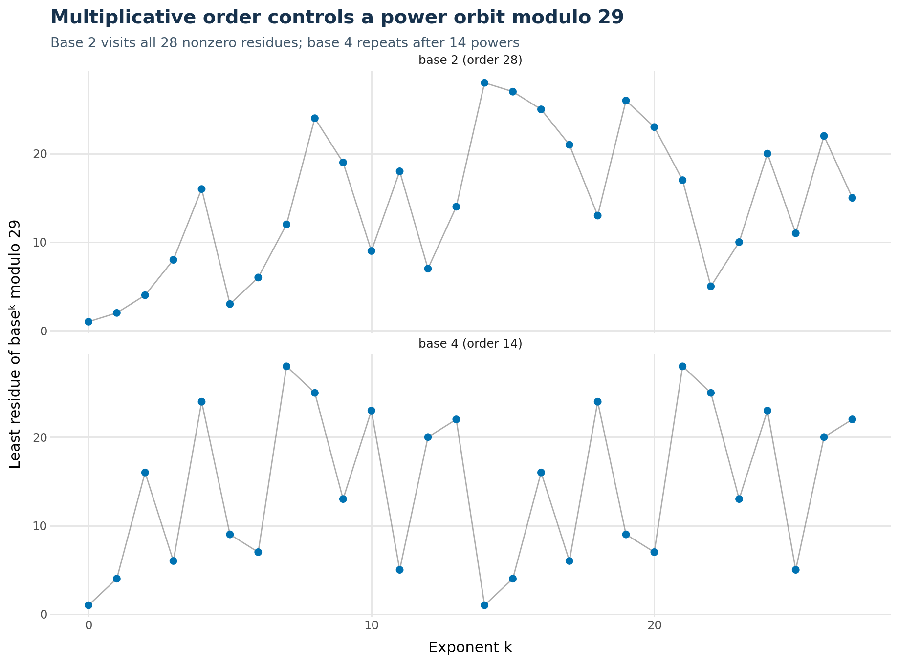

# Primitive Roots, Cyclotomic Polynomials, and Discrete Logarithms {#sec-primitive-roots-cyclotomy}

**Level and prerequisites: L2.** Prepare congruences, cyclic groups of units and elementary polynomial arithmetic; the Frobenius outlook also uses Chapter 23. Use the [level-specific reading guide](index.md#who-this-book-is-for) for linked Euler preparation.

<div class="chapter-goals">

**Learning goals.** Compute multiplicative orders and primitive roots; use the
prime-factor criterion for generators; explain when primitive roots exist for
composite moduli; construct cyclotomic polynomials exactly; read splitting
degrees from orders modulo a conductor; and implement a bounded baby-step
giant-step search for a discrete logarithm.

</div>

Repeated multiplication modulo an integer produces a finite orbit. The length
of that orbit can encode a generator, the factorisation of a polynomial, or the
cost of reversing exponentiation. These are three views of one structure:
cyclic subgroups of finite multiplicative groups.

## A short prerequisite repair

For a modulus $m>1$, an integer $u$ is a **unit modulo $m$** when
$\gcd(u,m)=1$. Its residue class belongs to the finite group
$(\mathbb Z/m\mathbb Z)^\times$, whose size is Euler's totient
$\varphi(m)$. The **multiplicative order**
$\operatorname{ord}_m(u)$ is the least positive integer $r$ such that

$$
u^r\equiv1\pmod m.
$$

The powers $1,u,u^2,\ldots$ repeat from that point onward. Lagrange's theorem
gives

$$
\operatorname{ord}_m(u)\mid\varphi(m).
$$

This divisibility is a theorem about a finite group, not merely a stopping
heuristic. It supplies a finite search bound and a check on computed answers.
The group language needed here is only closure, inverses, powers, and subgroup
size; the more systematic symmetry viewpoint appears in
[sec-galois-symmetry](31-galois-symmetry.md#sec-galois-symmetry).

## Primitive roots modulo a prime

Let $p$ be prime. A **primitive root modulo $p$** is a unit $g$ of order
$p-1$. Its powers visit every nonzero residue exactly once:

$$
\{g^0,g^1,\ldots,g^{p-2}\}
=(\mathbb Z/p\mathbb Z)^\times.
$$

**Theorem 43.2 (Primitive-root for prime fields).** The multiplicative group
$\mathbb F_p^\times$ is cyclic. Consequently primitive roots exist, and their
number is $\varphi(p-1)$.

Here is the proof architecture. Every element has order dividing $p-1$. For
each divisor $d$, the polynomial $X^d-1$ has at most $d$ roots in the field.
That root bound prevents all elements from being trapped in proper
subgroups; organizing the possible orders by divisors yields an element of
order $p-1$. If $g$ has that order, then $g^k$ is another generator exactly
when $\gcd(k,p-1)=1$, giving $\varphi(p-1)$ generators.

The theorem gives an efficient certificate. If

$$
p-1=\prod_{j=1}^{t}q_j^{e_j},
$$

then

<div id="eq-primitive-root-criterion" class="equation">

$$
g\text{ is primitive modulo }p
\iff
g^{(p-1)/q_j}\not\equiv1\pmod p
\quad\text{for every distinct }q_j. \tag{43.1}
$$

</div>

Indeed, failure of one test puts the order in a proper divisor of $p-1$.
Conversely, any proper divisor of $p-1$ omits at least one full prime-power
contribution and therefore forces one of the displayed powers to be one.

<!-- inline-formula-code:start -->
## Formula and finite computation

$$
g\text{ is primitive modulo }p
\iff
g^{(p-1)/q}\not\equiv1\pmod p
\quad\text{for every prime }q\mid(p-1).
$$

The criterion [Equation 43.1](#eq-primitive-root-criterion) turns the symbolic definition into
a short exact program. Parameter names describe the mathematical roles, so no
translation from anonymous letters is required.

```python
from math import isqrt

def is_prime(number: int) -> bool:
    """Return whether number is prime by exact trial division."""
    if number < 2:
        return False
    return all(
        number % divisor != 0 for divisor in range(2, isqrt(number) + 1)
    )

def distinct_prime_factors(number: int) -> list[int]:
    """Return the distinct prime factors of a positive integer."""
    if number < 1:
        raise ValueError("number must be positive")
    factors: list[int] = []
    remaining = number
    candidate = 2
    while candidate * candidate <= remaining:
        if remaining % candidate == 0:
            factors.append(candidate)
            while remaining % candidate == 0:
                remaining //= candidate
        candidate += 1
    if remaining > 1:
        factors.append(remaining)
    return factors

def primitive_roots(prime_modulus: int) -> list[int]:
    """Return every primitive root modulo a validated prime."""
    if not is_prime(prime_modulus):
        raise ValueError("prime_modulus must be prime")
    if prime_modulus == 2:
        return [1]
    group_order = prime_modulus - 1
    prime_divisors = distinct_prime_factors(group_order)
    return [
        candidate
        for candidate in range(2, prime_modulus)
        if all(
            pow(candidate, group_order // prime_divisor, prime_modulus) != 1
            for prime_divisor in prime_divisors
        )
    ]

roots = primitive_roots(29)
print(roots)
print(len(roots), "expected", 12)
```

**What the computation establishes.** The output certifies every generator
modulo $29$ after exact trial-division factorisation of $28$. It does not prove
the cyclicity theorem for arbitrary primes; that theorem is what guarantees
that the returned list is nonempty in every prime field.
<!-- inline-formula-code:end -->

<figure id="fig-primitive-root-orbits">


<figcaption>

Figure 43.1: Power orbits modulo 29 contrast a primitive root with an element in a proper subgroup.

</figcaption>
</figure>

[Figure 43.1](#fig-primitive-root-orbits) compares bases $2$ and $4$. Since $4=2^2$, its
orbit keeps only every second point of the cyclic exponent clock and has order
$28/\gcd(2,28)=14$. Connecting the residues by lines helps trace the iteration;
the vertical height has no order-theoretic meaning.

## Composite moduli: existence is exceptional

A unit group need not be cyclic. Modulo $8$, every unit squares to $1$, so no
element can have order $\varphi(8)=4$. Modulo $9$, by contrast, $2$ has order
$6$ and is a primitive root.

**Theorem 43.1 (Classification).** A positive integer $m$ has a primitive root
exactly when

$$
m\in\{1,2,4,p^k,2p^k\},
$$

where $p$ is an odd prime and $k\ge1$. For $m=1$ the assertion uses the
one-element-group convention.

The proof combines lifting from $p$ to prime powers with CRT. CRT usually turns
one cyclic factor into a product of cyclic groups, which need not remain
cyclic. The power-of-two unit groups provide the obstruction that leaves only
the displayed list. We quote the full lifting classification, but small cases
can be checked from orders exactly.

Do not infer that a lack of primitive roots means the group is mysterious.
The structure theorem for finite abelian groups decomposes it into cyclic
factors. Cryptographic algorithms often work deliberately inside one
large-order cyclic subgroup rather than demand that the entire unit group be
cyclic.

## Roots of unity and cyclotomic polynomials

The complex $n$th roots of unity satisfy $z^n=1$. A root is **primitive** when
its order is exactly $n$. The monic polynomial whose roots are precisely the
primitive $n$th roots is the **cyclotomic polynomial** $\Phi_n(X)$. Separating
roots by exact order gives

<div id="eq-cyclotomic-factorisation" class="equation">

$$
X^n-1=\prod_{d\mid n}\Phi_d(X). \tag{43.2}
$$

</div>

Examples are

$$
\Phi_1(X)=X-1,\quad
\Phi_2(X)=X+1,\quad
\Phi_3(X)=X^2+X+1,\quad
\Phi_4(X)=X^2+1.
$$

Möbius inversion in the multiplicative monoid of polynomials also gives the
compact formal identity

$$
\Phi_n(X)=\prod_{d\mid n}(X^d-1)^{\mu(n/d)}.
$$

Negative exponents in that expression cancel only after the entire product is
assembled, so it is a poor recipe for floating polynomial arithmetic. Exact
division using [Equation 43.2](#eq-cyclotomic-factorisation) is safer:

```python
def exact_monic_polynomial_quotient(
    dividend: list[int], divisor: list[int]
) -> list[int]:
    """Divide low-to-high coefficient lists when the monic division is exact."""
    if not divisor or divisor[-1] != 1 or len(dividend) < len(divisor):
        raise ValueError("require a nonzero monic divisor of no larger degree")
    remainder = dividend.copy()
    quotient = [0] * (len(dividend) - len(divisor) + 1)
    for degree in range(len(dividend) - 1, len(divisor) - 2, -1):
        coefficient = remainder[degree]
        quotient_degree = degree - len(divisor) + 1
        quotient[quotient_degree] = coefficient
        for offset, divisor_coefficient in enumerate(divisor):
            remainder[quotient_degree + offset] -= (
                coefficient * divisor_coefficient
            )
    if any(remainder):
        raise ValueError("polynomial division was not exact")
    return quotient

def cyclotomic_polynomial(index: int) -> list[int]:
    """Return low-to-high integer coefficients of Phi_index."""
    if index < 1:
        raise ValueError("index must be positive")
    cyclotomics: dict[int, list[int]] = {}
    for current_index in range(1, index + 1):
        polynomial = [-1] + [0] * (current_index - 1) + [1]
        for divisor in range(1, current_index):
            if current_index % divisor == 0:
                polynomial = exact_monic_polynomial_quotient(
                    polynomial, cyclotomics[divisor]
                )
        cyclotomics[current_index] = polynomial
    return cyclotomics[index]

for index in range(1, 11):
    print(index, cyclotomic_polynomial(index))
```

The lists run from constant coefficient upward. Thus the output
`[1, 1, 1]` means $1+X+X^2$. Every division is over the integers and checked
for zero remainder. The computation verifies the first ten identities; Gauss's
lemma and induction prove that every $\Phi_n$ has integer coefficients.

## Reduction modulo primes and splitting

Assume $p\nmid n$. Put $f=\operatorname{ord}_n(p)$. Over $\mathbb F_p$,
every irreducible factor of $\Phi_n(X)$ has degree $f$, and there are
$\varphi(n)/f$ such factors. The reason is Frobenius:

$$
\zeta\longmapsto\zeta^p,\qquad
\zeta\longmapsto\zeta^{p^2},\quad\ldots
$$

A primitive $n$th root returns after the least $f$ for which
$p^f\equiv1\pmod n$. This finite-field orbit is also the residue degree of a
prime above $p$ in $\mathbb Q(\zeta_n)$. Thus the same order calculation links
polynomial factorisation, Frobenius, and the explicit Artin map in
[sec-class-field-theory](40-class-field-theory.md#sec-class-field-theory).

The restriction $p\nmid n$ matters. When $p$ divides the conductor,
$X^n-1$ can acquire repeated roots modulo $p$, and the unramified Frobenius
description no longer applies.

## Discrete logarithms

Fix a cyclic group $\langle g\rangle$ of known order $r$. The
**discrete-logarithm problem** asks for $x$ satisfying

$$
g^x=h,\qquad 0\le x<r.
$$

Brute force needs up to $r$ multiplications. Baby-step giant-step writes
$x=im+j$ with $m=\lceil\sqrt r\rceil$ and rearranges:

$$
h(g^{-m})^i=g^j.
$$

Store the $m$ baby steps $g^j$, then walk through at most $m+1$ giant steps.
The method is deterministic and uses $O(\sqrt r)$ group operations and memory.

```python
from math import gcd, isqrt

def baby_step_giant_step(
    generator: int,
    target: int,
    prime_modulus: int,
    subgroup_order: int,
) -> int | None:
    """Return x with generator**x = target, or None after a bounded search."""
    if (
        prime_modulus <= 2
        or subgroup_order < 1
        or gcd(generator, prime_modulus) != 1
        or gcd(target, prime_modulus) != 1
    ):
        raise ValueError("require nonzero group elements and a positive order")
    square_root = isqrt(subgroup_order)
    step_size = square_root + int(square_root * square_root < subgroup_order)
    baby_steps = {
        pow(generator, exponent, prime_modulus): exponent
        for exponent in range(step_size)
    }
    giant_multiplier = pow(
        pow(generator, step_size, prime_modulus),
        -1,
        prime_modulus,
    )
    giant_value = target % prime_modulus
    for giant_index in range(step_size + 1):
        if giant_value in baby_steps:
            exponent = giant_index * step_size + baby_steps[giant_value]
            if (
                exponent < subgroup_order
                and pow(generator, exponent, prime_modulus)
                == target % prime_modulus
            ):
                return exponent
        giant_value = giant_value * giant_multiplier % prime_modulus
    return None

target = pow(2, 17, 29)
answer = baby_step_giant_step(2, target, 29, subgroup_order=28)
print(target, answer)
```

Returning `None` proves only that no exponent in the declared range was found
under the supplied group assumptions. It does not validate that the modulus is
prime, that the stated subgroup order is correct, or that a deployed group is
secure. Index-calculus algorithms can beat square-root time in several
multiplicative groups, while generic groups have different lower bounds.
Practical cryptographic choices require current standards and specialist
analysis.

## Theorem-scope ledger

- **Proved here:** the generator criterion once cyclicity is known, the count
  of generators in a cyclic group, exact cyclotomic recursion, and correctness
  of the bounded baby-step giant-step search.
- **Quoted:** cyclicity of finite-field multiplicative groups and the complete
  classification of moduli possessing primitive roots.
- **Derived from earlier chapters:** the Frobenius orbit interpretation of
  factor degrees and cyclotomic splitting.
- **Not claimed:** security of a particular discrete-logarithm deployment or
  efficient factorisation of an arbitrary group order.

## Summary and vocabulary

Multiplicative order is the period of a power orbit. A primitive root has the
largest possible order and exists for every prime modulus but only special
composite moduli. Cyclotomic polynomials separate roots of unity by exact
order. Modulo an unramified prime, the order of Frobenius determines
irreducible-factor degrees. Discrete logarithms reverse the exponent map, and
baby-step giant-step makes the square-root time–memory tradeoff explicit.

Key terms are **multiplicative order**, **primitive root**, **cyclotomic
polynomial**, **Frobenius orbit**, **discrete logarithm**, and **baby-step
giant-step**.

## Exercises

<div class="exercise" id="number_theory-43-primitive-roots-cyclotomy-ex-1">
<p class="exercise-title"><strong>Exercise 1</strong></p>

List the powers of $3$ modulo $7$ and determine its order.

</div>

<div class="exercise" id="number_theory-43-primitive-roots-cyclotomy-ex-2">
<p class="exercise-title"><strong>Exercise 2</strong></p>

Use [Equation 43.1](#eq-primitive-root-criterion) to decide whether $2$ and $4$ are
primitive modulo $29$.

</div>

<div class="exercise" id="number_theory-43-primitive-roots-cyclotomy-ex-3">
<p class="exercise-title"><strong>Exercise 3</strong></p>

Prove that if $g$ has order $r$, then $g^k$ has order
$r/\gcd(r,k)$.

<details class="hint"><summary>Hint 1</summary>

translate $(g^k)^m=1$ into the divisibility condition
  $r\mid km$, then divide both integers by $\gcd(r,k)$.

</details>

</div>

<div class="exercise" id="number_theory-43-primitive-roots-cyclotomy-ex-4">
<p class="exercise-title"><strong>Exercise 4</strong></p>

Find all primitive roots modulo $11$ and compare their number with
$\varphi(10)$.

</div>

<div class="exercise" id="number_theory-43-primitive-roots-cyclotomy-ex-5">
<p class="exercise-title"><strong>Exercise 5</strong></p>

Show directly that no primitive root exists modulo $8$.

</div>

<div class="exercise" id="number_theory-43-primitive-roots-cyclotomy-ex-6">
<p class="exercise-title"><strong>Exercise 6</strong></p>

Derive $\Phi_6(X)$ and $\Phi_{12}(X)$ using
[Equation 43.2](#eq-cyclotomic-factorisation) as the recursive identity.

</div>

<div class="exercise" id="number_theory-43-primitive-roots-cyclotomy-ex-7">
<p class="exercise-title"><strong>Exercise 7</strong></p>

Predict the degrees and number of irreducible factors of $\Phi_7(X)$ over
$\mathbb F_2$ and $\mathbb F_{13}$.

<details class="hint"><summary>Hint 1</summary>

compute the order of the field characteristic modulo $7$; that
  order is the common Frobenius-orbit size.

</details>

</div>

<div class="exercise" id="number_theory-43-primitive-roots-cyclotomy-ex-8">
<p class="exercise-title"><strong>Exercise 8</strong></p>

Explain exactly where the hypothesis $p\nmid n$ enters the Frobenius
factor-degree statement.

</div>

<div class="exercise" id="number_theory-43-primitive-roots-cyclotomy-ex-9">
<p class="exercise-title"><strong>Exercise 9</strong></p>

Trace baby-step giant-step for $2^x\equiv18\pmod{29}$.

<details class="hint"><summary>Hint 1</summary>

use $m=\lceil\sqrt{28}\rceil=6$, tabulate $2^j$ for
  $0\le j<6$, and multiply the target repeatedly by $2^{-6}$.

</details>

</div>

<div class="exercise" id="number_theory-43-primitive-roots-cyclotomy-ex-10">
<p class="exercise-title"><strong>Exercise 10</strong></p>

Design a certificate for a claimed primitive root that stores only the
factorisation of $p-1$ and the necessary modular powers.

</div>

## Selected solutions

**Solution to Exercise 3.** The least positive $m$ for which
$(g^k)^m=1$ is the least $m$ with $r\mid km$. Writing
$r=d r'$ and $k=d k'$ for $d=\gcd(r,k)$ leaves
$r'\mid k'm$. Since $\gcd(r',k')=1$, the least such $m$ is $r'$.

**Solution to Exercise 5.** The units modulo $8$ are $1,3,5,7$. Each satisfies
$u^2\equiv1\pmod8$, so every order is at most two, whereas the group has four
elements. No element generates it.

**Solution to Exercise 7.** Modulo $7$, the order of $2$ is $3$, so
$\Phi_7$ splits over $\mathbb F_2$ into $\varphi(7)/3=2$ irreducible cubics.
Modulo $7$, $13\equiv-1$ has order $2$, so over $\mathbb F_{13}$ it splits
into three irreducible quadratics.
