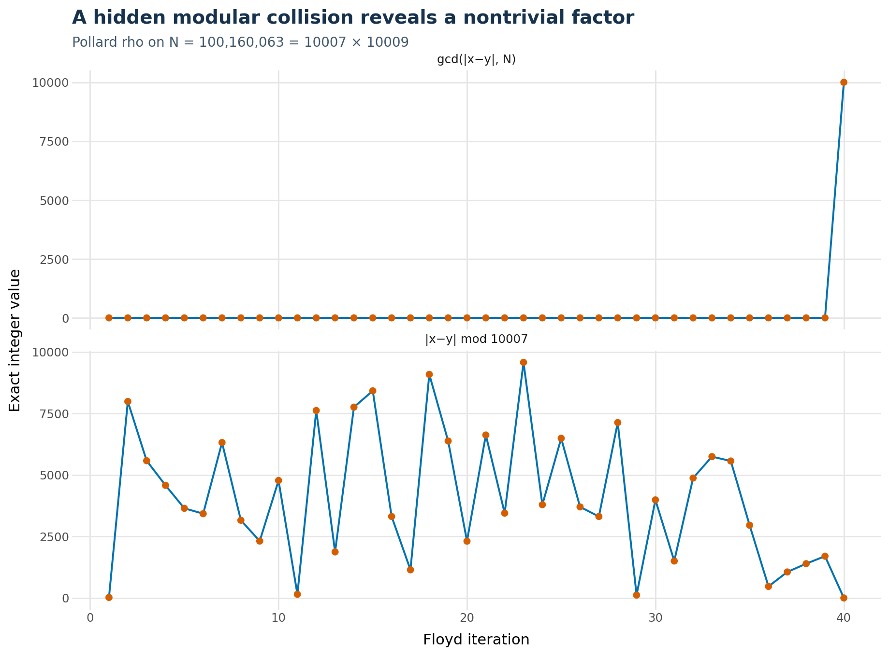

# Primality Proofs and Integer Factorisation {#sec-primality-factorisation}

**Level and prerequisites: L2.** Prepare modular arithmetic, Euclidean algorithms, multiplicative orders and proof by certificates. Use the [level-specific reading guide](index.md#who-this-book-is-for) for linked Euler preparation.

<div class="chapter-goals">

**Learning goals.** Separate primality decisions, probable-prime tests,
primality proofs, and factorisation; implement Miller–Rabin with a visible
witness trace; verify a Pocklington certificate; explain the mechanisms and
failure modes of Pollard rho and $p-1$; and compare modern factorisation
families without conflating heuristic and proved complexity.

</div>

Given a large integer $N$, two questions look similar but have very different
cost profiles:

1. Is $N$ prime?
2. If $N$ is composite, what are its prime factors?

A primality proof may be short even when no practical method can factor a
nearby semiprime of the same size. Conversely, finding one nontrivial factor
immediately proves compositeness but need not complete the factorisation. This
chapter makes those logical outputs explicit.

## Input size and the trial-division baseline

An integer near $N$ occupies about $\log_2 N$ bits. Trial division through
$\sqrt N$ therefore takes roughly $2^{(\log_2 N)/2}$ candidate divisions:
exponential time in the input length. The square-root bound remains an exact
algorithm and is excellent for small examples; its poor scaling motivates the
methods below.

Complexity statements must name their unit of cost. Counting arithmetic
operations on arbitrarily large integers hides the cost of each multiplication.
Bit complexity counts operations on bits. Practical timings additionally
depend on multiplication libraries, memory, parallelism, and input shape.

## Fermat tests, pseudoprimes, and Carmichael numbers

Fermat's little theorem says that for prime $p$ and $p\nmid a$,

$$
a^{p-1}\equiv1\pmod p.
$$

Thus a failed congruence proves compositeness. Passing it does not prove
primality. A composite $N$ passing for one base is a **Fermat pseudoprime** to
that base. A **Carmichael number** is a composite integer $N>1$ that passes for every base coprime to $N$.
For a composite integer $N>1$, Korselt's criterion is the following equivalence:

$$
N\text{ is Carmichael}
\iff
N\text{ is squarefree and }(p-1)\mid(N-1)\quad\text{for every prime }p\mid N.
$$

For the squarefree factorisation $561=3\cdot11\cdot17$, the divisors $2,10,16$ all divide $560$,
so every coprime base passes Fermat. Divisibility alone is not sufficient.

## The strong probable-prime test

Let $N>2$ be odd and write

$$
N-1=2^s d,\qquad d\text{ odd}.
$$

For a base $a$ coprime to $N$, a prime $N$ must satisfy either

$$
a^d\equiv1\pmod N
$$

or

<div id="eq-miller-rabin-condition" class="equation">

$$
a^{2^r d}\equiv-1\pmod N
\quad\text{for some }0\le r<s. \tag{44.1}
$$

</div>

Why? Repeatedly square $a^d$ until reaching
$a^{N-1}\equiv1$. Over a prime field, the only square roots of $1$ are
$\pm1$. The last value before the first $1$ must therefore be $-1$, unless the
sequence began at $1$.

For every odd composite $N$, at most one quarter of the $N-1$ nonzero residue
representatives $1\le a<N$ are strong liars. Bases sampled independently and
uniformly from this declared set therefore give an error
bound of at most $4^{-k}$ after $k$ rounds. This is a conditional probability
over the algorithm's random choice of bases; a fixed integer is not “partly
prime”.

<!-- inline-formula-code:start -->
## Formula and finite computation

$$
N-1=2^s d,\qquad
a^d\equiv1\pmod N
\quad\text{or}\quad
a^{2^r d}\equiv-1\pmod N\text{ for some }0\le r<s.
$$

The program returns the squaring sequence actually inspected in
[Equation 44.1](#eq-miller-rabin-condition). It accepts integer bases through their nonzero
residue modulo $N$. A zero residue is an invalid test input: even a prime
divides its own zero residue, so $\gcd(0,N)=N$ is not a nontrivial factor.
Only $1<\gcd(a,N)<N$ is accepted as an immediate factor witness. `False`
means a valid compositeness witness; invalid input raises an exception rather
than being reported as composite. `True` means that this one round passes.

```python
from math import gcd

def power_of_two_decomposition(even_number: int) -> tuple[int, int]:
    """Return s, d with even_number = 2**s * d and d odd."""
    if type(even_number) is not int:
        raise TypeError("even_number must be an integer")
    if even_number < 2 or even_number % 2 != 0:
        raise ValueError("even_number must be a positive even integer")
    power = 0
    odd_part = even_number
    while odd_part % 2 == 0:
        odd_part //= 2
        power += 1
    return power, odd_part

def miller_rabin_round(
    candidate: int, base: int
) -> tuple[bool, list[int]]:
    """Return whether candidate passes one strong probable-prime round."""
    if type(candidate) is not int or type(base) is not int:
        raise TypeError("candidate and base must be integers")
    if candidate <= 2 or candidate % 2 == 0:
        raise ValueError("candidate must be an odd integer greater than two")
    reduced_base = base % candidate
    if reduced_base == 0:
        raise ValueError("base must be nonzero modulo candidate")
    common_divisor = gcd(reduced_base, candidate)
    if 1 < common_divisor < candidate:
        return False, [common_divisor]
    power, odd_part = power_of_two_decomposition(candidate - 1)
    value = pow(reduced_base, odd_part, candidate)
    trace = [value]
    if value in (1, candidate - 1):
        return True, trace
    for _ in range(power - 1):
        value = value * value % candidate
        trace.append(value)
        if value == candidate - 1:
            return True, trace
        if value == 1:
            return False, trace
    return False, trace

for candidate in (561, 1_009):
    passed, trace = miller_rabin_round(candidate, base=2)
    print(candidate, passed, trace)
```

**What the computation establishes.** Base $2$ gives a concrete compositeness
witness for $561$, while $1009$ passes this round. One passing round is only a
probable-prime result. Primality of $1009$ needs more rounds with an applicable
deterministic base theorem or a certificate.
<!-- inline-formula-code:end -->

## Worked clinic: which probability space is being tested? {#sec-miller-rabin-base-clinic}

### Repair a false compositeness claim

Before looking at an error probability, check that the output is logically
valid. For the prime $101$, a call with base $101$ reduces that base to zero.
The number $\gcd(0,101)=101$ divides the candidate but proves nothing about
compositeness. The listing rejects this call. A call with candidate $85$ and
base $5$, by contrast, returns the proper factor $5$ and certifies
compositeness. For any validated nonzero residue, its gcd with $N$ is smaller
than $N$; when the gcd is greater than one it is genuinely nontrivial.

Bases $1$ and $N-1$ always pass for an odd $N$. They remain in this textbook's
sampling set so its denominator agrees with the stated theorem. They carry
little information individually. A different sampling set needs its own
counting argument, even if it is chosen to avoid such uninformative bases.

### Count first, then take probabilities

Take $N=9=3^2$, so $N-1=2^3\cdot1$. A passing base must have $a=1$ modulo $9$
or some member of $a,a^2,a^4$ equal to $-1$. Neither $a^2=-1$ nor
$a^4=-1$ is possible modulo $9$, since reduction modulo $3$ would make a
square equal to $2$. Thus the passing residues are exactly $\{1,8\}$.

| Distribution of the base | One-round passing probability for $N=9$ |
|---|---|
| Uniform on $\{1,\ldots,8\}$ | $2/8=1/4$ |
| Uniform on the six units modulo $9$ | $2/6=1/3$ |
| Uniform on $\{1,8\}$ | $1$ |

The second row does not contradict the one-quarter theorem: its sample space
is different. Nonunits were included in the theorem's denominator and supplied
valid factor witnesses. Conditioning on being a unit removes those outcomes.
This is a comparison of probability spaces, not an instruction to discard a
factor once one has been found.

More generally, if a composite $N$ has passing-base set $L_N$ and a base has
distribution $\mu$, its one-round error probability is

$$
\theta=\sum_{a\in L_N}\mu(a).
$$

For $k$ independently drawn bases with this same distribution, the probability
that every round passes is $\theta^k$. If one random base is drawn once and
then reused $k$ times, that event still has probability $\theta$. Running the
same arithmetic again supplies no fresh independent draw. Uniformity and
independence are hypotheses about the actual selection procedure, not about
how random the printed trace looks.

### An independent finite census

The following listing evaluates the defining modular powers directly instead
of calling the squaring-chain implementation above. It therefore supplies a
different finite check on its results. Exhaustively enumerating all bases is
appropriate for the displayed small integers; it is not a fast primality
algorithm for large inputs.

```python
from fractions import Fraction
from math import gcd

def passing_base_census(candidate: int) -> list[int]:
    """Enumerate all passing nonzero residues from the defining power conditions."""
    if type(candidate) is not int:
        raise TypeError("candidate must be an integer")
    if candidate <= 2 or candidate % 2 == 0:
        raise ValueError("candidate must be an odd integer greater than two")
    power = 0
    odd_part = candidate - 1
    while odd_part % 2 == 0:
        odd_part //= 2
        power += 1
    return [
        base for base in range(1, candidate)
        if pow(base, odd_part, candidate) == 1
        or any(
            pow(base, (2**index) * odd_part, candidate) == candidate - 1
            for index in range(power)
        )
    ]

for candidate in (9, 85):
    passing = passing_base_census(candidate)
    unit_count = sum(gcd(base, candidate) == 1 for base in range(1, candidate))
    print(candidate, "passing residues", passing)
    print("uniform nonzero", Fraction(len(passing), candidate - 1))
    print("conditioned on units", Fraction(len(passing), unit_count))
```

All counts here are exact, and the candidate is known to be composite by its
displayed factorisation. The finite enumeration checks this example; the
universal one-quarter bound remains a theorem, not the extrapolation of a few
censuses.

### Changed task: derive the census without trusting the code

Now use $85=5\cdot17$, with $84=2^2\cdot21$.

1. Prove that $a\mapsto a^{21}$ permutes the units modulo $85$.
2. Put $x=a^{21}$. Use CRT to count the cases $x=1$, $x=-1$, and $x^2=-1$
   modulo $85$, and hence derive the complete passing-base list independently
   of the census code.
3. Compute the passing probability for a uniform base on all nonzero residues,
   on units only, and on $\{2,\ldots,83\}$.
4. For the first of these distributions, compare three independent rounds
   with drawing one base once and testing it three times.
5. Classify the outputs for $(N,a)=(101,101),(85,5),(85,13)$ as invalid input,
   a compositeness witness, or a passing round. Which output proves primality?

**Explanation.** CRT identifies the unit group with the product of cyclic
groups of orders $4$ and $16$. Since $21$ is coprime to both orders, exponent
$21$ is invertible on both groups, so the power map is a permutation.
The two cases $x=\pm1$ contribute one residue each. There are two square roots
of $-1$ modulo $5$, namely $2,3$, and two modulo $17$, namely $4,13$.
Their four CRT combinations give $13,38,47,72$ modulo $85$. These have order
$4$, so raising them to power $21\equiv1\pmod4$ leaves them unchanged.
Consequently the passing bases are exactly

$$
L_{85}=\{1,13,38,47,72,84\}.
$$

The three probabilities are $6/84=1/14$, $6/64=3/32$, and
$4/82=2/41$, respectively. The last sample space removes the two always-passing
residues but retains the other bases. Three independent draws from the first
space have error probability $1/14^3=1/2744$; three repetitions of one draw
have error probability $1/14$. The classified calls are invalid, a proper
factor witness, and a passing round. None is a primality proof. The exact
classification of invalid inputs is separate from the probabilistic guarantee
for valid inputs.

**Primary reference.** The precise domain of the general one-quarter theorem
is stated in Menezes, van Oorschot, and Vanstone,
[*Handbook of Applied Cryptography*, Chapter 4](https://cacr.uwaterloo.ca/hac/about/chap4.pdf),
Fact 4.23. Keith Conrad's author-hosted
[*The Miller–Rabin Test*](https://kconrad.math.uconn.edu/blurbs/ugradnumthy/millerrabin.pdf),
Definition 2.3, Example 2.5, and Theorem 2.9 provide a further treatment.
The conditional sample spaces and the changed $85$ task are derived here;
the cited theorem does not promise the same bound for arbitrary distributions.

### Deterministic use and base tables

For a declared bounded range, theorems give finite base sets that make
Miller–Rabin deterministic. The range is part of the theorem: copying a base
list without its upper bound invalidates the guarantee. For arbitrary-size
inputs, implementations either use random rounds with an explicit error budget
or proceed to a proof-producing algorithm.

Baillie–PSW combines a strong base-$2$ test with a Lucas probable-prime test
and has no known counterexample, but “no known counterexample” is not a proof
that none exists. Correct reporting distinguishes this strong practical test
from a deterministic theorem.

## Certificates: turning a decision into a checkable proof

A **primality certificate** is finite data from which a comparatively simple
verifier can prove that $N$ is prime. Pratt certificates recursively certify
the factorisation of $N-1$ when a primitive-root witness is available. Modern
ECPP certificates use elliptic curves and are effective for large inputs.

Pocklington's theorem gives an accessible middle ground. Suppose

$$
N-1=FR,\qquad F>\sqrt N,
$$

and the complete prime factorisation of $F$ is known. If, for every prime
$q\mid F$, some integer $a_q$ satisfies

<div id="eq-pocklington-certificate" class="equation">

$$
a_q^{N-1}\equiv1\pmod N,\qquad
\gcd\left(a_q^{(N-1)/q}-1,N\right)=1, \tag{44.2}
$$

</div>

then $N$ is prime. The proof shows that every prime divisor $\ell$ of $N$ has
$F\mid\ell-1$. If $N$ were composite, this forces incompatible lower bounds on
its factors.

```python
from math import gcd, isqrt

def is_prime_by_trial_division(number: int) -> bool:
    """Return whether number is prime by exact trial division."""
    if number < 2:
        return False
    return all(
        number % divisor != 0 for divisor in range(2, isqrt(number) + 1)
    )

def verify_pocklington_certificate(
    candidate: int,
    factor_powers: dict[int, int],
    witnesses: dict[int, int],
) -> bool:
    """Verify the displayed form of Pocklington's primality certificate."""
    if candidate <= 2 or candidate % 2 == 0 or not factor_powers:
        return False
    known_part = 1
    for prime_factor, exponent in factor_powers.items():
        if exponent < 1 or not is_prime_by_trial_division(prime_factor):
            return False
        known_part *= prime_factor**exponent
    if (candidate - 1) % known_part != 0 or known_part**2 <= candidate:
        return False
    for prime_factor in factor_powers:
        if prime_factor not in witnesses:
            return False
        witness = witnesses[prime_factor] % candidate
        if pow(witness, candidate - 1, candidate) != 1:
            return False
        if gcd(
            pow(witness, (candidate - 1) // prime_factor, candidate) - 1,
            candidate,
        ) != 1:
            return False
    return True

print(
    verify_pocklington_certificate(
        candidate=101,
        factor_powers={2: 2, 5: 2},
        witnesses={2: 2, 5: 2},
    )
)
```

This verifier is deliberately more transparent than fast. It trial-divides
the small claimed factors of $F$, checks the exact size condition without
floating square roots, and then checks every modular identity. A scalable
certificate recursively supplies proofs for the factors instead.

AKS proved that primality belongs to deterministic polynomial time without
unproved assumptions. Its importance is theoretical: it settles the complexity
classification. It does not imply that AKS is normally the fastest practical
route to a certificate.

## Factorisation by collisions: Pollard rho

Suppose $N$ has an unknown prime factor $p$. Iterate a polynomial such as

$$
x_{n+1}\equiv x_n^2+c\pmod N.
$$

Although the computation occurs modulo $N$, the sequence also runs modulo
$p$. A birthday-paradox heuristic suggests a repeated state modulo $p$ after
about $\sqrt p$ steps. Floyd's two-speed iteration compares $x_i$ and
$x_{2i}$, and

<div id="eq-pollard-rho-gcd" class="equation">

$$
\gcd(|x_i-x_{2i}|,N) \tag{44.3}
$$

</div>

reveals $p$ when the two states agree modulo $p$ but not modulo every factor of
$N$.

```python
from math import gcd

def pollard_rho_factor(
    composite: int,
    maximum_steps: int,
    starting_value: int = 2,
    constant_term: int = 1,
) -> tuple[int | None, list[tuple[int, int, int, int]]]:
    """Return one factor and rows (step, tortoise, hare, gcd), if found."""
    if composite <= 1 or composite % 2 == 0 or maximum_steps < 1:
        raise ValueError("require an odd composite candidate and a positive bound")

    def iteration(value: int) -> int:
        return (value * value + constant_term) % composite

    tortoise = hare = starting_value % composite
    trace: list[tuple[int, int, int, int]] = []
    for step in range(1, maximum_steps + 1):
        tortoise = iteration(tortoise)
        hare = iteration(iteration(hare))
        common_divisor = gcd(abs(tortoise - hare), composite)
        trace.append((step, tortoise, hare, common_divisor))
        if 1 < common_divisor < composite:
            return common_divisor, trace
        if common_divisor == composite:
            return None, trace
    return None, trace

factor, trace = pollard_rho_factor(
    composite=100_160_063,
    maximum_steps=100,
)
print(factor, len(trace), trace[-1])
```

The maximum-step input prevents a hidden unbounded search. A failure means
that this polynomial, seed, and budget did not expose a factor; a real
implementation restarts with independently chosen parameters. The algorithm
is heuristic in its typical running-time analysis, but every returned divisor
is verified immediately by exact division.

<figure id="fig-pollard-rho-gcd-trace">


<figcaption>

Figure 44.1: A Pollard-rho trace shows a residue collision modulo one hidden prime at the same step that the gcd jumps to that factor.

</figcaption>
</figure>

[Figure 44.1](#fig-pollard-rho-gcd-trace) visualises [Equation 44.3](#eq-pollard-rho-gcd) for
$N=10007\cdot10009$. The plot is explanatory rather than probabilistic
evidence: the exact gcd printed by the code is the factor certificate.

## Smoothness methods and the modern landscape

An integer is **$B$-smooth** when all its prime factors are at most $B$.
Pollard's $p-1$ method succeeds when an unknown factor $p$ has smooth
$p-1$. Choose an exponent $M$ divisible by many small prime powers. If
$p-1\mid M$, then Fermat gives $a^M\equiv1\pmod p$, and

$$
\gcd(a^M-1,N)
$$

may separate $p$ from the other factors. The method can fail because $p-1$ is
not smooth or because every prime factor divides the gcd simultaneously.

The elliptic-curve method replaces the fixed group
$\mathbb F_p^\times$, of order $p-1$, by many elliptic-curve groups whose
orders vary with the curve. One hopes that one order is smooth. This makes ECM
especially effective for finding moderately sized prime factors even when the
cofactor is enormous.

For balanced large semiprimes, relation-collection methods dominate:

| Method | Mechanism | Typical useful regime | Guarantee represented honestly |
|---|---|---|---|
| trial division | search small divisors | tiny factors | deterministic bound |
| Pollard rho | collisions modulo a hidden factor | small-to-medium factors | heuristic runtime; exact output |
| Pollard $p-1$ | smoothness of $p-1$ | structurally favourable factors | conditional on smoothness |
| ECM | smooth elliptic-curve group order | medium factors | heuristic runtime; exact output |
| quadratic sieve | smooth values near a square | medium composite size | heuristic relation yield |
| number field sieve | algebraic and rational smooth relations | very large general inputs | best known heuristic asymptotics |

The number field sieve has heuristic running time often written

$$
L_N[1/3,(64/9)^{1/3}]
=\exp\!\left(
((64/9)^{1/3}+o(1))
(\log N)^{1/3}(\log\log N)^{2/3}
\right).
$$

This is subexponential in $\log N$ but not polynomial. “Best known” is not a
lower bound proving that no faster algorithm exists.

Quantum Shor factoring runs in polynomial time in an ideal fault-tolerant
quantum model. That mathematical result is distinct from current hardware
capacity, engineering overhead, and migration policy. Security decisions
therefore require current authoritative standards, not a static textbook
parameter recommendation.

## Certificates and reproducibility

A factorisation record should contain the factors, their multiplicities,
primality certificates for the terminal factors, and an exact multiplication
back to $N$. A probable-prime record should name every test, base, random-seed
policy, and error bound. A benchmark should record software, hardware, version,
input, and stopping criteria. “The program said prime” is neither a theorem nor
a reproducible experiment.

<div class="callout callout-warning">
<p class="callout-title">Pitfall: evidence labels are mathematical content</p>

A failed Fermat or Miller–Rabin round proves compositeness. A passed random
round changes an error bound. A verified Pocklington or ECPP certificate proves
primality. A found divisor proves compositeness. These outputs are not
interchangeable.

</div>

## Theorem-scope ledger

- **Proved here:** correctness of the strong-test implication for primes,
  verification logic for the stated Pocklington theorem, and why a nontrivial
  Pollard-rho gcd is a factor.
- **Quoted:** the one-quarter strong-liar bound, Pocklington's theorem, AKS
  polynomial-time primality, and the established correctness of ECPP-style
  certificates.
- **Heuristic:** birthday collision times, smoothness probabilities, and the
  displayed practical factorisation-runtime comparisons.
- **Not supplied:** production cryptographic parameters or an implementation
  hardened against timing, memory, fault, or side-channel attacks.

## Summary and vocabulary

Primality testing and factorisation are different problems. Miller–Rabin gives
fast compositeness witnesses and controlled probable-prime evidence.
Certificates turn primality claims into finite proofs. Pollard rho exploits
collisions; $p-1$, ECM, and sieve algorithms exploit smoothness in different
structures. Every computation must identify whether its output is a witness,
an error-bounded test, a theorem-backed certificate, or a heuristic search.

Key terms are **pseudoprime**, **Carmichael number**, **strong liar**,
**primality certificate**, **Pocklington theorem**, **smoothness**, **Pollard
rho**, **ECM**, and **number field sieve**.

## Exercises

<div class="exercise" id="number_theory-44-primality-factorisation-ex-1">
<p class="exercise-title"><strong>Exercise 1</strong></p>

Verify Korselt's divisibility conditions for $1105=5\cdot13\cdot17$.

</div>

<div class="exercise" id="number_theory-44-primality-factorisation-ex-2">
<p class="exercise-title"><strong>Exercise 2</strong></p>

Write $2046=2^s d$ with $d$ odd and trace a Miller–Rabin round for
$N=2047$ and base $2$.

<details class="hint"><summary>Hint 1</summary>

$2046=2\cdot1023$, so there is only one squaring level after
  the initial odd power. Passing base $2$ is compatible with compositeness.

</details>

</div>

<div class="exercise" id="number_theory-44-primality-factorisation-ex-3">
<p class="exercise-title"><strong>Exercise 3</strong></p>

Explain why encountering a nontrivial square root of $1$ modulo $N$ proves
that $N$ is composite.

</div>

<div class="exercise" id="number_theory-44-primality-factorisation-ex-4">
<p class="exercise-title"><strong>Exercise 4</strong></p>

Estimate the maximum error probability after $12$ independent
Miller–Rabin rounds.

</div>

<div class="exercise" id="number_theory-44-primality-factorisation-ex-5">
<p class="exercise-title"><strong>Exercise 5</strong></p>

Verify every condition in the displayed Pocklington certificate for $101$.

<details class="hint"><summary>Hint 1</summary>

the known part of $100$ is all of it; check the two distinct
  prime divisors $2$ and $5$, not every repeated factor separately.

</details>

</div>

<div class="exercise" id="number_theory-44-primality-factorisation-ex-6">
<p class="exercise-title"><strong>Exercise 6</strong></p>

Why does the exact inequality $F^2>N$ avoid floating-point square roots in
a Pocklington verifier?

</div>

<div class="exercise" id="number_theory-44-primality-factorisation-ex-7">
<p class="exercise-title"><strong>Exercise 7</strong></p>

Trace the first five Pollard-rho iterations for $N=8051$, seed $2$, and
$x^2+1$.

</div>

<div class="exercise" id="number_theory-44-primality-factorisation-ex-8">
<p class="exercise-title"><strong>Exercise 8</strong></p>

Give two distinct reasons a Pollard-rho run can return no factor.

</div>

<div class="exercise" id="number_theory-44-primality-factorisation-ex-9">
<p class="exercise-title"><strong>Exercise 9</strong></p>

Explain why Pollard $p-1$ may find one prime divisor but miss another.

</div>

<div class="exercise" id="number_theory-44-primality-factorisation-ex-10">
<p class="exercise-title"><strong>Exercise 10</strong></p>

Contrast the roles of smooth values in ECM and the quadratic sieve.

</div>

<div class="exercise" id="number_theory-44-primality-factorisation-ex-11">
<p class="exercise-title"><strong>Exercise 11</strong></p>

Design a complete factorisation certificate for $2^{12}-1$.

<details class="hint"><summary>Hint 1</summary>

factor algebraically first, then attach a primality proof to
  each terminal factor and multiply the certified powers back to the input.

</details>

</div>

<div class="exercise" id="number_theory-44-primality-factorisation-ex-12">
<p class="exercise-title"><strong>Exercise 12</strong></p>

Classify each statement as proof, bounded probabilistic evidence, or
heuristic: “base 2 passes”, “this ECPP certificate verifies”, “ECM should
find a 40-digit factor quickly”.

</div>

## Selected solutions

**Solution to Exercise 3.** In a field, $(x-1)(x+1)=0$ implies
$x=\pm1$. If $x^2\equiv1\pmod N$ but $x\not\equiv\pm1\pmod N$, then
$\mathbb Z/N\mathbb Z$ has zero divisors and hence is not a field. Therefore
$N$ is composite; the gcds of $x-1$ or $x+1$ with $N$ may expose factors.

**Solution to Exercise 4.** The bound is
$4^{-12}=2^{-24}=1/16\,777\,216$, assuming bases are sampled independently
and uniformly in the range covered by the theorem.

**Solution to Exercise 7.** The tortoise values are
$5,26,677,\ldots$ and the hare values begin $26,7474,871,\ldots$.
At the third comparison,
$\gcd(|677-871|,8051)=\gcd(194,8051)=97$, so the factor is certified.
