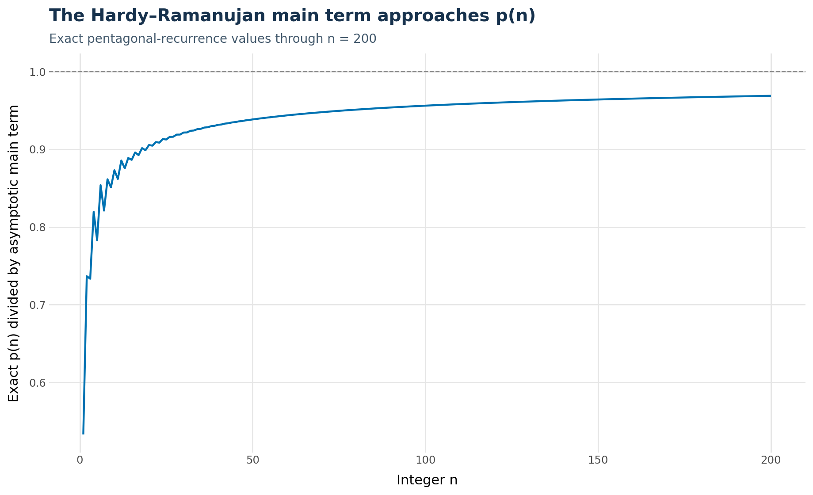

# Integer Partitions, q-Series, and Asymptotic Enumeration {#sec-partitions-q-series}

**Level and prerequisites: L3–L4.** Prepare formal power series and generating functions; asymptotic sections also require complex analysis. Use the [level-specific reading guide](index.md#who-this-book-is-for) for linked Euler preparation.

<div class="chapter-goals">

**Learning goals.** Encode partitions by Ferrers diagrams and generating
functions; prove identities by bijection and by products; compute exact
partition numbers with Euler's pentagonal recurrence; distinguish formal
power-series algebra from analytic convergence; verify Ramanujan congruences
on finite ranges; and interpret the Hardy–Ramanujan asymptotic accurately.

</div>

Additive number theory asks not only whether an integer is representable but
how many representations it has. An **integer partition** of $n$ is a
nonincreasing list of positive integers

$$
\lambda=(\lambda_1,\ldots,\lambda_\ell),
\qquad
\lambda_1\ge\cdots\ge\lambda_\ell\ge1,
\qquad
\sum_i\lambda_i=n.
$$

Order does not matter. Thus $4+1$ and $1+4$ are one partition of $5$, while
$3+2$ is another. The number of partitions of $n$ is denoted $p(n)$, with the
empty partition giving $p(0)=1$.

## Ferrers diagrams and conjugation

Draw $\lambda_i$ dots in row $i$, aligned on the left. Reflecting this Ferrers
diagram across its main diagonal produces the **conjugate partition**
$\lambda'$, whose parts are

<div id="eq-partition-conjugate" class="equation">

$$
\lambda'_j=\#\{i:\lambda_i\ge j\}. \tag{45.1}
$$

</div>

Conjugation is an involution: $(\lambda')'=\lambda$. It exchanges the number
of parts with the largest part. Therefore

$$
\#\{\lambda\vdash n:\ell(\lambda)\le k\}
= \#\{\lambda\vdash n:\lambda_1\le k\}.
$$

This equality is proved by a reversible object-level map, not by comparing a
few counts.

```python
def conjugate_partition(parts: list[int]) -> list[int]:
    """Return the Ferrers-diagram conjugate of a validated partition."""
    if (
        any(part <= 0 for part in parts)
        or any(parts[index] < parts[index + 1] for index in range(len(parts) - 1))
    ):
        raise ValueError("parts must be positive and nonincreasing")
    if not parts:
        return []
    return [
        sum(part >= column for part in parts)
        for column in range(1, parts[0] + 1)
    ]

partition = [7, 5, 5, 2]
conjugate = conjugate_partition(partition)
print(partition, conjugate, conjugate_partition(conjugate))
```

The final list equals the first exactly. That finite equality checks the
implementation; the row–column correspondence proves involution for every
partition.

## Generating functions as exact bookkeeping

For each possible part size $m$, choose it zero, one, two, or more times:

$$
1+q^m+q^{2m}+\cdots=\frac1{1-q^m}.
$$

Multiplying the independent choices gives Euler's partition product

<div id="eq-partition-product" class="equation">

$$
\sum_{n\ge0}p(n)q^n
=\prod_{m\ge1}\frac1{1-q^m}. \tag{45.2}
$$

</div>

There are two legitimate interpretations. In the ring of formal power series,
the identity is coefficient bookkeeping: the coefficient of $q^n$ depends
only on factors with $m\le n$, so no analytic limit is needed. For a complex
number $q$ with $|q|<1$, the series and product also converge analytically.
Mixing these interpretations can create unjustified substitutions at
$|q|=1$.

A finite dynamic program implements the formal product. Processing part size
$m$ from left to right and updating degrees upward permits any multiplicity:

```python
def partition_coefficients_from_product(limit: int) -> list[int]:
    """Return coefficients through q**limit in prod_m (1-q**m)^(-1)."""
    if limit < 0:
        raise ValueError("limit must be nonnegative")
    coefficients = [1] + [0] * limit
    for part_size in range(1, limit + 1):
        for total in range(part_size, limit + 1):
            coefficients[total] += coefficients[total - part_size]
    return coefficients

print(partition_coefficients_from_product(12))
```

The upward update is essential. Reversing it would use each part at most once
and would count partitions into distinct parts instead.

## Distinct parts, odd parts, and a product proof

A distinct part $m$ may be chosen zero or one time, contributing $1+q^m$.
Hence

$$
\sum_{n\ge0}d(n)q^n=\prod_{m\ge1}(1+q^m).
$$

Use $1+q^m=(1-q^{2m})/(1-q^m)$. Cancelling the factors associated with even
exponents leaves

<div id="eq-distinct-odd-product" class="equation">

$$
\prod_{m\ge1}(1+q^m)
=\prod_{\substack{r\ge1\\r\ \mathrm{odd}}}\frac1{1-q^r}. \tag{45.3}
$$

</div>

Therefore the number of partitions of $n$ into distinct parts equals the
number into odd parts.

There is also a bijection. Replace each part $2^a u$, with $u$ odd, by
$2^a$ copies of $u$. Distinct input parts have distinct powers of two attached
to each odd core, so their binary multiplicities can be recovered uniquely.
This is Glaisher's map. The product proof explains the algebra; the bijection
explains exactly how individual objects correspond.

## Euler's pentagonal recurrence

Euler's pentagonal-number theorem states

<div id="eq-pentagonal-theorem" class="equation">

$$
\prod_{m\ge1}(1-q^m)
=\sum_{k=-\infty}^{\infty}(-1)^k
q^{k(3k-1)/2}. \tag{45.4}
$$

</div>

Multiplying by [Equation 45.2](#eq-partition-product) and comparing the coefficient of $q^n$
gives

<div id="eq-pentagonal-recurrence" class="equation">

$$
p(n)=\sum_{k\ge1}(-1)^{k-1}
\left[
p\left(n-\frac{k(3k-1)}2\right)
+p\left(n-\frac{k(3k+1)}2\right)
\right], \tag{45.5}
$$

</div>

where $p(0)=1$ and $p(r)=0$ for $r<0$. The offsets
$1,2,5,7,12,15,\ldots$ are generalized pentagonal numbers, and the signs occur
in pairs $+,+,-,-,\ldots$.

<!-- inline-formula-code:start -->
## Formula and finite computation

$$
p(n)=\sum_{k\ge1}(-1)^{k-1}
\left[
p\left(n-\frac{k(3k-1)}2\right)
+p\left(n-\frac{k(3k+1)}2\right)
\right].
$$

The recurrence [Equation 45.5](#eq-pentagonal-recurrence) computes exact integers. Its outer
bound is the requested limit; its inner loop stops as soon as both new offsets
lie beyond the current coefficient.

```python
def partition_numbers(limit: int) -> list[int]:
    """Return p(0), p(1), ..., p(limit) by Euler's recurrence."""
    if limit < 0:
        raise ValueError("limit must be nonnegative")
    partitions = [0] * (limit + 1)
    partitions[0] = 1
    for integer in range(1, limit + 1):
        total = 0
        for index in range(1, integer + 1):
            lower_offset = index * (3 * index - 1) // 2
            upper_offset = index * (3 * index + 1) // 2
            if lower_offset > integer:
                break
            sign = 1 if index % 2 == 1 else -1
            total += sign * partitions[integer - lower_offset]
            if upper_offset <= integer:
                total += sign * partitions[integer - upper_offset]
        partitions[integer] = total
    return partitions

values = partition_numbers(50)
print(values[:16])
print("p(50) =", values[50])
```

**What the computation establishes.** The output follows deductively from
Euler's recurrence and checks $p(50)=204226$. Correctness for all $n$ depends
on the pentagonal-number theorem; a matching product computation is a valuable
independent finite audit.
<!-- inline-formula-code:end -->

### Why the recurrence is unusually efficient

For each $n$, only $O(\sqrt n)$ generalized pentagonal offsets occur. Computing
all values through $N$ therefore uses $O(N^{3/2})$ integer additions in this
direct form, rather than enumerating $p(N)$ combinatorial objects. Faster power-
series algorithms exist, but the recurrence is transparent, exact, and easy to
certificate by comparing every row with [Equation 45.5](#eq-pentagonal-recurrence).

## Restricted partitions and Gaussian binomial coefficients

Let $p_k(n)$ count partitions of $n$ into at most $k$ parts. Conjugation also
makes this the number whose largest part is at most $k$, so

$$
\sum_{n\ge0}p_k(n)q^n
=\prod_{m=1}^{k}\frac1{1-q^m}.
$$

If both the number of parts and largest part are bounded, Ferrers diagrams fit
inside a rectangle. The generating polynomial for diagrams inside a
$k$ by $(n-k)$ rectangle is the **Gaussian binomial coefficient**

$$
\binom{n}{k}_q
=\prod_{j=1}^{k}\frac{1-q^{n-k+j}}{1-q^j}.
$$

Despite its rational appearance, this is a polynomial with nonnegative integer
coefficients. The recurrence

$$
\binom{n}{k}_q
=\binom{n-1}{k}_q
+q^{n-k}\binom{n-1}{k-1}_q
$$

proves polynomiality and separates diagrams according to whether the outer
boundary uses the last available row. At $q=1$, the polynomial evaluates to
the ordinary binomial coefficient, linking weighted partitions to subset
counting.

## Congruences in the partition sequence

Ramanujan discovered the striking congruences

<div id="eq-ramanujan-partition-congruences" class="equation">

$$
p(5n+4)\equiv0\pmod5,\qquad
p(7n+5)\equiv0\pmod7,\qquad
p(11n+6)\equiv0\pmod{11}. \tag{45.6}
$$

</div>

They are infinite theorems, not pattern guesses. Their proofs can be expressed
through $q$-series identities and, in modern language, modular forms. This
connects the elementary product [Equation 45.2](#eq-partition-product) with
[sec-modular-forms](28-modular-forms.md#sec-modular-forms).

Finite verification is still useful as a regression test:

```python
def partition_numbers(limit: int) -> list[int]:
    """Return partition numbers through limit by Euler's recurrence."""
    if limit < 0:
        raise ValueError("limit must be nonnegative")
    values = [1] + [0] * limit
    for integer in range(1, limit + 1):
        total = 0
        for index in range(1, integer + 1):
            offsets = (
                index * (3 * index - 1) // 2,
                index * (3 * index + 1) // 2,
            )
            if offsets[0] > integer:
                break
            sign = 1 if index % 2 else -1
            total += sign * values[integer - offsets[0]]
            if offsets[1] <= integer:
                total += sign * values[integer - offsets[1]]
        values[integer] = total
    return values

partitions = partition_numbers(500)
tests = ((5, 4), (7, 5), (11, 6))
for modulus, residue in tests:
    checked = [
        integer
        for integer in range(residue, 501, modulus)
        if partitions[integer] % modulus != 0
    ]
    print(modulus, checked)
```

Empty lists certify the stated cases only through $500$. They can catch a
coding or indexing error but cannot replace the infinite proof.

## The Hardy–Ramanujan scale

Partition numbers grow faster than every polynomial but slower than
$c^n$ for every fixed $c>1$. Hardy and Ramanujan proved

<div id="eq-hardy-ramanujan-partitions" class="equation">

$$
p(n)\sim
\frac{1}{4n\sqrt3}
\exp\left(\pi\sqrt{\frac{2n}{3}}\right). \tag{45.7}
$$

</div>

Equivalently,

$$
\log p(n)\sim\pi\sqrt{\frac{2n}{3}}.
$$

The symbol $\sim$ means that the ratio of the two sides tends to one. It does
not claim equality, a one-sided bound for every $n$, or accurate rounding at
small $n$.

<figure id="fig-partition-asymptotic">


<figcaption>

Figure 45.1: The ratio of exact partition numbers to the Hardy–Ramanujan main term approaches one.

</figcaption>
</figure>

[Figure 45.1](#fig-partition-asymptotic) uses exact recurrence values until the final
floating evaluation of the asymptotic expression. The approach toward one is
finite evidence consistent with [Equation 45.7](#eq-hardy-ramanujan-partitions). It does not
prove a limiting statement.

The proof introduces the circle method: extract a coefficient by integrating a
generating function around a circle, then analyse arcs near roots of unity.
Rademacher refined this into a convergent infinite series whose truncations
give controlled errors and, with enough terms, exact values after rounding.
We quote these analytic theorems. Their full proofs require complex analysis
and modular transformation laws beyond the local repair needed here.

## Random partitions and limit shapes

Choose uniformly among the $p(n)$ partitions of $n$. Statistics such as the
largest part, number of parts, and multiplicities become random variables.
Conjugation shows that largest part and number of parts have the same
distribution. After suitable scaling, a typical Ferrers boundary concentrates
near a deterministic limit shape.

This probability model is precise because the finite sample space and uniform
measure are specified. It differs from calling one fixed partition “random”
without a sampling rule. Limit-shape theorems describe concentration as
$n\to\infty$; a picture of samples suggests the phenomenon but does not prove
the limit.

## Theorem-scope ledger

- **Proved here:** conjugation identities, the distinct-parts/odd-parts
  identity from products and Glaisher's bijection, and recurrence correctness
  assuming Euler's pentagonal theorem.
- **Computed exactly:** finite product coefficients, $p(n)$ through declared
  limits, and finite congruence audits.
- **Quoted:** Euler's pentagonal theorem, Ramanujan's infinite congruences, the
  Hardy–Ramanujan asymptotic, Rademacher's convergent refinement, and
  partition limit-shape theorems.
- **Not claimed:** that finite ratios prove an asymptotic or that a finite
  congruence search proves every case.

## Summary and vocabulary

Partitions turn unordered additive decompositions into diagrams and formal
power series. Conjugation provides bijections, while products encode allowed
multiplicities. Euler's pentagonal theorem yields an exact sparse recurrence.
Ramanujan congruences reveal modular structure, and the Hardy–Ramanujan
formula captures the exponential square-root growth scale.

Key terms are **partition**, **Ferrers diagram**, **conjugate partition**,
**formal power series**, **pentagonal recurrence**, **Gaussian binomial
coefficient**, **Ramanujan congruence**, and **Hardy–Ramanujan asymptotic**.

## Exercises

<div class="exercise" id="number_theory-45-partitions-q-series-ex-1">
<p class="exercise-title"><strong>Exercise 1</strong></p>

List all partitions of $6$ and compute the conjugate of each.

</div>

<div class="exercise" id="number_theory-45-partitions-q-series-ex-2">
<p class="exercise-title"><strong>Exercise 2</strong></p>

Prove directly that conjugation exchanges “at most $k$ parts” and “largest
part at most $k$”.

</div>

<div class="exercise" id="number_theory-45-partitions-q-series-ex-3">
<p class="exercise-title"><strong>Exercise 3</strong></p>

Explain why the coefficient of $q^n$ in [Equation 45.2](#eq-partition-product) depends on
only finitely many factors.

</div>

<div class="exercise" id="number_theory-45-partitions-q-series-ex-4">
<p class="exercise-title"><strong>Exercise 4</strong></p>

Use Glaisher's map on the distinct partition $12+10+3+1$ and invert the
result.

<details class="hint"><summary>Hint 1</summary>

separate each distinct part into an odd core times a power of
  two, then collect equal odd cores. Binary expansion reverses the process.

</details>

</div>

<div class="exercise" id="number_theory-45-partitions-q-series-ex-5">
<p class="exercise-title"><strong>Exercise 5</strong></p>

Derive $p(5)$ from [Equation 45.5](#eq-pentagonal-recurrence), showing every signed term.

</div>

<div class="exercise" id="number_theory-45-partitions-q-series-ex-6">
<p class="exercise-title"><strong>Exercise 6</strong></p>

Modify the product dynamic program to count partitions into distinct parts.

</div>

<div class="exercise" id="number_theory-45-partitions-q-series-ex-7">
<p class="exercise-title"><strong>Exercise 7</strong></p>

Compute the coefficients of $\binom{5}{2}_q$ from the recurrence.

<details class="hint"><summary>Hint 1</summary>

apply the two-term Gaussian-binomial recurrence until reaching
  boundary values $k=0$ or $k=n$.

</details>

</div>

<div class="exercise" id="number_theory-45-partitions-q-series-ex-8">
<p class="exercise-title"><strong>Exercise 8</strong></p>

Verify the three Ramanujan congruences for the first five admissible
arguments.

</div>

<div class="exercise" id="number_theory-45-partitions-q-series-ex-9">
<p class="exercise-title"><strong>Exercise 9</strong></p>

Compare the exact $p(50)$ with [Equation 45.7](#eq-hardy-ramanujan-partitions) and report
absolute and relative errors.

</div>

<div class="exercise" id="number_theory-45-partitions-q-series-ex-10">
<p class="exercise-title"><strong>Exercise 10</strong></p>

Explain why convergence for $|q|<1$ does not by itself justify evaluating
the partition product at $q=1$.

</div>

<div class="exercise" id="number_theory-45-partitions-q-series-ex-11">
<p class="exercise-title"><strong>Exercise 11</strong></p>

Prove that the number of self-conjugate partitions of $n$ equals the number
of partitions of $n$ into distinct odd parts.

<details class="hint"><summary>Hint 1</summary>

diagonal hooks in a self-conjugate Ferrers diagram have distinct
  odd lengths; reconstruct the diagram from those hooks.

Each of Chapters 43–45 also ends with three full selected solutions. The code
examples give finite checks, while the hints identify the proof mechanism.

</details>

</div>

<div class="exercise" id="number_theory-45-partitions-q-series-ex-12">
<p class="exercise-title"><strong>Exercise 12</strong></p>

Design a certificate that two independent programs computed the same
partition table without storing every internal update.

</div>

## Selected solutions

**Solution to Exercise 3.** A factor with part size $m>n$ contributes either
$1$ or a monomial of degree at least $m>n$. It therefore cannot change the
coefficient of $q^n$. Only the first $n$ factors matter.

**Solution to Exercise 5.** With $p(0),\ldots,p(4)=1,1,2,3,5$, the offsets not
exceeding five are $1,2,5$ with signs $+,+,-$. Hence

$$
p(5)=p(4)+p(3)-p(0)=5+3-1=7.
$$

**Solution to Exercise 10.** At $q=1$, every factor
$(1-q^m)^{-1}$ is undefined and the coefficient series has divergent sum.
Formal power-series equality concerns one coefficient at a time; analytic
equality concerns values only inside the disk of convergence. Neither licenses
direct substitution at the boundary.
