# Appendix F — Python laboratories for exact arithmetic {#sec-number-theory-python-laboratory}

This appendix provides a first programming route through Number Theory. No
programming knowledge is assumed. Each Python block is self-contained and uses
only exact integer or rational arithmetic unless a section explicitly says it
is making a floating approximation. Copy one block at a time, predict its
output, run it, and then change one input.

The central rule is simple: computation can certify a declared finite case, but
it does not turn a finite search into a theorem about all integers. Good code
therefore records its domain, validates its inputs, and returns evidence that a
second implementation or hand calculation can inspect.

## Reading the first function

Python's `//` and `%` operators return quotient and remainder. A `while` loop
repeats while its condition is true. Type annotations describe the expected
inputs and outputs; the docstring states the mathematical contract.

### Formula-to-code translation without prerequisites

Read `=` in Python as “store the value on the right under the name on the
left,” not as an equation to solve. A call such as `f(12)` substitutes `12`
into the finite procedure named `f`. `range(1, 5)` supplies the integers
1, 2, 3, 4—the final endpoint is excluded. A list preserves order, a set
removes repetitions, and `return` exposes the result to the caller. The colon
after `if`, `for`, `while`, or `def` begins an indented block. You never need to
memorize these translations: revisit this paragraph and trace one line at a
time whenever the syntax obscures the mathematics.

## Lab 1 — Trace the Euclidean algorithm

```python
def euclidean_trace(
    first_integer: int, second_integer: int
) -> tuple[int, list[tuple[int, int, int, int]]]:
    """Return the gcd and rows (dividend, divisor, quotient, remainder)."""
    old_a, old_b = abs(first_integer), abs(second_integer)
    rows: list[tuple[int, int, int, int]] = []
    while old_b != 0:
        quotient, remainder = divmod(old_a, old_b)
        rows.append((old_a, old_b, quotient, remainder))
        old_a, old_b = old_b, remainder
    return old_a, rows

gcd_value, trace = euclidean_trace(252, 198)
print(gcd_value)
for row in trace:
    print(row)
```

Every row certifies $a=qb+r$ with $0\le r<b$. The decreasing nonnegative
remainders prove termination; the common-divisor invariant proves that the last
nonzero remainder is the gcd.

<figure id="fig-code-euclidean-trace">
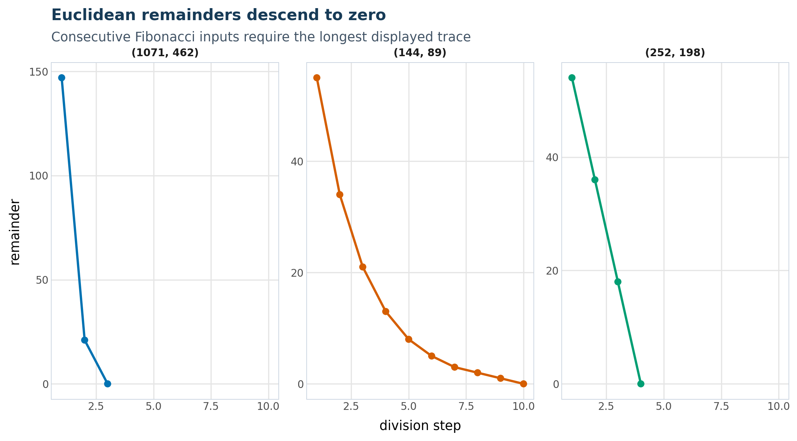

<figcaption>

Figure C.1: Remainders in several Euclidean algorithms descend to zero at different rates.

</figcaption>
</figure>

[Figure C.1](#fig-code-euclidean-trace) shows why Fibonacci neighbours are difficult
inputs for this algorithm, but the proof of the worst-case bound is in
[Chapter 2](02-divisibility.md).

## Lab 2 — Bézout coefficients, not merely a gcd

The extended algorithm maintains coefficients $s,t$ satisfying
$sa+tb=$ current remainder.

```python
def extended_gcd(first_integer: int, second_integer: int) -> tuple[int, int, int]:
    """Return g, s, t with s*first_integer + t*second_integer = g >= 0."""
    if first_integer == 0 and second_integer == 0:
        raise ValueError("at least one input must be nonzero")
    old_r, r = abs(first_integer), abs(second_integer)
    old_s, s = 1, 0
    old_t, t = 0, 1
    while r != 0:
        quotient = old_r // r
        old_r, r = r, old_r - quotient * r
        old_s, s = s, old_s - quotient * s
        old_t, t = t, old_t - quotient * t
    sign_a = -1 if first_integer < 0 else 1
    sign_b = -1 if second_integer < 0 else 1
    return old_r, old_s * sign_a, old_t * sign_b

g, s, t = extended_gcd(252, 198)
print(g, s, t, s * 252 + t * 198)
```

The fourth printed value should equal `g`. That equality is a reusable
certificate: it can be checked without trusting the internal loop.

## Lab 3 — Sieve a finite interval

The Sieve of Eratosthenes marks composite multiples. The slice assignment is a
compact way to mark an arithmetic progression, while the square-root stopping
point follows from the least-prime-factor argument.

```python
from math import isqrt

def primes_up_to(limit: int) -> list[int]:
    """Return every prime p with 2 <= p <= limit."""
    if limit < 0:
        raise ValueError("limit must be nonnegative")
    is_prime = bytearray(b"\x01") * (limit + 1)
    if limit >= 0:
        is_prime[0] = 0
    if limit >= 1:
        is_prime[1] = 0
    for prime in range(2, isqrt(limit) + 1):
        if is_prime[prime]:
            start = prime * prime
            count = (limit - start) // prime + 1
            is_prime[start : limit + 1 : prime] = b"\x00" * count
    return [value for value in range(2, limit + 1) if is_prime[value]]

print(primes_up_to(50))
```

The output proves only the listed interval. To turn a prime table into a
certificate for one candidate, use exact trial division or a proved primality
certificate.

<figure id="fig-code-sieve-density">
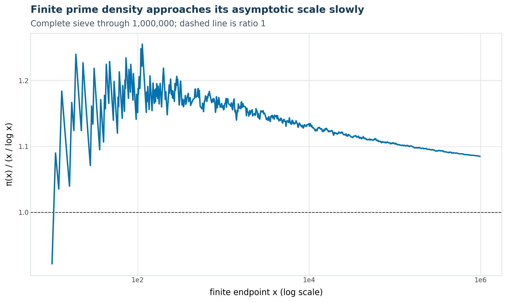

<figcaption>

Figure C.2: The normalized prime-counting ratio approaches one slowly over finite ranges.

</figcaption>
</figure>

The trend in [Figure C.2](#fig-code-sieve-density) illustrates the Prime Number Theorem; it
does not prove it.

## Lab 4 — Exact factorization by trial division

This deliberately simple routine exposes every factor and leaves a final prime
larger than the square root when necessary.

```python
from math import isqrt

def prime_factorization(number: int) -> dict[int, int]:
    """Return the prime-exponent factorization of a positive integer."""
    if number <= 0:
        raise ValueError("number must be positive")
    remaining = number
    factors: dict[int, int] = {}
    candidate = 2
    while candidate <= isqrt(remaining):
        while remaining % candidate == 0:
            factors[candidate] = factors.get(candidate, 0) + 1
            remaining //= candidate
        candidate = 3 if candidate == 2 else candidate + 2
    if remaining > 1:
        factors[remaining] = factors.get(remaining, 0) + 1
    return factors

factors = prime_factorization(360360)
reconstructed = 1
for prime, exponent in factors.items():
    reconstructed *= prime**exponent
print(factors, reconstructed)
```

Reconstruction checks multiplication but not by itself the primality of each
key. Here trial division supplied that proof. Large-integer factorization needs
more sophisticated methods from [Chapter 22](22-computational.md).

## Lab 5 — Square-and-multiply modular exponentiation

The exponent is read in binary. At each step the program squares the base and,
when the current bit is one, multiplies it into the result.

```python
def modular_power(base: int, exponent: int, modulus: int) -> tuple[int, int]:
    """Return base**exponent mod modulus and the modular multiplication count."""
    if exponent < 0 or modulus <= 1:
        raise ValueError("require exponent >= 0 and modulus > 1")
    result = 1
    current = base % modulus
    remaining = exponent
    multiplications = 0
    while remaining > 0:
        if remaining % 2 == 1:
            result = (result * current) % modulus
            multiplications += 1
        remaining //= 2
        if remaining > 0:
            current = (current * current) % modulus
            multiplications += 1
    return result, multiplications

value, cost = modular_power(7, 560, 561)
print(value, cost, pow(7, 560, 561))
```

The built-in `pow` supplies an independent implementation check. The result
`1` does not prove that $561$ is prime: it is the classic Carmichael warning.

<figure id="fig-code-modexp-cost">
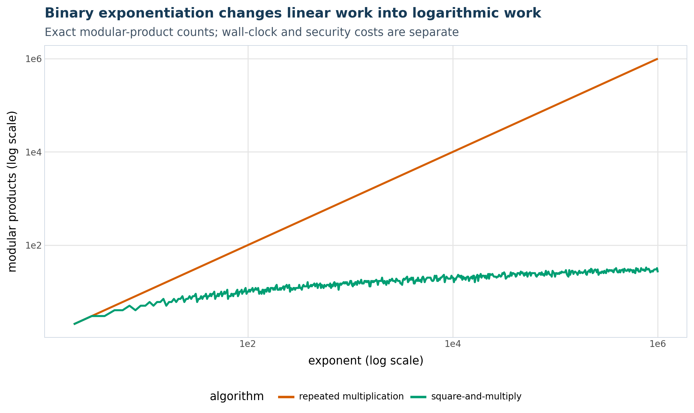

<figcaption>

Figure C.3: Binary square-and-multiply uses logarithmically many modular products compared with repeated multiplication.

</figcaption>
</figure>

[Figure C.3](#fig-code-modexp-cost) describes operation counts, not wall-clock time or
cryptographic security.

## Lab 6 — Solve a pair of congruences by CRT

For coprime moduli, a Bézout identity constructs the unique residue modulo the
product.

```python
from math import gcd

def inverse_mod(value: int, modulus: int) -> int:
    """Return the inverse of value modulo modulus."""
    if modulus <= 1 or gcd(value, modulus) != 1:
        raise ValueError("an inverse requires coprime input and modulus > 1")
    return pow(value, -1, modulus)

def crt_pair(
    first_residue: int,
    first_modulus: int,
    second_residue: int,
    second_modulus: int,
) -> tuple[int, int]:
    """Solve two congruences whose moduli are coprime."""
    if (
        first_modulus <= 1
        or second_modulus <= 1
        or gcd(first_modulus, second_modulus) != 1
    ):
        raise ValueError("moduli must be greater than one and coprime")
    combined = first_modulus * second_modulus
    correction = (
        (second_residue - first_residue)
        * inverse_mod(first_modulus, second_modulus)
    ) % second_modulus
    solution = (first_residue + first_modulus * correction) % combined
    return solution, combined

solution, modulus = crt_pair(2, 3, 3, 5)
print(solution, modulus, solution % 3, solution % 5)
```

The last two values directly audit the two input congruences.

## Lab 7 — Euler's totient from a factorization

The product formula $\varphi(n)=n\prod_{p\mid n}(1-1/p)$ can be implemented
without floating arithmetic by updating an integer once per distinct prime.

```python
from math import gcd

def totient(number: int) -> int:
    """Return Euler's totient by exact trial division."""
    if number <= 0:
        raise ValueError("number must be positive")
    result = number
    remaining = number
    prime = 2
    while prime * prime <= remaining:
        if remaining % prime == 0:
            result -= result // prime
            while remaining % prime == 0:
                remaining //= prime
        prime = 3 if prime == 2 else prime + 2
    if remaining > 1:
        result -= result // remaining
    return result

for number in (1, 8, 12, 36):
    direct = sum(gcd(candidate, number) == 1 for candidate in range(1, number + 1))
    print(number, totient(number), direct)
```

The direct count is slower but valuable as a small-input oracle.

## Lab 8 — Continued fractions of rational numbers

Repeated Euclidean division produces a finite simple continued fraction. Exact
integer arithmetic avoids confusing a rounded decimal with the original
rational number.

```python
from fractions import Fraction

def rational_continued_fraction(value: Fraction) -> list[int]:
    """Return the finite simple continued fraction of a positive rational."""
    if value <= 0:
        raise ValueError("value must be positive")
    numerator, denominator = value.numerator, value.denominator
    coefficients: list[int] = []
    while denominator != 0:
        quotient, remainder = divmod(numerator, denominator)
        coefficients.append(quotient)
        numerator, denominator = denominator, remainder
    return coefficients

print(rational_continued_fraction(Fraction(415, 93)))
```

The answer `[4, 2, 6, 7]` can be reconstructed from the bottom upward. Chapter
9 explains why its truncations are excellent rational approximations.

## Lab 9 — Quadratic residues and multiplicities

Squaring every residue class gives a finite image. Keeping counts distinguishes
the set of values from the number of square roots of each value.

```python
def square_root_counts(modulus: int) -> dict[int, int]:
    """Count square roots of each residue modulo modulus."""
    if modulus <= 1:
        raise ValueError("modulus must be greater than one")
    counts = {residue: 0 for residue in range(modulus)}
    for value in range(modulus):
        counts[(value * value) % modulus] += 1
    return counts

counts = square_root_counts(11)
print([residue for residue, count in counts.items() if count > 0])
print(counts)
```

<figure id="fig-code-quadratic-residue-map">
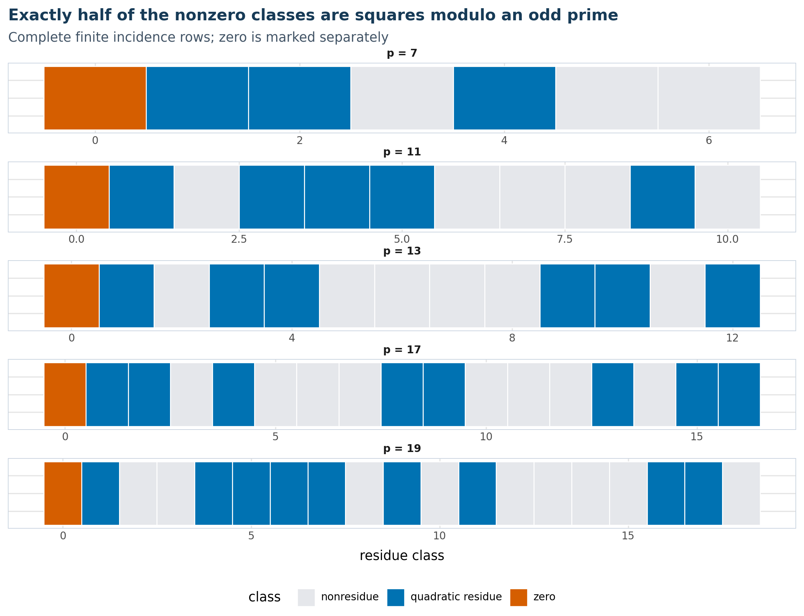

<figcaption>

Figure C.4: Quadratic-residue incidence across several odd primes shows half of the nonzero classes selected.

</figcaption>
</figure>

[Figure C.4](#fig-code-quadratic-residue-map) displays finite fields of prime order.
Composite moduli have a different multiplicity pattern.

## Lab 10 — A complete RSA toy round trip

This example is educational only: tiny public primes provide no security. It
checks every prerequisite before encrypting and decrypting one residue.

```python
from math import gcd, isqrt

def is_prime(number: int) -> bool:
    """Return whether number is prime by exact trial division."""
    if number < 2:
        return False
    return all(number % divisor != 0 for divisor in range(2, isqrt(number) + 1))

def rsa_toy(
    message: int,
    first_prime: int,
    second_prime: int,
    public_exponent: int,
) -> tuple[int, int]:
    """Return ciphertext and recovered message for a validated toy RSA instance."""
    if (
        first_prime == second_prime
        or not is_prime(first_prime)
        or not is_prime(second_prime)
    ):
        raise ValueError("use two distinct positive primes")
    modulus = first_prime * second_prime
    totient = (first_prime - 1) * (second_prime - 1)
    if (
        not 0 <= message < modulus
        or public_exponent <= 1
        or gcd(public_exponent, totient) != 1
    ):
        raise ValueError("message range or public exponent is invalid")
    private_exponent = pow(public_exponent, -1, totient)
    ciphertext = pow(message, public_exponent, modulus)
    recovered = pow(ciphertext, private_exponent, modulus)
    return ciphertext, recovered

ciphertext, recovered = rsa_toy(
    message=42,
    first_prime=61,
    second_prime=53,
    public_exponent=17,
)
print(ciphertext, recovered)
```

The small-input trial division is a complete primality check here. Production
cryptography still requires authenticated padding, secure randomness, large
certified primes, side-channel resistance, and reviewed libraries—never a
home-written version of this code.

## Lab 11 — The Möbius function and a finite summatory experiment

The Möbius function records whether an integer contains a repeated prime
factor. It equals $0$ when a prime square divides $n$; otherwise it is $1$ or
$-1$ according to whether the number of distinct prime factors is even or odd.
The summatory function $M(x)=\sum_{n\leq x}\mu(n)$ is important in analytic
number theory, but a long finite trace is still only a finite trace.

```python
def mobius(number: int) -> int:
    """Return the exact Möbius value of a positive integer."""
    if number < 1:
        raise ValueError("number must be positive")
    remaining = number
    distinct_primes = 0
    prime = 2
    while prime * prime <= remaining:
        if remaining % prime == 0:
            remaining //= prime
            distinct_primes += 1
            if remaining % prime == 0:
                return 0
        prime += 1
    if remaining > 1:
        distinct_primes += 1
    return -1 if distinct_primes % 2 else 1

running = 0
for integer in range(1, 31):
    value = mobius(integer)
    running += value
    print(integer, value, running)
```

The early return is not a shortcut in the mathematical argument: once a square
factor has been found, the definition forces the value to be zero. For a
nonzero value, the remaining unfactored number at loop exit is either $1$ or one
prime factor.

<figure id="fig-code-mobius-summatory">
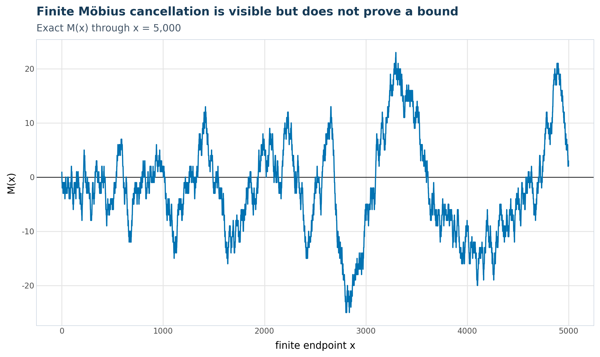

<figcaption>

Figure C.5: The finite summatory Möbius function oscillates while remaining explicitly bounded to the displayed experiment.

</figcaption>
</figure>

[Figure C.5](#fig-code-mobius-summatory) visualizes cancellation, not a proof of any
unbounded estimate for $M(x)$.

## Lab 12 — Multiplicative order with a termination guarantee

When $\gcd(a,m)=1$, the multiplicative order of $a$ modulo $m$ is the first
positive exponent $r$ for which $a^r\equiv1\pmod m$. There are at most $m$
residue classes, so a loop bounded by $m$ is enough for this elementary search.

```python
from math import gcd

def multiplicative_order(base: int, modulus: int) -> int:
    """Return the least positive r with base**r congruent to one modulo modulus."""
    if modulus <= 1:
        raise ValueError("modulus must exceed one")
    if gcd(base, modulus) != 1:
        raise ValueError("base must be a unit modulo modulus")
    residue = 1
    for exponent in range(1, modulus + 1):
        residue = (residue * base) % modulus
        if residue == 1:
            return exponent
    raise RuntimeError("finite residue repetition failed unexpectedly")

for base in (2, 3, 4, 6):
    print(base, multiplicative_order(base, 13))
```

The returned exponent is certified by recomputing the power. Minimality follows
because every smaller positive exponent was tested first. The final exception
protects the function's contract instead of silently returning a false answer.

<figure id="fig-code-multiplicative-order-map">
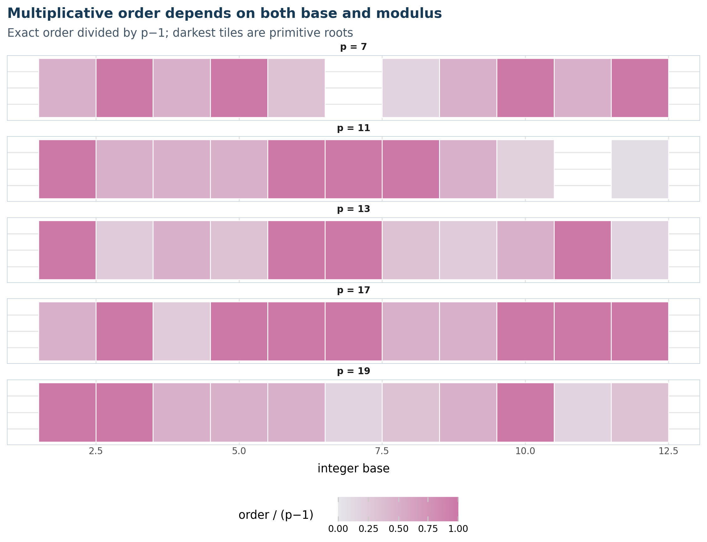

<figcaption>

Figure C.6: Multiplicative orders of small bases vary across prime moduli but always divide the nonzero group size.

</figcaption>
</figure>

## Lab 13 — Prime gaps and record gaps in a declared interval

A prime gap is the difference between consecutive primes. This program sieves
all integers through a stated limit, then retains every gap and marks the gaps
that exceed all earlier ones. Nothing in the code extrapolates beyond that
limit.

```python
def prime_gaps(limit: int) -> list[tuple[int, int, bool]]:
    """Return upper prime, preceding gap, and record status through limit."""
    if limit < 3:
        raise ValueError("limit must be at least three")
    flags = bytearray(b"\x01") * (limit + 1)
    flags[0:2] = b"\x00\x00"
    divisor = 2
    while divisor * divisor <= limit:
        if flags[divisor]:
            start = divisor * divisor
            count = (limit - start) // divisor + 1
            flags[start : limit + 1 : divisor] = b"\x00" * count
        divisor += 1
    primes = [number for number, flag in enumerate(flags) if flag]
    result: list[tuple[int, int, bool]] = []
    record = 0
    for lower, upper in zip(primes, primes[1:]):
        gap = upper - lower
        is_record = gap > record
        record = max(record, gap)
        result.append((upper, gap, is_record))
    return result

gaps = prime_gaps(10_000)
print(gaps[:8])
print([row for row in gaps if row[2]])
```

The slice assignment crosses out exactly the multiples beginning at $d^2$;
smaller composite multiples already have a smaller prime factor. A second sieve
or a primality certificate can independently check any reported record.

<figure id="fig-code-prime-gap-records">
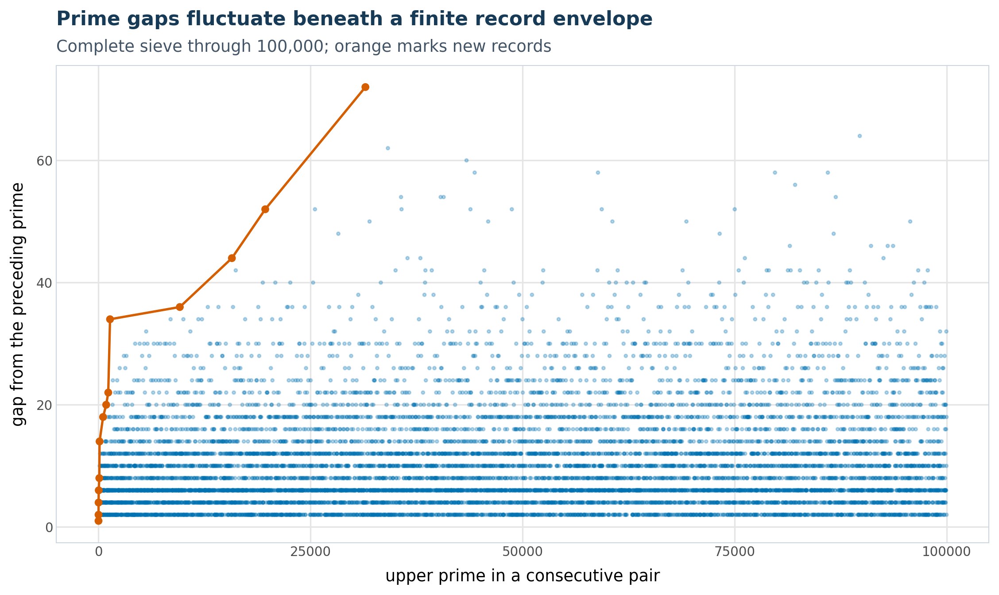

<figcaption>

Figure C.7: Prime gaps fluctuate and their finite record envelope rises in discrete jumps.

</figcaption>
</figure>

## Lab 14 — Generate Pell solutions with an invariant

Solutions of $x^2-2y^2=1$ grow rapidly. Multiplying
$x+y\sqrt2$ by $3+2\sqrt2$ gives the recurrence in this block. The invariant is
checked on every generated pair rather than assumed from a printed table.

```python
def pell_solutions(count: int) -> list[tuple[int, int]]:
    """Return the first count positive solutions of x*x - 2*y*y = 1."""
    if count < 1:
        raise ValueError("count must be positive")
    solutions: list[tuple[int, int]] = []
    x_value, y_value = 3, 2
    for _ in range(count):
        if x_value * x_value - 2 * y_value * y_value != 1:
            raise ArithmeticError("Pell invariant was lost")
        solutions.append((x_value, y_value))
        x_value, y_value = (
            3 * x_value + 4 * y_value,
            2 * x_value + 3 * y_value,
        )
    return solutions

for index, (x_value, y_value) in enumerate(pell_solutions(8), start=1):
    print(index, x_value, y_value, x_value * x_value - 2 * y_value * y_value)
```

This recurrence constructs solutions; the main text proves why it lists all
positive solutions in order. That distinction between generation and
classification is important.

<figure id="fig-code-pell-growth">
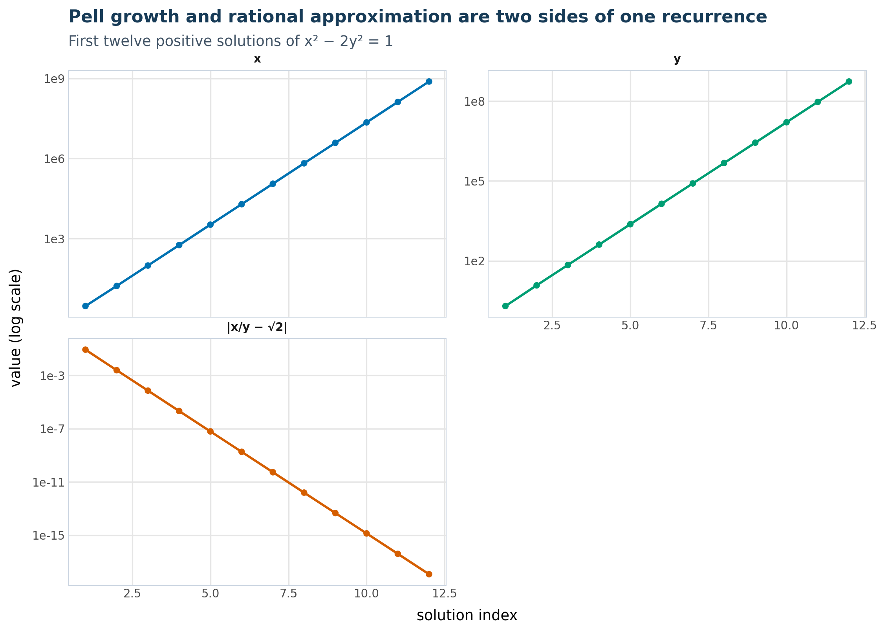

<figcaption>

Figure C.8: Pell solutions grow exponentially while their rational ratios approach the square root of two.

</figcaption>
</figure>

## Lab 15 — Count integer partitions by dynamic programming

An integer partition writes $n$ as an unordered sum of positive integers. The
array entry `ways[total]` counts partitions using only the part sizes processed
so far. Processing parts in increasing order prevents different orderings of
the same summands from being counted as new partitions.

```python
def partition_counts(limit: int) -> list[int]:
    """Return p(0), p(1), ..., p(limit) by exact dynamic programming."""
    if limit < 0:
        raise ValueError("limit must be nonnegative")
    ways = [0] * (limit + 1)
    ways[0] = 1
    for part in range(1, limit + 1):
        for total in range(part, limit + 1):
            ways[total] += ways[total - part]
    return ways

values = partition_counts(20)
for integer, count in enumerate(values):
    print(integer, count)
```

For example, the output $p(5)=7$ can be checked by writing the seven partitions
by hand. The method proves the returned finite table through its loop invariant;
it does not by itself prove an asymptotic formula for $p(n)$.

## Lab 16 — Turn a divisor sum into an exact identity check

Euler's totient function satisfies

$$
\sum_{d\mid n}\varphi(d)=n.
$$

The outer function below lists the divisors, evaluates every summand, and
returns both sides. That makes the program inspectable: a reader can recompute
the small divisor list by hand instead of trusting a single Boolean.

```python
def positive_divisors(number: int) -> list[int]:
    """Return the positive divisors of a positive integer in increasing order."""
    if number <= 0:
        raise ValueError("number must be positive")
    return [candidate for candidate in range(1, number + 1) if number % candidate == 0]

def euler_totient(number: int) -> int:
    """Count integers from 1 through number that are coprime to number."""
    from math import gcd

    if number <= 0:
        raise ValueError("number must be positive")
    return sum(gcd(candidate, number) == 1 for candidate in range(1, number + 1))

def divisor_sum_certificate(number: int) -> tuple[list[tuple[int, int]], int]:
    """Return pairs (d, phi(d)) and their sum for one positive integer."""
    pairs = [(divisor, euler_totient(divisor)) for divisor in positive_divisors(number)]
    total = sum(value for _, value in pairs)
    if total != number:
        raise RuntimeError("the divisor-sum identity failed")
    return pairs, total

terms, reconstructed = divisor_sum_certificate(360)
print(terms)
print(reconstructed)
```

The final comparison certifies this input and catches an implementation error.
The general identity still requires the proof in [Chapter 7](07-functions.md):
partition the integers $1,\ldots,n$ by their gcd with $n$.

<figure id="fig-code-divisor-sum-identity">
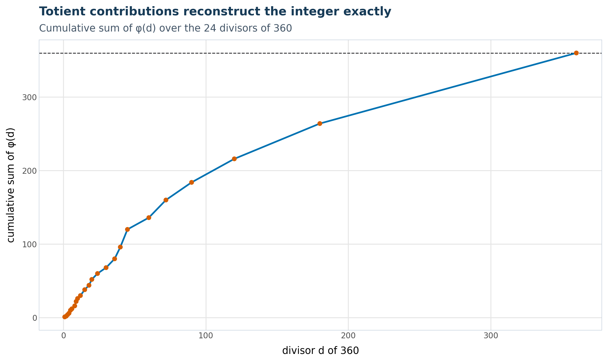

<figcaption>

Figure C.9: Cumulative totient contributions over the divisors of 360 end exactly at 360.

</figcaption>
</figure>

## Lab 17 — Compare a finite Euler product with $\zeta(2)$

For $s=2$, the infinite identity is

$$
\zeta(2)=\sum_{n=1}^{\infty}\frac1{n^2}
=\prod_p\frac1{1-p^{-2}}=\frac{\pi^2}{6}.
$$

The program computes only the product over primes no larger than a declared
endpoint. It uses trial division because transparency matters more than speed
in a first implementation.

```python
from math import isqrt, pi

def primes_up_to(limit: int) -> list[int]:
    """Return every prime at most limit by exact trial division."""
    if limit < 2:
        raise ValueError("limit must be at least two")
    primes: list[int] = []
    for candidate in range(2, limit + 1):
        if all(candidate % divisor != 0 for divisor in range(2, isqrt(candidate) + 1)):
            primes.append(candidate)
    return primes

def finite_euler_product(limit: int) -> float:
    """Return the Euler product for s=2 over primes at most limit."""
    product = 1.0
    for prime in primes_up_to(limit):
        product /= 1.0 - 1.0 / (prime * prime)
    return product

for endpoint in (10, 100, 1_000):
    value = finite_euler_product(endpoint)
    print(endpoint, value, pi * pi / 6.0 - value)
```

The shrinking error is finite numerical evidence. It neither proves Euler's
product nor proves the evaluation $\zeta(2)=\pi^2/6$; both require arguments
that control infinitely many omitted terms.

<figure id="fig-code-finite-euler-product">
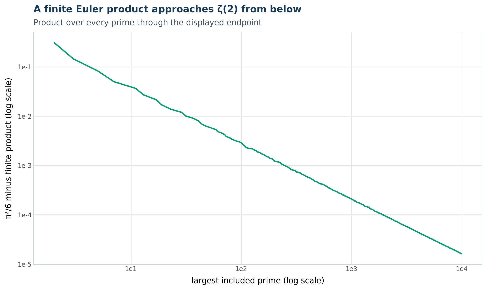

<figcaption>

Figure C.10: Finite Euler products approach pi squared over six from below.

</figcaption>
</figure>

## Lab 18 — Audit two formulas for the prime-counting function

The prime number theorem says $\pi(x)\sim x/\log x$. A logarithmic-integral
approximation is often better at accessible scales. The next block computes the
exact finite count and both approximations without treating either
approximation as an equality.

```python
from math import log

def prime_flags(limit: int) -> list[bool]:
    """Return a complete primality table from zero through limit."""
    if limit < 2:
        raise ValueError("limit must be at least two")
    flags = [True] * (limit + 1)
    flags[0] = flags[1] = False
    prime = 2
    while prime * prime <= limit:
        if flags[prime]:
            for multiple in range(prime * prime, limit + 1, prime):
                flags[multiple] = False
        prime += 1
    return flags

def prime_counting_audit(limit: int) -> tuple[int, float, float]:
    """Return pi(limit), limit/log(limit), and a discrete Li approximation."""
    flags = prime_flags(limit)
    exact = sum(flags)
    elementary = limit / log(limit)
    logarithmic_integral = sum(1.0 / log(integer) for integer in range(2, limit + 1))
    return exact, elementary, logarithmic_integral

for endpoint in (100, 1_000, 10_000):
    print(endpoint, prime_counting_audit(endpoint))
```

The discrete sum is a deliberately elementary stand-in for the integral
$\operatorname{Li}(x)$. The table compares finite errors; the asymptotic theorem
in [Chapter 12](12-analytic.md) is a statement about all sufficiently large
scales.

<figure id="fig-code-prime-counting-approximations">
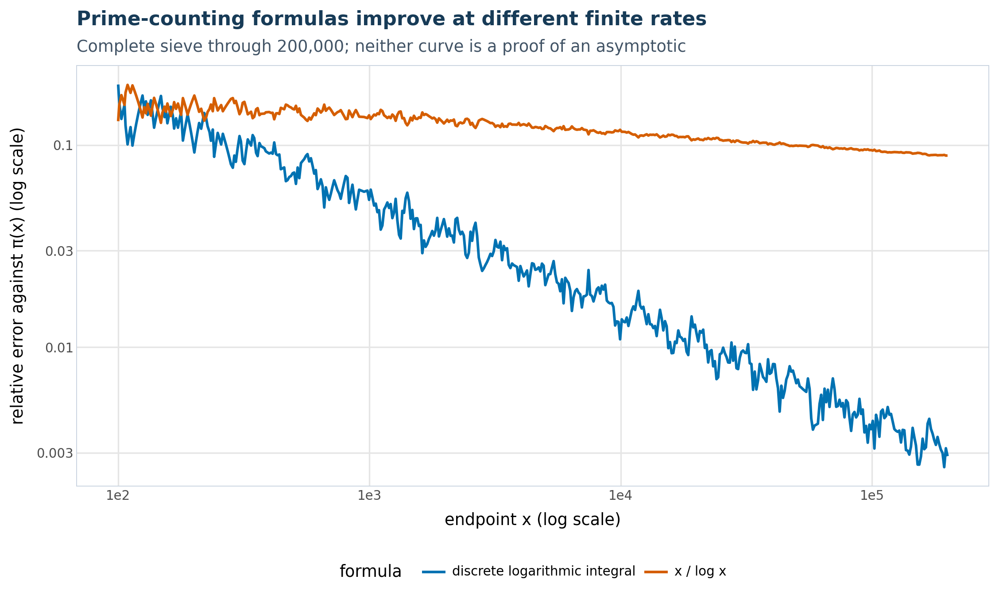

<figcaption>

Figure C.11: Two prime-counting approximations have different relative errors on a finite interval.

</figcaption>
</figure>

## Lab 19 — Make the Gaussian-integer norm multiplicative

Represent $a+bi$ by the pair `(a, b)`. Multiplication and the norm
$N(a+bi)=a^2+b^2$ then use only exact integer arithmetic.

```python
def gaussian_multiply(left: tuple[int, int], right: tuple[int, int]) -> tuple[int, int]:
    """Multiply two Gaussian integers represented by integer pairs."""
    a, b = left
    c, d = right
    return a * c - b * d, a * d + b * c

def gaussian_norm(value: tuple[int, int]) -> int:
    """Return the exact norm a squared plus b squared."""
    real, imaginary = value
    return real * real + imaginary * imaginary

left = (3, 2)
right = (1, -4)
product = gaussian_multiply(left, right)
certificate = gaussian_norm(product) == gaussian_norm(left) * gaussian_norm(right)
print(left, right, product)
print(gaussian_norm(left), gaussian_norm(right), gaussian_norm(product), certificate)
```

Expanding both sides proves norm multiplicativity for arbitrary integer pairs.
The Boolean checks one pair and makes a transcription error easy to detect; it
does not replace the symbolic expansion in [Chapter 13](13-algebraic.md).

<figure id="fig-code-gaussian-norm-grid">
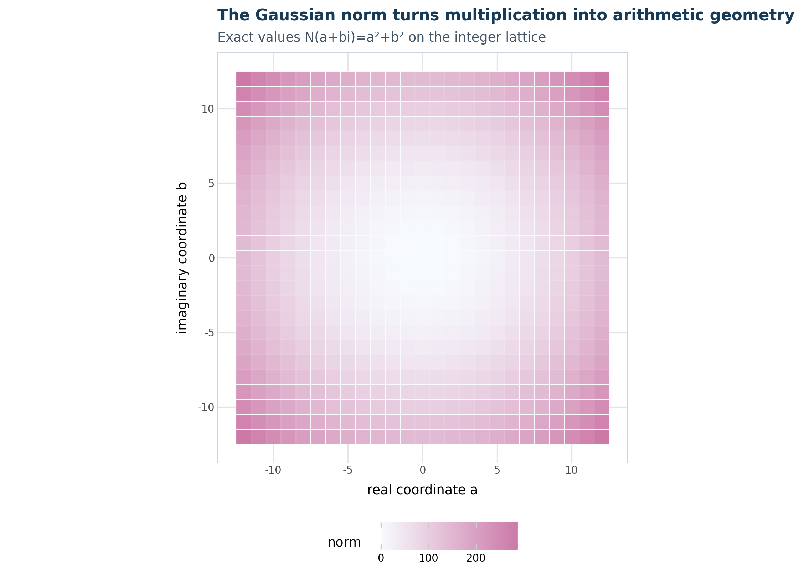

<figcaption>

Figure C.12: Gaussian-integer norm values form circular level patterns on the integer lattice.

</figcaption>
</figure>

## Lab 20 — Measure how addition expands a finite set

For a finite set $A$, the sumset is

$$
A+A=\{a+b:a,b\in A\}.
$$

Intervals have many repeated sums; separated powers of two have far fewer.
Code makes the collisions countable.

```python
def finite_sumset(values: set[int]) -> set[int]:
    """Return A+A for a nonempty finite set of integers A."""
    if not values:
        raise ValueError("values must be nonempty")
    return {left + right for left in values for right in values}

families = {
    "interval": set(range(8)),
    "squares": {value * value for value in range(8)},
    "powers of two": {2**value for value in range(8)},
}
for name, values in families.items():
    result = finite_sumset(values)
    print(name, len(values), len(result), sorted(result))
```

These exact finite cardinalities illustrate additive structure. They do not
prove a general doubling theorem or classify all small-doubling sets; those
questions require the combinatorial arguments of [Chapters 16](16-additive.md)
and [33](33-additive-combinatorics.md).

<figure id="fig-code-finite-sumset-growth">
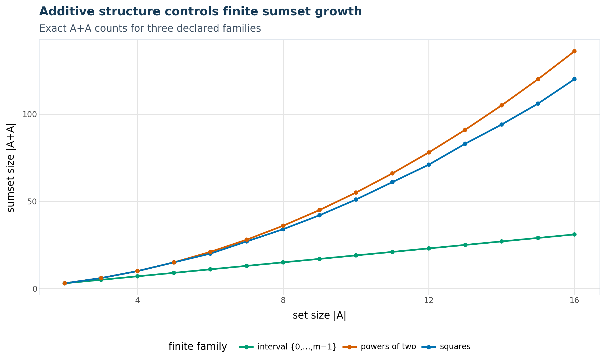

<figcaption>

Figure C.13: Intervals, squares, and powers of two have visibly different finite sumset growth.

</figcaption>
</figure>

## Verification habits

For exact algorithms, retain a certificate whenever possible: a Bézout
identity, reconstructed factorization, congruence check, or decrypted residue.
Test boundary inputs such as $1$, negative values when allowed, equal moduli,
and exponents $0$ and $1$. Do not catch and discard an exception; a failed
precondition is mathematical information.

The collection validator parses and executes every Python block in this
appendix. The thirteen code-laboratory figures are regenerated by the typed,
deterministic Plotnine program in `figures.py` and carry explicit finite-scope
captions.

## Reading routes

- Labs 1–2 accompany [divisibility](02-divisibility.md).
- Labs 3–5 accompany [primes](03-primes.md), [modular
  arithmetic](04-congruence.md), and [computational number
  theory](22-computational.md).
- Labs 6–7 accompany the [Chinese Remainder Theorem](05-crt.md) and
  [arithmetic functions](07-functions.md).
- Labs 8–9 accompany [continued fractions](09-fractions.md) and
  [quadratic residues](08-residues.md).
- Lab 10 accompanies [cryptography](11-cryptography.md) while preserving the
  boundary between an explanatory toy and a secure system.
- Labs 11–12 accompany [arithmetic functions](07-functions.md),
  [congruence arithmetic](04-congruence.md), and the analytic viewpoint
  developed in [prime distribution](12-analytic.md).
- Labs 13–14 accompany [prime distribution](12-analytic.md), [Pell
  equations](10-pell.md), and [continued
  fractions](09-fractions.md).
- Lab 15 accompanies [additive and combinatorial number
  theory](16-additive.md) and the later combinatorial chapters.
- Labs 16–20 accompany [arithmetic functions](07-functions.md), [analytic
  number theory](12-analytic.md), [algebraic integers](13-algebraic.md), and
  [additive structure](16-additive.md). They translate divisor convolution,
  Euler products, asymptotic approximations, norms, and sumsets into finite
  certificates without upgrading a finite computation into a theorem.
