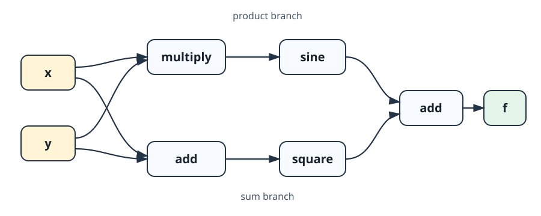

# Computational Graphs and Forward Mode

## Purpose and prerequisites

Chapters 5–6 treated a derivative as a linear map and derived Jacobian-vector and vector-Jacobian products. This chapter turns that mathematics into a program transformation. We will define a computational graph, prove forward accumulation by induction, derive dual-number arithmetic, implement a dependency-free reference evaluator, and state where traces, mutation, randomness, and nondifferentiable control flow break a naive story.

Forward mode answers a precise question:

> Given a program $f$, an input $x$, and an input direction $v$, compute the pair $(f(x),Df(x)[v])$ in one forward traversal.

The second component is a JVP. It is a directional rate, not necessarily a full gradient. For $f\colon \mathbb{R}^d\to \mathbb{R}^m$, repeating forward mode on the $d$ coordinate directions constructs the full $m\times d$ Jacobian one column at a time. That is attractive when $d$ is small and expensive when $d$ is enormous.

## Programs as directed acyclic graphs

A straight-line numerical program consists of input nodes, constant nodes, and primitive-operation nodes. Each non-input node receives values from parent nodes and produces a value. Direct every edge from a parent to its consumer. If evaluation has no cycles, this is a directed acyclic graph, or DAG.

Consider

$f(x,y)=\sin\left(xy\right)+(x+y)^{2}$.

One graph is

```text
x ──┬── multiply ── sin ──┐
    │                      ├── add ── f
y ──┘                      │
x ───── add ── square ─────┘
y ─────┘
```



A topological order lists every parent before its child. For example:

$x,y,u=xy,s=\sin\left(u\right),a=x+y,q=a^{2},f=s+q$.

The graph records dependencies, while the trace records the actual primitive calls and values for one execution. Two syntactically different programs can compute the same mathematical function but create different graphs. Conversely, one program with data-dependent branches can create different traces for different inputs.

### Nodes need identities, not only values

If $a=x\cdot x$ and $b=x\cdot x$ are evaluated separately, $a$ and $b$ may have equal numerical values but distinct node identities. If instead $a=x\cdot x; b=a$, both consumers share one node. Differentiation must follow dependency identity and count every path. Using a dictionary keyed only by floating value would merge unrelated nodes and corrupt derivatives.

## Tangents and the local propagation rule

Associate with each node value $z$ a tangent $\dot{z}$, interpreted as the derivative of that node with respect to a scalar path parameter at zero. Start an input path

$x(t)=x+tv$.

Then each intermediate node becomes a function of $t$, and

$\dot{z}=(d/dt)z(t)|_{t=0}$.

For a primitive $z=\phi (a_{1},…,a_{k})$, the multivariable chain rule gives

$\dot{z}=\sum_{j=1}^k (\partial \phi /\partial a_{j})(a_{1},…,a_{k}) \dot{a}_{j}$.

This local rule propagates the derivative in the same direction as ordinary evaluation.

Useful scalar primitive rules are:

- $z=a+b$: $\dot{z}=\dot{a}+\dot{b}$;
- $z=ab$: $\dot{z}=\dot{a} b+a \dot{b}$;
- $z=a/b$, $b\ne 0$: $\dot{z}=(\dot{a} b-a \dot{b})/b^{2}$;
- $z=\exp\left(a\right)$: $\dot{z}=\exp\left(a\right)\dot{a}$;
- $z=\log\left(a\right)$, $a>0$: $\dot{z}=\dot{a}/a$;
- $z=\sin\left(a\right)$: $\dot{z}=\cos\left(a\right)\dot{a}$;
- $z=a^k$ for a fixed integer $k$: $\dot{z}=ka^{k-1}\dot{a}$ wherever the power is defined and differentiable. For negative $k$, require $a\ne0$; for $k=0$, the primitive is the constant one on its declared domain and has tangent zero, including at zero only if the program explicitly defines $0^0=1$.

Array primitives use the same differential identities. If $Z=AX+B$, then

$\dot{Z}=\dot{A} X+A \dot{X}+\dot{B}$,

with shapes matching $Z$. A sum reduction $s=\sum_{ij} Z_{ij}$ has $\dot{s}=\sum_{ij} \dot{Z}_{ij}$. Broadcasting is not invisible: the tangent follows the same expansion and reduction semantics as the value.

## Correctness by topological induction

Let every node $z_{j}$ in topological order compute a differentiable function of the program input near $x$. Claim: forward accumulation stores

$\dot{z}_{j}=Dz_{j}(x)[v]$

at every node.

For an input coordinate, seed its tangent with the matching component of $v$; constants receive tangent zero. Thus the claim holds at source nodes. Assume it holds for every parent of node $z_{j}=\phi (z_{p_{1}},…,z_{p_{k}})$. The local rule stores

$\sum_{l} D_{l}\phi (z_{p}) \dot{z}_{p_l}$

$=\sum_{l} D_{l}\phi (z_{p}) Dz_{p_{l}}(x)[v]$

$=Dz_{j}(x)[v]$

by the chain rule. Induction over the topological order proves the claim at every output.

This proof has hypotheses. Each executed primitive must have the stated derivative at the stored value; parents must not be mutated before their tangent rule uses them; the recorded graph must match the executed data dependencies; and the path must remain in a branch where the local derivative represents the intended function.

## Worked scalar graph

Return to

$f(x,y)=\sin\left(xy\right)+(x+y)^{2}$.

At $(x,y)=(2,3)$ in direction $v=(1,-1)$, seed $\dot{x}=1$, $\dot{y}=-1$.

1. $u=xy=6$, so $\dot{u}=\dot{x} y+x \dot{y}=1\cdot 3+2\cdot (-1)=1$.
2. $s=\sin\left(u\right)=\sin\left(6\right)$, so $\dot{s}=\cos\left(6\right)\dot{u}=\cos\left(6\right)$.
3. $a=x+y=5$, so $\dot{a}=1+(-1)=0$.
4. $q=a^{2}=25$, so $\dot{q}=2a \dot{a}=0$.
5. $f=s+q=\sin\left(6\right)+25$, so $\dot{f}=\cos\left(6\right)$.

The symbolic gradient is

$\nabla f=(y \cos\left(xy\right)+2(x+y), x \cos\left(xy\right)+2(x+y))$.

Dotting it with $(1,-1)$ gives $(y-x)\cos\left(xy\right)=\cos\left(6\right)$, agreeing with the graph trace.

## Dual numbers package the same algebra

Introduce a formal symbol $\varepsilon$ satisfying $\varepsilon ^{2}=0$ but $\varepsilon \ne 0$. A dual number has the form $a+\dot{a} \varepsilon$. Addition and multiplication obey

$(a+\dot{a} \varepsilon )+(b+\dot{b} \varepsilon )=(a+b)+(\dot{a}+\dot{b})\varepsilon$,

$(a+\dot{a} \varepsilon )(b+\dot{b} \varepsilon )=ab+(\dot{a} b+a \dot{b})\varepsilon$,

because the $\dot{a} \dot{b} \varepsilon ^{2}$ term vanishes. For a differentiable scalar primitive,

$\phi (a+\dot{a} \varepsilon )=\phi (a)+\phi '(a)\dot{a} \varepsilon$.

This is not an approximation: within dual arithmetic, the first-order coefficient is exact for the implemented primitive rules. It is a compact algebraic implementation of the chain rule.

### A dependency-free reference type

```text
record Dual:
    value: real
    tangent: real

function add(a, b):
    return Dual(a.value + b.value,
                a.tangent + b.tangent)

function multiply(a, b):
    return Dual(a.value * b.value,
                a.tangent * b.value + a.value * b.tangent)

function sine(a):
    return Dual(sin(a.value), cos(a.value) * a.tangent)

function square(a):
    return multiply(a, a)
```

To evaluate the worked example, call the same lifted program with $Dual(2,1)$ and $Dual(3,-1)$. The returned value is $\sin\left(6\right)+25$, and its tangent is $\cos\left(6\right)$.

This scalar reference is intentionally small enough to inspect. A tensor implementation must additionally define shape rules, broadcasting, dtype, aliasing, and tangent storage. Those engineering details are mathematical semantics, not performance trivia.

## Vector inputs and multiple directions

For $f\colon \mathbb{R}^d\to \mathbb{R}^m$, seed the input tangent with $v\in \mathbb{R}^d$; every intermediate tangent has the same shape as its primal value, and the output tangent is $J_{f}(x)v\in \mathbb{R}^m$.

### Worked affine-softplus JVP

Let

$f(x)=\log\left(1+\exp\left(a^{\top}x+b\right)\right)$

for fixed $a\in \mathbb{R}^d$. Define $z=a^{\top}x+b$ and $s(z)=\log\left(1+\exp\left(z\right)\right)$. For direction $v$,

$\dot{z}=a^{\top}v$,

and

$\dot{s}=[\exp\left(z\right)/(1+\exp\left(z\right))]\dot{z}=\sigma (z)a^{\top}v$.

At large positive $z$, direct $\log\left(1+\exp\left(z\right)\right)$ can overflow even though the derivative is finite. A stable primal uses $\max\left(z,0\right)+\log\left(1+\exp\left(-\lvert z\rvert\right)\right)$, and a stable sigmoid rule chooses an algebraically equivalent branch. Forward mode inherits the numerical quality of its primal and local rules.

### Chunked tangents

Instead of one direction, store a tangent matrix with $k$ columns. Seeding $V\in \mathbb{R}^{d\times k}$ propagates $J_{f}(x)V$ in one trace, using vectorized local rules. Setting $V=I_{d}$ produces the full Jacobian, but storage and arithmetic grow with $d$. Chunking trades memory for repeated evaluations; it does not remove the fundamental dependence on the number of input directions.

## Cost: when forward mode is the right orientation

Let a program use $C$ primitive scalar operations. A single forward JVP usually costs a small constant multiple of $C$ and stores only primal/tangent state needed by the forward trace. To assemble a full Jacobian by coordinate seeds costs roughly $d$ traversals.

Reverse mode, developed in Chapter 8, propagates one output covector backward. A scalar loss with millions of parameters has $m=1$ and huge $d$; one reverse traversal is usually preferable to millions of forward seeds. Forward mode is attractive when:

- the input dimension is small;
- outputs are numerous;
- only a few directional sensitivities are needed;
- a JVP is the primitive needed by a larger algorithm;
- forward-over-reverse or reverse-over-forward constructs a Hessian-vector product.

The slogan “forward for few inputs, reverse for few outputs” is a cost guide, not a theorem about every implementation. Sparsity, batching, memory traffic, recomputation, and primitive support can change the crossover.

## Shared subexpressions and branch accumulation

Forward mode naturally handles a value used more than once because each consumer receives the same stored tangent. Let

$f(x)=x^{2}+x^{2}$,

implemented with a shared node $q=x^{2}$ followed by $f=q+q$. The trace gives $\dot{q}=2x \dot{x}$ and $\dot{f}=\dot{q}+\dot{q}=4x \dot{x}$. Both outgoing paths contribute.

If a compiler performs common-subexpression elimination, the graph topology changes but the mathematical JVP should not. Tests should compare equivalent traces, particularly when aliases and in-place updates are possible.

## Control flow and trace-local derivatives

Consider

```text
function absolute_like(x):
    if x >= 0: return x
    else: return -x
```

At $x>0$, the executed trace derivative is $1$; at $x<0$, it is $-1$. At $x=0$, the mathematical absolute-value function is not differentiable, although the program executes the first branch and a naive tracer may report $1$.

A trace-local derivative answers how the executed operations change while the branch stays fixed. It may fail to represent perturbations that cross a branch boundary. Therefore a differentiation system must state whether it returns classical derivatives, selected subgradients, one-sided derivatives, or merely derivatives of executed traces.

Loops with a data-dependent iteration count have the same issue. For a fixed trace, unrolling yields a finite DAG. Near a boundary where the iteration count changes, the overall program can be nonsmooth or discontinuous. Chapter 9 supplies verification strategies and failure labels.

## Mutation, randomness, and external state

Automatic differentiation assumes a functional dependency story even when implementation uses mutable storage. The following can invalidate a tangent:

- overwriting a primal value before a local rule uses it;
- changing an array through an alias while another node expects the old value;
- treating a random draw as a differentiable deterministic input without fixing its source;
- reading clock, file, global, or device state not represented in the graph;
- silently changing precision or reduction order between primal and tangent paths.

A random program can often be represented as $f(\theta ,\xi )$ where $\xi$ is explicit random input. Forward mode can differentiate with respect to $\theta$ while holding the realized $\xi$ fixed, if primitives are differentiable. That pathwise derivative is not automatically the derivative of an expectation; interchanging differentiation and expectation needs separate hypotheses.

## Higher derivatives and perturbation confusion

Nesting forward mode can produce higher directional derivatives, but perturbation symbols must remain distinct. To compute a mixed second derivative, one needs independent nilpotent tags, not accidental reuse of one global $\varepsilon$. A robust implementation tracks perturbation identity.

For a scalar $F\colon \mathbb{R}^d\to \mathbb{R}$, a Hessian-vector product can be obtained by differentiating the gradient in direction $v$, often using forward-over-reverse. This avoids constructing the $d\times d$ Hessian. Correctness still depends on twice differentiability along the trace and on the derivative rules themselves being differentiable.

## Verification contract for a forward engine

Use layered tests:

1. exact unit tests for every primitive, including zeros, signs, and domains;
2. product, quotient, and chain compositions with hand-derived tangents;
3. shared-subexpression and duplicated-path tests;
4. vector shape and broadcast tests;
5. comparison with centered directional differences away from kinks;
6. JVP/VJP duality tests against the reverse engine;
7. deterministic trace replay under explicit random state;
8. typed failures for invalid domains, nonfinite values, and unsupported primitives.

A passing suite supports the implemented derivative rules on tested traces. It does not prove the learning objective, data contract, or population claim correct.

## A second graph: zero outer derivative with a nonzero inner derivative

**Worked example (shared product and sine).** Consider $f(x,y)=(xy+\sin x)^2$. Use nodes $u=xy$, $v=\sin x$, $s=u+v$, $f=s^2$. For an input direction $(a,b)$, their tangents are
$$
\dot u=ay+xb,\qquad \dot v=a\cos x,\qquad
\dot s=a(y+\cos x)+xb,\qquad \dot f=2s\dot s.
$$
At $(x,y)=(0,3)$, the inner value is zero, while its differential is $4a$. The final tangent is nevertheless zero in every direction because the outer square has derivative zero there. A zero gradient does not imply that the intermediate representation was insensitive. Direct expansion near zero gives $f(t,3)=16t^2+O(t^4)$, consistent with zero first derivative and nonzero second derivative.

At $(1,2)$, write $s=2+\sin1$. The JVP is $2s[(2+\cos1)a+b]$. Choosing $(a,b)=(1,-2-\cos1)$ makes the first-order change vanish without making the gradient zero. One selected directional derivative therefore cannot establish that every derivative component is zero.

The original optimization manuscript used this graph to compare tangent and adjoint calculations. Its derivative teaching now lives here and in the next chapter, while optimization chapters link these products as prerequisites.

## Exercises

1. Draw a DAG and give a topological order for $f(x,y)=(x+y)(x-y)$.
2. Forward-propagate the tangent of that function at $(x,y)=(3,1)$ in direction $(2,-1)$. Check against the symbolic gradient.
3. Prove the quotient tangent rule from multiplication and the identity $(1/b)b=1$.
4. For $f(x)=\exp\left(\sin\left(x^{2}\right)\right)$, compute the forward trace at $x=1$ with seed $\dot{x}=3$.
5. Use dual-number multiplication to show the derivative of $x^{3}$ is $3x^{2}$.
6. Let $f(x_{1},x_{2})=(x_{1}x_{2},x_{1}+x_{2}^{2})$. Compute $J_{f}(2,3)v$ for $v=(1,-2)$ without writing the full Jacobian first.
7. Then write the Jacobian from Exercise 6 and verify the product.
8. A program computes $q=x\cdot x; f=q+q+q$. What tangent should it return? Name a graph bug that could return the wrong answer.
9. Explain why seeding every coordinate one at a time constructs Jacobian columns rather than rows.
10. Compare the rough traversal counts for a map $\mathbb{R}^{5}\to \mathbb{R}^{1000}$ and for a scalar loss $\mathbb{R}^{1000}\to \mathbb{R}$. Which differentiation orientation is suggested in each case?
11. A branch returns $x^{2}$ for $x\ge 0$ and $-x$ for $x<0$. Find trace derivatives on both sides and analyze differentiability at zero.
12. Explain why differentiating $f(\theta ,\xi )$ at fixed random draw $\xi$ does not by itself prove $d\mathbb{E}[f(\theta ,\xi )]/d\theta =\mathbb{E}[\partial f/\partial \theta ]$.
13. Design three primitive-level tests for a dual-number $log$ operation, including one required failure.
14. State the tangent shapes for $Z=XW^{\top}+1b^{\top}$ when $X\colon n\times d$, $W\colon m\times d$, and $b\colon m$.
15. A loop computes $s_{0}=x$ and $s_{k+1}=s_{k}^{2}+c$ for $k=0,...,K-1$. Derive the forward tangent recurrence for perturbations in both $x$ and $c$, then evaluate $s_{2}$ and its tangent at $x=1,c=1$ with seeds $(\dot{x},\dot{c})=(2,-1)$.
16. Explain how propagating a tangent matrix with $r$ columns computes $r$ JVPs in one graph traversal. State the seed and output shapes for $f\colon \mathbb{R}^d \to \mathbb{R}^m$ and the main memory trade-off.

## Full solutions

1. One order is $x,y,a=x+y,b=x-y,f=ab$; edges run from both inputs to $a$ and $b$, then from $a,b$ to $f$. Other topological orders that preserve dependencies are valid.
2. Seed $\dot{x}=2$, $\dot{y}=-1$. Then $a=4$, $\dot{a}=1$; $b=2$, $\dot{b}=3$; and $f=8$, $\dot{f}=\dot{a} b+a \dot{b}=1\cdot 2+4\cdot 3=14$. Since $f=x^{2}-y^{2}$, $\nabla f=(2x,-2y)=(6,-2)$, and its dot product with $(2,-1)$ is $12+2=14$.
3. Let $c=1/b$, so $cb=1$. Differentiating gives $\dot{c} b+c \dot{b}=0$, hence $\dot{c}=-\dot{b}/b^{2}$. For $z=ac$, the product rule yields $\dot{z}=\dot{a}/b-a \dot{b}/b^{2}=(\dot{a} b-a \dot{b})/b^{2}$.
4. $u=x^{2}=1$, $\dot{u}=2x \dot{x}=6$; $s=\sin\left(u\right)=\sin\left(1\right)$, $\dot{s}=\cos\left(1\right)\cdot 6$; $f=\exp\left(\sin\left(1\right)\right)$, and $\dot{f}=\exp\left(\sin\left(1\right)\right)\cdot 6\cos(1)$.
5. $(x+\dot{x}\varepsilon )^{2}=x^{2}+2x\dot{x}\varepsilon$. Multiplying once more by $x+\dot{x}\varepsilon$ gives $x^{3}+(x^{2}\dot{x}+2x^{2}\dot{x})\varepsilon =x^{3}+3x^{2}\dot{x}\varepsilon$. With unit seed, the tangent is $3x^{2}$.
6. Seed tangents $(1,-2)$. For $u=x_{1}x_{2}$, $\dot{u}=1\cdot 3+2\cdot (-2)=-1$. For $v_{2}=x_{2}^{2}$, its tangent is $2\cdot 3\cdot (-2)=-12$; adding $x_{1}$ gives tangent $1-12=-11$. Thus the JVP is $(-1,-11)$.
7. $J=\begin{bmatrix}x_{2} & x_{1} \\ 1 & 2x_{2}\end{bmatrix}$, so at $(2,3)$, $J=\begin{bmatrix}3 & 2 \\ 1 & 6\end{bmatrix}$. Multiplying by $(1,-2)^{\top}$ gives $(3-4,1-12)^{\top}=(-1,-11)^{\top}$.
8. Since $\dot{q}=2x\dot{x}$, the result is $\dot{f}=3\dot{q}=6x\dot{x}$. A graph that merges paths as a set rather than a multiset, or accumulates only one consumer contribution, can return $2x\dot{x}$ or $4x\dot{x}$.
9. A seed $e_{j}$ produces $Je_{j}$, which is exactly column $j$ of $J$. Output-coordinate covectors in reverse mode produce rows through $e_{i}^{\top}J$.
10. The first map has only five input directions, so about five forward traversals can build its full Jacobian; reverse would require up to 1,000 output seeds. The scalar loss has one output, so one reverse traversal is suggested, while 1,000 forward seeds would build its gradient. Memory and sparsity can modify the choice.
11. For $x>0$, derivative of $x^{2}$ is $2x$; for $x<0$, derivative of $-x$ is $-1$. At zero, the right derivative is $0$ and the left derivative is $-1$, so the mathematical function is not differentiable. The executed $x\ge 0$ branch may report 0, only a trace-local one-sided selection.
12. Moving a derivative through an expectation is a limit interchange. It can fail without integrability and domination/uniformity conditions, and the distribution of $\xi$ may itself depend on $\theta$. A pathwise derivative for one fixed draw is a computational fact, not the interchange theorem.
13. Test $\log\left(Dual(1,3)\right)=Dual(0,3)$; test a positive nonunit input such as $Dual(e^{2},-4)$ returning value 2 and tangent $-4/e^{2}$; and require a typed domain failure for value zero or negative. Also test finite-output handling near the smallest supported positive values.
14. $Z\colon n\times m$. The tangent identity is $\dot{Z}=\dot{X} W^{\top}+X \dot{W}^{\top}+1 \dot{b}^{\top}$, and every term has shape $n\times m$. If only one argument is active, inactive tangent arrays are zeros of their corresponding shapes.
15. Differentiation gives $\dot{s}_{0}=\dot{x}$ and $\dot{s}_{k+1}=2s_{k} \dot{s}_{k}+\dot{c}$. Forward values are $s_{0}=1$, $s_{1}=2$, $s_{2}=5$. Tangents are $\dot{s}_{0}=2$, $\dot{s}_{1}=2\cdot 1\cdot 2-1=3$, and $\dot{s}_{2}=2\cdot 2\cdot 3-1=11$. The recurrence differentiates the executed two-iteration trace.
16. Use a seed matrix $V\colon d\times r$; each primitive propagates the final tangent axis linearly, producing $J_{f}(x)V\colon m\times r$. This batches $r$ directional derivatives while sharing the primal traversal. It increases tangent storage and arithmetic roughly with $r$, so using $V=I_{d}$ can become as costly as materializing the full Jacobian.

## Project checkpoint and forward links

Implement the scalar `Dual` record and at least eight primitives using only arithmetic and elementary functions. Test a branched/shared graph, a directionally seeded two-input function, and deterministic failure on invalid domains. Compare against hand derivatives and centered directional differences away from kinks. Record every trace and tolerance.

Chapter 8 runs the complementary adjoint traversal for scalar objectives. Chapter 9 uses both engines to build derivative tests and to distinguish smooth derivatives from selected behavior at nonsmooth program boundaries.
