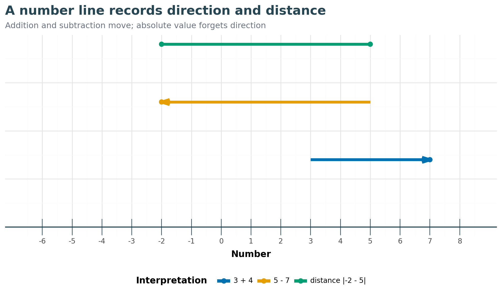
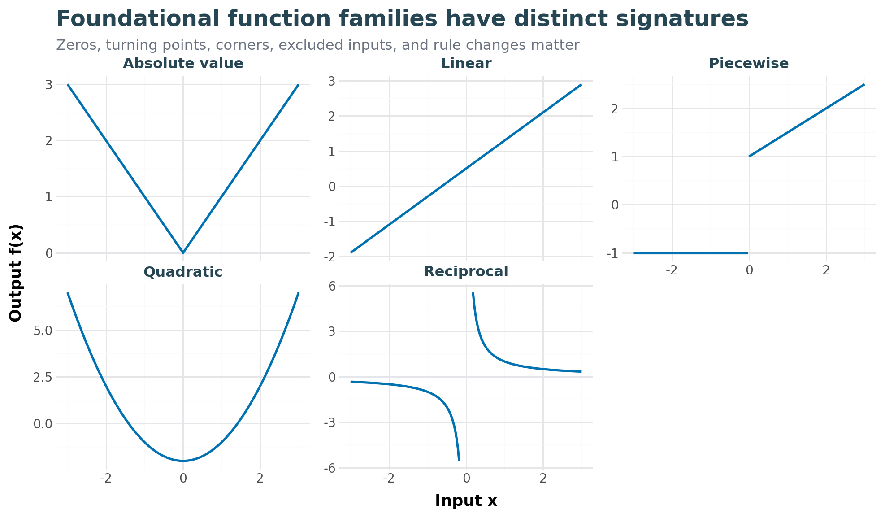

# A concise starting toolkit {#sec-foundation-padic-bridge}

This book assumes no previous course, but it does not place a long arithmetic
course in front of the subject. This compact chapter introduces notation needed
immediately. Algebra, analysis, topology, probability, and abstract structures
are rebuilt later at the point where they enter. Read unfamiliar paragraphs and
skim the rest.

## Numbers and arithmetic essentials {#sec-foundation-arithmetic}

The natural numbers are $1,2,3,\ldots$; the integers also include $0$ and
negatives; rational numbers have the form $a/b$ with integers $a,b$ and
$b\ne0$. For integers $a$ and positive $b$, division gives unique integers
$q,r$ with

$$
a=bq+r,\qquad 0\le r<b.
$$

For example, $37=5\cdot7+2$. The remainder is what survives after removing as
many complete groups of size $b$ as possible.

```python
def quotient_remainder(number: int, divisor: int) -> tuple[int, int]:
    """Return q, r with number = divisor*q + r and 0 <= r < divisor."""
    if divisor <= 0:
        raise ValueError("divisor must be positive")
    quotient, remainder = divmod(number, divisor)
    return quotient, remainder

print(quotient_remainder(37, 5))
```

Absolute value $|x|$ is ordinary distance from zero. The p-adic subject will
replace this ruler with one based on divisibility.

<figure id="fig-primer-number-line">


<figcaption>

Figure 1: Arithmetic and distance are represented as directed motion on a number line.

</figcaption>
</figure>

## Fractions, ratios, and exactness {#sec-foundation-rationals}

A fraction $a/b$ requires $b\ne0$, and multiplying numerator and denominator by
the same nonzero integer does not change it. To add,

$$
\frac ab+\frac cd=\frac{ad+bc}{bd}.
$$

Decimals are convenient displays but may be rounded. P-adic arithmetic relies
on exact divisibility, so examples use integers, rational numbers, residues,
and explicit precision rather than ordinary floating-point approximations.

## Algebra as reversible bookkeeping {#sec-foundation-algebra}

A variable names a number or structure. An equation asserts equality; applying
the same reversible operation to both sides preserves its solutions. Factoring
reverses expansion, for example $x^2-1=(x-1)(x+1)$. A polynomial is a finite sum
$a_0+a_1x+\cdots+a_nx^n$. Denominators require nonzero inputs, and division by a
quantity known only modulo $p^N$ is permitted only when that quantity is a unit.
The later arithmetic chapters explain this condition precisely.

## Geometry and coordinates {#sec-foundation-geometry}

A distance measures separation. Ordinary coordinates use

$$
\sqrt{(x_2-x_1)^2+(y_2-y_1)^2}.
$$

P-adic geometry behaves differently: triangles satisfy a stronger inequality
and balls are organized by common residue digits. Diagrams in this book encode
valuation or residue depth; they are not Euclidean pictures of an invisible
p-adic plane.

## Functions and graphs {#sec-foundation-functions}

A function assigns one output to every allowed input. Its domain records the
allowed inputs; its range records actual outputs. Composition means
$(f\circ g)(x)=f(g(x))$. A graph is one representation of a function, but a
p-adic function often needs a residue tree, valuation plot, or precision table
instead of an ordinary continuous curve.

<figure id="fig-primer-functions">


<figcaption>

Figure 2: Several familiar real function families provide a reference point before p-adic behavior diverges.

</figcaption>
</figure>

## Powers, logarithms, and series notation {#sec-foundation-transcendentals}

Powers abbreviate multiplication and obey $a^{m+n}=a^ma^n$. For $a>0$ and
$a\ne1$, $\log_a x=y$ means $a^y=x$. A geometric sum satisfies

$$
1+r+\cdots+r^n=\frac{1-r^{n+1}}{1-r},\qquad r\ne1.
$$

Whether an infinite series converges depends on the chosen notion of distance.
This is one of the first places where p-adic and real intuition separate.

## Statements, quantifiers, and proof {#sec-foundation-proof}

“For every” is universal and one counterexample disproves it. “There exists” is
existential and one construction may prove it. An implication is equivalent to
its contrapositive, not necessarily its converse. A theorem lists hypotheses
and a conclusion; a proof connects them. Direct calculation, cases,
contradiction, induction, and construction are reviewed when first used.

A congruence checked modulo $p^{10}$ is a finite statement at that precision.
It is not automatically an equality of p-adic numbers. The book continually
labels this difference.

<figure id="fig-primer-logic">


<figcaption>

Figure 3: A complete finite truth table separates implication from its converse.

</figcaption>
</figure>

## Sequences, sums, data, and finite computation {#sec-foundation-computation}

A sequence is an ordered list $a_1,a_2,\ldots$. Sigma notation abbreviates a
finite sum. An infinite series is studied through its finite partial sums.
Algorithms in this book state the prime, input, precision, and certificate.
Loops have finite stopping rules; exact integer arithmetic carries the proof
obligation whenever possible.

```python
def geometric_partial_sum(base: int, terms: int) -> int:
    """Return 1 + base + ... + base**(terms-1) exactly."""
    if terms < 0:
        raise ValueError("terms must be nonnegative")
    total = 0
    power = 1
    for _ in range(terms):
        total += power
        power *= base
    return total

print(geometric_partial_sum(5, 6))
```

The output is one finite partial sum. Convergence requires a theorem about what
happens as the number of terms grows.

## Continuing with p-adic numbers {#the-p-adic-handoff}

Fix a prime $p$. For nonzero integer $n$, the valuation $v_p(n)$ is the number
of factors of $p$ in $n$. Thus $v_3(45)=2$ because $45=3^2\cdot5$. Set
$v_p(0)=+\infty$. For a nonzero rational number, subtract the valuation of the
denominator from that of the numerator. The associated size is

$$
|x|_p=p^{-v_p(x)}.
$$

More divisibility means smaller p-adic size.

```python
from math import isqrt

def is_prime(number: int) -> bool:
    """Return whether number is prime by exact trial division."""
    if number < 2:
        return False
    return all(number % divisor != 0 for divisor in range(2, isqrt(number) + 1))

def integer_valuation(number: int, prime: int) -> int:
    """Return v_prime(number) for a nonzero integer and a declared prime."""
    if number == 0 or not is_prime(prime):
        raise ValueError("number must be nonzero and prime must be prime")
    value = abs(number)
    valuation = 0
    while value % prime == 0:
        value //= prime
        valuation += 1
    return valuation

print(integer_valuation(45, 3))
```

Chapter 1 develops divisibility and Chapter 2 defines absolute values carefully.
You are ready if you can follow exact division, substitution, and a finite loop;
every deeper prerequisite is supplied just in time.
